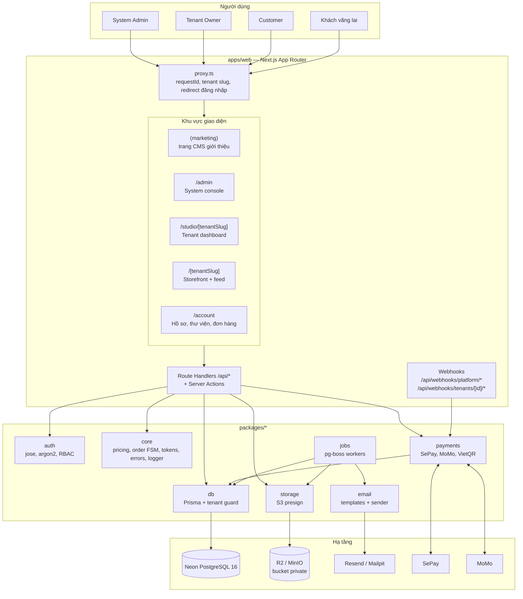
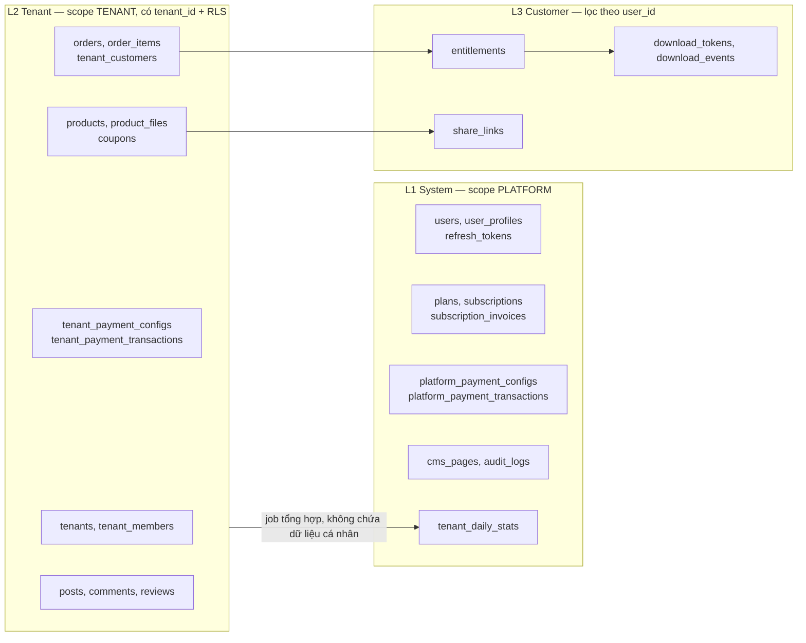
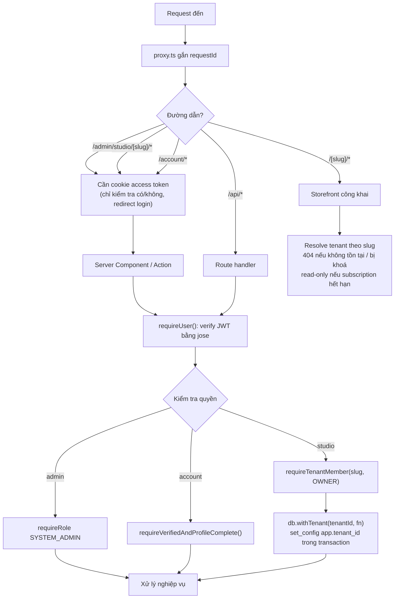

# ARCHITECTURE — Gieo Chữ

Nguồn gốc: [GIEOCHU_PROMPT_MVP_PHASE1.md](GIEOCHU_PROMPT_MVP_PHASE1.md) §4. File này phải được cập nhật trong
cùng commit mỗi khi luồng xử lý tổng thể thay đổi (mục 0.4).

## Sơ đồ hệ thống



**Trạng thái hiện tại (sau M5 — upload thật):** `PX` (proxy.ts — x-request-id + CSP nonce theo từng request,
ADR-016 — + gate hồ sơ/tenant/admin qua `lib/page-guards.ts`), `STF` (storefront công khai `/[tenantSlug]`),
`STU` (`/studio`, `/studio/[tenantSlug]`, settings + settings/payments + billing + products/CRUD + upload file
thật/ảnh bìa — **code xong, chờ verify với R2 thật**), `ADM` (`/admin`:
users/tenants/plans/cms/settings(+settings/storage — ADR-017)/billing/payment/billing/invoices — cơ bản,
audit log viewer chờ M12), `MKT` (`/`, `/pricing`, `/p/[slug]`), `AUTH` (đầy đủ: mật khẩu, JWT, RBAC), `PAY`
(`packages/payments` — đầy đủ MANUAL_QR/SEPAY/MOMO, dùng chung Platform/Tenant qua `PaymentScope`), `CORE`
(errors, logger, crypto: encryptSecret/decryptSecret/maskSecret — chuyển từ payments, dùng chung được với
storage, ADR-017 —, slug/branding/access-policy/membership, admin: lock-decision/plan-validation/cms-blocks/
dashboard-summary, billing: period/invoice-code/subscription-state/plan-limits, product:
slug-suggestion/publish-eligibility/storage-accounting), `DB` (User(+isSuperAdmin)/.../Tenant/TenantMember/
TenantSlugHistory/Subscription(+periodEndReminderStage)/Product(đầy đủ)/ProductFile/SystemSettings/
SystemStorageConfig/TenantPaymentConfig/PlatformPaymentConfig/WebhookEvent/BankBin/SubscriptionInvoice/
PlatformPaymentTransaction + RLS helpers `withTenant/withCustomer/withPublic/withSystemJob` — **có hiệu lực
thật**, xem ADR-010; SubscriptionInvoice/PlatformPaymentTransaction/SystemStorageConfig là L1, không RLS),
`STO` (`packages/storage` — đầy đủ: `createS3Client`/`testS3Connection`/`presign.ts`/`scan.ts`; ClamAV thật
vẫn chưa tích hợp, ADR-018), `MAIL`, `JOBS` (nay có `JobQueue.schedule()` cho cron —
`subscription.sweep` chạy hằng giờ, `file.scan` xử lý theo job — cả 2 trong `apps/web/worker.ts`) đã có.
Phần lớn bảng L2 còn lại (order, coupon...) còn là skeleton/tối thiểu chờ module tương ứng (xem `docs/PLAN.md`).

## Ranh giới dữ liệu theo layer



Nguyên tắc (không đổi trong suốt dự án):

- System admin **không có route nào** đọc `orders`, `order_items`, `tenant_customers` của tenant. Dashboard
  System chỉ đọc `tenant_daily_stats` và bảng của L1.
- Tenant chỉ thấy `tenant_customers` của chính mình.
- Customer có **một tài khoản toàn cục**, thư viện gom tài liệu đã mua từ mọi tenant.

## Phân giải tenant và bảo vệ route



**Quy tắc bất biến:** `proxy.ts` chỉ chuyển hướng và gắn header. Mọi route handler / server action / server
component nhạy cảm tự xác thực và phân quyền lại — không tin proxy đã lọc đủ.

## Cấu trúc thư mục (thực tế sau M5 phần 1)

```
.
├── apps/
│   └── web/                       # Next.js App Router
│       ├── app/
│       │   ├── (auth)/             # register, login, verify-email, forgot-password, reset-password
│       │   ├── account/            # profile, security, library (stub)
│       │   ├── admin/              # dashboard, users, tenants, plans, cms(+[slug]/new),
│       │   │                       # settings(+settings/storage — ADR-017), billing/payment, billing/invoices (M3)
│       │   ├── studio/             # onboarding, dashboard, settings (+ settings/payments — M7,
│       │   │                       # + billing — M3, + products(+new,+[productId]) — M5)
│       │   ├── [tenantSlug]/       # storefront công khai
│       │   ├── pricing/, p/[slug]/ # trang công khai (M2)
│       │   ├── api/
│       │   │   ├── auth/           # register, login, refresh, logout, verify-email, resend-verification,
│       │   │   │                   # forgot-password, reset-password
│       │   │   ├── admin/          # dashboard (GET, aggregate-only)
│       │   │   ├── webhooks/tenants/[tenantId]/[provider]/   # M7: verify + idempotent accept
│       │   │   ├── webhooks/platform/[provider]/             # M3: verify + match invoice + PAID
│       │   │   ├── studio/[tenantSlug]/uploads/               # M5: presign/complete/cover-presign/cover-complete
│       │   │   └── me/
│       │   └── layout.tsx, page.tsx (marketing shell)
│       ├── lib/                    # cookies, session, page-guards (+admin/tenant-page guards),
│       │                           # tenant, create-tenant, storefront, admin-dashboard, admin-users,
│       │                           # tenant-payment (M7), platform-payment/subscription-billing/
│       │                           # subscription-sweep/tenant-write-guard (M3), plan-limits/product/
│       │                           # product-upload/file-scan/system-storage (M5), pricing, rate-limit,
│       │                           # jobs, jwt-context, duration
│       ├── proxy.ts                # x-request-id + CSP nonce theo từng request (ADR-016)
│       ├── worker.ts               # pg-boss worker: email.send (M11) + subscription.sweep cron (M3) +
│       │                           # file.scan (M5)
│       ├── tests/integration/      # Vitest — auth (8), tenant (5), admin (4), tenant-payment (4),
│       │                           # subscription-billing (5), product (2), product-upload (1 — 1 test M5
│       │                           # còn lại chờ storage thật)
│       ├── next.config.ts          # X-Content-Type-Options/Referrer-Policy (CSP ở proxy.ts, ADR-016)
│       └── vitest.config.ts
├── packages/
│   ├── auth/        # password, JWT access token, refresh/verification token, RBAC (M1)
│   ├── core/         # errors, logger (M0); crypto/ encryption (encryptSecret/decryptSecret/maskSecret —
│   │                 # chuyển từ payments, ADR-017); tenant/ slug-branding-access-membership (M4);
│   │                 # admin/ lock-decision-plan-validation-cms-blocks-dashboard-summary (M2);
│   │                 # billing/ period-invoice_code-subscription_state-plan_limits (M3);
│   │                 # product/ slug-suggestion-publish-eligibility-storage-accounting (M5);
│   │                 # pricing/order-FSM ở M6/M8
│   ├── payments/    # PaymentProvider (PaymentScope-agnostic), vietqr, providers/
│   │                # (manual-qr/sepay/momo), registry (M7) — encryption re-exported từ @gieochu/core
│   ├── db/          # schema.prisma (User(+isSuperAdmin)/.../Tenant/TenantMember/TenantSlugHistory/
│   │                # Subscription(+periodEndReminderStage)/Product(đầy đủ)/ProductFile/Plan/CmsPage/
│   │                # SystemSettings/SystemStorageConfig/TenantPaymentConfig/PlatformPaymentConfig/
│   │                # WebhookEvent/BankBin/SubscriptionInvoice/PlatformPaymentTransaction),
│   │                # prisma.config.ts, client.ts, rls.ts (withTenant/withCustomer/withPublic/
│   │                # withSystemJob), seed.ts, prisma/migrations/,
│   │                # scripts/setup-app-role.mts (tạo role Postgres riêng cho app — ADR-010)
│   ├── storage/     # file-format.ts, object-key.ts, s3-client.ts, connection-test.ts, presign.ts (PUT
│   │                # đơn + multipart), scan.ts (readObjectForScan — hash + magic bytes 1 lần đọc) (M5)
│   ├── email/       # EmailSender (SMTP/Resend) + template kích hoạt/reset mật khẩu/subscription-billing (M3)/
│   │                # product-file-rejected (M5)
│   ├── jobs/        # pg-boss queue wrapper — send() (M1) + schedule() cron (M3) + FILE_SCAN queue (M5)
│   └── config/      # env.ts (zod), brand.ts, eslint-preset.mjs
├── docker/
│   └── docker-compose.yml         # minio (+createbuckets), mailpit, postgres (profile local-db)
├── docs/
│   ├── ARCHITECTURE.md            # (file này)
│   ├── PLAN.md
│   ├── DECISIONS.md
│   ├── BACKLOG.md
│   ├── bao-cao-ky-thuat-module-payment-2026-09-18.md   # báo cáo tham khảo do người dùng cung cấp (M3)
│   └── modules/
│       ├── M0.md
│       ├── M1.md
│       ├── M2.md
│       ├── M3.md
│       ├── M4.md
│       ├── M5.md
│       └── M7.md
├── scripts/count-tests.mjs
├── CLAUDE.md
└── turbo.json
```
