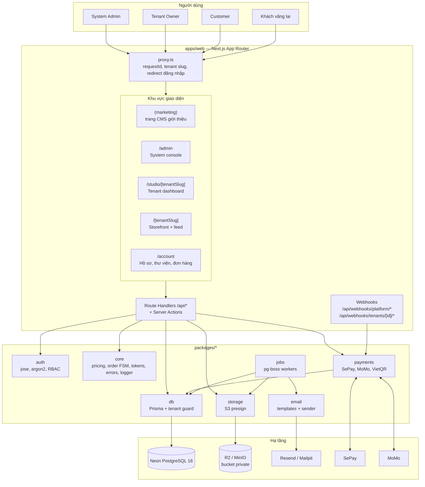
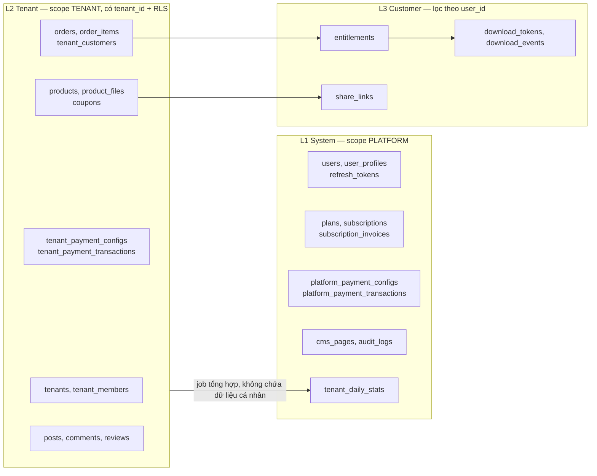
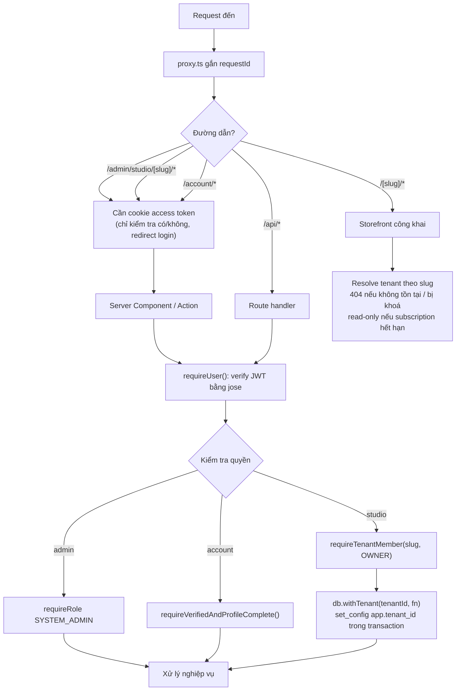

# ARCHITECTURE — Gieo Chữ

Nguồn gốc: [GIEOCHU_PROMPT_MVP_PHASE1.md](GIEOCHU_PROMPT_MVP_PHASE1.md) §4. File này phải được cập nhật trong
cùng commit mỗi khi luồng xử lý tổng thể thay đổi (mục 0.4).

## Sơ đồ hệ thống



**Trạng thái hiện tại (sau M1):** `PX` (proxy.ts + gate hồ sơ qua `lib/page-guards.ts`), `MKT` (shell tối
giản), `AUTH` (đầy đủ: mật khẩu, JWT, RBAC), `CORE` (errors + logger), `DB` (User/UserProfile/RefreshToken/
VerificationToken/Plan/CmsPage), `MAIL` (SMTP/Resend sender + template), `JOBS` (pg-boss, queue `email.send`)
đã có. `PAY`, `STO` và các bảng L2 (tenant/product/order) còn là skeleton chờ module tương ứng (xem
`docs/PLAN.md`).

## Ranh giới dữ liệu theo layer



Nguyên tắc (không đổi trong suốt dự án):

- System admin **không có route nào** đọc `orders`, `order_items`, `tenant_customers` của tenant. Dashboard
  System chỉ đọc `tenant_daily_stats` và bảng của L1.
- Tenant chỉ thấy `tenant_customers` của chính mình.
- Customer có **một tài khoản toàn cục**, thư viện gom tài liệu đã mua từ mọi tenant.

## Phân giải tenant và bảo vệ route



**Quy tắc bất biến:** `proxy.ts` chỉ chuyển hướng và gắn header. Mọi route handler / server action / server
component nhạy cảm tự xác thực và phân quyền lại — không tin proxy đã lọc đủ.

## Cấu trúc thư mục (thực tế sau M1)

```
.
├── apps/
│   └── web/                       # Next.js App Router
│       ├── app/
│       │   ├── (auth)/             # register, login, verify-email, forgot-password, reset-password
│       │   ├── account/            # profile, security, library (stub) — admin/, studio/, [tenantSlug]/ sau
│       │   ├── api/
│       │   │   ├── auth/           # register, login, refresh, logout, verify-email, resend-verification,
│       │   │   │                   # forgot-password, reset-password
│       │   │   └── me/
│       │   └── layout.tsx, page.tsx (marketing shell)
│       ├── lib/                    # cookies, session, page-guards, rate-limit, jobs, jwt-context, duration
│       ├── proxy.ts
│       ├── worker.ts               # pg-boss worker: xử lý job email.send (khung M11)
│       ├── tests/integration/      # Vitest — auth.test.ts (8 test)
│       ├── next.config.ts          # CSP/security headers
│       └── vitest.config.ts
├── packages/
│   ├── auth/        # password, JWT access token, refresh/verification token, RBAC (M1)
│   ├── core/         # errors.ts, logger.ts (M0); pricing/order-FSM thêm ở M6/M8
│   ├── payments/    # skeleton — M7
│   ├── db/          # schema.prisma (User/UserProfile/RefreshToken/VerificationToken/Plan/CmsPage),
│   │                # prisma.config.ts, client.ts, seed.ts, prisma/migrations/
│   ├── storage/     # skeleton — M5
│   ├── email/       # EmailSender (SMTP/Resend) + template kích hoạt/reset mật khẩu (khung M11, M1 dùng)
│   ├── jobs/        # pg-boss queue wrapper (khung M11, M1 dùng)
│   └── config/      # env.ts (zod), brand.ts, eslint-preset.mjs
├── docker/
│   └── docker-compose.yml         # minio (+createbuckets), mailpit, postgres (profile local-db)
├── docs/
│   ├── ARCHITECTURE.md            # (file này)
│   ├── PLAN.md
│   ├── DECISIONS.md
│   ├── BACKLOG.md
│   └── modules/
│       ├── M0.md
│       └── M1.md
├── scripts/count-tests.mjs
├── CLAUDE.md
└── turbo.json
```
