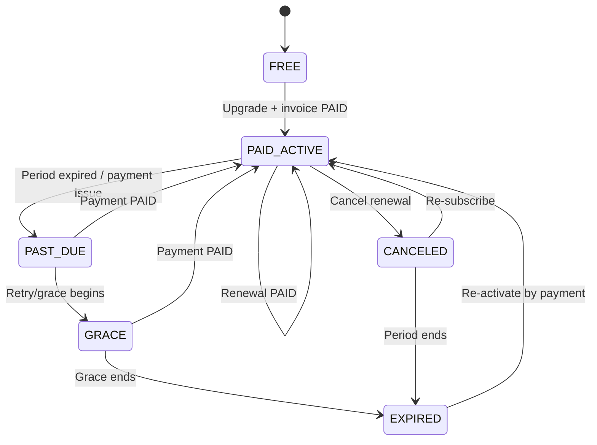
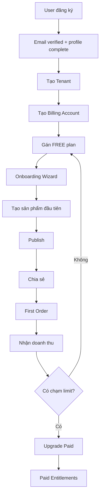
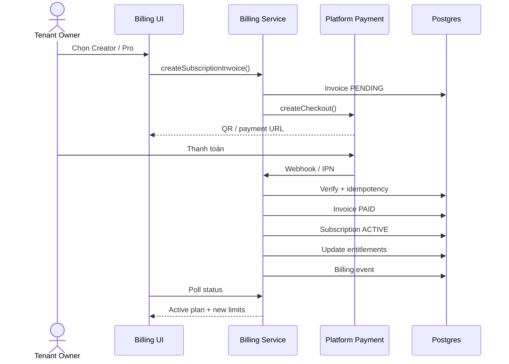

# Gieo Chữ — Báo cáo & Đề xuất mô hình Monetization Hybrid

**Phiên bản:** v2.0  
**Ngày:** 2026-09-18  
**Phạm vi:** MVP Giai đoạn 1 — Module M3 Subscription & Platform Billing và các module liên quan  
**Nguồn chính:** `GIEOCHU_PROMPT_MVP_PHASE1.md`

---

## 1. Executive Summary

### 1.1 Kết luận chính

Sau khi phân tích đặc tả MVP hiện tại, đề xuất chuyển mô hình monetization của Gieo Chữ từ **Subscription-first** sang **Hybrid Monetization**, trong đó:

1. **FREE là entry plan thực sự**, không phải trial ngắn hạn.
2. Tenant Owner có thể **tạo storefront và bán sản phẩm thật trên Free** với giới hạn thấp.
3. **Subscription trả phí dùng để mở rộng capacity và tính năng**, thay vì là điều kiện để được tồn tại hoặc được phép bắt đầu bán.
4. **Transaction fee** là một lớp monetization có thể áp dụng về sau hoặc áp dụng có kiểm soát ở các plan phù hợp, nhưng **không nên đưa vào MVP ngay** vì payment flow hiện tại chuyển tiền trực tiếp vào tài khoản Tenant.
5. M3 nên được đổi định danh từ **“Subscription và Platform Billing”** thành **“Billing, Subscription & Entitlements”**.
6. Kiến trúc billing nên tách các khái niệm **Plan, Entitlement, Usage, Subscription và Invoice** thay vì coi Subscription là toàn bộ billing model.

### 1.2 Mục tiêu của thay đổi

Mô hình mới giải quyết một vấn đề cốt lõi của sản phẩm:

> Tenant Owner có thể cần nhiều ngày hoặc nhiều tuần để upload tài liệu, hoàn thiện storefront, chia sẻ tài liệu và có giao dịch đầu tiên. Nếu bắt buộc trả subscription trước khi có cơ hội tạo doanh thu, Gieo Chữ tạo friction ngay tại thời điểm user chưa cảm nhận được giá trị kinh tế.

Mô hình Hybrid chuyển điểm thu tiền từ:

> **“Trả tiền để bắt đầu”**

sang:

> **“Bắt đầu miễn phí → tạo giá trị → trả tiền khi cần mở rộng.”**

---

# 2. Bối cảnh hiện tại của Gieo Chữ

## 2.1 Bản chất sản phẩm

Gieo Chữ là nền tảng SaaS “Document Social” dành cho giáo viên, coach và chuyên gia giáo dục/đào tạo. Tenant Owner có thể tạo trang social tài liệu, bán template, slide, ebook, bộ đề và tài liệu nâng cao; cấu hình giá, khuyến mãi, payment; đăng bài social; quản lý đơn hàng và khách hàng. Customer có một tài khoản toàn cục để mua và quản lý thư viện tài liệu từ nhiều tenant.

Nguồn đặc tả mô tả rõ hai hệ thống thanh toán tách biệt:

- **Platform Payment:** Tenant Owner trả subscription cho Gieo Chữ.
- **Tenant Payment:** Customer thanh toán mua tài liệu cho Tenant Owner.

Tiền subscription đi về tài khoản nền tảng; tiền bán tài liệu đi về tài khoản Tenant Owner. Hai payment scope dùng chung package provider nhưng không dùng chung bảng, secret hoặc route. `PaymentScope` được xác định thành `PLATFORM` hoặc `TENANT`.  

Nguồn: `GIEOCHU_PROMPT_MVP_PHASE1.md`, mục 1.2.

## 2.2 Kiến trúc subscription hiện tại

MVP hiện tại đang thiết kế theo flow:

```text
Create Tenant
    ↓
TRIALING
    ↓
ACTIVE
    ↓
GRACE
    ↓
EXPIRED
    ↓
READ_ONLY
```

Tenant mới được tạo subscription `TRIALING` với số ngày trial lấy từ system settings. Khi hóa đơn được thanh toán, subscription chuyển sang `ACTIVE`; khi hết kỳ thì vào `GRACE`, sau đó `EXPIRED`, và tenant được chuyển `READ_ONLY`.

Nguồn: `GIEOCHU_PROMPT_MVP_PHASE1.md`, M3.

## 2.3 Giới hạn plan hiện tại

Bảng `PLANS` hiện có các trường chính:

- `priceVnd`
- `interval`
- `intervalCount`
- `maxProducts`
- `storageMb`
- `maxFileMb`
- `isActive`

M3 áp giới hạn qua:

```ts
assertPlanLimit(tenantId, 'products' | 'storage' | 'fileSize')
```

và M5 gọi giới hạn trong quá trình upload/publish tài liệu.

Nguồn: `GIEOCHU_PROMPT_MVP_PHASE1.md`, mục 5.1 và M3/M5.

---

# 3. Vấn đề của mô hình Subscription-first

## 3.1 Giá trị kinh tế xuất hiện khá muộn

Hành trình thực tế của Tenant Owner không phải:

```text
Register → Pay → Value
```

mà gần với:

```text
Register
   ↓
Create Store
   ↓
Configure Branding
   ↓
Upload Document
   ↓
Create Product
   ↓
Set Price
   ↓
Configure Payment
   ↓
Publish
   ↓
Share
   ↓
Get First Customer
   ↓
Generate Revenue
```

Do đó, thời điểm user cảm nhận được ROI của nền tảng thường đến sau nhiều bước setup.

## 3.2 Trial theo thời gian không phản ánh đúng hành vi của creator

Một trial 14 ngày không đảm bảo user đã có:

- sản phẩm hoàn chỉnh;
- khách truy cập;
- khách hàng đầu tiên;
- giao dịch đầu tiên;
- doanh thu đầu tiên.

Nếu trial kết thúc trước khi user kiếm được tiền, user có thể kết luận rằng họ phải trả tiền cho một cửa hàng chưa chứng minh được hiệu quả.

## 3.3 Billing hiện tại đang gắn “quyền tồn tại” với “quyền mở rộng”

Trong thiết kế hiện tại, subscription và trạng thái tenant có quan hệ rất chặt. Hết subscription dẫn tới `READ_ONLY`.

Điều này hợp lý với SaaS truyền thống, nhưng đối với Gieo Chữ có thể tạo ra một nhầm lẫn về product value:

> Subscription không nên là “vé vào cửa”; subscription nên là “động cơ tăng trưởng”.

---

# 4. Đề xuất mô hình Hybrid Monetization

## 4.1 Mô hình tổng thể

```text
                         GIEO CHỮ
                             │
             ┌───────────────┴───────────────┐
             │                               │
          FREE PLAN                    PAID SUBSCRIPTION
             │                               │
      Start + sell thật                Capacity + Features
             │                               │
             └───────────────┬───────────────┘
                             │
                     FUTURE MONETIZATION
                             │
                Transaction Fee / Add-ons
```

## 4.2 Triết lý monetization

### Free

Mục tiêu: giúp Tenant Owner **đi từ “chưa có gì” tới “đơn hàng đầu tiên”**.

### Paid Subscription

Mục tiêu: giúp Tenant Owner **tăng quy mô sau khi đã chứng minh nhu cầu**.

### Transaction Fee

Mục tiêu tương lai: giúp Gieo Chữ chia sẻ upside từ những tenant có doanh thu lớn, nhưng chỉ triển khai khi payment architecture hỗ trợ thu phí đáng tin cậy.

### Add-ons

Mục tiêu tương lai: monetization theo nhu cầu đặc biệt mà không buộc mọi user phải nâng lên một plan lớn.

---

# 5. Mô hình Plan đề xuất

## 5.1 FREE — “Bắt đầu miễn phí”

Free không phải trial.

Free nên là **plan lâu dài** với giới hạn thấp.

Đề xuất ban đầu:

| Capability | Free |
|---|---:|
| Subscription | 0đ |
| Sản phẩm | 5 |
| Storage | 500 MB |
| Kích thước file | 50 MB |
| Storefront | Có |
| Checkout | Có |
| Tenant Payment | Có |
| Order management | Có |
| Customer management | Có |
| Social post | Có |
| Download / Library | Có |
| Basic branding | Có |
| Coupon | Có thể giới hạn / chưa mở |
| Analytics nâng cao | Không |
| Custom domain | Không |

**Nguyên tắc:** Free phải đủ để user thực hiện một vòng đời kinh doanh hoàn chỉnh và có cơ hội nhận thanh toán thật.

## 5.2 CREATOR

Mục tiêu: user đã bắt đầu có tài liệu và cần thêm capacity.

Ví dụ cấu hình để làm cơ sở kiểm thử economics:

| Capability | Creator |
|---|---:|
| Giá tham khảo | 99k–149k/tháng |
| Sản phẩm | 50 |
| Storage | 5 GB |
| Kích thước file | 250 MB |
| Coupon | Có |
| Analytics nâng cao | Có |
| Branding nâng cao | Có |
| Social/Content tools | Có |

## 5.3 PRO

Mục tiêu: creator có thư viện tài liệu lớn và hoạt động kinh doanh ổn định.

Ví dụ:

| Capability | Pro |
|---|---:|
| Giá tham khảo | 199k–299k/tháng |
| Sản phẩm | 200 |
| Storage | 20 GB |
| Kích thước file | 1 GB |
| Coupon | Có |
| Analytics | Advanced |
| Branding | Advanced |
| SEO | Advanced |
| Automation | Có |

## 5.4 BUSINESS

Mục tiêu: trung tâm, tổ chức, creator lớn hoặc tenant có volume cao.

Định hướng:

- capacity cao;
- nhiều staff trong phase tương lai;
- analytics chuyên sâu;
- automation;
- custom domain;
- policy/support riêng.

Giá có thể bắt đầu từ khoảng 499k/tháng hoặc pricing theo thỏa thuận.

> Các mức giá ở phần 5 chỉ là **giá tham khảo để thiết kế economics**, chưa phải giá niêm yết chính thức.

---

# 6. Transaction Fee — Đề xuất nhưng chưa triển khai đầy đủ trong MVP

## 6.1 Ý tưởng

Hybrid monetization có thể sử dụng transaction fee như một lớp bổ sung:

| Plan | Subscription | Transaction fee định hướng |
|---|---:|---:|
| Free | 0đ | Cao hơn paid plan |
| Creator | Có | Thấp hơn Free |
| Pro | Có | Rất thấp |
| Business | Cao | Có thể 0% hoặc gần 0% |

Một cấu hình ví dụ để mô phỏng economics:

```text
FREE     → 5%
CREATOR  → 3%
PRO      → 1%
BUSINESS → 0% hoặc gần 0%
```

Đây chỉ là mô hình minh họa, không phải mức phí đã chốt.

## 6.2 Vì sao chưa nên triển khai ngay

Payment flow hiện tại của Gieo Chữ cho Tenant Payment có thiết kế tiền đi trực tiếp về tài khoản Tenant Owner.

```text
Customer
   ↓
Tenant Payment
   ↓
Tenant Bank Account
```

Trong flow này, Gieo Chữ không trực tiếp giữ hoặc phân phối số tiền thanh toán.

Nếu muốn thu transaction fee, có hai hướng:

### A. Hậu kỳ billing

```text
GMV tháng
   ↓
Tính platform fee
   ↓
Tạo invoice
   ↓
Tenant trả Gieo Chữ
```

Rủi ro:

- công nợ;
- khó thu;
- user có thể né fee bằng thanh toán ngoài platform;
- accounting phức tạp hơn.

### B. Split payment / marketplace payment

```text
Customer
   ↓
Payment platform
   ├── Platform fee
   └── Tenant net amount
```

Mô hình này tốt hơn về economics nhưng cần payment architecture khác đáng kể so với MVP hiện tại.

## 6.3 Quyết định cho MVP

**Không đưa transaction fee vào critical path của M3 MVP.**

Thay vào đó:

1. Free plan có thể bán thật.
2. Subscription thu tiền cho capacity/features.
3. Kiến trúc billing để sẵn field/model cho transaction fee trong tương lai.
4. Sau khi có dữ liệu GMV thực tế mới quyết định cơ chế fee.

---

# 7. Trial → Free Forever

## 7.1 Đề xuất thay đổi

Hiện tại:

```text
Create Tenant
    ↓
TRIALING
```

Đề xuất:

```text
Create Tenant
    ↓
FREE PLAN
```

User chỉ tạo subscription trả phí khi chủ động upgrade.

## 7.2 Lý do

Free Forever:

- giảm friction onboarding;
- cho phép user hoàn thiện store theo tốc độ thật;
- không ép user đánh giá sản phẩm trước khi có trải nghiệm;
- tạo cơ hội đạt first sale;
- tạo upgrade trigger tự nhiên khi user chạm giới hạn.

## 7.3 Trial có thể giữ như một công cụ marketing riêng

Trong tương lai, trial vẫn có thể tồn tại như một promotion:

```text
FREE
  ↓
“Try Pro for 14 days”
  ↓
Return to Free if not upgraded
```

Trial khi đó là **growth experiment**, không phải lifecycle bắt buộc của tenant.

---

# 8. Mô hình Billing Architecture đề xuất

## 8.1 Tách Billing Account khỏi Subscription

Kiến trúc hiện tại:

```text
TENANT
   ↓
SUBSCRIPTION
   ↓
PLAN
```

Kiến trúc đề xuất:

```text
TENANT
   ↓
BILLING_ACCOUNT
   ├── PLAN / ENTITLEMENTS
   ├── USAGE
   ├── SUBSCRIPTION
   ├── INVOICES
   └── FUTURE FEES / ADD-ONS
```

Điều này giúp Gieo Chữ không phải refactor lớn khi bổ sung:

- add-on;
- usage-based billing;
- transaction fee;
- credit;
- custom package;
- annual billing;
- promotion.

## 8.2 Các khái niệm phải tách riêng

### Plan

Định nghĩa catalog thương mại.

Ví dụ:

```text
FREE
CREATOR
PRO
BUSINESS
```

### Entitlement

Quyền mà tenant được hưởng từ plan.

Ví dụ:

```text
maxProducts = 50
storageMb = 5120
maxFileMb = 250
coupon = true
analyticsAdvanced = true
```

### Usage

Tenant đã sử dụng bao nhiêu.

Ví dụ:

```text
productsUsed = 31
storageUsedBytes = 3.2 GB
```

### Subscription

Quan hệ trả phí theo chu kỳ.

Chỉ cần thiết khi tenant đang ở paid plan.

### Invoice

Bằng chứng/đối tượng thanh toán.

---

# 9. Database Schema đề xuất

## 9.1 Giữ lại `plans`

Có thể mở rộng `plans` từ schema hiện tại.

Đề xuất logic:

```text
PLANS
- id
- code
- name
- priceVnd
- interval
- intervalCount
- maxProducts
- storageMb
- maxFileMb
- transactionFeeBps nullable
- features Json
- isFree
- isActive
```

`transactionFeeBps` có thể để `nullable` để chưa dùng ở MVP nhưng sẵn sàng cho tương lai.

## 9.2 Bổ sung `billing_accounts`

Đề xuất:

```text
BILLING_ACCOUNTS
- id
- tenantId UNIQUE
- currentPlanId
- status
- createdAt
- updatedAt
```

Các trạng thái có thể là:

```text
ACTIVE
PAST_DUE
GRACE
EXPIRED
```

Không coi Free là subscription state.

## 9.3 `subscriptions`

Giữ bảng hiện tại nhưng chuyển vai trò thành paid subscription.

```text
SUBSCRIPTIONS
- id
- billingAccountId
- planId
- status
- currentPeriodStart
- currentPeriodEnd
- graceEndsAt
- canceledAt
```

Status:

```text
ACTIVE
PAST_DUE
GRACE
EXPIRED
CANCELED
```

Không cần `TRIALING` làm lifecycle mặc định.

## 9.4 `subscription_invoices`

Giữ gần như hiện tại:

```text
SUBSCRIPTION_INVOICES
- id
- subscriptionId
- code
- amountVnd
- status
- provider
- expiresAt
- paidAt
```

## 9.5 `usage_meters`

Đề xuất thêm nếu cần tracking rõ ràng:

```text
USAGE_METERS
- id
- billingAccountId
- metric
- value
- periodStart
- periodEnd
- updatedAt
```

Các metric ban đầu:

```text
PRODUCTS
STORAGE_BYTES
```

Có thể mở rộng:

```text
ORDERS
GMV
DOWNLOADS
AI_USAGE
```

Chỉ thêm metric khi có use case thật.

## 9.6 `billing_events`

Khuyến nghị bổ sung event log cho billing:

```text
BILLING_EVENTS
- id
- billingAccountId
- eventType
- source
- payload Json
- createdAt
```

Ví dụ:

```text
PLAN_UPGRADED
PLAN_DOWNGRADED
SUBSCRIPTION_STARTED
SUBSCRIPTION_RENEWED
SUBSCRIPTION_PAST_DUE
SUBSCRIPTION_EXPIRED
LIMIT_REACHED
```

Điều này hữu ích cho audit, support và debugging.

---

# 10. Entitlement Model

## 10.1 Vì sao cần Entitlement

Logic business không nên hỏi trực tiếp:

```ts
if (plan.code === 'PRO') ...
```

mà nên hỏi:

```ts
can(tenant, 'analytics.advanced')
```

hoặc:

```ts
assertLimit(tenant, 'products')
```

Điều này giúp plan chỉ là cách đóng gói thương mại của entitlement.

## 10.2 Ví dụ

```ts
interface PlanEntitlements {
  limits: {
    maxProducts: number;
    storageBytes: bigint;
    maxFileBytes: number;
  };
  features: {
    coupons: boolean;
    advancedAnalytics: boolean;
    advancedBranding: boolean;
    seoTools: boolean;
  };
}
```

## 10.3 Nguyên tắc

**Business logic đọc entitlement, không đọc tên plan.**

Sai:

```ts
if (plan.code === 'PRO') {
  allowAnalytics();
}
```

Đúng:

```ts
if (entitlements.features.advancedAnalytics) {
  allowAnalytics();
}
```

---

# 11. Usage & Limit Model

## 11.1 Dashboard billing mới

Trang `/studio/[slug]/billing` nên thể hiện:

```text
GÓI HIỆN TẠI
FREE

Sản phẩm
██████████ 5 / 5

Storage
████████░░ 438 MB / 500 MB

Doanh thu tháng này
1.280.000đ

[ Nâng cấp ]
```

## 11.2 Upgrade trigger

Không chỉ dựa trên ngày hết hạn.

Trigger có thể là:

- `products >= 80% limit`;
- `storage >= 80% limit`;
- attempt upload vượt `maxFileMb`;
- attempt publish vượt `maxProducts`.

Ví dụ:

```text
Bạn đang dùng 5/5 sản phẩm.
Nâng cấp lên Creator để đăng thêm tối đa 45 sản phẩm.
```

Đây là contextual upsell.

---

# 12. State Machine đề xuất

## 12.1 Tenant Plan State



## 12.2 Ý nghĩa quan trọng

`FREE` không phải `READ_ONLY`.

Free vẫn:

- storefront ON;
- publish ON trong limit;
- checkout ON;
- orders ON;
- downloads ON.

`READ_ONLY` chỉ là trạng thái hạn chế, chủ yếu áp dụng cho tenant đã mất paid entitlement hoặc bị hệ thống khóa tính năng bán.

---

# 13. Quy tắc Tenant Status

## 13.1 FREE

```text
Storefront       ON
Checkout         ON
Create Product   ON within limits
Publish          ON within limits
Customer access  ON
Downloads        ON
```

## 13.2 ACTIVE / Paid

```text
Storefront       ON
Checkout         ON
Product limits   theo plan
Features         theo plan
```

## 13.3 EXPIRED

```text
Storefront       ON / cảnh báo
Existing orders  ON
Existing files   không bị xóa
Existing buyers  vẫn tải được theo entitlement
New publishing   OFF
New orders       OFF nếu policy chọn READ_ONLY
```

## 13.4 LOCKED

Dùng cho moderation / abuse / system decision.

Khách vãng lai có thể nhận 404 theo đặc tả hiện tại.

---

# 14. Payment Architecture trong mô hình Hybrid

## 14.1 Platform Payment — giữ nguyên

Platform Payment tiếp tục dùng cho:

```text
Tenant Owner
    ↓
Subscription Invoice
    ↓
Platform Payment
    ↓
Gieo Chữ
```

Provider có thể vẫn là:

- QR thủ công / VietQR;
- SePay;
- MoMo.

## 14.2 Tenant Payment — giữ nguyên trong MVP

```text
Customer
   ↓
Tenant Checkout
   ↓
Tenant Payment
   ↓
Tenant Owner
```

Không trộn platform billing với tenant commerce payment.

## 14.3 Tương lai

Nếu triển khai transaction fee theo kiểu split payment, nên tạo Payment Architecture v2 thay vì cố “vá” M3 hiện tại.

---

# 15. Revised M3 — Đặc tả đề xuất

## M3 — Billing, Subscription & Entitlements

### Mục tiêu

Tenant có thể dùng Gieo Chữ theo Free plan và bán sản phẩm trong giới hạn cơ bản; khi có nhu cầu tăng capacity/features, owner nâng cấp subscription thông qua Platform Payment.

### Chức năng

1. Tạo tenant → tạo `billing_account` → gán `FREE`.
2. Billing page hiển thị plan, usage, limits và billing history.
3. Upgrade Free → Paid.
4. Renewal Paid → gia hạn invoice.
5. Downgrade/cancel → giữ quyền tới hết kỳ đã thanh toán.
6. Grace/Expired chỉ áp dụng cho paid subscription.
7. Free không hết hạn.
8. `assertPlanLimit()` đọc entitlement hiện tại.
9. `featureGate()` kiểm tra feature entitlement.
10. Billing event ghi lại thay đổi quan trọng.

### Không làm trong MVP

- split payment;
- transaction fee settlement;
- automated collection nhiều provider;
- proration;
- complex add-on billing;
- usage billing theo API;
- credit wallet.

---

# 16. Revised User Flow

## 16.1 Onboarding



## 16.2 Upgrade Flow



---

# 17. Pricing Page mới

Pricing page nên truyền đạt:

> **Bắt đầu miễn phí. Chỉ nâng cấp khi bạn cần nhiều hơn.**

Không nên đặt trọng tâm vào:

> “Trial 14 ngày — sau đó phải trả tiền.”

### So sánh nên có

| | Free | Creator | Pro | Business |
|---|---:|---:|---:|---:|
| Giá | 0đ | $$ | $$$ | $$$$ |
| Sản phẩm | 5 | 50 | 200 | Custom |
| Storage | 500MB | 5GB | 20GB | Custom |
| File max | 50MB | 250MB | 1GB | Custom |
| Storefront | ✓ | ✓ | ✓ | ✓ |
| Checkout | ✓ | ✓ | ✓ | ✓ |
| Coupon | – / Basic | ✓ | ✓ | ✓ |
| Analytics | Basic | Advanced | Advanced+ | Custom |
| Branding | Basic | Advanced | Advanced | Custom |
| SEO | Basic | Basic | Advanced | Advanced |
| Automation | – | – / Basic | ✓ | ✓ |

---

# 18. Economics — Mục tiêu của từng lớp pricing

## Free

Mục tiêu không phải doanh thu trực tiếp.

Mục tiêu là:

- activation;
- first product;
- first published product;
- first customer;
- first GMV.

## Creator

Mục tiêu monetization từ creator nhỏ/vừa.

## Pro

Mục tiêu monetization từ creator có traction.

## Business

Mục tiêu monetization từ volume lớn và nhu cầu enterprise-like.

## Transaction fee tương lai

Mục tiêu là chia sẻ upside từ GMV khi payment infrastructure cho phép thu phí đáng tin cậy.

---

# 19. KPI cần theo dõi sau khi triển khai

Để quyết định mô hình có hiệu quả hay không, không nên chỉ theo dõi MRR.

Cần theo dõi funnel:

```text
Signup
  ↓
Tenant Created
  ↓
First Product Created
  ↓
First Product Published
  ↓
First Share
  ↓
First Customer
  ↓
First GMV
  ↓
Limit Hit
  ↓
Upgrade
  ↓
Renewal
```

Các KPI đề xuất:

- Tenant activation rate;
- % tenant có sản phẩm đầu tiên;
- % tenant publish sản phẩm đầu tiên;
- % tenant có first order;
- median time to first sale;
- GMV per active tenant;
- Free → Paid conversion;
- Paid retention;
- downgrade rate;
- churn;
- storage utilization;
- product limit utilization;
- ARPU;
- MRR;
- paid tenant / active tenant.

---

# 20. Các câu hỏi kinh tế cần validate bằng dữ liệu thật

Chưa nên chốt ngay mức giá cuối cùng trước khi có dữ liệu từ user.

Cần đo:

1. Một tenant trung bình có bao nhiêu sản phẩm?
2. Storage trung bình bao nhiêu MB/tenant?
3. Tỷ lệ tenant có first sale là bao nhiêu?
4. Bao lâu để có first sale?
5. Tenant nào sẵn sàng trả subscription?
6. Giới hạn nào tạo ra upgrade trigger mạnh nhất?
7. Giá 99k, 149k, 199k, 299k có tác động khác nhau ra sao?
8. Tenant có sẵn sàng trả phí định kỳ nếu đã có GMV chưa?

---

# 21. Rủi ro và cách kiểm soát

## 21.1 Free users quá nhiều, không convert

**Rủi ro:** cost storage/support tăng nhưng revenue thấp.

**Giải pháp:**

- giới hạn 5 sản phẩm;
- giới hạn storage;
- limit file size;
- advanced features chỉ ở paid;
- monitor activation và GMV.

## 21.2 Tenant cố tình duy trì Free dù đã có volume lớn

**Giải pháp:**

- giới hạn theo usage;
- contextual upgrade;
- paid plan có lợi ích rõ;
- transaction fee ở tương lai nếu payment architecture hỗ trợ.

## 21.3 Transaction fee khó thu

**Giải pháp:**

Không đưa vào MVP nếu tiền đang đi trực tiếp Tenant Bank.

## 21.4 Billing logic phình quá nhanh

**Giải pháp:**

MVP chỉ implement:

```text
FREE
Paid Subscription
Invoice
Platform Payment
Entitlement
Usage Limits
Grace/Expired
```

Các capability khác đưa vào backlog.

---

# 22. Lộ trình triển khai đề xuất

## Phase 1 — MVP Billing

### Bắt buộc

- [ ] Free plan
- [ ] Billing Account
- [ ] Plan catalog
- [ ] Entitlements
- [ ] Usage limits
- [ ] Paid subscription
- [ ] Platform invoices
- [ ] Platform Payment
- [ ] Webhook idempotency
- [ ] Grace/Expired
- [ ] Billing UI
- [ ] Audit events
- [ ] Upgrade flow

### Chưa làm

- [ ] Transaction fee settlement
- [ ] Split payment
- [ ] Add-ons
- [ ] Credits
- [ ] Proration
- [ ] Usage billing

## Phase 2 — Growth Billing

- [ ] Add-ons
- [ ] Annual discount
- [ ] Promotional trial Pro
- [ ] Coupon cho subscription
- [ ] Usage analytics
- [ ] Upgrade recommendations

## Phase 3 — Marketplace Economics

- [ ] Transaction fee
- [ ] Split payment nếu provider phù hợp
- [ ] Settlement/reconciliation
- [ ] Fee invoice
- [ ] GMV tiers
- [ ] High-volume pricing

---

# 23. Các thay đổi cần thực hiện trên đặc tả MVP hiện tại

## M3

Thay:

```text
Subscription và Platform Billing
```

bằng:

```text
Billing, Subscription & Entitlements
```

### Business rule mới

**Cũ:**

```text
Create Tenant → TRIALING
```

**Mới:**

```text
Create Tenant → Billing Account → FREE
```

## M4

Thay:

```text
T1 → T2 → T3 subscription TRIALING
```

bằng:

```text
T1 → Tenant
T2 → Membership OWNER
T3 → Billing Account
T4 → FREE plan
```

## M5

`assertPlanLimit()` tiếp tục được giữ nhưng chuyển sang đọc **current entitlements** thay vì giả định mọi tenant phải có paid subscription.

## M2

Dashboard nên tách:

- Free tenants;
- Paid tenants;
- Active paid subscriptions;
- MRR;
- Subscription revenue;
- GMV tổng hợp.

Không coi “số subscription” là toàn bộ active tenant.

---

# 24. Đề xuất API/Service Boundary

Có thể tổ chức package/service theo hướng:

```text
packages/core/
  billing/
    plans.ts
    entitlements.ts
    usage.ts
    limits.ts
    subscription.ts
    invoices.ts
    billing-events.ts
```

Các hàm domain quan trọng:

```ts
getBillingAccount(tenantId)
getCurrentPlan(tenantId)
resolveEntitlements(tenantId)
getUsage(tenantId, metric)
assertPlanLimit(tenantId, metric)
can(tenantId, feature)
createSubscriptionInvoice(...)
activateSubscription(...)
renewSubscription(...)
cancelSubscription(...)
expireSubscription(...)
recordBillingEvent(...)
```

Mục tiêu là apps/web không tự viết logic pricing.

---

# 25. Backward Compatibility / Migration Strategy

Không nên xóa `subscriptions` ngay.

## Migration 1

Thêm:

```text
billing_accounts
```

## Migration 2

Seed plan:

```text
FREE
CREATOR
PRO
BUSINESS
```

## Migration 3

Migrate tenant hiện tại:

```text
existing tenant
    ↓
create billing_account
    ↓
assign current plan
```

## Migration 4

Các tenant đang `TRIALING` chuyển về:

```text
FREE
```

nếu business decision xác định Free Forever là chính sách chính thức.

## Migration 5

Paid subscription vẫn giữ nguyên invoice/history.

Không làm mất lịch sử thanh toán.

---

# 26. Test Strategy cho M3 v2

## Unit test đề xuất

### Plan

- FREE có price = 0.
- Paid plan có interval hợp lệ.
- Không cho giới hạn âm.

### Entitlement

- FREE resolve đúng limits.
- PRO resolve đúng feature flags.
- Feature không thuộc plan bị từ chối.

### Usage

- Product count tính đúng.
- Storage tính đúng.
- 80%/100% thresholds đúng.

### Subscription

- Free không expire.
- Upgrade paid đúng.
- Renewal nối kỳ đúng.
- Cancel giữ quyền tới cuối kỳ.
- Grace/expired đúng.

### Invoice

- Invoice code unique.
- Webhook idempotent.
- Số tiền không tin từ client.

## Integration test đề xuất

1. Create tenant → Free.
2. Free create product.
3. Free publish product trong limit.
4. Free checkout.
5. Hitting product limit → block đúng.
6. Upgrade → invoice.
7. Payment webhook → Paid Active.
8. Entitlements thay đổi ngay sau payment.
9. Paid hết hạn → Grace.
10. Grace hết → Expired.
11. Existing buyer vẫn truy cập entitlement.
12. Payment webhook duplicate không tạo double activation.

---

# 27. Decision Record

## ADR: Hybrid Monetization cho Gieo Chữ

### Context

Subscription-first có thể tạo friction vì Tenant Owner chưa chắc có thể kiếm tiền ngay sau khi đăng ký.

### Decision

Áp dụng:

```text
Free Forever + Paid Subscription
```

Transaction fee được thiết kế như **future monetization layer**, chưa đưa vào critical path MVP.

### Consequences

**Positive:**

- onboarding friction thấp;
- user có thể đạt first sale trước khi trả phí;
- subscription trở thành upgrade engine;
- architecture linh hoạt hơn;
- dễ bổ sung add-on và usage billing về sau.

**Negative:**

- cần quản lý Free plan;
- hệ thống entitlement phức tạp hơn subscription-only;
- có thể có nhiều free users không convert;
- revenue ban đầu có thể thấp hơn nếu chưa có transaction fee.

---

# 28. Final Recommendation

## Mô hình đề xuất chính thức

```text
                    GIEO CHỮ
                       │
                       ▼
                 FREE FOREVER
                       │
              bán được thật trong limit
                       │
                       ▼
                FIRST CUSTOMER
                       │
                       ▼
                GROW USAGE
                       │
              chạm giới hạn / cần feature
                       │
                       ▼
               PAID SUBSCRIPTION
                       │
                mở rộng capacity
                       │
                       ▼
                PRO / BUSINESS
                       │
                       ▼
         FUTURE TRANSACTION ECONOMICS
```

### Nguyên tắc quan trọng nhất

> **Không thu tiền chỉ vì Tenant Owner tạo một cửa hàng. Thu tiền khi Gieo Chữ giúp họ mở rộng hoạt động kinh doanh hoặc cung cấp năng lực mà Free không còn đáp ứng.**

### Quyết định cho MVP Phase 1

**Nên triển khai ngay:**

- Free Forever;
- Paid Subscription;
- Billing Account;
- Entitlements;
- Usage Limits;
- Platform Billing;
- Invoice;
- Grace/Expired;
- contextual upgrade UX.

**Chưa triển khai:**

- Transaction fee settlement;
- split payment;
- complex add-ons;
- usage billing.

---

# 29. Checklist trước khi Claude Code bắt đầu M3

- [ ] Chốt Free limits.
- [ ] Chốt danh sách feature entitlement.
- [ ] Chốt Creator/Pro/Business packaging.
- [ ] Chốt Billing Account schema.
- [ ] Chốt FREE không hết hạn.
- [ ] Chốt paid subscription lifecycle.
- [ ] Chốt khi nào tenant thành READ_ONLY.
- [ ] Chốt policy existing buyers khi tenant expired.
- [ ] Chốt pricing page copy.
- [ ] Chốt upgrade triggers.
- [ ] Chốt invoice flow.
- [ ] Chốt platform payment provider trong MVP.
- [ ] Chốt audit events.
- [ ] Chốt test matrix.

---

## 30. Ghi chú nguồn và phạm vi

Báo cáo này được xây dựng dựa trên đặc tả `GIEOCHU_PROMPT_MVP_PHASE1.md`, đặc biệt các phần:

- mô hình 3 layer System / Tenant / Customer;
- hai hệ thống payment PLATFORM / TENANT;
- database schema cho `plans`, `subscriptions`, `subscription_invoices`;
- M2 System Admin;
- M3 Subscription & Platform Billing;
- M4 Tenant Workspace & Storefront;
- M5 Product & File;
- background jobs cho subscription sweep/remind và invoice expiry.

Các mức giá, tỷ lệ transaction fee, giới hạn Free/Creator/Pro/Business và một số schema mới trong báo cáo là **đề xuất thiết kế**, chưa phải dữ kiện đã có trong tài liệu nguồn.
