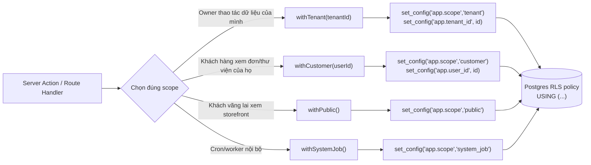
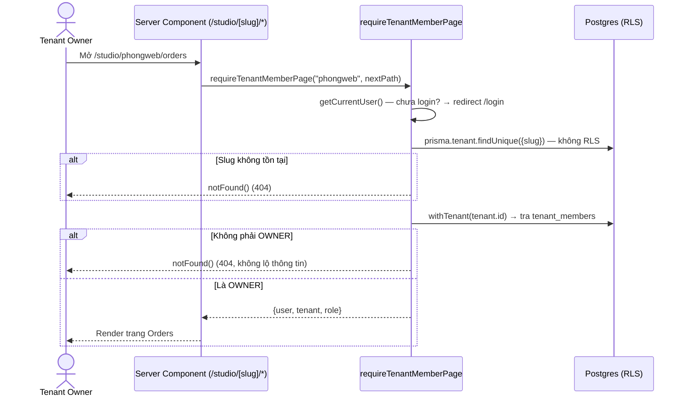
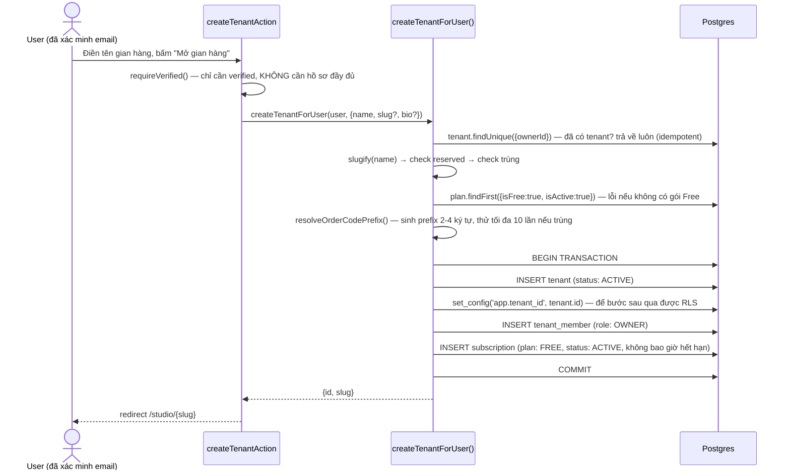
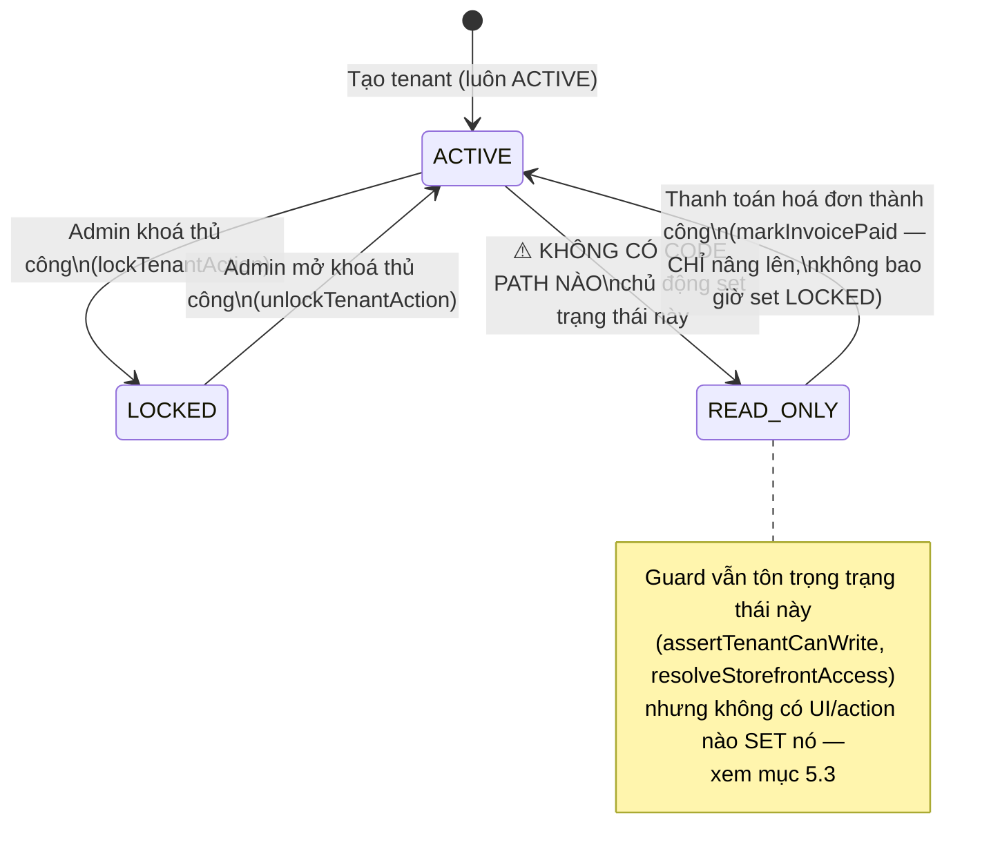
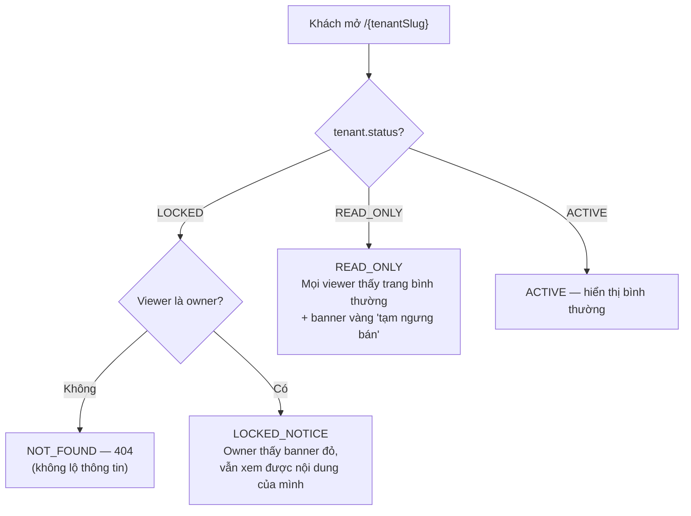

# Gieo Chữ — Cấu trúc & Workflow Module Tenant

**Phạm vi tài liệu:** Ghi lại đầy đủ, chính xác hiện trạng code (không suy đoán) của toàn bộ Module Tenant —
data model, RLS, guard, route, vòng đời trạng thái, quan hệ billing, storefront công khai. Đi kèm sơ đồ
workflow. Dùng làm tài liệu tham chiếu khi debug hoặc mở rộng module — không phải kế hoạch phát triển mới.

---

## 1. Tổng quan

Tenant = "gian hàng" của 1 giáo viên/coach/chuyên gia trên Gieo Chữ. Mỗi `User` sở hữu **tối đa 1** `Tenant`
(`Tenant.ownerId` là `@unique`). Tenant là gốc Layer 2 (L2) — mọi bảng con mang `tenantId` và được RLS bảo vệ
theo tenant, trừ vài bảng cố ý ở Layer 1 (xem mục 3).

---

## 2. Data model

### 2.1 Bảng gốc

```prisma
enum TenantStatus { ACTIVE  READ_ONLY  LOCKED }
enum TenantMemberRole { OWNER  STAFF }

model Tenant {
  id               String       @id @default(cuid(2))
  slug             String       @unique
  ownerId          String       @unique          // 1 user = tối đa 1 tenant
  owner            User         @relation(fields: [ownerId], references: [id])
  name             String
  bio              String?
  logoKey          String?
  coverKey         String?
  branding         Json?        // { primaryColor, accentColor, socialLinks: {...} }
  orderCodePrefix  String       @unique
  status           TenantStatus @default(ACTIVE)
  storageUsedBytes Int          @default(0)
  // ... quan hệ tới members, slugHistory, subscription, products, orders, coupons,
  //     paymentConfigs, subscriptionInvoices, transactions, customers,
  //     entitlements, shareLinks, downloadEvents
}

model TenantMember {
  tenantId String
  userId   String
  role     TenantMemberRole @default(OWNER)
  joinedAt DateTime @default(now())
  @@id([tenantId, userId])
}

model TenantSlugHistory {
  id        String   @id @default(cuid(2))
  tenantId  String
  oldSlug   String   @unique   // dùng để redirect 301 khi đổi slug
  changedAt DateTime @default(now())
}
```

**Ghi chú quan trọng:**
- `TenantMemberRole.STAFF` **tồn tại trong enum nhưng chưa có bất kỳ nơi nào trong code tạo bản ghi STAFF** —
  MVP chỉ tạo `OWNER` (`create-tenant.ts`). `canManageTenant(role)` (packages/core) chỉ trả `true` cho
  `OWNER` — nếu sau này có STAFF thật, hàm này sẽ tự động từ chối họ cho tới khi được cập nhật thêm quyền
  hạn chi tiết. Schema đã "chuẩn bị sẵn", logic chưa triển khai.
- Bảng `Tenant` chính nó **không bật RLS** — quyết định kiến trúc rõ ràng (chỉ các bảng con mới cần RLS vì
  tra cứu tenant theo slug là thao tác public, không cần scope).

### 2.2 Toàn bộ bảng con (`tenantId`) — có RLS hay không

| Bảng | RLS? | Ghi chú |
|---|---|---|
| `products` | ✅ | owner / public (chỉ `PUBLISHED`) / system_job / **customer đã mua** (kể cả sau khi unpublish) |
| `product_files` | ✅ | owner / system_job / public (preview+CLEAN+chưa xoá của product PUBLISHED) / **customer có entitlement CLEAN** |
| `tenant_members` | ✅ | owner / system_job |
| `tenant_payment_configs` | ✅ | owner / system_job (không có nhánh public) |
| `coupons` | ✅ | owner / public (chỉ `isEnabled=true`) / system_job |
| `coupon_redemptions` | ✅ | owner / system_job |
| `orders` | ✅ | owner / customer (khớp `customerId`) / system_job |
| `order_items` | ✅ | scope qua JOIN tới `orders` (không có cột `tenantId` riêng) |
| `tenant_payment_transactions` | ✅ | owner / system_job |
| `tenant_customers` | ✅ | owner / system_job |
| `entitlements` | ✅ | owner / customer (khớp `userId`) / system_job |
| `share_links` | ✅ | owner / **public không lọc status** (để phân biệt 404 vs 410 khi hết hạn/thu hồi) / system_job |
| `download_events` | ✅ | owner / system_job (không có nhánh public/customer — chỉ audit trail) |
| `subscription` | ❌ (L1) | chặn ở app layer (`requireTenantMember`/`requireRole`) |
| `subscription_invoices` | ❌ (L1) | tương tự |
| `download_tokens` | ❌ (L1, cố ý) | ranh giới bảo mật là "ai đang giữ token thô", không phải theo dòng |
| `tenant_slug_history` | ❌ | đọc qua `getPrismaClient()` trực tiếp |

**Lịch sử tiến hoá policy đáng chú ý:** policy của `products` và `product_files` từng bị `DROP POLICY` rồi
`CREATE POLICY` lại ở các migration M9 để mở thêm nhánh "customer" — ban đầu chỉ owner/public/system_job,
sau đó phát hiện khách hàng đã mua không đọc được sản phẩm/file của chính mình nếu sản phẩm bị gỡ khỏi
`PUBLISHED` (đã ghi ADR-020 trong `docs/DECISIONS.md`).

---

## 3. Cơ chế RLS

`packages/db/src/rls.ts` cung cấp 4 hàm, mỗi hàm mở 1 `prisma.$transaction` rồi set 1 Postgres session
variable **chỉ có hiệu lực trong transaction đó** (`set_config(key, value, true)` — tham số `true` = local):

```ts
withTenant(tenantId, fn)   // set app.scope='tenant',  app.tenant_id=<id>
withCustomer(userId, fn)   // set app.scope='customer', app.user_id=<id>
withPublic(fn)             // set app.scope='public'
withSystemJob(fn)          // set app.scope='system_job' — full access, dùng cho cron/worker
```

Mọi RLS policy Postgres (`FORCE ROW LEVEL SECURITY`, áp dụng cả cho chính role sở hữu bảng) đọc lại giá trị
này qua `current_setting('app.scope', true)` — không có đường tắt nào bỏ qua ngoại trừ gọi đúng 1 trong 4 hàm
trên trước khi query.



---

## 4. Guard / kiểm soát truy cập

3 tầng guard, không có middleware tập trung nào gác quyền (`proxy.ts` chỉ gắn `x-request-id`, mỗi
Server Component/Server Action/Route Handler **tự gọi guard riêng**):

| Hàm | File | Dùng cho | Hành vi khi sai quyền |
|---|---|---|---|
| `requireTenantMember(slug, role?)` | `lib/tenant.ts` | Server Action | Chưa login → `unauthorized()`; slug không tồn tại → `notFound()` (404); có tenant nhưng không phải OWNER → `forbidden()` (403) |
| `requireTenantMemberPage(slug, nextPath)` | `lib/page-guards.ts` | Server Component | Chưa login → redirect `/login`; **mọi AppError khác (403 lẫn 404) đều convert thành `notFound()`** — không tiết lộ trang có tồn tại hay không cho non-member |
| `requireVerifiedAccess(nextPath)` | `lib/page-guards.ts` | Server Component (storefront/checkout) | Chưa login → redirect `/login`; chưa xác minh email → redirect `/verify-email` |

`requireTenantMember` tra `TenantMember` **qua `withTenant()`** chứ không phải plain query — lý do: nếu
không set `app.tenant_id` trước, RLS trên `tenant_members` sẽ filter mất luôn cả bản ghi của chính owner hợp
lệ (bug thật đã từng gặp ở M4, ghi trong `docs/PLAN.md`).



---

## 5. Vòng đời Tenant (lifecycle)

### 5.1 Tạo tenant — `createTenantForUser()` (`lib/create-tenant.ts`)



### 5.2 Trạng thái Tenant — nơi thay đổi `TenantStatus`



**Quy tắc `assertTenantCanWrite(tenant)`** (`lib/tenant-write-guard.ts`): chỉ cho phép ghi khi
`status === "ACTIVE"` — gọi ở mọi thao tác tạo mới (product CRUD, order, coupon, share-link, upload). Tenant
`READ_ONLY`/`LOCKED` vẫn **đọc/hiển thị** được (storefront vẫn show sản phẩm `PUBLISHED`), chỉ chặn **ghi mới**.

### 5.3 Phát hiện đáng chú ý: `READ_ONLY` không có nơi nào set trong code hiện tại

`TenantStatus.READ_ONLY` được khai báo, được mọi guard tôn trọng đúng đắn (`assertTenantCanWrite`,
`resolveStorefrontAccess`, `markInvoicePaid` biết cách gỡ nó về `ACTIVE`), nhưng **rà toàn bộ `apps/web` không
tìm thấy bất kỳ code path nào chủ động set `status = "READ_ONLY"`** — chỉ còn 1 test cũ
(`subscription-billing.test.ts`) set thủ công để kiểm tra guard. Comment trong `subscription-sweep.ts` xác
nhận đây là thay đổi kiến trúc có chủ đích (ADR-021, M3 v2): trước đây billing sweep từng set `READ_ONLY` khi
subscription hết hạn, giờ đổi sang downgrade thẳng về gói Free (tenant vẫn bán được) — nhưng khi đổi, không
ai thêm lại 1 con đường khác để set `READ_ONLY` (ví dụ: cảnh báo/tạm ngưng thủ công bởi Admin, khác với
`LOCKED` hẳn). Hiện `admin/tenants/actions.ts` chỉ có `lockTenantAction`/`unlockTenantAction` — không có
action nào cho `READ_ONLY`. **Đây không phải bug chặn hoạt động** (không route nào set nhầm READ_ONLY), chỉ
là 1 trạng thái "chết" trong enum — nếu Admin cần 1 mức "tạm ngưng nhẹ hơn khoá hẳn", đây là chỗ cần bổ sung
action; nếu không cần, có thể cân nhắc bỏ hẳn `READ_ONLY` khỏi enum sau này.

---

## 6. Slug và đổi tên

- `slugify()` (`packages/core/src/tenant/slug.ts`): chuẩn hoá tiếng Việt (bỏ dấu qua NFD normalize, xử lý
  riêng đ/Đ → d/D), kebab-case.
- `RESERVED_SLUGS`: chặn dùng các từ khoá hệ thống làm slug (`admin, studio, account, api, login, pricing,
  p, s`...).
- **Đổi được, cooldown 30 ngày/lần** — `changeSlugAction` (`studio/[tenantSlug]/settings/actions.ts`): kiểm
  tra `TenantSlugHistory` gần nhất, nếu chưa đủ 30 ngày thì từ chối; nếu hợp lệ, ghi `TenantSlugHistory{oldSlug}`
  + update `tenant.slug` trong 1 transaction.
- **Slug cũ redirect** — CHỈ áp dụng cho trang storefront chính (`/[tenantSlug]`), qua
  `findSlugRedirectTarget()`: tra `TenantSlugHistory` theo `oldSlug`, nếu có thì `redirect()` sang slug hiện
  tại. **Không áp dụng** cho `/[tenantSlug]/products/[productSlug]` hay `/studio/[tenantSlug]/*` — các route
  này tra tenant trực tiếp, slug cũ sẽ `notFound()` thẳng thay vì redirect (điểm chưa nhất quán, đáng cân
  nhắc mở rộng redirect ra các route còn lại nếu cần).

---

## 7. Quan hệ với Subscription/Billing

`Tenant.subscription` là quan hệ **1-1** (`Subscription.tenantId @unique`), tạo cùng lúc với tenant, gán gói
Free ngay từ đầu (không qua giai đoạn `TRIALING`).

Giới hạn gói assert qua `apps/web/lib/plan-limits.ts`:

| Hàm | Kiểm tra | Lỗi |
|---|---|---|
| `assertPlanLimit(tenantId, "products", 1)` | Đếm `product.count({status:PUBLISHED})` so với `plan.maxProducts` | `PRODUCT_LIMIT_REACHED` |
| `assertPlanLimit(tenantId, "storage", bytes)` | `tenant.storageUsedBytes + bytes` so với `plan.storageMb` | `STORAGE_LIMIT_REACHED` |
| `assertPlanLimit(tenantId, "fileSize", bytes)` | so với `plan.maxFileMb` | `FILE_TOO_LARGE` |
| `assertPlanFeature(tenantId, key)` | đọc `plan.features` JSON (không bao giờ hard-code theo `plan.code`) | `forbidden()` |

Vòng đời billing (state machine `transitionSubscriptionStatus`, sweep hằng giờ) là module riêng — xem
`docs/GIEOCHU_HYBRID_MONETIZATION_BILLING_PROPOSAL_V2.md` và `docs/modules/M3.md`, không lặp lại chi tiết ở
đây.

---

## 8. Storefront công khai — quyết định hiển thị theo trạng thái Tenant

`resolveStorefrontAccess(status, viewer)` (`packages/core/src/tenant/access-policy.ts`) — hàm thuần:



Lưu ý: RLS trên bảng `products` **không kiểm tra `tenant.status`**, chỉ kiểm tra `product.status`. Việc chặn
"tạm ngưng bán" khi `READ_ONLY` hoàn toàn là banner UI + `assertTenantCanWrite()` chặn ở bước tạo đơn
(`createOrder()` gọi lại `assertTenantCanWrite` ngay sau khi tìm tenant — chặn thật sự, không chỉ ẩn nút).
Trang chi tiết sản phẩm (`/[tenantSlug]/products/[productSlug]`) có logic **cứng hơn**: `LOCKED` luôn
`notFound()` kể cả với owner (khác trang storefront chính, nơi owner vẫn xem được).

---

## 9. Toàn bộ route — Module Tenant

### 9.1 `/studio` (onboarding, không cần slug)

| Route | File | Guard | Hành động chính |
|---|---|---|---|
| `GET /studio` | `app/studio/page.tsx` | `requireVerifiedAccess` | Đã có tenant → redirect `/studio/{slug}`; chưa có → hiện form |
| Action | `app/studio/actions.ts` | `requireVerified` | `createTenantAction` → `createTenantForUser()` |

### 9.2 `/studio/[tenantSlug]/*` (quản trị Studio — mọi route đều qua `requireTenantMemberPage`/`requireTenantMember`)

| Route | Mục đích | Lib chính |
|---|---|---|
| `GET /studio/[slug]` | Dashboard (doanh thu 30 ngày, đơn chờ xác nhận) | `getOrderDashboardStats` |
| `GET .../orders` | Danh sách đơn, lọc theo trạng thái | `listOrders` |
| `GET .../orders/[orderId]` | Chi tiết đơn: xác nhận thủ công/huỷ/hoàn tiền/cấp-thu hồi lượt tải | `changeOrderStatusBySeller` (ADR-068; `confirmOrderManually` đã xoá — ADR-074)`/cancelOrder/markOrderRefunded` (order.ts), `grantExtraDownloads/revokeEntitlement` (entitlement.ts) |
| `GET .../customers` | Danh sách khách hàng | `listTenantCustomers` |
| `GET .../products` | Danh sách sản phẩm | `listProducts` |
| `GET .../products/new` | Tạo sản phẩm mới | `createProductAction` → `assertPlanLimit` |
| `GET .../products/[id]` | Sửa sản phẩm, upload file/ảnh bìa | `updateProduct/publish/unpublish/archive/restore` |
| `GET .../products/[id]/share-links` | Link tải riêng | `createShareLink/revokeShareLink` |
| `GET .../coupons` , `.../coupons/new`, `.../coupons/[id]` | CRUD mã giảm giá | `createCoupon/updateCoupon` |
| `GET .../billing` | Subscription, usage bar, gia hạn/nâng cấp | `getSubscriptionOverview`, `createRenewalInvoice` |
| `GET .../settings` | Tên/bio/branding/**đổi slug** | `updateBrandingAction`, `changeSlugAction` |
| `GET .../settings/payments` | Cấu hình Manual QR/SePay/MoMo của tenant | `saveTenantProviderConfig` |

### 9.3 `/api/studio/[tenantSlug]/uploads/*` — presign/complete upload (file sản phẩm + ảnh bìa), đều qua `requireTenantMember`.

### 9.4 `/[tenantSlug]/*` (storefront công khai)

| Route | Guard | Ghi chú |
|---|---|---|
| `GET /[slug]` | Public (không login) | `resolveStorefrontAccess`, slug-history redirect |
| `GET /[slug]/products/[productSlug]` | Public | `LOCKED` → `notFound()` cứng, kể cả owner |
| Action `buyProductAction` | `requireVerifiedAccess` | Tạo order — `assertTenantCanWrite` chặn thật nếu không ACTIVE |
| `GET /[slug]/checkout/[orderCode]` | `requireVerifiedAccess` | Chọn provider, áp coupon |

---

## 10. Tổng kết điểm cần lưu ý khi sửa/mở rộng module này

1. **1 user = tối đa 1 tenant** (`ownerId @unique`) — không có khái niệm multi-shop-per-owner trong MVP.
2. **`STAFF` role tồn tại trong schema nhưng chưa vận hành được** — cần thêm logic phân quyền chi tiết trước
   khi dùng thật (hiện `canManageTenant()` từ chối mọi role khác OWNER).
3. **`READ_ONLY` là trạng thái "chết"** — không có action nào set nó (mục 5.3) — cần quyết định: thêm action
   Admin, hay bỏ hẳn khỏi enum.
4. **Redirect slug cũ chỉ hoạt động ở trang storefront chính**, chưa áp dụng cho trang sản phẩm/Studio.
5. **`Tenant` không có RLS** — mọi tra cứu theo slug là plain query, cố ý (bảng công khai theo bản chất).
6. **`assertTenantCanWrite` là chốt chặn ghi thật sự** (không chỉ UI) — mọi thao tác tạo mới đều gọi lại hàm
   này độc lập với việc UI có ẩn nút hay không.

