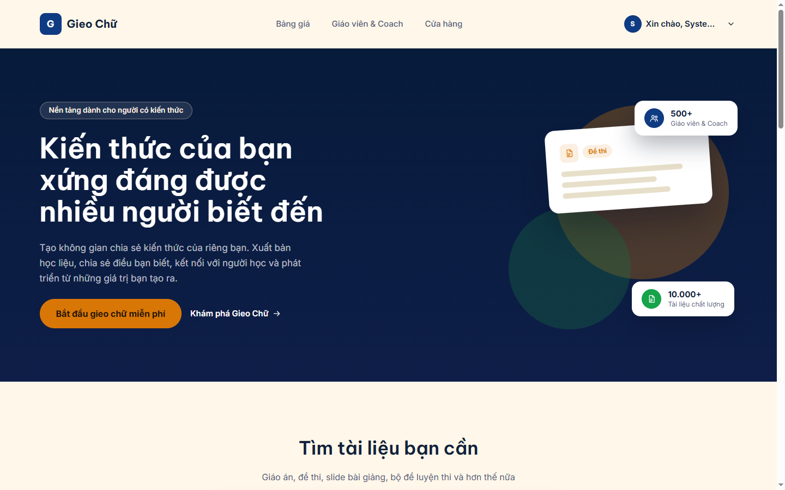
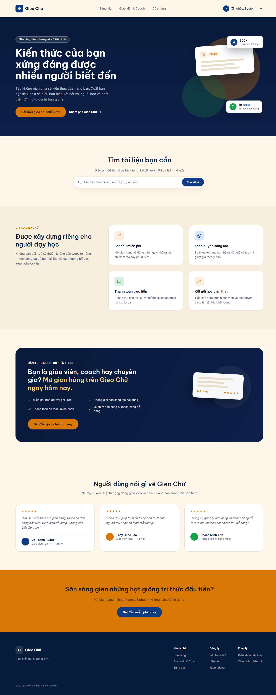
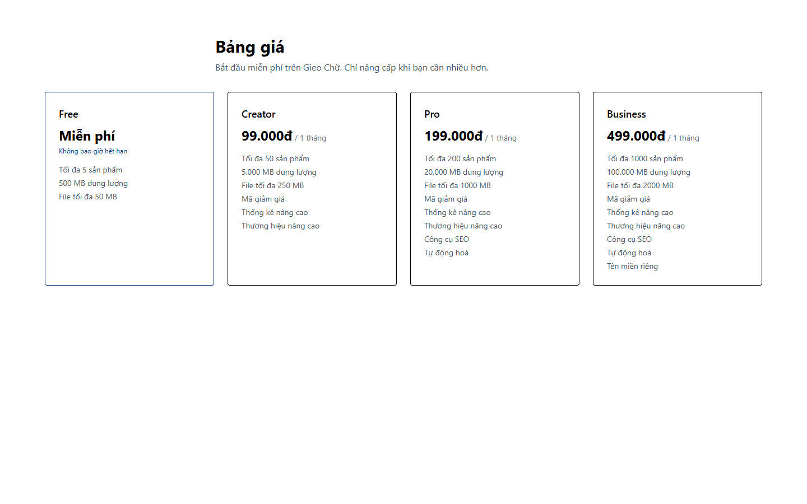
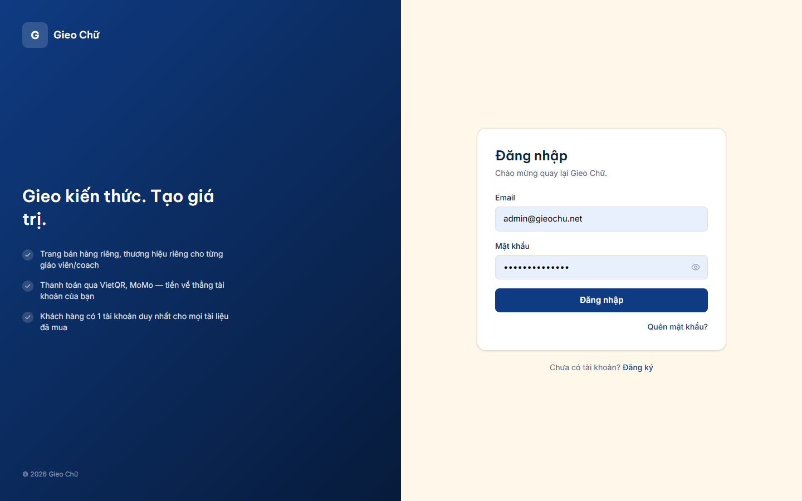
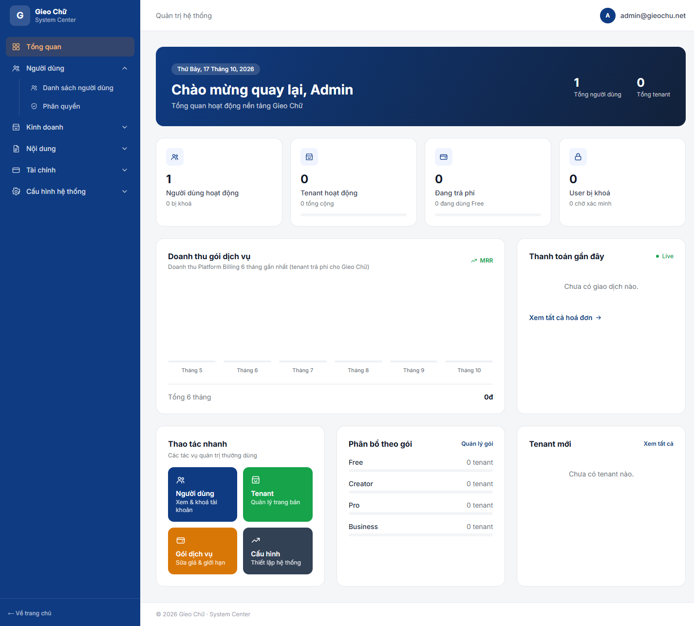
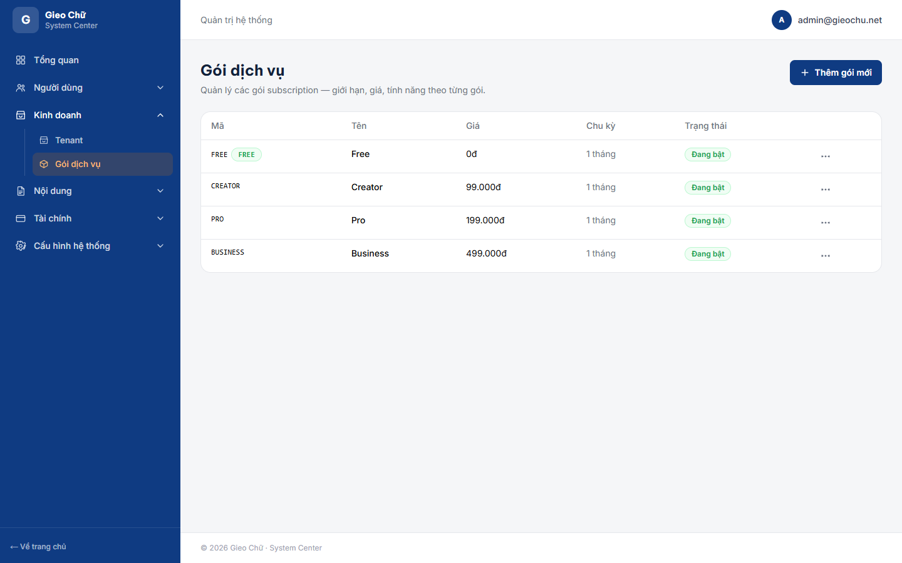
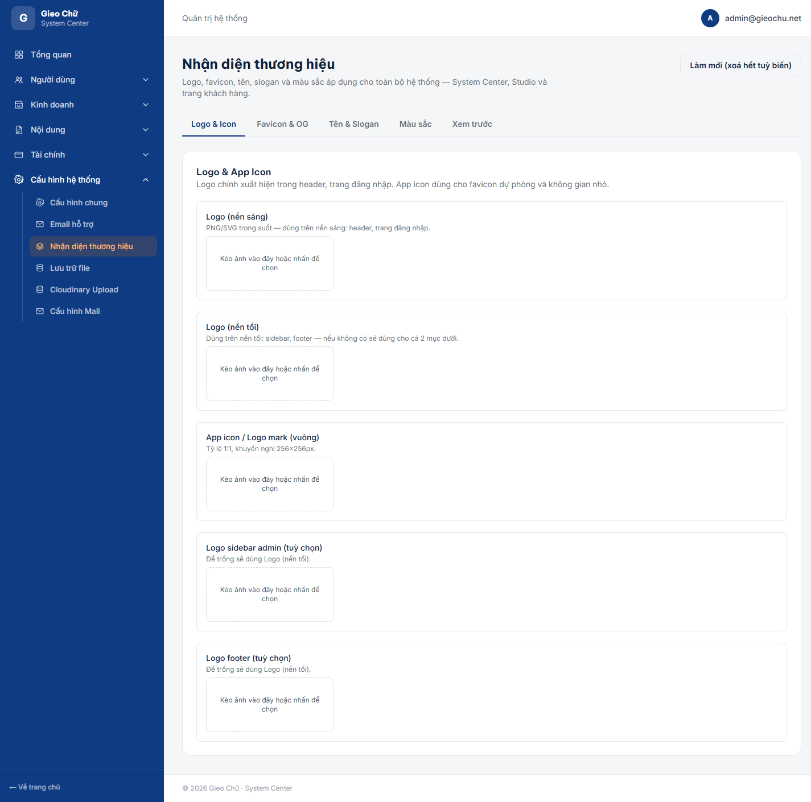
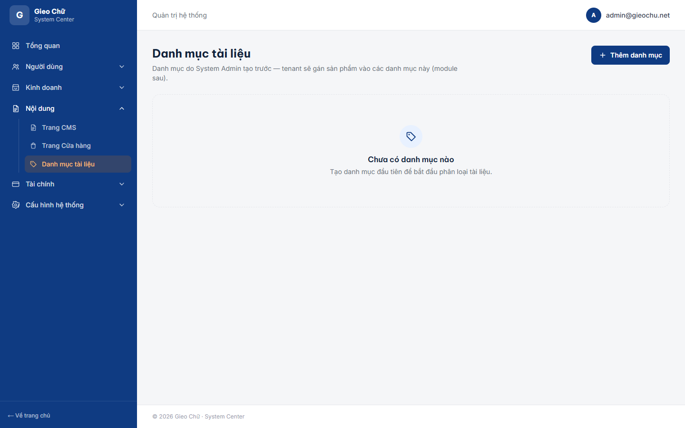

# 📚 CẨM NANG HƯỚNG DẪN SỬ DỤNG HỆ THỐNG GIEO CHỮ

> **Gieo Chữ** — Nền tảng thương mại điện tử chuyên biệt dành cho giáo viên, giảng viên, coach và người sáng tạo tri thức để xuất bản, kinh doanh và phân phối tài liệu số (giáo án, đề thi, slide bài giảng, ebook, template học tập).

---

## 📑 MỤC LỤC
1. [Tổng Quan Nền Tảng](#1-tổng-quan-nền-tảng)
2. [Hướng Dẫn Dành Cho Người Mua / Học Viên](#2-hướng-dẫn-dành-cho-người-mua--học-viên)
3. [Hướng Dẫn Dành Cho Giáo Viên / Người Bán (Gian Hàng & Studio)](#3-hướng-dẫn-dành-cho-giáo-viên--người-bán-gian-hàng--studio)
4. [Hướng Dẫn Dành Cho Quản Trị Viên (System Center)](#4-hướng-dẫn-dành-cho-quản-trị-viên-system-center)
5. [Các Câu Hỏi Thường Gặp & Xử Lý Sự Cố](#5-các-câu-hỏi-thường-gặp--xử-lý-sự-cố)

---

## 1. TỔNG QUAN NỀN TẢNG

Hệ thống Gieo Chữ được xây dựng theo mô hình **Multi-Tenant chuyên biệt**:
- **Trang chủ & Sàn học liệu chung (Marketplace):** Nơi tổng hợp các tài liệu nổi bật, giáo viên tiêu biểu và danh mục tài liệu để học viên tìm kiếm.
- **Trang gian hàng riêng (Storefront):** Mỗi giáo viên sở hữu một đường dẫn riêng biệt (ví dụ: `https://gieochu.net/thayquoc`) với thương hiệu và học liệu của riêng mình.
- **Xưởng sáng tạo (Tenant Studio):** Phân hệ dành riêng cho giáo viên để quản lý toàn bộ học liệu, đơn hàng, khách hàng, mã giảm giá và báo cáo doanh thu.
- **Trung tâm điều hành (System Center):** Phân hệ quản trị tối cao của nền tảng dành cho System Admin để kiểm soát gói thuê bao, danh mục, cấu hình hạ tầng và thương hiệu hệ thống.

*Hình 1.1: Giao diện Trang chủ nền tảng Gieo Chữ*

*Hình 1.2: Toàn cảnh cấu trúc Trang chủ (Hero, Thống kê, Tìm kiếm, Lợi ích, Đánh giá)*

---

## 2. HƯỚNG DẪN DÀNH CHO NGƯỜI MUA / HỌC VIÊN

### 2.1. Tìm kiếm và Lựa chọn Học liệu
1. Truy cập Trang chủ hoặc chuyên trang **Cửa hàng** (`/cua-hang`).
2. Sử dụng thanh tìm kiếm thông minh: Có thể gõ từ khóa tiếng Việt có dấu hoặc không dấu (nhờ công nghệ `unaccent search`).
3. Lọc học liệu theo danh mục (Toán, Ngữ văn, Tiếng Anh, Kỹ năng mềm...), theo loại tài liệu (Đề thi, Slide bài giảng, Sách điện tử Ebook...) hoặc mức giá (Miễn phí, Đang ưu đãi).

### 2.2. Đặt hàng và Thanh toán
1. Nhấp vào tài liệu cần mua để xem nội dung chi tiết, mục lục xem trước và các đánh giá từ người mua trước.
2. Nhấn nút **"Mua ngay"** hoặc **"Nhận miễn phí"**:
   - Nếu là tài liệu **0đ (Miễn phí):** Hệ thống lập tức hoàn tất đơn hàng và chuyển tài liệu vào Thư viện của bạn ngay lập tức.
   - Nếu là tài liệu **Có phí:** Hệ thống chuyển sang màn hình Thanh toán với mã đơn hàng duy nhất.
3. Thanh toán tiện lợi qua **Mã VietQR**:
   - Mở ứng dụng ngân hàng bất kỳ (Vietcombank, MB Bank, Techcombank...) hoặc ví điện tử.
   - Quét mã QR hiển thị trên màn hình. Nội dung chuyển khoản và số tiền chính xác được tự động điền sẵn.
   - Sau khi chuyển khoản thành công, hệ thống tự động kích hoạt quyền sở hữu tài liệu cho bạn.

### 2.3. Quản lý Thư viện Học liệu & Tải file (`/account/library`)
1. Đăng nhập vào tài khoản và truy cập mục **Thư viện tài liệu** (`/account/library`).
2. Tại đây lưu trữ vĩnh viễn toàn bộ các tài liệu số bạn đã từng mua hoặc nhận miễn phí.
3. Nhấp vào nút **Tải xuống**:
   - Link tải file được mã hóa bảo mật (Presigned URL) có hiệu lực 10 phút để chống chia sẻ trái phép.
   - Nếu tài liệu là liên kết lưu trữ ngoài (Google Drive, Notion...), nút liên kết sẽ mở trực tiếp thư mục cấp quyền.

### 2.4. Đánh giá & Phản hồi (Reviews)
1. Sau khi đã sở hữu và xem học liệu, tại trang chi tiết sản phẩm sẽ xuất hiện form **Đánh giá học liệu**.
2. Chọn số sao từ 1 đến 5 sao và viết nhận xét chi tiết để giúp giáo viên hoàn thiện học liệu cũng như hỗ trợ các học viên khác lựa chọn.

---

## 3. HƯỚNG DẪN DÀNH CHO GIÁO VIÊN / NGƯỜI BÁN (GIAN HÀNG & STUDIO)

### 3.1. Đăng ký & Mở Gian hàng Mới
1. Nhấp vào nút **"Bắt đầu miễn phí"** trên trang chủ hoặc truy cập `/register`.
2. Điền thông tin cá nhân (Họ tên, Email, Mật khẩu) và **Tên định danh gian hàng (Tenant Slug)**:
   - Slug này sẽ trở thành đường dẫn gian hàng của bạn (Ví dụ: đặt slug là `toanthaynam` thì link gian hàng là `gieochu.net/toanthaynam`).
3. Mặc định mọi gian hàng mới đều được kích hoạt **Gói Free vĩnh viễn** — không mất phí duy trì, không cần thẻ tín dụng, có thể đăng bán ngay tối đa 5 học liệu.

*Hình 3.1: Bảng giá các gói tài khoản dành cho người bán (Free, Creator, Pro, Business)*

### 3.2. Quản lý Học liệu Số trong Studio (`/studio/[tenantSlug]/products`)
1. Truy cập **Studio** của bạn tại `/studio/[tenantSlug]`.
2. Chọn menu **Sản phẩm** › **Thêm sản phẩm mới**:
   - **Thông tin cơ bản:** Tiêu đề học liệu, tóm tắt ngắn, mô tả chi tiết bằng trình soạn thảo Rich Text (hỗ trợ định dạng, chèn ảnh, đề mục).
   - **Phân loại & Định dạng:** Chọn danh mục môn học, chọn định dạng (Đề thi `EXAM`, Slide `SLIDE`, Sách điện tử `EBOOK`, Template `TEMPLATE`...).
   - **Tải lên File tài liệu:** Tải trực tiếp file gốc (PDF, Word, PowerPoint, ZIP) lên kho bảo mật riêng của hệ thống HOẶC đính kèm liên kết ngoài (Google Drive, Dropbox, Canva...).
   - **Ảnh bìa học liệu:** Tải lên ảnh bìa đại diện để thu hút người học.
   - **Chính sách giá:** Đặt đơn giá VND (số nguyên), thiết lập giá khuyến mãi kèm số ngày ưu đãi (Flash Sale).
3. Sau khi hoàn thành, nhấn **Xuất bản (Publish)** để tài liệu hiển thị ngay lập tức trên gian hàng của bạn.

### 3.3. Quản lý Đơn hàng & Doanh thu (`/studio/[tenantSlug]/orders`)
- Xem danh sách toàn bộ đơn hàng phát sinh trên gian hàng theo thời gian thực.
- Theo dõi trạng thái đơn hàng (`PENDING` - Chờ thanh toán, `FULFILLED` - Đã hoàn tất, `CANCELLED` - Đã hủy).
- Đối với các đơn thanh toán chuyển khoản thủ công, giáo viên có thể xác nhận đơn hàng bằng nút **"Xác nhận đã thanh toán"** kèm ghi chú đối soát.

### 3.4. Quản lý Mã giảm giá (Coupons) (`/studio/[tenantSlug]/coupons`)
- Tạo các chương trình khuyến mãi riêng cho học viên của bạn.
- Thiết lập: Giảm theo phần trăm (%) hoặc giảm số tiền cố định (VND).
- Giới hạn số lượt sử dụng tối đa và đặt thời hạn hiệu lực của mã giảm giá.

### 3.5. Tùy biến Giao diện Gian hàng (Storefront CMS)
- Thiết lập ảnh đại diện, ảnh bìa gian hàng, lời giới thiệu bản thân và thông điệp chào mừng học viên.
- Cấu hình thông tin tài khoản ngân hàng nhận tiền thanh toán trực tiếp từ học viên (không qua trung gian giữ tiền).

---

## 4. HƯỚNG DẪN DÀNH CHO QUẢN TRỊ VIÊN (SYSTEM CENTER)

Phân hệ **System Center** (`/admin`) chỉ dành cho người dùng có vai trò **SYSTEM_ADMIN** để vận hành toàn bộ hạ tầng nền tảng.

### 4.1. Đăng nhập Quản trị
Truy cập `/login` và đăng nhập bằng tài khoản Quản trị hệ thống:
- Mặc định: `admin@gieochu.net`
- Mật khẩu: *(Khởi tạo qua biến môi trường `SEED_ADMIN_PASSWORD`)*

*Hình 4.1: Màn hình Đăng nhập hệ thống bảo mật*

### 4.2. Bảng điều khiển Tổng quan (`/admin`)
Bảng điều khiển cung cấp cái nhìn toàn diện về hoạt động của toàn sàn:
- Tổng số lượng Gian hàng đang hoạt động (`Active Tenants`).
- Tổng số lượng Học liệu đã xuất bản (`Published Products`).
- Tổng số giao dịch đơn hàng và doanh thu toàn sàn.
- Biểu đồ tăng trưởng và các thông báo hệ thống quan trọng.

*Hình 4.2: Giao diện Bảng điều khiển Trung tâm Quản trị (System Center Dashboard)*

### 4.3. Quản lý Gói Dịch vụ Đăng ký (`/admin/plans`)
Quản trị viên có toàn quyền cấu hình các gói dịch vụ dành cho người bán theo mô hình **Hybrid Monetization (ADR-021)**:
- **Gói FREE (0đ):** Gói mặc định vĩnh viễn khi mở gian hàng (tối đa 5 sản phẩm, 500MB lưu trữ).
- **Gói CREATOR (99.000đ/tháng):** Tối đa 50 sản phẩm, 5GB lưu trữ, hỗ trợ mã giảm giá và báo cáo nâng cao.
- **Gói PRO (199.000đ/tháng):** Tối đa 200 sản phẩm, 20GB lưu trữ, công cụ SEO và tự động hóa.
- **Gói BUSINESS (499.000đ/tháng):** 1.000 sản phẩm, 100GB lưu trữ, tùy biến tên miền riêng (Custom Domain).

Admin có thể chỉnh sửa giá tiền, hạn mức dung lượng, số lượng sản phẩm hoặc kích hoạt/vô hiệu hóa bất kỳ gói dịch vụ nào.

*Hình 4.3: Màn hình Quản lý các gói thuê bao dịch vụ nền tảng*

### 4.4. Cài đặt Nhận diện Thương hiệu (`/admin/settings/branding`)
Hệ thống cho phép cấu hình thương hiệu trực tiếp từ giao diện quản trị mà không cần sửa code (theo **ADR-032**):
- **Tên nền tảng & Câu khẩu hiệu (Slogan):** Hiển thị trên thanh tiêu đề và chân trang.
- **Logo hệ thống:** Hỗ trợ tải lên Logo bản sáng (Light mode), bản tối (Dark mode), Logo vuông (Square), Logo thanh bên (Sidebar) và Logo chân trang (Footer).
- **Favicon & Ảnh chia sẻ mạng xã hội (OpenGraph Image).**
- **Bảng màu chủ đạo:** Tùy biến mã màu thương hiệu chính (`Primary Color`), màu nhấn (`Accent Color`).

*Hình 4.4: Màn hình Cài đặt Nhận diện Thương hiệu (Branding Settings)*

### 4.5. Quản lý Danh mục Học liệu (`/admin/categories`)
Quản lý cây danh mục tài liệu phân phối trên toàn sàn:
- Thêm mới danh mục: Đặt tên môn học/ngành học (Toán học, Văn học, Luyện thi IELTS, Thiết kế đồ họa...).
- Cấu hình đường dẫn tĩnh (Slug), mô tả danh mục và ảnh minh họa đại diện.
- Bật/tắt trạng thái hoạt động (`isActive`) của danh mục.

*Hình 4.5: Màn hình Quản lý Danh mục Tài liệu toàn hệ thống*

### 4.6. Cấu hình Hạ tầng Hệ thống (`/admin/settings`)

#### 4.6.1. Cấu hình Lưu trữ Đa Nền tảng (Dual Storage: Cloudflare R2 & MinIO Self-hosted)
Truy cập `/admin/settings/storage`: Hệ thống hỗ trợ song song hai nhà cung cấp lưu trữ tệp tin S3-compatible (theo **ADR-038**):
- **Cloudflare R2:** Dịch vụ lưu trữ đám mây toàn cầu, không tính phí băng thông tải về (Zero Egress). Nhập `Endpoint`, `Region`, `Access Key ID`, `Secret Access Key` và hai bucket hệ thống (`bucketPrivate`, `bucketPublic`).
- **MinIO Self-hosted:** Giải pháp lưu trữ đối tượng tự quản lý trên máy chủ riêng (VPS / On-premise) tương thích 100% chuẩn S3 API:
  + **Host:** Tên miền (vd: `s3.gieochu.net`) hoặc Địa chỉ IP máy chủ (vd: `103.142.26.15`).
  + **Port:** Cổng dịch vụ API (mặc định: `9000` với kết nối trực tiếp, hoặc `443` khi qua Reverse Proxy HTTPS).
  + **Cơ chế useSSL:** Bật khi sử dụng HTTPS với tên miền; Tắt khi sử dụng HTTP với địa chỉ IP nội bộ.
  + **Tiền tố Bucket (Bucket Prefix):** Tiền tố tự động gán cho bucket (mặc định: `gc-`).
  + **Giới hạn kích thước tải lên (Max Upload MB):** Hạn mức dung lượng tối đa cho 1 file tải lên (vd: `500` MB).
- **Nhà cung cấp Chính (Active Provider):** Quản trị viên chọn `CLOUDFLARE_R2` hoặc `MINIO` làm nơi tiếp nhận các tệp tải lên mới.
- **Bảo mật tuyệt đối:** Toàn bộ `Access Key ID` và `Secret Access Key` được mã hóa AES-256-GCM trong cơ sở dữ liệu bằng khóa riêng `STORAGE_ENCRYPTION_KEY`. Nút **"Kiểm tra kết nối"** thực hiện lệnh `HeadBucket` thực tế để xác thực kết nối trước khi lưu.

#### 4.6.2. Quản lý & Giám sát Bucket Riêng của Gian hàng (`/admin/settings/storage/buckets`)
Hệ thống áp dụng mô hình **Dedicated Bucket** — mỗi gian hàng (Tenant) sở hữu một bucket độc lập dạng `gc-{12 ký tự đầu tenantId}`:
- **Theo dõi thời gian thực:**
  + Tên gian hàng, mã định danh (Slug) và trạng thái hoạt động.
  + Tên Bucket riêng và Nhà cung cấp đang lưu trữ (`CLOUDFLARE_R2` hoặc `MINIO`).
  + Số lượng tệp tin đang lưu trữ (`fileCount`).
  + Dung lượng thực tế sử dụng (`storageUsedBytes`) so với Hạn mức gói thuê bao (`Plan.storageMb`).
  + Thanh tỷ lệ phần trăm dung lượng kèm mã màu cảnh báo trực quan: Xanh lá (< 75%), Vàng/Cam (75–90%), Đỏ (> 90% hoặc chạm ngưỡng).
- **Hành động quản trị:**
  + **Kiểm tra bucket:** Xác minh sự tồn tại vật lý và quyền truy cập của bucket trên cụm lưu trữ S3/MinIO.
  + **Khởi tạo bucket:** Cấp phát chủ động bucket riêng cho các gian hàng cũ mà không cần chờ lượt tải lên đầu tiên (cơ chế Lazy Provisioning).

#### 4.6.3. Công cụ Quản trị Đồng bộ Dữ liệu (Storage Sync Engine) (`/admin/settings/storage/sync`)
Cho phép Quản trị viên chuyển dịch tệp học liệu an toàn giữa Cloudflare R2 và MinIO:
- **Chiều đồng bộ:** Hỗ trợ hai chiều `R2 -> MinIO` hoặc `MinIO -> R2`.
- **Cơ chế Stream Copy (Zero-RAM / Zero-Disk):** Đọc trực tiếp luồng stream từ nhà cung cấp nguồn truyền sang nhà cung cấp đích, không nạp tệp vào bộ nhớ RAM máy chủ web Next.js và không tạo file tạm trên ổ cứng, đảm bảo an toàn tuyệt đối ngay cả với tệp dung lượng lớn.
- **Bộ lọc linh hoạt:** Có thể chọn đồng bộ toàn bộ hệ thống hoặc chỉ định một `tenantId` cụ thể, kèm số lượng tệp giới hạn cho mỗi lượt (`limit`).
- **Tự động cập nhật:** Sau khi xác nhận truyền stream thành công bằng ETag và Content-Length, hệ thống tự động cập nhật bản ghi `ProductFile.storageBucket` và `ProductFile.storageProvider` sang nền tảng mới.

#### 4.6.4. Các Cấu hình Hạ tầng Khác
- **Cấu hình SMTP Email (`/admin/settings/smtp`):** Cấu hình máy chủ gửi email xác thực tài khoản, thông báo kích hoạt đơn hàng và link tải tài liệu.
- **Cấu hình Hình ảnh Cloudinary (`/admin/settings/cloudinary`):** Quản lý lưu trữ ảnh bìa sản phẩm, ảnh storefront và ảnh bài viết.
- **Cấu hình Chung (`/admin/settings/general`):** Thiết lập thời hạn của token tải file (mặc định 10 phút / 600 giây theo §7.6), thời gian hết hạn đơn hàng chờ chuyển khoản, số ngày dùng thử và ân hạn gói.

---

## 5. CÁC CÂU HỎI THƯỜNG GẶP & XỬ LÝ SỰ CỐ

| Vấn đề thường gặp | Nguyên nhân | Hướng dẫn xử lý |
|---|---|---|
| **Không tải được file tài liệu sau khi mua** | Link tải đã quá thời hạn 10 phút | Vào lại `/account/library`, nhấn lại nút **"Tải xuống"** để hệ thống cấp mới đường dẫn bảo mật. |
| **Đơn hàng chuyển khoản chưa thấy kích hoạt** | Sai cú pháp mã đơn hàng khi chuyển khoản ngân hàng | Chụp ảnh biên lai giao dịch, liên hệ với giáo viên chủ gian hàng hoặc gửi email hỗ trợ để admin xác nhận thủ công trong Studio. |
| **Bị giới hạn số lượng sản phẩm tải lên** | Gian hàng đã đạt hạn mức của gói dịch vụ hiện tại | Vào mục `/studio/[tenantSlug]/billing` để nâng cấp lên gói cao hơn (Creator / Pro / Business). |
| **Lỗi tải file dung lượng lớn** | Dung lượng file vượt quá giới hạn đơn lẻ của gói dịch vụ | Nén file hoặc tải lên dịch vụ lưu trữ đám mây ngoài (Google Drive) rồi dán liên kết vào phần "Tài liệu ngoài" của sản phẩm. |

---
*Tài liệu được biên soạn và bảo trì bởi Đội ngũ Kỹ thuật Gieo Chữ.*
