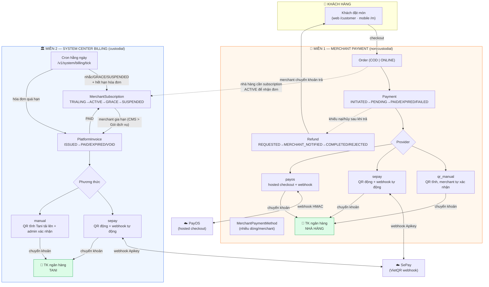
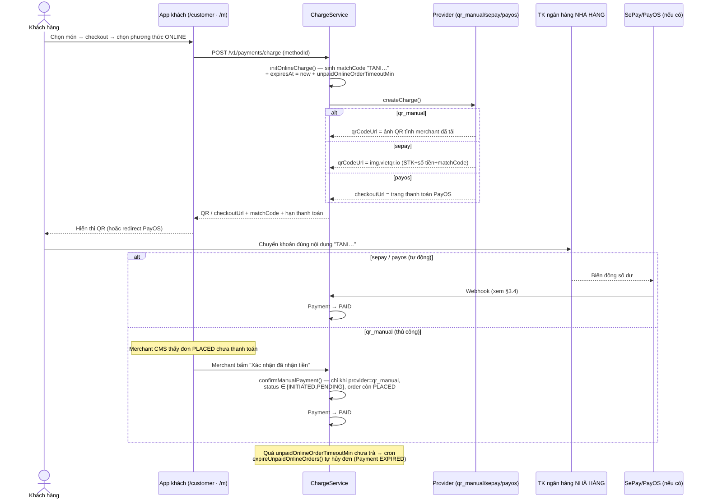
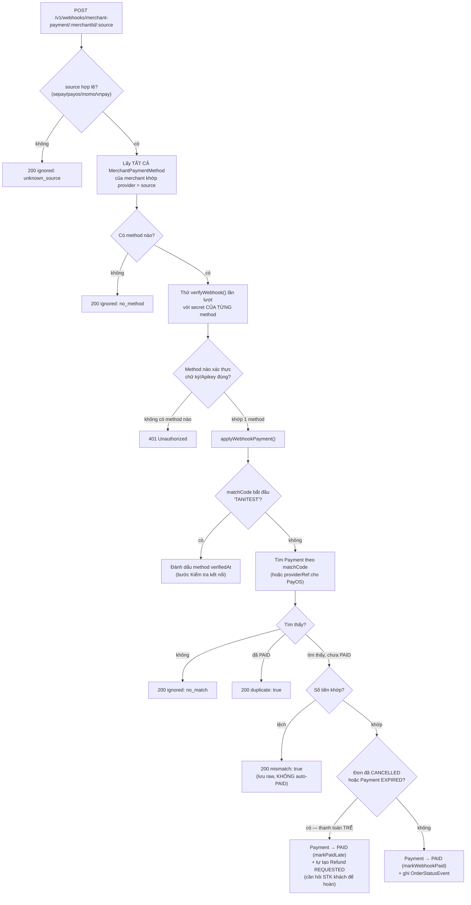
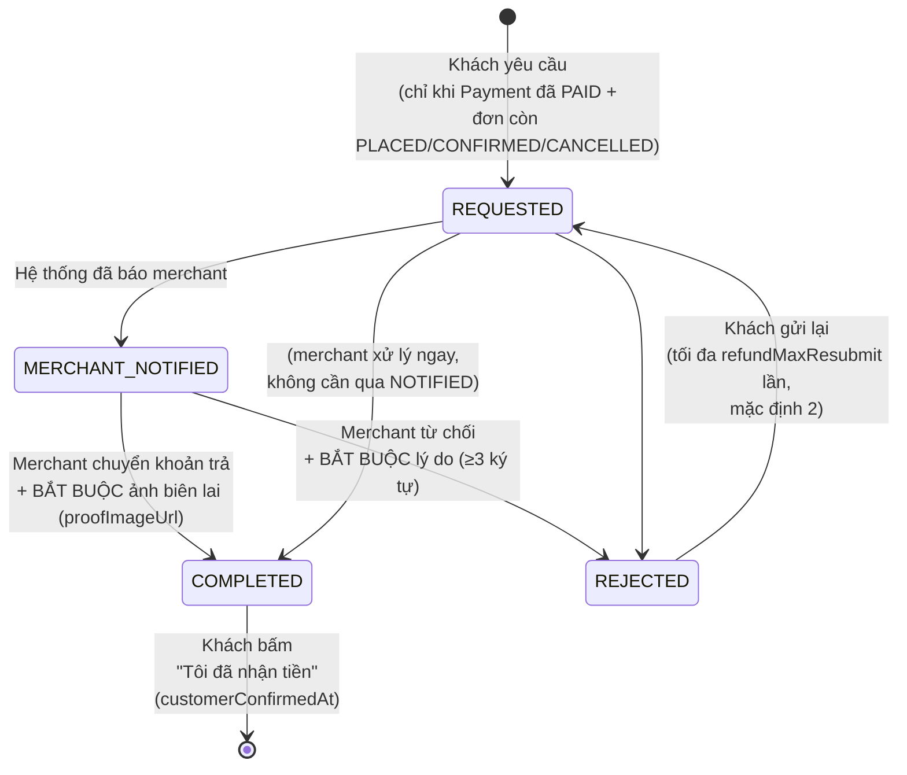
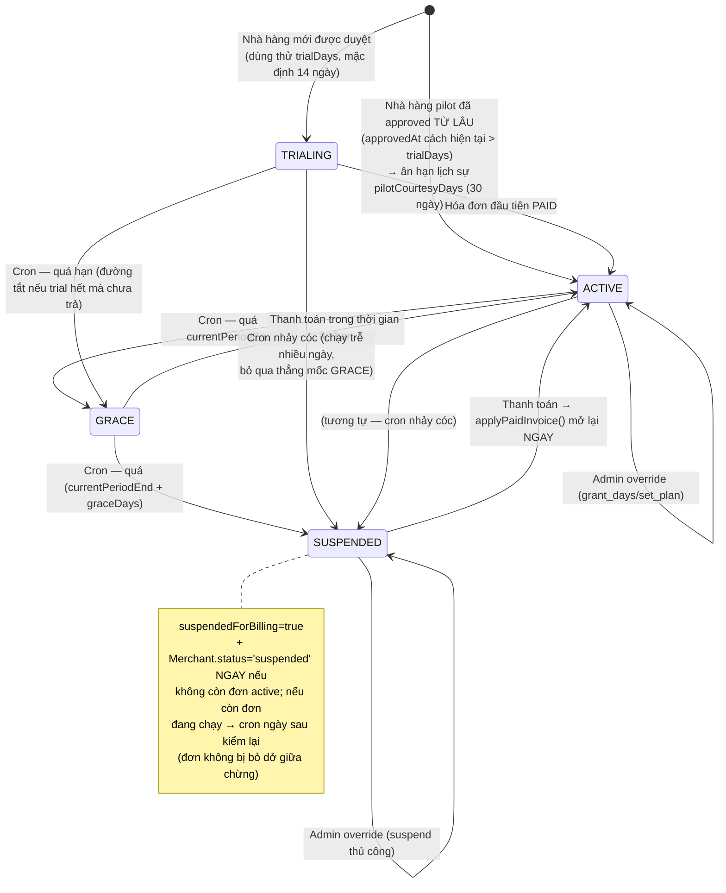
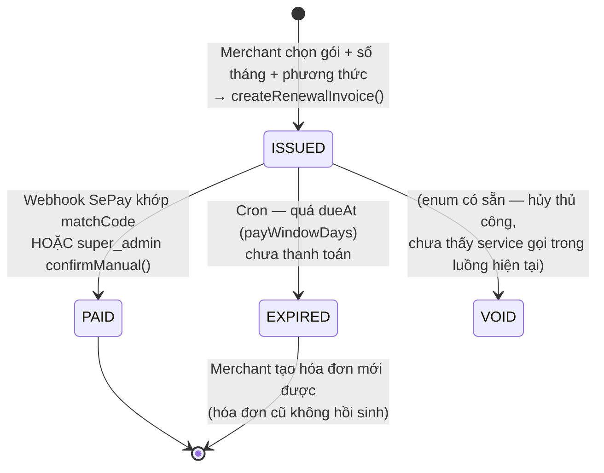
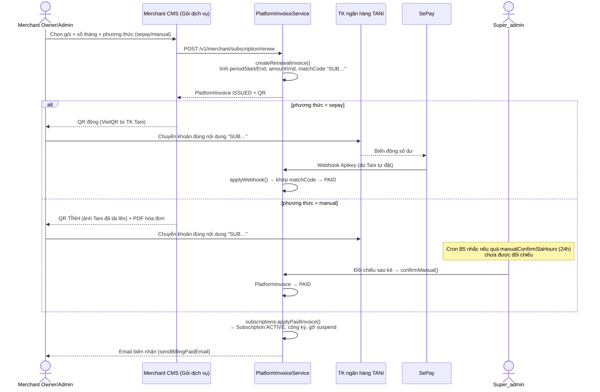
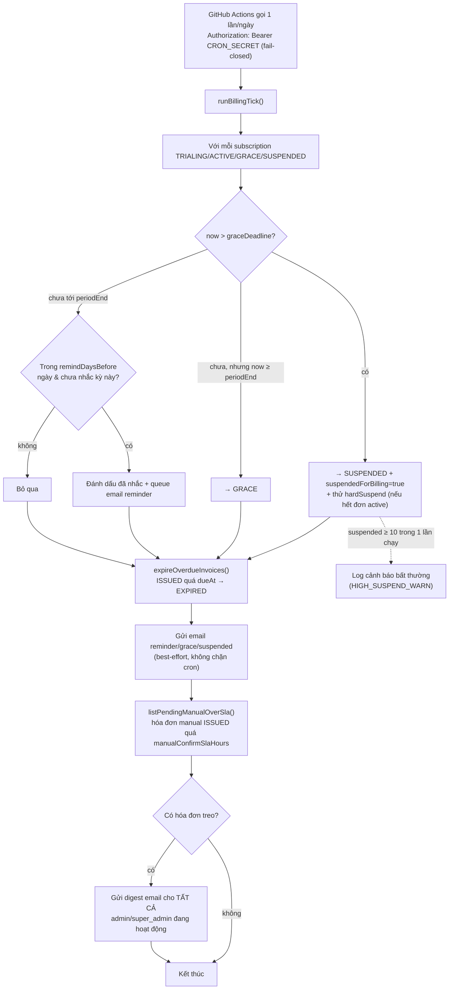

# Báo cáo kỹ thuật — Module Payment (System Center + Merchant)

> **Ngày:** 2026-09-18 · **Loại:** Báo cáo kỹ thuật chi tiết (verify trực tiếp trong code, không suy đoán).
> **Phạm vi:** Toàn bộ dòng tiền trong hệ thống TaniGos — cả 2 miền: **Merchant Payment** (khách ↔ nhà hàng, non-custodial) và **System Center Billing** (nhà hàng ↔ Tani, custodial phí SaaS).
> **Nguồn:** `prisma/schema.prisma`, `apps/web/lib/server/services/merchant-payment/**`, `apps/web/lib/server/services/system-billing/**`, `apps/web/app/api/v1/{payments,webhooks,merchant,admin,system}/**`, `apps/web/components/merchant/panels/{payments-panel,subscription-panel}.tsx`.
> Tài liệu kế hoạch gốc (bối cảnh quyết định): `plan/11-payment-per-merchant.md`, `plan/11a–11d`, `plan/12-system-center-billing.md`.

---

## 1. Nguyên tắc kiến trúc — 2 miền tách biệt hoàn toàn

TaniGos có **2 dòng tiền độc lập, không giao nhau**, cố ý tách bằng model, bảng, webhook, mã đối soát và cả trang cấu hình riêng:

| | **Merchant Payment** (§3) | **System Center Billing** (§4) |
|---|---|---|
| Tiền của ai → tài khoản ai | **Khách hàng → tài khoản ngân hàng của Nhà hàng** | **Nhà hàng → tài khoản ngân hàng của Tani** |
| Bản chất | **Non-custodial** — Tani không giữ tiền, chỉ điều phối trạng thái đơn | **Custodial** — Tani thực sự nhận phí thuê bao phần mềm |
| Việc mua bán | Khách mua món ăn | Nhà hàng mua quyền sử dụng nền tảng (gói Starter/Growth/Enterprise) |
| Model chính | `Payment`, `MerchantPaymentMethod`, `MerchantPaymentConfig`, `MerchantSecret`, `Refund` | `MerchantSubscription`, `PlatformInvoice` |
| Mã đối soát | `TANI` + 8 ký tự (vd. `TANIF8QK2M1R`) | `SUB` (hoặc prefix tùy chỉnh) + 8 ký tự (vd. `SUBF4H3JZW5`) |
| Webhook | `POST /v1/webhooks/merchant-payment/:merchantId/:source` | `POST /v1/webhooks/system-billing/sepay` |
| Cấu hình bởi | Từng **Merchant Owner/Admin** (số TK **của chính họ**) | **Super_admin** (số TK **của Tani**) |
| Trang cấu hình | Merchant CMS → **Thanh toán** (`payments-panel.tsx`) | System Center → **Gói dịch vụ SaaS → Tài khoản thu phí** (`admin/billing/payment`) |
| Trang khách hàng dùng | Merchant CMS → **Gói dịch vụ** (`subscription-panel.tsx`) | — |

Nguyên tắc này được chốt tường minh trong `plan/00-quyet-dinh-payment-out-of-scope.md` và nhắc lại trong code (`types.ts` của cả 2 module): *"Dòng tiền đi THẲNG về tài khoản ngân hàng của Merchant Owner (non-custodial). Tani chỉ điều phối trạng thái đơn."*

---

## 2. Sơ đồ tổng thể hệ thống Payment

**Điểm mấu chốt của sơ đồ:** 2 miền chỉ chạm nhau ở **1 điểm logic duy nhất** — subscription phải `ACTIVE`/`TRIALING`/`GRACE` (chưa `SUSPENDED`) thì nhà hàng mới hiển thị và nhận đơn trên app khách. Ngoài điểm đó, không có bảng, service hay webhook nào dùng chung.

---

## 3. Miền 1 — Merchant Payment (thanh toán khách ↔ nhà hàng)

### 3.1. Data model

| Model | Vai trò | Trường đáng chú ý | Nguồn |
|---|---|---|---|
| `Payment` | 1 bản ghi thanh toán / đơn | `status` (`PaymentStatus`), `merchantId`, `matchCode` (unique), `qrCodeUrl`, `expiresAt`, `providerRef` (PayOS), `methodId`, `rawWebhookPayload` | `prisma/schema.prisma:687-717` |
| `MerchantPaymentMethod` | 1 dòng = 1 cổng thanh toán online merchant bật — **merchant có thể bật NHIỀU cùng lúc**, khách chọn ở checkout | `provider`, `enabled`, `bankBin/AccountNumber/AccountName`, `qrImageUrl` (qr_manual), `customerNote`, `verifiedAt`, `pendingTestCode` | `prisma/schema.prisma:721-744` |
| `MerchantPaymentConfig` | Cấu hình cấp merchant — từ P5 chỉ còn `codEnabled` (online đã chuyển hết sang `MerchantPaymentMethod`) | `codEnabled` | `prisma/schema.prisma:749-769` |
| `MerchantSecret` | Credential đã **mã hóa at-rest** (`lib/server/encrypt.ts`) — namespace theo `provider.methodId(.sub)` | `key`, `valueEncrypted` | `prisma/schema.prisma:772-782` |
| `Refund` | Yêu cầu hoàn tiền — luôn **thủ công** | `status` (`RefundStatus`), `customerBank*`, `proofImageUrl`, `resubmitCount`, `mode` (giữ chỗ cho tương lai, hiện luôn `manual`) | `prisma/schema.prisma:787-819` |

**Enum:**
- `PaymentStatus`: `INITIATED → PENDING → PAID | FAILED | REFUNDED | EXPIRED`
- `PaymentMethod` (chọn ở checkout): `COD | ONLINE`
- `RefundStatus`: `REQUESTED → MERCHANT_NOTIFIED → COMPLETED | REJECTED` (REJECTED có thể gửi lại → REQUESTED, tối đa `refundMaxResubmit` lần)

### 3.2. 5 provider — bảng năng lực

Định nghĩa tại `lib/server/services/merchant-payment/types.ts:46-84` (`PROVIDER_CAPABILITIES`):

| Provider | `checkoutKind` | Credential cần | Sẵn sàng | Cơ chế xác nhận |
|---|---|---|---|---|
| **`qr_manual`** | `qr` | Không có | ✅ | Merchant tải **ảnh QR tĩnh** (QR ngân hàng thật, giống ảnh "nhận tiền" trong app bank) → khách quét, **tự nhập** số tiền + nội dung → merchant tự bấm "Đã nhận tiền" cho từng đơn. **Không có webhook, không sinh QR động.** |
| **`sepay`** | `qr` | `apiKey` | ✅ | QR **động** sinh từ `img.vietqr.io` (kèm sẵn số tiền + nội dung theo đơn) → SePay gọi webhook khi tiền về → **tự động** chuyển `Payment` sang `PAID`. |
| **`payos`** | `hosted_redirect` | `clientId`, `apiKey`, `checksumKey` | ✅ | Trang thanh toán riêng của PayOS (redirect) → webhook HMAC-SHA256 tự xác nhận. Hoàn tiền **best-effort** qua API PayOS (endpoint chưa được PayOS công bố chính thức tại thời điểm code — `refund()` trả `{ok:false}` nếu cổng từ chối, không chặn hoàn tiền thủ công). |
| **`momo`** | `hosted_redirect` | `partnerCode`, `accessKey`, `secretKey` | ❌ khung | Cần pháp nhân doanh nghiệp + hợp đồng MoMo — **chưa tích hợp API thật**, bị chặn ở `updateMethod()` khi cố bật (`PROVIDER_NOT_READY`). |
| **`vnpay`** | `hosted_redirect` | `tmnCode`, `hashSecret` | ❌ khung | Tương tự — chưa tích hợp. |

**Điểm bảo mật quan trọng (đã chốt trong phiên làm việc trước):** `qr_manual` **không bao giờ** dùng mã BIN ngân hàng để tự sinh QR động thay thế — đây là quyết định cố ý (không ngân hàng nào cấp mã BIN công khai; QR tĩnh là ảnh merchant tự tải lên, giống hệt cách chuyển khoản thủ công thông thường qua ảnh QR "nhận tiền" của ngân hàng).

Factory chọn implementation theo `provider` key: `lib/server/services/merchant-payment/providers/index.ts:14-20`.

### 3.3. Luồng thanh toán của khách hàng

Nguồn: `charge.service.ts` — `initOnlineCharge()` (dòng 182-255), `confirmManualPayment()` (dòng 273-315), `expireUnpaidOnlineOrders()` (dòng 379-390).

**Idempotent theo thiết kế:** gọi lại `initOnlineCharge` khi đã có `matchCode`/`expiresAt` sẽ **tái sử dụng** giá trị cũ thay vì sinh mới (dòng 217-220) — tránh đổi mã QR giữa chừng nếu khách back rồi mở lại màn thanh toán.

### 3.4. Luồng webhook (SePay / PayOS)

Nguồn: route `app/api/v1/webhooks/merchant-payment/[merchantId]/[provider]/route.ts`, logic `applyWebhookPayment()` trong `charge.service.ts:321-376`.

**Thiết kế đáng chú ý:**
- **1 merchant có thể có nhiều `MerchantPaymentMethod` cùng nhận webhook từ 1 nguồn** (ví dụ 2 cổng `sepay` khác STK) — route thử xác thực **lần lượt** bằng secret của từng method thay vì giả định chỉ có 1.
- **Nhánh hợp lệ luôn trả HTTP 200** (kể cả `ignored`/`mismatch`) — chỉ khi **không method nào xác thực được chữ ký** mới trả `401`. Đây là để tránh SePay/PayOS retry vô hạn khi lỗi chỉ là "không khớp dữ liệu" chứ không phải lỗi xác thực.
- **Thanh toán trễ** (khách chuyển khoản sau khi đơn đã bị hủy/hết hạn) không bị bỏ qua — hệ thống vẫn ghi nhận `PAID` rồi **tự động tạo yêu cầu hoàn tiền** để không mất dấu vết dòng tiền.

### 3.5. Luồng hoàn tiền — luôn thủ công

Nguồn: `refund.service.ts` — `requestRefund()` (dòng 126-217), `completeRefund()` (230-256), `rejectRefund()` (259-279), `customerConfirmReceipt()` (282-294).

- **`amount` luôn = giá trị đơn** — hoàn toàn bộ, không hoàn một phần.
- **Phí chuyển khoản khi hoàn do khách chịu** (business rule ghi rõ trong comment code).
- Trường `mode`/`providerRefundRef` đã có sẵn trong schema cho **hoàn tiền tự động qua API cổng trong tương lai**, nhưng **hiện tại service không bao giờ gọi** (`refund.service.ts` dòng 214-216: *"Hoàn tiền LUÔN thủ công... tránh lạm dụng + lỗi hệ thống"*) — kể cả PayOS có `refund()` implement sẵn, cũng chưa được `RefundService` gọi tới.

### 3.6. Chính sách hệ thống (`merchant_payment_policy`)

Super_admin cấu hình tại **System Center → Cấu hình hệ thống → Chính sách thanh toán** (`admin/settings/payment-policy`), áp dụng **chung cho mọi merchant**:

| Tham số | Mặc định | Giới hạn | Ý nghĩa |
|---|---|---|---|
| `unpaidOnlineOrderTimeoutMin` | 15 phút | 3–120 | Đơn ONLINE chưa trả quá hạn → tự hủy |
| `manualPaymentReminderMin` | 5 phút | 1–60 | Nhắc merchant xác nhận `qr_manual` |
| `refundReminderHours` | 24 giờ | 1–168 | Nhắc merchant xử lý yêu cầu hoàn tiền |
| `refundMaxResubmit` | 2 lần | 0–10 | Số lần khách gửi lại sau khi bị từ chối |

Nguồn: `policy.service.ts:12-24`.

### 3.7. API routes chính

| Route | Vai trò |
|---|---|
| `POST /v1/payments/charge` | Khách mở màn thanh toán (`initOnlineCharge`) |
| `GET /v1/payments/status/:orderId` | Khách poll trạng thái |
| `POST /v1/orders/:id/confirm-manual-payment` | Merchant xác nhận `qr_manual` |
| `POST /v1/webhooks/merchant-payment/:merchantId/:source` | Webhook SePay/PayOS per-merchant |
| `GET/POST/PATCH/DELETE /v1/merchant/payment-methods[/:id]` | CRUD phương thức thanh toán (CMS) |
| `POST /v1/merchant/payment-methods/:id/test` | "Kiểm tra kết nối" SePay/PayOS |
| `GET/PATCH /v1/merchant/payment-config` | Bật/tắt COD |
| `GET /v1/merchant/payment-report` | Báo cáo đối soát (chỉ dữ liệu Tani có sẵn — **không thay thế sao kê ngân hàng**, `report.service.ts:1-4`) |
| `GET/PATCH /v1/system/payment-policy` | Super_admin cấu hình policy |
| `GET /v1/restaurants/:id/payment-methods` | Public — danh sách phương thức online khả dụng cho 1 nhà hàng |

### 3.8. Giao diện

- **Merchant CMS → Thanh toán** (`components/merchant/panels/payments-panel.tsx`): danh sách phương thức đã bật, form thêm/sửa từng provider (ẩn/hiện trường theo `isQrManual`/`isSepay`/`isPayos`), nút "Kiểm tra kết nối" hiển thị QR test + mã webhook, toggle bật/tắt COD.
- **System Center → Chính sách thanh toán**: chỉnh 4 tham số policy ở §3.6.

---

## 4. Miền 2 — System Center Billing (phí thuê bao SaaS)

### 4.1. Data model

| Model | Vai trò | Trường đáng chú ý | Nguồn |
|---|---|---|---|
| `MerchantSubscription` | 1 subscription / merchant (unique) | `planKey`, `status` (`SubscriptionStatus`), `currentPeriodStart/End`, `trialEndsAt`, `suspendedForBilling`, `remindedForPeriodEnd` | `prisma/schema.prisma:1121-1139` |
| `PlatformInvoice` | 1 hóa đơn phí SaaS / lần gia hạn | `status` (`PlatformInvoiceStatus`), `paymentMethod` (`sepay`/`manual`), `matchCode` (unique, prefix `SUB`), `sepayRef`, `confirmedByUserId`, `confirmNote` | `prisma/schema.prisma:1141-1169` |

Cấu hình lưu trong `SystemIntegrationSetting` (key-value JSON, KHÔNG phải bảng riêng):
- Key **`system_billing`** — 3 gói (Starter/Growth/Enterprise) + policy vận hành.
- Key **`system_payment`** — TK ngân hàng Tani + bật/tắt 2 phương thức thu (`sepay`/`manual`).

**Enum:**
- `SubscriptionStatus`: `TRIALING | ACTIVE | GRACE | SUSPENDED | CANCELLED`
- `PlatformInvoiceStatus`: `ISSUED | PAID | VOID | EXPIRED`

### 4.2. Vòng đời Subscription

Nguồn: `subscription.service.ts` — `ensureSubscription()` (dòng 91-123), `runBillingTick()` (269-349), `applyPaidInvoice()` (238-256), `adminOverride()` (415-467).

**Enforcement gói** (chặn TRƯỚC khi tạo, không phải dọn dẹp SAU):
- `assertCanAddBranch()` — chặn thêm chi nhánh nếu subscription `SUSPENDED`/trial hết hạn, hoặc đã đạt `maxBranches` của gói.
- `assertCanAddRestaurant()` — mỗi merchant tối đa **1 nhà hàng**.
- Hạ gói bị chặn nếu số chi nhánh đang dùng **vượt** `maxBranches` gói mới (`invoice.service.ts:145-154`).

### 4.3. Vòng đời Hóa đơn (`PlatformInvoice`)

Nguồn: `invoice.service.ts` — `createRenewalInvoice()` (111-207), `confirmManual()` (276-292), `applyWebhook()` (232-257), `expireOverdueInvoices()` (259-261).

**Logic tính tiền/kỳ hạn đáng chú ý** (`createRenewalInvoice`, dòng 172-206):
- **Dedupe**: đã có hóa đơn `ISSUED` chưa hết hạn → trả lại hóa đơn đó, **không tạo hóa đơn thứ 2** (tránh merchant bấm nhiều lần ra nhiều hóa đơn trùng).
- **Nâng gói (upgrade)**: kỳ mới bắt đầu **ngay hôm nay**, cộng thêm số ngày còn lại của kỳ cũ (không mất ngày đã trả trước đó).
- **Gia hạn cùng gói / hạ gói**: kỳ mới nối tiếp `currentPeriodEnd` hiện tại (`max(now, currentPeriodEnd)` làm điểm bắt đầu).
- `amountVnd = unitPriceVnd × months` — đơn giá lấy từ `plan.priceMonthly` tại **thời điểm tạo hóa đơn** (đổi giá gói sau đó không ảnh hưởng hóa đơn đã phát hành).
- VAT (`policy.vatPercent`) chỉ **tách hiển thị** trên hóa đơn PDF, **không cộng thêm** vào `amountVnd` — cùng triết lý "giá đã gồm thuế" như module Catalog/Order.

### 4.4. Luồng tạo & thanh toán hóa đơn

Nguồn: `invoice.service.ts:111-207` (tạo), `276-292` (confirm thủ công), `232-257` (webhook), route webhook `app/api/v1/webhooks/system-billing/sepay/route.ts`.

**Khác biệt quan trọng với miền Merchant Payment:** hóa đơn `manual` ở đây dùng **ảnh QR tĩnh của chính Tani** (`manualQrImageUrl`, tải sẵn trong System Center) — **không phải QR merchant tải lên**. Cùng nguyên tắc bảo mật "không tự sinh QR động thay thế ảnh tĩnh" như `qr_manual` ở miền 1 (`config.service.ts:275-276`: *"'Chuyển khoản thủ công' LUÔN cần ảnh QR tĩnh thật — KHÔNG có chuyện tự sinh QR động thay thế"*).

### 4.5. Cron hằng ngày — `POST /v1/system/billing/tick`

Nguồn: `app/api/v1/system/billing/tick/route.ts`, `subscription.service.ts:269-349`.

Scheduler thực tế: **GitHub Actions** (`.github/workflows/cron-system-billing-tick.yml`) — không dùng Vercel Cron vì gói Hobby chỉ cho 1 cron/ngày và đã dùng cho cron order-timeout.

### 4.6. Cấu hình

**`system_billing` — Chính sách & Gói** (System Center → Gói dịch vụ SaaS → Giá gói & Chính sách):

| Tham số | Mặc định | Ý nghĩa |
|---|---|---|
| `trialDays` | 14 | Số ngày dùng thử cho merchant mới |
| `pilotCourtesyDays` | 30 | Ân hạn cho merchant pilot cũ (approved trước khi có billing) |
| `remindDaysBefore` | 7 | Nhắc trước khi hết hạn N ngày |
| `graceDays` | 7 | Số ngày ân hạn sau khi hết hạn trước khi khóa |
| `payWindowDays` | *(bắt buộc set, không có default an toàn)* | Hạn thanh toán mỗi hóa đơn |
| `manualConfirmSlaHours` | 24 | SLA nhắc admin đối chiếu hóa đơn `manual` |
| `months` | `[1,3,6,12]` | Các lựa chọn số tháng gia hạn |
| `vatPercent` | `null` (không tách VAT) | % VAT tách hiển thị trên hóa đơn PDF |
| `plans[]` | Starter (1 chi nhánh) · Growth (3) · Enterprise (∞) | `priceMonthly` mặc định `null` — **phải set giá trước khi merchant gia hạn được** |

**`system_payment` — TK thu phí & phương thức** (System Center → Gói dịch vụ SaaS → Tài khoản thu phí):

| Tham số | Ý nghĩa |
|---|---|
| `bankBin/AccountNumber/AccountName` | TK ngân hàng **của Tani** |
| `sepayEnabled` + `sepayApiKey` (mã hóa) | Bật SePay — bắt buộc "Kiểm tra kết nối" thành công (`sepayVerifiedAt`) trước khi bật |
| `matchCodePrefix` | Mặc định `SUB` — 2-6 ký tự A-Z, đổi được (chốt trong phiên trước) |
| `manualEnabled` + `manualQrImageUrl` + `manualNote` | Bật chuyển khoản thủ công — bắt buộc có ảnh QR tĩnh trước khi bật |

**Cơ chế tự-tắt an toàn** (`config.service.ts:256-273`): đổi số TK hoặc API key → **tự động tắt SePay** và xóa `sepayVerifiedAt`/`sepayPendingTestCode`, bắt kiểm tra kết nối lại — tránh treo trạng thái "đang bật" với thông tin chưa từng được xác minh thật.

### 4.7. API routes chính

| Route | Vai trò |
|---|---|
| `GET /v1/merchant/subscription` | Merchant xem subscription hiện tại (banner, số ngày còn lại) |
| `POST /v1/merchant/subscription/renew` | Tạo hóa đơn gia hạn/nâng gói |
| `GET /v1/merchant/subscription/invoices[/:id]` | Lịch sử hóa đơn |
| `GET /v1/merchant/subscription/invoices/:id/pdf` | Hóa đơn dạng in được (đã có logo + QR — xem §7) |
| `POST /v1/webhooks/system-billing/sepay` | Webhook SePay của Tani |
| `GET/PATCH /v1/admin/billing/plans` | Super_admin sửa giá gói + policy |
| `GET/PATCH /v1/admin/settings/system-payment` + `/test-sepay` | Cấu hình TK thu phí + kiểm tra kết nối |
| `GET /v1/admin/billing/subscriptions[/:merchantId]` + `POST .../override` | Console theo dõi + can thiệp thủ công |
| `GET/POST /v1/admin/billing/invoices` + `POST .../confirm-manual` | Danh sách hóa đơn + xác nhận thủ công |
| `POST /v1/admin/billing/backfill` | Chạy 1 lần sau deploy — tạo subscription cho merchant approved còn thiếu |
| `POST /v1/system/billing/tick` | Cron hằng ngày (CRON_SECRET) |

### 4.8. Giao diện

- **System Center**: `/admin/billing/plans` (giá gói & chính sách), `/admin/billing/payment` (TK thu phí Tani + SePay/manual), `/admin/billing/subscriptions` (danh sách toàn bộ merchant, filter theo trạng thái, override).
- **Merchant CMS → Gói dịch vụ** (`subscription-panel.tsx`): gói hiện tại, nâng gói, hóa đơn đang chờ (QR + nút xem/lưu PDF — **QR đã chuyển sang bên phải** theo yêu cầu chỉnh sửa gần nhất), lịch sử hóa đơn.

---

## 5. Bảo mật & cô lập dữ liệu

| Cơ chế | Áp dụng |
|---|---|
| **Mã hóa credential at-rest** | `MerchantSecret.valueEncrypted` (miền 1) và `system_payment.sepayApiKey` (miền 2) đều qua `lib/server/encrypt.ts`; hiển thị lại ở CMS luôn ở dạng **mask** (`maskValue()`), không bao giờ trả plaintext qua API GET. |
| **Webhook signature theo từng domain** | SePay: header `Authorization: Apikey <key>` — **key do chính Tani/merchant tự đặt**, dán vào dashboard SePay (không phải key SePay cấp). PayOS: HMAC-SHA256 querystring-sort bằng `checksumKey`. Sai chữ ký → không method/nguồn nào khớp → `401`. |
| **Cô lập theo merchant** | Route webhook per-merchant `.../:merchantId/:source` — chỉ thử secret của **đúng merchant đó**; matchCode/providerRef được lookup **kèm điều kiện `merchantId`** ở tầng store, chặn 1 merchant dùng matchCode đoán được để đánh lừa webhook của merchant khác. |
| **2 namespace matchCode tách biệt** | `TANI…` (đơn hàng) vs `SUB…` (hóa đơn SaaS) — regex đối soát ở mỗi domain chỉ khớp đúng prefix của mình, không nhầm lẫn hóa đơn phí SaaS với đơn hàng khách dù cùng chạy qua SePay. |
| **Xác thực bắt buộc trước khi bật cổng tự động** | Cả `sepay` (2 miền) và `payos` đều bắt "Kiểm tra kết nối" (`verifiedAt` != null) thành công mới cho `enabled=true` — tránh bật nhầm cấu hình chưa test. |
| **Không tự sinh QR động thay ảnh tĩnh** | Nguyên tắc bảo mật lặp lại ở CẢ 2 miền cho phương thức thủ công (`qr_manual`, `manual`) — QR luôn là ảnh thật do người dùng tải lên, không có mã BIN ngân hàng bị lộ qua API sinh QR tự động. |
| **Fail-closed cho cron** | `POST /v1/system/billing/tick` bắt buộc `Authorization: Bearer CRON_SECRET` đúng — sai/thiếu → `401`, không có đường vòng. |
| **Route → Service → Store, không route nào đụng `prisma` trực tiếp** | Tuân thủ quy tắc kiến trúc chung của dự án (`getMerchantPaymentChargeService()`, `getPlatformInvoiceService()`, v.v. qua `store-factory.ts`). |

---

## 6. Tình trạng hiện tại & việc còn dở

- ✅ **Hoàn thiện, đã verify E2E trên Neon dev**: cả 2 miền (theo memory dự án — Payment P1-P5, System Center Billing B1-B5).
- ✅ **Hóa đơn PDF** (`invoices/:id/pdf`): vừa bổ sung **logo thương hiệu động** (qua `loadBrandingConfig()`) và **ảnh QR** (dùng lại đúng `inv.qr` đã tính sẵn — không tự sinh QR riêng, tránh lệch với QR hiển thị trong CMS) — 2026-09-18.
- ⚠️ **`momo`/`vnpay`** (miền 1): chỉ là khung (`stub.provider.ts`) — cần pháp nhân doanh nghiệp + hợp đồng, **chưa tích hợp API thật**, bị chặn cứng ở tầng service (`PROVIDER_NOT_READY`) nếu cố bật.
- ⚠️ **Hoàn tiền tự động qua API cổng** (`RefundExecInput`/`RefundExecResult`, `PayOsProvider.refund()`): interface đã có sẵn cho tương lai, nhưng `RefundService` hiện **không gọi** — hoàn tiền miền 1 luôn 100% thủ công theo chủ ý thiết kế (tránh lạm dụng).
- ⚠️ **`VOID`** (`PlatformInvoiceStatus`): enum đã khai báo trong schema nhưng chưa thấy service nào gán trạng thái này trong luồng hiện tại (chỉ có `ISSUED → PAID` hoặc `ISSUED → EXPIRED` qua cron).
- ⚠️ **`Refund.mode`**: cột đã có (`'manual' | 'auto'`), nhưng giá trị thực tế luôn là `'manual'` — cột `providerRefundRef` chưa từng được ghi.
- 📌 **`plan/11d-payment-P4-provider-mo-rong.md` §7** (theo `GIOI-THIEU-HE-THONG.md`): còn hoãn việc dọn route pilot cũ vì web checkout còn dùng — cần rà lại nếu muốn dọn dứt điểm.

---

## 7. Tham chiếu tài liệu

| Chủ đề | File |
|---|---|
| Quyết định payment out-of-scope ban đầu | `plan/00-quyet-dinh-payment-out-of-scope.md` |
| Kế hoạch gốc Merchant Payment (P1-P5) | `plan/11-payment-per-merchant.md`, `plan/11a` (nền tảng), `plan/11b` (SePay webhook), `plan/11c` (hoàn tiền), `plan/11d` (mở rộng provider) |
| Kế hoạch gốc System Center Billing (B1-B5) | `plan/12-system-center-billing.md` |
| Giới thiệu tổng quan hệ thống | `plan/GIOI-THIEU-HE-THONG.md` §3 (bảng module), §5.2 (sequence thanh toán), §5.4 (state subscription) |
| Ghi chú memory (evolving) | `.claude/…/memory/project_payment_module_p1_p5.md`, `project_system_center_billing_plan.md` |

---

*Báo cáo này được viết bằng cách đọc trực tiếp source code hiện hành (không dựa vào tài liệu kế hoạch cũ để suy đoán) — mọi trích dẫn file:dòng đều đã verify tại thời điểm 2026-09-18.*
