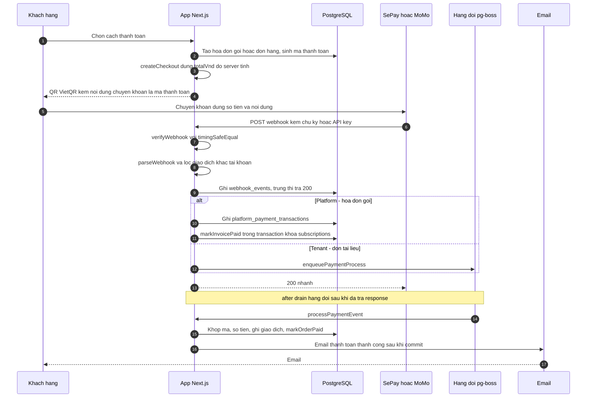

# Hướng dẫn phát triển module thanh toán — Gieo Chữ (SePay, MoMo, VietQR)

> Ngày viết: 2026-11-27 (tên file theo yêu cầu của chủ dự án: `doc-payment-241126`). Nguồn yêu cầu: ADR-074 mục 6 trong
> [DECISIONS.md](DECISIONS.md). Người đọc: kỹ sư dựng một hệ thống SaaS khác có thanh toán tại Việt Nam và muốn dùng lại
> kiến trúc/mã của Gieo Chữ.

## Quy ước đọc tài liệu này

- **Nguồn sự thật là code runtime.** Mọi đoạn trích dưới đây được chép từ code ở thời điểm viết, kèm đường dẫn và tên hàm. Khi
  code đổi, đoạn trích có thể lỗi thời — mở đúng file để đối chiếu trước khi chép.
- Mức xác minh: ✅ đã đối chiếu code/schema (đọc mã nguồn) · 🟡 lấy từ ADR/tài liệu, chưa đối chiếu lại bằng code ở
  lần viết này · ❓ cần môi trường thật (SePay, ngân hàng, MoMo, VPS) mới kiểm chứng được.
- Số test: `node scripts/count-tests.mjs` cho ra **105 unit / 69 integration** ✅ (trần gốc 91/50 đã được nâng theo các ADR
  — xem `CLAUDE.md`). Tài liệu này không đổi số test.
- Không có secret, key hay URL thật trong tài liệu. Địa chỉ ví dụ dùng `https://app.example.com`.

## Mục lục

1. [Kiến trúc tổng thể](#1-kiến-trúc-tổng-thể)
2. [Cấu trúc `packages/payments`](#2-cấu-trúc-packagespayments)
3. [Mã thanh toán (ADR-065)](#3-mã-thanh-toán-adr-065)
4. [Bảo mật](#4-bảo-mật)
5. [Xử lý đơn và hoá đơn](#5-xử-lý-đơn-và-hoá-đơn)
6. [Job nền và cron (ADR-036)](#6-job-nền-và-cron-adr-036)
7. [Email thông báo thanh toán (ADR-070)](#7-email-thông-báo-thanh-toán-adr-070)
8. [Giao diện cấu hình cổng](#8-giao-diện-cấu-hình-cổng)
9. [Checklist tái dùng, runbook SePay, bài học](#9-checklist-tái-dùng-runbook-sepay-bài-học)
10. [Điểm lệch giữa code và tài liệu](#10-điểm-lệch-giữa-code-và-tài-liệu)
11. [Bản đồ file](#11-bản-đồ-file)

---

## 1. Kiến trúc tổng thể

### 1.1. Hai phạm vi thanh toán, không bao giờ dùng chung

Gieo Chữ có hai hệ thống thanh toán độc lập chạy trên **cùng một thư viện** `packages/payments`:

| | Platform (System Center) | Tenant (Studio) |
|---|---|---|
| Thu tiền của ai | Gian hàng trả phí gói dịch vụ cho hệ thống | Khách mua tài liệu của gian hàng |
| Đối tượng được thanh toán | `SubscriptionInvoice` (hoá đơn gói) | `Order` (đơn tài liệu) |
| Bảng cấu hình cổng | `platform_payment_configs` (L1, một dòng/cổng) | `tenant_payment_configs` (L2, có `tenantId`, RLS) |
| Bảng giao dịch | `platform_payment_transactions` | `tenant_payment_transactions` |
| Route webhook | `/api/webhooks/platform/{provider}` | `/api/webhooks/tenants/{tenantId}/{provider}` |
| Xử lý sau webhook | Gọi thẳng `markInvoicePaid` trong request | Đẩy job `payment.process`, drain bằng `after()` |
| Truy cập DB | `getPrismaClient()` (L1, không RLS) | `withTenant()` / `withSystemJob()` (bắt buộc, RLS) |

Quy tắc bắt buộc (✅ `packages/payments/src/types.ts`): **mọi hàm thanh toán nhận `PaymentScope` tường minh** và hai hệ thống
**không bao giờ** chung bảng, secret hay route.

```ts
// packages/payments/src/types.ts
export type PaymentScope = { kind: "PLATFORM" } | { kind: "TENANT"; tenantId: string };
export type PaymentProviderId = "MANUAL_QR" | "SEPAY" | "MOMO" | "MOMO_MANUAL";
```

Scope **không** đổi logic của provider (SePay/MoMo/QR chạy như nhau); nó chỉ quyết định (1) bảng cấu hình mà **người gọi** đọc,
(2) đường dẫn webhook. Hàm `buildWebhookNotifyUrl` (✅ `packages/payments/src/registry.ts`):

```ts
export function buildWebhookNotifyUrl(appUrl: string, scope: PaymentScope, providerId: PaymentProviderId): string {
  const providerSegment = providerId.toLowerCase();
  const path =
    scope.kind === "PLATFORM"
      ? `/api/webhooks/platform/${providerSegment}`
      : `/api/webhooks/tenants/${scope.tenantId}/${providerSegment}`;
  return `${appUrl}${path}`;
}
```

Các cổng (✅ `types.ts`, `registry.ts`):

| `PaymentProviderId` | Cách hoạt động | Tự đối soát? | Có webhook? |
|---|---|---|---|
| `SEPAY` | VietQR + SePay theo dõi tài khoản ngân hàng, gọi webhook khi tiền vào | Có | Có (cả hai scope) |
| `MOMO` | MoMo API `captureWallet` (chuyển hướng sang trang MoMo), IPN ký HMAC | Có | Có (cả hai scope) |
| `MANUAL_QR` | VietQR tĩnh theo số tài khoản, người nhận tiền xác nhận tay | Không | Không |
| `MOMO_MANUAL` | Khách tự chuyển trong app MoMo (số điện thoại), xác nhận tay | Không | Không |

`MANUAL_CONFIRM_PROVIDERS = ["MANUAL_QR", "MOMO_MANUAL"]` quyết định luồng "báo chủ gian hàng có đơn chờ xác nhận tay".
Route webhook platform chỉ nhận `SEPAY`, `MOMO`; route tenant nhận `SEPAY`, `MOMO` (✅ `VALID_PROVIDERS` ở hai route).

### 1.2. Sơ đồ luồng



Điểm cần nhớ (✅):

1. Webhook **xác thực chữ ký trước khi parse** nghiệp vụ, trả 2xx nhanh.
2. Phía **Platform** áp hoá đơn ngay trong request (ít, ghi L1); phía **Tenant** ghi job rồi xử lý sau response (ghi L2, nặng hơn:
   quyền tải, mã giảm giá, thống kê khách, email).
3. Email gửi **sau commit**, lỗi chỉ log (xem §7).
4. Sai chữ ký → 401; body hỏng → 400; giao dịch lệch tài khoản/trùng → 200 để cổng không gửi lại.

---

## 2. Cấu trúc `packages/payments`

```
packages/payments/src/
├── types.ts            PaymentScope, PaymentProvider<TConfig>, CheckoutResult, NormalizedPaymentEvent...
├── registry.ts         getProvider, buildWebhookNotifyUrl, MANUAL_CONFIRM_PROVIDERS, isManualConfirmProvider
├── vietqr.ts           buildVietQrPayload (EMVCo + NAPAS), crc16ccitt
├── index.ts            export; re-export encryptSecret/decryptSecret/maskSecret từ @gieochu/core
└── providers/
    ├── sepay.ts        sepayProvider + extractSepayPaymentCodes + sepayAccountMatches + testSepayConnection
    ├── momo.ts         momoProvider (chữ ký create + IPN), testConnection qua API query
    ├── manual-qr.ts    VietQR tĩnh, không webhook
    └── momo-manual.ts  chuyển MoMo bằng tay (không QR)
```

### 2.1. Interface chung

```ts
// packages/payments/src/types.ts
export interface PaymentProvider<TConfig = unknown> {
  readonly id: PaymentProviderId;
  validateConfig(input: unknown): TConfig;                       // zod
  testConnection?(cfg: TConfig): Promise<TestResult>;
  createCheckout(args: CreateCheckoutArgs<TConfig>): Promise<CheckoutResult>;
  verifyWebhook(req: RawWebhookRequest, cfg: TConfig): Promise<boolean>;   // chạy TRƯỚC khi parse
  parseWebhook(body: unknown): NormalizedPaymentEvent;
}

export interface NormalizedPaymentEvent {
  providerEventId: string;   // khoá idempotency
  reference?: string;        // mã đơn/hoá đơn (MoMo trả sẵn; SePay phải tách từ content - xem §3)
  amountVnd: number;
  occurredAt: Date;
  success: boolean;
  raw: unknown;
}

/** Cái mà route webhook đưa cho verifyWebhook: thô, chưa parse. */
export interface RawWebhookRequest { headers: Record<string, string>; rawBody: string }
```

`getProvider(id)` tra bảng `PROVIDERS`. Thêm cổng mới = thêm một object `PaymentProvider`, thêm id vào `PaymentProviderId` (và enum
Prisma `PaymentProviderId`), đăng ký ở `registry.ts`.

> Lưu ý thiết kế: `parseWebhook(body)` **không nhận `cfg`**, nên không biết tiền tố mã thanh toán của gian hàng. Vì vậy với SePay,
> route webhook tự tách mã bằng `extractSepayPaymentCodes(body, [...prefixes])` sau khi đã giải mã cấu hình.

### 2.2. Schema zod cấu hình SePay

```ts
// packages/payments/src/providers/sepay.ts
const sepayConfigSchema = z.object({
  bankBin: z.string().regex(/^\d{6}$/, "Mã ngân hàng (BIN) phải gồm 6 chữ số."),
  accountNo: z.string().min(4).max(30),
  accountName: z.string().min(1),
  authType: z.enum(["API_KEY", "HMAC_SHA256"]),
  secret: z.string().min(1),
  /** ADR-065: tiền tố mã thanh toán — 2–5 chữ cái (giới hạn ô "Tiền tố" của SePay). */
  paymentPrefix: z.string().regex(/^[A-Z]{2,5}$/, "Tiền tố mã thanh toán phải gồm 2–5 chữ cái in hoa."),
  /** API Token (my.sepay.vn → Cấu hình Công ty → API Access) — chỉ dùng cho "Kiểm tra kết nối", không bắt buộc. */
  apiToken: z.string().optional(),
});
```

Cấu hình được tách làm hai phần khi lưu DB (✅ `apps/web/lib/platform-payment.ts`, `tenant-payment.ts`): **`publicConfig`** (JSON: BIN,
số tài khoản, tên chủ tài khoản, `authType`, `paymentPrefix`...) và **`encryptedSecrets`** (chuỗi AES-256-GCM của JSON secret:
`secret`, `apiToken`). Khi dùng, hai phần được ghép lại: `{ ...publicConfig, ...secrets }`.

### 2.3. Tách mã thanh toán từ payload SePay

SePay gửi cả `code` (mã SePay tự nhận diện theo "Cấu trúc mã thanh toán") lẫn `content` (nội dung chuyển khoản thô). Hàm ưu tiên
`code` rồi tới `content`, thử lần lượt từng tiền tố:

```ts
// packages/payments/src/providers/sepay.ts
export interface SepayWebhookBody {
  id: number | string;
  code?: string | null;
  content?: string;
  accountNumber?: string | null;     // một tài khoản SePay có thể nối nhiều tài khoản ngân hàng
  transferType: "in" | "out";
  transferAmount: number;
  transactionDate: string;
}

function suffixPattern(options: SepayReferenceOptions): string {
  const length = options.codeLength && options.codeLength > 0 ? `{${options.codeLength}}` : "*";
  return options.numeric ? `[0-9]${length}(?![0-9])` : `[A-Z0-9]${length}`;
}

export function extractSepayReferences(body: SepayWebhookBody, prefixes: readonly string[], options: SepayReferenceOptions = {}): string[] {
  const suffix = suffixPattern(options);
  const found: string[] = [];
  for (const prefix of prefixes) {
    const trimmed = prefix.trim();
    if (!trimmed) continue;
    const pattern = new RegExp(`${escapeRegExp(trimmed)}${suffix}`, "i");   // tiền tố do người dùng điền → escape
    for (const source of [body.code, body.content]) {
      const match = source ? source.match(pattern) : null;
      if (match && !found.includes(match[0].toUpperCase())) found.push(match[0].toUpperCase());
    }
  }
  return found;
}

/** Mã thanh toán (tiền tố + 8 chữ số) đọc được từ payload SePay — dùng chung webhook PLATFORM và TENANT. */
export function extractSepayPaymentCodes(body: SepayWebhookBody, prefixes: readonly unknown[]): string[] {
  const valid = prefixes.map(normalizePaymentCodePrefix).filter((prefix): prefix is string => prefix !== null);
  return extractSepayReferences(body, [...new Set(valid)], { codeLength: PAYMENT_CODE_DIGITS, numeric: true });
}
```

Điểm tinh tế (✅): `codeLength` cố định 8 và lookahead `(?![0-9])` giúp tách đúng mã khi ngân hàng **nối liền** nội dung
(`SEVQR40718256NGUYENVANA` → `SEVQR40718256`), đồng thời không bắt nhầm chuỗi dài hơn 8 chữ số.

### 2.4. Lọc giao dịch của tài khoản khác

```ts
// packages/payments/src/providers/sepay.ts
export function sepayAccountMatches(body: unknown, accountNo: string): boolean {
  if (typeof body !== "object" || body === null) return true;
  const received = (body as { accountNumber?: unknown }).accountNumber;
  if (typeof received !== "string" && typeof received !== "number") return true;
  const receivedDigits = digitsOnly(String(received));
  if (!receivedDigits) return true;
  return receivedDigits === digitsOnly(accountNo);
}
```

Payload không có `accountNumber` → không đủ căn cứ để từ chối, coi là khớp. Route webhook dùng hàm này để trả 200 và **bỏ qua** giao
dịch tài khoản khác (không ghi `webhook_events`, không ghi giao dịch).

### 2.5. Kiểm tra kết nối SePay

`testSepayConnection(cfg, fetchImpl = fetch)` gọi SePay User API `GET https://my.sepay.vn/userapi/bankaccounts/list` với
`Authorization: Bearer <apiToken>` (giới hạn của SePay: 2 request/giây/IP → 429). Nó xác nhận: token hợp lệ, số tài khoản đã cấu hình
**có trên SePay**, đúng ngân hàng (`bank_bin`), đang hoạt động (`active`). **Không** kiểm tra được secret webhook (SePay không có API
cho việc đó) — phần đó chỉ kiểm bằng giao dịch thật (§9.3). Tham số `fetchImpl` cho phép test bằng fetch giả.

```ts
export async function testSepayConnection(cfg: SepayConfig, fetchImpl: typeof fetch = fetch): Promise<TestResult> {
  const token = cfg.apiToken?.trim();
  if (!token) return { ok: false, message: "Chưa nhập API Token SePay — ..." };
  // ... fetchImpl(SEPAY_BANK_ACCOUNTS_URL, { headers: { Authorization: `Bearer ${token}` }, signal: AbortSignal.timeout(10_000) })
  // 401/403 → token sai; 429 → đợi; !ok → HTTP lỗi; JSON không có mảng bankaccounts → phản hồi không hợp lệ
  const wanted = cfg.accountNo.replace(/\s+/g, "");
  const account = accounts.find((item) => String(item.account_number ?? "").replace(/\s+/g, "") === wanted);
  if (!account) return { ok: false, message: `API Token hợp lệ nhưng không thấy tài khoản ${tail4(wanted)} trên SePay — ...` };
  if (account.bank_bin && account.bank_bin !== cfg.bankBin) return { ok: false, message: "...thuộc ngân hàng khác..." };
  if (String(account.active ?? "1") !== "1") return { ok: false, message: "...đang tạm khoá trên SePay." };
  return { ok: true, message: "Kết nối thành công — ..." };
}
```

Thông báo lỗi **không** trả số tài khoản đầy đủ hay token (`tail4` chỉ hiện `••••` + 4 số cuối).

### 2.6. Xác thực webhook SePay

```ts
async function verifySepayWebhook(req: RawWebhookRequest, cfg: SepayConfig): Promise<boolean> {
  if (cfg.authType === "API_KEY") {
    const header = req.headers["authorization"] ?? "";
    return safeEqual(header, `Apikey ${cfg.secret}`);
  }
  const signatureHeader = req.headers["x-sepay-signature"] ?? "";
  const timestamp = req.headers["x-sepay-timestamp"] ?? "";
  const expected = `sha256=${createHmac("sha256", cfg.secret).update(`${timestamp}.${req.rawBody}`).digest("hex")}`;
  return safeEqual(signatureHeader, expected);
}

function safeEqual(a: string, b: string): boolean {
  const bufA = Buffer.from(a);
  const bufB = Buffer.from(b);
  if (bufA.length !== bufB.length) return false;     // timingSafeEqual ném lỗi nếu độ dài khác nhau
  return timingSafeEqual(bufA, bufB);
}
```

Hai chế độ: `API_KEY` (header `Authorization: Apikey <key>`) và `HMAC_SHA256` (header `X-SePay-Signature: sha256=<hex>`, ký
`{X-SePay-Timestamp}.{rawBody}`). Chữ ký tính trên **rawBody** nên route phải đọc `request.text()` trước khi `JSON.parse`.
Ghi chú trong code: tên header/định dạng đã đối chiếu với tài liệu webhook chính thức của SePay (🟡 ở thời điểm đó; ❓ nếu SePay đổi).

### 2.7. Parse payload SePay (ném lỗi thay vì TypeError)

`parseSepayWebhook` kiểm `id`, `transferType` (`in`/`out`), `transferAmount` (số nguyên ≥ 0, nhận cả chuỗi số), `transactionDate`.
Thiếu/sai → `throw new Error(...)`; route bắt và trả **400** + log thay vì để TypeError thành 500. Thời gian giao dịch giả định múi
giờ VN: `new Date(`${transactionDate.replace(" ", "T")}+07:00`)`. `success` = `transferType === "in"`.

### 2.8. MoMo (tóm tắt)

✅ `packages/payments/src/providers/momo.ts`: `createCheckout` gọi `captureWallet`, ký HMAC-SHA256 trên chuỗi tham số **theo thứ tự
bảng chữ cái** (`buildMomoCreateSignature`); `verifyWebhook` tính lại chữ ký IPN (`buildMomoIpnSignature`) và so bằng
`timingSafeEqual`; `parseWebhook` lấy `transId` làm `providerEventId`, `orderId` làm `reference`, `resultCode === 0` là thành công.
`testConnection` gọi API `query` với một `orderId` giả — mã phản hồi dạng số (kể cả "không tìm thấy giao dịch") vẫn chứng tỏ
credentials hợp lệ. Môi trường `sandbox`/`production` chọn host khác nhau.

### 2.9. VietQR

`buildVietQrPayload({ bankBin, accountNo, amountVnd, content })` (✅ `vietqr.ts`) dựng chuỗi EMVCo Merchant-Presented QR với phần mở rộng
NAPAS (tag 38, GUID `A000000727`, service code `QRIBFTTA`), kèm CRC-16/CCITT-FALSE. Có số tiền → QR động (`01=12`), không có →
QR tĩnh (`01=11`). `content` đặt ở tag `62`/`08` — đây chính là **nội dung chuyển khoản** (mã thanh toán). Ảnh QR sinh bằng thư viện
`qrcode` (`QRCode.toDataURL`).

---

## 3. Mã thanh toán (ADR-065)

### 3.1. Vấn đề

Ngày 2026-11-24, một hoá đơn gói SePay đã được chuyển khoản đúng nhưng kẹt "Chờ thanh toán" (✅ theo ADR-065 trong `DECISIONS.md`).
Trên SePay giao dịch có "Mã thanh toán: —" và **không có webhook**. Nguyên nhân (🟡 theo ADR; hành vi phía SePay ❓ không thể kiểm
lại nếu không có tài khoản SePay thật): SePay chỉ nhận diện mã thanh toán theo **"Cấu trúc mã thanh toán"** với **hậu tố thuần số, độ dài
cố định**, ô tiền tố giới hạn **2–5 chữ cái**. Hệ thống cũ sinh hậu tố 8 ký tự **lẫn chữ** → SePay không trích được mã, ghi "Xác thực
tự động: Không thực hiện" và **không gọi webhook**. Thêm nữa, một số ngân hàng **bắt buộc nội dung bắt đầu bằng từ khoá** (VietinBank:
`SEVQR`), nên từ khoá đó phải **chính là tiền tố**.

### 3.2. Định dạng

```
mã thanh toán = TIỀN TỐ (2–5 chữ cái A–Z in hoa) + 8 CHỮ SỐ (chữ số đầu khác 0)      VD: SEVQR40718256
```

```ts
// packages/core/src/billing/payment-code.ts
export const PAYMENT_CODE_DIGITS = 8;
export const PAYMENT_CODE_PREFIX_MIN = 2;
export const PAYMENT_CODE_PREFIX_MAX = 5;

const PREFIX_PATTERN = new RegExp(`^[A-Z]{${PAYMENT_CODE_PREFIX_MIN},${PAYMENT_CODE_PREFIX_MAX}}$`);

export function normalizePaymentCodePrefix(value: unknown): string | null {
  const prefix = typeof value === "string" ? value.trim().toUpperCase() : "";
  return PREFIX_PATTERN.test(prefix) ? prefix : null;
}

/** Số nguyên ngẫu nhiên đều trong [0, max) bằng CSPRNG (Web Crypto — chạy cả Node lẫn trình duyệt), loại phần lệch modulo. */
function randomBelow(max: number): number {
  const limit = Math.floor(0x1_0000_0000 / max) * max;
  const buf = new Uint32Array(1);
  for (;;) {
    globalThis.crypto.getRandomValues(buf);
    const value = buf[0]!;
    if (value < limit) return value % max;
  }
}

export function generatePaymentCode(prefix: string): string {
  if (!PREFIX_PATTERN.test(prefix)) throw new Error(`Invalid payment code prefix: ${prefix}`);
  const min = 10 ** (PAYMENT_CODE_DIGITS - 1);
  return `${prefix}${min + randomBelow(9 * min)}`;
}

export function isPaymentCode(code: string, prefix?: string): boolean {
  const head = prefix ?? `[A-Z]{${PAYMENT_CODE_PREFIX_MIN},${PAYMENT_CODE_PREFIX_MAX}}`;
  return new RegExp(`^${head}[1-9]\\d{${PAYMENT_CODE_DIGITS - 1}}$`).test(code);
}
```

`globalThis.crypto` (Web Crypto) giúp cùng một file chạy được ở Node, Edge và trình duyệt. Có thêm subpath
`@gieochu/core/payment-code` để **client component** import được mà không kéo cả `@gieochu/core` (xem `apps/web/lib/sepay-setup.ts`).

### 3.3. Dùng mã ở hai phạm vi

| | Platform (hoá đơn gói) | Tenant (đơn tài liệu) |
|---|---|---|
| Nơi lưu | `subscription_invoices.code` | Cột riêng `orders.paymentRef` (nullable) |
| Tiền tố | SePay: `paymentPrefix` đã cấu hình; cổng khác: `SUB` (`DEFAULT_INVOICE_CODE_PREFIX`) | `paymentPrefix` cấu hình; không hợp lệ → tiền tố mã đơn (`tenantSepayPrefix`) |
| Chống trùng | `resolveUniqueInvoiceCode` thử lại tới 10 lần; `code` unique | `resolveSepayPaymentRef` thử lại 10 lần; **`@@unique([tenantId, paymentRef])`** |
| Khi nào sinh | Lúc tạo hoá đơn (`createRenewalInvoice`) | Lúc khách chọn SePay (`buildTenantCheckoutPayload`); giữ nguyên khi áp/gỡ mã giảm giá hoặc chọn lại SePay nếu còn đúng tiền tố |
| Khớp ở webhook | `sepayInvoiceReferenceCandidates` → tiền tố cấu hình rồi `SUB` | Ưu tiên `paymentRef`, sau đó mã đơn (khách tự gõ); job khớp `paymentRef` **hoặc** `code` |

Tại sao Studio cần cột `paymentRef` riêng thay vì đổi mã đơn: mã đơn xuất hiện ở URL, email, QR thủ công, MoMo — chỉ **đường SePay** bị
ràng buộc định dạng, nên chỉ nó dùng mã mới (✅ `order.ts`: "Mã đơn, URL, QR thủ công, MoMo giữ nguyên `orders.code`").

```ts
// apps/web/lib/order.ts
export function tenantSepayPrefix(paymentPrefix: unknown, orderCodePrefix: string): string {
  return normalizePaymentCodePrefix(paymentPrefix) ?? normalizePaymentCodePrefix(orderCodePrefix) ?? "SHOP";
}

async function resolveSepayPaymentRef(tenantId: string, currentRef: string | null, prefix: string): Promise<string> {
  if (currentRef && isPaymentCode(currentRef, prefix)) return currentRef;        // giữ mã cũ nếu còn đúng tiền tố
  for (let attempt = 0; attempt < PAYMENT_REF_RETRIES; attempt += 1) {
    const candidate = generatePaymentCode(prefix);
    const taken = await withTenant(tenantId, (tx) => tx.order.findFirst({ where: { tenantId, paymentRef: candidate }, select: { id: true } }));
    if (!taken) return candidate;
  }
  throw internalError("Không tạo được mã thanh toán, vui lòng thử lại.");
}
```

```prisma
// packages/db/prisma/schema.prisma — model Order
paymentRef  String?
@@unique([tenantId, paymentRef])
```

### 3.4. Cấu hình tương ứng trên SePay (hai bên phải khớp)

Trên SePay: **Công ty → Cấu hình chung → Cấu trúc mã thanh toán** — tạo **một** mẫu: tiền tố = tiền tố trong app, hậu tố **từ 8 đến 8**,
**"Là số nguyên"**. Đổi tiền tố trong app thì đổi mẫu bên SePay cùng lúc (🟡 theo ADR-065 và `sepay-setup.ts`; tên menu trên SePay ❓).
Chuỗi hướng dẫn được sinh tự động từ hằng `PAYMENT_CODE_DIGITS` để không lệch (`sepayCodeStructureInstruction`, `sepaySetupSteps`).

---

## 4. Bảo mật

### 4.1. Mã hoá secret cổng bằng AES-256-GCM

Secret (`secret` webhook, `apiToken` SePay, `secretKey` MoMo...) được mã hoá bằng `PAYMENT_ENCRYPTION_KEY` **trước khi lưu DB**. Định dạng
lưu: `iv:tag:ciphertext`, mỗi phần base64.

```ts
// packages/core/src/crypto/encryption.ts
const ALGORITHM = "aes-256-gcm";
const IV_LENGTH = 12;

export function encryptSecret(plaintext: string, keyBase64: string): string {
  const key = Buffer.from(keyBase64, "base64");
  const iv = randomBytes(IV_LENGTH);
  const cipher = createCipheriv(ALGORITHM, key, iv);
  const ciphertext = Buffer.concat([cipher.update(plaintext, "utf8"), cipher.final()]);
  const tag = cipher.getAuthTag();
  return `${iv.toString("base64")}:${tag.toString("base64")}:${ciphertext.toString("base64")}`;
}

export function decryptSecret(encoded: string, keyBase64: string): string {
  const parts = encoded.split(":");
  if (parts.length !== 3) throw new Error("Invalid encrypted secret format");
  const [ivB64, tagB64, ciphertextB64] = parts as [string, string, string];
  const decipher = createDecipheriv(ALGORITHM, Buffer.from(keyBase64, "base64"), Buffer.from(ivB64, "base64"));
  decipher.setAuthTag(Buffer.from(tagB64, "base64"));
  return Buffer.concat([decipher.update(Buffer.from(ciphertextB64, "base64")), decipher.final()]).toString("utf8");
}

/** UI never shows the real secret (§7.3) — only the last 4 characters. */
export function maskSecret(plaintext: string): string {
  return `••••${plaintext.slice(-4)}`;
}
```

- Khoá là **base64 của đúng 32 byte** (tạo bằng `openssl rand -base64 32`); IV ngẫu nhiên 12 byte cho mỗi lần mã hoá; GCM có auth tag
  nên sửa ciphertext bị phát hiện.
- **Khoá riêng theo miền** (✅ comment trong file + `env.ts`): secret kho lưu trữ dùng `STORAGE_ENCRYPTION_KEY`, tách khỏi
  `PAYMENT_ENCRYPTION_KEY` — lộ một khoá chỉ lộ một miền.
- Chỉ trả bản che `••••abcd` ra UI: `listPlatformProviderConfigs` / `listTenantProviderConfigs` giải mã rồi `maskSecret` (✅), **không
  bao giờ** trả secret thô về client.
- Ô secret để trống khi lưu = **giữ secret đã lưu** (hợp nhất với bản cũ), nên sửa các trường khác không buộc nhập lại credentials:

```ts
// apps/web/lib/platform-payment.ts — savePlatformProviderConfig (tenant-payment.ts có đoạn tương tự)
const resolvedSecrets = Object.fromEntries(
  Object.entries(input.secrets)
    .map(([key, value]) => [key, value || existingSecrets[key] || ""] as const)
    .filter(([, value]) => value !== ""),
);
provider.validateConfig({ ...input.publicConfig, ...resolvedSecrets });      // zod — lỗi → AppError INVALID_PAYMENT_CONFIG
const encryptedSecrets = encryptSecret(JSON.stringify(resolvedSecrets), env.PAYMENT_ENCRYPTION_KEY);
```

- Audit `PAYMENT_CONFIG_UPDATED` chỉ ghi **cờ** (`credentialsChanged`, `accountChanged`...), không ghi secret hay `publicConfig` (số tài khoản).
- **Tự tắt cổng khi đổi định danh nhận tiền (ADR-013, chỉ Platform):** đổi `bankBin`/`accountNo` (hoặc `partnerCode`, hoặc secret
  định danh) → `isEnabled = false`, xoá `lastVerifiedAt`; admin phải "Kiểm tra kết nối" thành công hoặc lưu lại có tích "Bật". `apiToken`
  nằm trong `TEST_ONLY_SECRET_KEYS` nên đổi nó **không** tự tắt cổng. Phía **Tenant** không có cơ chế tự tắt này (✅ `saveTenantProviderConfig`
  chỉ upsert `isEnabled: input.isEnabled`; ADR-013 nói rõ chỉ áp cho Platform).

### 4.2. Webhook: xác thực trước, parse sau, idempotent, trả 2xx nhanh

Thứ tự trong route tenant (✅ `apps/web/app/api/webhooks/tenants/[tenantId]/[provider]/route.ts`):

```ts
const rawBody = await request.text();                         // chữ ký tính trên body thô
// ... gom headers (key chữ thường)
const configRow = await withSystemJob((tx) => tx.tenantPaymentConfig.findUnique({ where: { tenantId_provider: { tenantId, provider: providerId } } }));
if (!configRow || !configRow.isEnabled) return NextResponse.json({ error: "not_configured" }, { status: 404 });

const secrets = JSON.parse(decryptSecret(configRow.encryptedSecrets, env.PAYMENT_ENCRYPTION_KEY)) as Record<string, string>;
const cfg = { ...(configRow.publicConfig as Record<string, unknown>), ...secrets };

const provider = getProvider(providerId);
const isValid = await provider.verifyWebhook({ headers, rawBody }, cfg as never);     // 1) XÁC THỰC TRƯỚC
if (!isValid) return NextResponse.json({ error: "invalid_signature" }, { status: 401 });

let parsedBody: unknown; let event: ReturnType<typeof provider.parseWebhook>;
try { parsedBody = JSON.parse(rawBody); event = provider.parseWebhook(parsedBody); }  // 2) rồi mới parse
catch { return NextResponse.json({ error: "invalid_body" }, { status: 400 }); }

if (providerId === "SEPAY" && !sepayAccountMatches(parsedBody, String((cfg as { accountNo?: unknown }).accountNo ?? ""))) {
  return NextResponse.json({ success: true });                // 3) tài khoản khác → 200, bỏ qua (không ghi gì)
}

try {
  await withSystemJob((tx) => tx.webhookEvent.create({ data: { scope: "TENANT", provider: providerId, providerEventId: event.providerEventId, tenantId } }));
} catch {
  return NextResponse.json({ success: true });                // 4) IDEMPOTENT: trùng unique → đã xử lý
}
// 5) tách mã, enqueue job, 200
await enqueuePaymentProcess({ tenantId, provider: providerId, providerEventId: event.providerEventId, reference, referenceCandidates, amountVnd: event.amountVnd, success: event.success, rawPayload: parsedBody });
scheduleQueueDrain([QUEUE_NAMES.PAYMENT_PROCESS]);            // xử lý nặng SAU response
return NextResponse.json({ success: true });
```

Ý nghĩa các mã trả về (để cổng không gửi lại vô ích): 401 chỉ khi sai chữ ký; 404 khi cổng chưa bật/chưa cấu hình; 400 khi body không
hợp lệ **sau** khi chữ ký đã đúng; 200 cho mọi trường hợp "đã nhận" (kể cả bỏ qua/trùng).

Idempotency có **hai tầng** (✅ `schema.prisma`):

```prisma
model WebhookEvent {                      // tầng HTTP: mỗi sự kiện của một (scope, provider) chỉ xử lý một lần
  scope           WebhookScope            // PLATFORM | TENANT
  provider        PaymentProviderId
  providerEventId String
  tenantId        String?
  @@unique([scope, provider, providerEventId])
}
model TenantPaymentTransaction {          // tầng sổ cái: một giao dịch chỉ ghi một lần cho mỗi gian hàng
  @@unique([tenantId, provider, providerTxnId])
}
```

`webhook_events` ghi qua `withSystemJob` vì lúc webhook tới **chưa có phiên tenant** (✅ comment trong `schema.prisma`: "no tenant session at the point a raw webhook arrives").

### 4.3. Không tin số tiền/trạng thái từ client

- Tổng tiền luôn do **server tính lại** (`order.totalVnd`, `plan.priceVnd`); `createCheckout` nhận `amountVnd` từ đó. QR **không bao giờ** lệch `totalVnd`:
  `initiateOrderCheckout` chỉ ghi payload khi `totalVnd` không đổi kể từ lúc đọc (`updateMany` có điều kiện `totalVnd: order.totalVnd`) —
  áp/gỡ mã giảm giá chạy song song thì báo `ORDER_CHANGED` (409).
- Khớp số tiền webhook bằng so sánh **bằng nhau tuyệt đối** — `matchPaymentAmount(orderTotalVnd, receivedAmountVnd)` trả `MATCHED` hoặc
  `MISMATCH_AMOUNT` (✅ `packages/core/src/order/payment-match.ts`). Thừa/thiếu đều không tự áp; chỉ báo người bán/khách (§7).
- Platform: `invoice.amountVnd === event.amountVnd` mới `matchedInvoiceId` + áp hoá đơn.

### 4.4. Phân quyền dữ liệu

- System admin **không có route nào** đọc chi tiết đơn/khách của tenant — chỉ L1 và `tenant_daily_stats` (CLAUDE.md §7.9). Hoá đơn gói là L1 nên admin
  xem/đổi trạng thái được (§5.3); đơn tài liệu thì chỉ chủ gian hàng.
- Mọi bảng L2 phải qua `withTenant`/`withSystemJob`. Bài học thật: đọc bảng `orders` bằng client trần → thấy **0 dòng** và email đơn hàng
  từng **không bao giờ gửi** (✅ comment trong `sendOrderPaidEmailsInner`). Đọc dưới `withSystemJob` khi không có phiên tenant.

---

## 5. Xử lý đơn và hoá đơn

### 5.1. Đơn tài liệu (Tenant): `markOrderPaid`

Hàm áp thanh toán chạy **trong transaction của người gọi** (✅ `apps/web/lib/order.ts`). Phần quan trọng: **cập nhật có điều kiện**, chống áp hai
lần khi webhook/job và người bán xác nhận cùng lúc (ADR-068 mục 7):

```ts
export async function markOrderPaid(tx: Tx, orderId: string, source: MarkOrderPaidSource): Promise<MarkOrderPaidResult> {
  const order = await tx.order.findUniqueOrThrow({ where: { id: orderId } });
  if (order.status === "PAID" || order.status === "FULFILLED") {
    return { fulfilled: false, productIds: [], couponOverused: null };           // idempotent
  }
  const now = new Date();
  const paidStatus = transitionOrderStatus(order.status as OrderStatus, "MARK_PAID");    // máy trạng thái ở @gieochu/core
  // Chỉ áp khi đơn VẪN ở trạng thái đã đọc. Hai nguồn song song cùng đọc PENDING → lần sau chờ khoá dòng của lần trước,
  // Postgres đánh giá lại WHERE trên bản đã commit (FULFILLED) → 0 dòng → no-op.
  const { count } = await tx.order.updateMany({ where: { id: orderId, status: order.status }, data: { status: paidStatus, paidAt: now } });
  if (count === 0) return { fulfilled: false, productIds: [], couponOverused: null };
  // ... mã giảm giá: UPDATE "coupons" SET "usedCount" = "usedCount"+1 WHERE ... usedCount < usageLimit (nguyên tử)
  // ... upsert thống kê khách, upsert entitlement cho từng dòng đơn
  const fulfilledStatus = transitionOrderStatus(paidStatus, "FULFILL");
  await tx.order.update({ where: { id: orderId }, data: { status: fulfilledStatus } });
  return { fulfilled: true, productIds: [...new Set(items.map((item) => item.productId))], couponOverused };
}
```

Mẫu thiết kế đáng chép:

- Hàm trả `{ fulfilled, productIds, couponOverused }` để **người gọi làm việc phụ SAU commit** (ADR-037: audit không ghi trong transaction
  nghiệp vụ): `auditMarkOrderPaid`, `recomputeProductSoldCounts`, `sendOrderPaidEmails`.
- Người gọi **rollback** nếu `!result.fulfilled` (nguồn khác vừa áp): `if (!result.fulfilled) throw orderAlreadyPaidError();` — để ghi chú xác nhận
  không bị lưu lệch và không audit/email lần hai.
- Mã giảm giá tăng bằng một câu `UPDATE ... WHERE usedCount < usageLimit` nguyên tử; hết lượt ngay lúc thanh toán thì **đơn vẫn PAID**, chỉ
  ghi `couponOverused` để audit.

**Job `payment.process`** (✅ `apps/web/lib/payment-process.ts`, `processPaymentEvent`) chạy **toàn bộ trong một `withTenant`**:

```ts
const candidates = data.referenceCandidates?.length ? data.referenceCandidates : data.reference ? [data.reference] : [];
const found = candidates.length > 0
  ? await tx.order.findMany({ where: { tenantId: data.tenantId, OR: [{ paymentRef: { in: candidates } }, { code: { in: candidates } }] } })
  : [];
const order = candidates.map((ref) => found.find((row) => row.paymentRef === ref || row.code === ref)).find((row) => row !== undefined) ?? null;

if (!order) { /* ghi tenantPaymentTransaction matchStatus UNMATCHED để người bán đối soát */ }

const matchStatus = matchPaymentAmount(order.totalVnd, data.amountVnd);
await tx.tenantPaymentTransaction.create({ data: { /* ... */ matchStatus, rawPayload: data.rawPayload } });   // luôn ghi sổ
if (!data.success) return { ... failedOrderId: data.provider === "MOMO" && unpaid ? order.id : null };
if (matchStatus !== "MATCHED") return { ... mismatch: { ..., notifyCustomer: unpaid } };
if (!canManuallyConfirmOrder(order.status as OrderStatus, order.expiresAt, new Date())) return { fulfilled: false, ... };
const result = await markOrderPaid(tx, order.id, data.provider === "SEPAY" ? "SEPAY_WEBHOOK" : "MOMO_IPN");
```

Quy tắc hiệu lực (✅ `packages/core/src/order/expiry.ts`):

```ts
export function effectiveOrderStatus(status, expiresAt, now) {
  if (status === "PENDING" && expiresAt.getTime() < now.getTime()) return "EXPIRED";   // đơn quá hạn coi là hết hạn ngay khi đọc
  return status;
}
export function canManuallyConfirmOrder(status, expiresAt, now, options = {}) {
  const effective = effectiveOrderStatus(status, expiresAt, now);
  if (effective === "PENDING") return true;
  if (effective === "EXPIRED") return Boolean(options.declaredPaidAt && options.declaredPaidAt.getTime() < expiresAt.getTime());
  return false;
}
```

Webhook/job **chỉ tự áp đơn còn PENDING** (không áp đơn đã hết hạn); giao dịch về sau hạn vẫn được ghi sổ để người bán xử lý tay.

> Lưu ý lệch với ADR-036 mục "Chủ dự án chốt": ADR-036 mô tả cửa sổ thanh toán trễ 24 giờ; ADR-061 đã bỏ cửa sổ đó (`manualConfirmDeadline`
> = `expiresAt`). Code hiện hành theo ADR-061 (xem §10).

### 5.2. Hạn giữ đơn: `holdStartedAt ?? createdAt`

Hạn giữ đơn của mỗi phương thức = **mốc giữ + số giờ của phương thức** (✅ `order.ts`):

```ts
export function orderHoldHoursFor(provider, settings: { orderHoldManualHours: number; orderHoldAutoHours: number }): number {
  return provider === null || isManualConfirmProvider(provider) ? settings.orderHoldManualHours : settings.orderHoldAutoHours;
}
export function orderHoldStartedAt(order: { holdStartedAt: Date | null; createdAt: Date }): Date {
  return order.holdStartedAt ?? order.createdAt;
}
```

Lý do (ADR-068 mục 8): trước đó hạn tính từ `createdAt`, nên đơn **mở lại sau hơn 72 giờ** không chọn được phương thức vì hạn đã qua. Cột
`orders.holdStartedAt DateTime?` (migration expand) được đặt = thời điểm mở lại. Mọi chỗ tính hạn phải gọi `orderHoldStartedAt(order)`, không
đọc `createdAt` trực tiếp. Đổi phương thức **không gia hạn** đơn (hạn mới đã qua → `PROVIDER_HOLD_EXPIRED`).

### 5.3. Xác nhận tay, đổi trạng thái, mở lại

**Hoá đơn gói (System Admin, ADR-066/067, ✅ `apps/web/lib/subscription-billing.ts`).** Bảng chuyển trạng thái (mọi cổng):

```ts
const INVOICE_STATUS_TRANSITIONS: Record<DbInvoiceStatus, readonly InvoiceStatusTarget[]> = {
  PENDING: ["PAID", "VOID"],
  EXPIRED: ["PAID", "PENDING", "VOID"],     // PENDING = mở lại
  VOID: ["PENDING"],
  PAID: [],                                 // đã trả → đi luồng hoàn tiền (ADR-041)
  REFUNDED: [],
};
```

Danh sách này chỉ để UI quyết định hiện lựa chọn nào; **server luôn kiểm lại dưới khoá**. Mẫu chung cho mọi thao tác ghi hoá đơn: một transaction,
**khoá dòng `subscriptions` của gian hàng** (`FOR UPDATE`), đọc lại hoá đơn dưới khoá, rồi **`updateMany` có điều kiện theo trạng thái đã đọc**:

```ts
async function lockSubscriptionRow(tx: Prisma.TransactionClient, tenantId: string): Promise<void> {
  await tx.$queryRaw`SELECT "id" FROM "subscriptions" WHERE "tenantId" = ${tenantId} FOR UPDATE`;
}

export async function markInvoicePaid(invoiceId: string, options: { source: InvoicePaidSource; actorId?: string | null; note?: string | null; scheduleNotification?: ScheduleAfterResponse } = { source: "PLATFORM_WEBHOOK" }): Promise<void> {
  const prisma = getPrismaClient();
  const applied = await prisma.$transaction(async (tx) => {
    const head = await tx.subscriptionInvoice.findUniqueOrThrow({ where: { id: invoiceId }, select: { tenantId: true } });
    await lockSubscriptionRow(tx, head.tenantId);
    const invoice = await tx.subscriptionInvoice.findUniqueOrThrow({ where: { id: invoiceId }, include: { plan: true } });
    if (invoice.status !== "PENDING") return null;                         // PAID/REFUNDED/... → no-op
    const result = await applyInvoicePaymentLocked(tx, invoice, { recomputePeriod: false });
    return result ? { invoice, result } : null;
  });
  if (!applied) return;
  await audit.log({ /* SUBSCRIPTION_PAID: source, provider, planId, previousPlanId, amountVnd, periodEnd, note */ });
  const notifyPaid = () => notifyOwnerOfInvoiceStatus(invoice.id, "PAID");           // ADR-070 A1 — chỉ khi thật sự áp
  if (options.scheduleNotification) options.scheduleNotification(notifyPaid); else await notifyPaid();
}

// applyInvoicePaymentLocked: updateMany({ where: { id: invoice.id, status: invoice.status }, data: { status: "PAID", paidAt: now } }); count 0 → null
```

- **Xác nhận tay** (`confirmManualInvoicePayment`, ADR-066): bỏ giới hạn theo cổng — SePay/MoMo bình thường tự xác nhận qua webhook; đây là đường
  cứu khi tiền đã về mà webhook không tới. Ghi chú không bắt buộc (≤ 500 ký tự), chỉ nằm trong metadata audit.
- **Xác nhận trễ** (`confirmExpiredManualInvoice`, hoá đơn EXPIRED): chặn nếu gian hàng có hoá đơn **tạo sau** đang PENDING/PAID
  (`assertNoNewerInvoiceLocked`, tránh trả 2 lần/lùi gói); **tính lại kỳ** `computeRenewalPeriod(now, currentPeriodEnd, plan)`.
- **Huỷ** (`voidSubscriptionInvoice`): chỉ PENDING/EXPIRED → VOID; không đổi thuê bao. Gửi email A5 sau lần huỷ thành công.
- **Mở lại** (`reopenSubscriptionInvoice`, EXPIRED/VOID → PENDING): gói phải còn bán (`plan.isActive`, nếu không `PLAN_INACTIVE` 409); phải là hoá
  đơn **mới nhất** của gian hàng; không có hoá đơn PENDING khác; `dueAt` mới = bây giờ + `invoicePendingTtlHours`; kỳ **tính lại**. Mã, số
  tiền, cổng, `checkoutPayload` giữ nguyên (mã cũ dạng chữ+số của SePay không nhận diện — admin xác nhận tay). Không gửi email.
- **Chống tạo trùng hoá đơn** (`createRenewalInvoice`, ADR-013 + ADR-059 B2): dùng lại hoá đơn PENDING còn hạn; tạo hoá đơn trong
  transaction khoá `subscriptions`; gọi API cổng (MoMo) **trước** transaction để không giữ khoá qua mạng.

**Đơn tài liệu (chủ gian hàng, ADR-068, ✅ `order.ts` `changeOrderStatusBySeller`):**

```ts
const ORDER_STATUS_TARGETS: Partial<Record<OrderStatus, readonly OrderStatusTarget[]>> = {
  PENDING: ["PAID", "CANCELLED"],
  EXPIRED: ["PAID", "PENDING", "CANCELLED"],
  CANCELED: ["PENDING"],
};
```

- PAID: khoá dòng `orders` `FOR UPDATE`, kiểm lại trạng thái hiệu lực (`PENDING`/`EXPIRED`), rồi `markOrderPaid` (người bán xác nhận được cả đơn hết hạn — tiền về
  trễ; webhook/job **không** đổi luật này). Ghi chú không bắt buộc → ghi chú nội bộ + `confirmNote`; audit chỉ ghi id + trạng thái (§7.9: không ghi văn bản tự do).
- Mở lại: chặn khi gian hàng không ACTIVE, tài liệu không còn bán, hoặc khách đã có quyền tải còn hiệu lực qua đơn khác (tránh trả hai lần). Cập nhật:

```ts
tx.order.updateMany({
  where: { id: order.id, tenantId, status: order.status, expiresAt: order.expiresAt },
  data: { status: nextStatus, holdStartedAt: reopenedAt, expiresAt, customerDeclaredPaidAt: null, customerReminderSentAt: null },
})
```

  Giữ tổng tiền, mã giảm giá, phương thức, `checkoutPayload`, `paymentRef`; **không gửi email** cho khách khi mở lại.
- Huỷ (PENDING/EXPIRED → CANCELED): `updateMany` có điều kiện; email B5 chỉ gửi khi lần huỷ này thành công.

Nguyên tắc chung rút ra: **mọi chuyển trạng thái tiền = `updateMany` có điều kiện trạng thái đã đọc (+ khoá dòng ở nơi nhiều bên cùng ghi), `count === 0` →
no-op hoặc 409, và mọi việc phụ (email, audit) chỉ chạy khi lần đó thật sự đổi trạng thái.**

---

## 6. Job nền và cron (ADR-036)

Ràng buộc nền tảng: **Vercel không chạy tiến trình thường trực** nên `apps/web/worker.ts` (pg-boss `work`) không có nơi chạy. Giải pháp
(✅ `apps/web/lib/job-runner.ts`, `app/api/cron/daily/route.ts`):

1. **Việc phát sinh từ request** (`payment.process`, `file.scan`): `send` vào pg-boss trước (bản ghi bền), rồi **`after()`** của Next.js chạy
   bộ xử lý hàng đợi **sau khi đã trả response**.
2. **Việc định kỳ**: `GET /api/cron/daily`, xác thực `Authorization: Bearer <CRON_SECRET>` bằng `timingSafeEqual`; thiếu `CRON_SECRET` → 503 (biến tuỳ chọn;
   nếu đặt thì ≥ 32 ký tự, ngắn hơn làm app dừng khi khởi động).

```ts
// apps/web/lib/job-runner.ts — drainQueues (rút gọn)
const jobs = await queue.fetch<object>(name, { batchSize });        // fetch khoá dòng (SKIP LOCKED) — nhiều drain song song không lấy trùng job
for (const job of jobs) {
  try { await handler(job.data); }
  catch (error) { result.failed += 1; logger.error(...); await queue.fail(name, job.id, error); continue; }   // 1 job hỏng không làm hỏng cả lô
  await queue.complete(name, job.id);
}
// Ngân sách thời gian mềm (budgetMs) kiểm trước mỗi lần fetch; lô đã lấy luôn xử lý xong.

export function scheduleQueueDrain(names: readonly DrainableQueueName[], budgetMs = 20_000): void {
  try {
    after(async () => { /* drainQueues({ names, budgetMs }) — bắt lỗi, chỉ log */ });
  } catch (error) {
    logger.warn({ err: error, queues: names }, "after() unavailable — job left for the next drain");   // ngoài request (test gọi thẳng route) → không ném
  }
}
```

Thiết kế cần chép:

- `scheduleQueueDrain` **không bao giờ ném** nên không biến một 2xx thành 500; ngoài phạm vi request (test) job nằm lại hàng đợi cho lượt drain sau.
- **Handler phải idempotent** vì `complete` có thể lỗi sau khi handler đã chạy (job chạy lại khi hết hạn): `processPaymentEvent` an toàn nhờ unique giao dịch + `markOrderPaid` no-op khi đã PAID.
- Route webhook đặt `export const maxDuration = 60;` để `after()` còn thời gian drain (~20 giây).
- Cron chạy từng bước **cô lập** (`runStep`): một bước lỗi không bỏ qua bước khác; trả 500 `CRON_STEP_FAILED` nếu có bước thất bại. Phản hồi chỉ chứa **số đếm**.
  Thứ tự (✅ code hiện hành): `subscription.sweep` → `order.sweep` → `order.payment_reminders` → `rate_limit_counters.purge` → `queue.supervise` →
  `audit.purge` → `stats.aggregate` → `abuse_report.ip_purge` → `refresh_tokens.purge` → `download_events.purge` → `queue.drain` (drain **cuối** vì dùng nhiều ngân sách thời gian nhất).
  (ADR-036 gốc chỉ có hai sweep + drain; các bước khác thêm từ ADR-037/038/053/054.)
- `queue.supervise` trả job `active` quá hạn (drain bị cắt bởi timeout) về hàng đợi thử lại.

**Quy tắc cho test và script (CLAUDE.md, 2026-11-26):** các hàm sweep **bắt buộc truyền `{ tenantIds: [...] }` của tenant tạm** — không bao giờ quét
toàn DB, vì máy dev dùng chung DB với production (ADR-034):

```ts
// apps/web/lib/order.ts
export async function runOrderSweep(options: { tenantIds?: readonly string[] } = {}): Promise<number> {
  const tenantIds = options.tenantIds ? [...new Set(options.tenantIds)] : null;
  if (tenantIds !== null && tenantIds.length === 0) return 0;               // mảng rỗng = không làm gì, KHÔNG phải "tất cả"
  // where: { status: "PENDING", expiresAt: { lt: now }, ...(tenantIds !== null ? { tenantId: { in: tenantIds } } : {}) }
}
// runSubscriptionSweep, runOrderPaymentReminders, aggregateTenantDailyStats: cùng quy ước.
```

Điểm nhỏ nhưng quan trọng: mảng rỗng phải trả về ngay (không thành "không lọc"). Sweep còn **gửi email** nên quét nhầm toàn DB là gửi email tới khách thật.

> Ghi chú triển khai: cron mô tả ở trên là Vercel Cron (`vercel.json`, "0 20 * * *" = 03:00 giờ VN, theo comment trong route). Production hiện chạy trên VPS
> (ADR-049) — cách lên lịch gọi route cron trên VPS (cron hệ điều hành/dịch vụ ngoài gọi cùng route với header Bearer) ❓ chưa đối chiếu trong tài liệu này.
> `worker.ts` **không deploy** và không chạy local trên DB dùng chung (sẽ tạo lại lịch pg-boss, chạy song song với cron) trừ khi Quốc duyệt.

---

## 7. Email thông báo thanh toán (ADR-070)

### 7.1. Bảng sự kiện

| # | Sự kiện | Người nhận | Hàm gọi |
|---|---|---|---|
| A1 | Hoá đơn gói thanh toán thành công | Chủ gian hàng | `markInvoicePaid`, `confirmExpiredManualInvoice`, `confirmInvoiceFromPlatformTransaction` |
| A2 | Hoá đơn gói hết hạn chưa trả | Chủ gian hàng | `runSubscriptionSweep` (✅ `subscription-sweep.ts`) |
| A3 | Hoá đơn gói nhận giao dịch đúng mã nhưng sai tiền | Chủ gian hàng | route webhook platform |
| A4 | Hoá đơn gói MoMo thất bại/huỷ | Chủ gian hàng | route webhook platform |
| A5 | Admin huỷ hoá đơn gói | Chủ gian hàng | `voidSubscriptionInvoice` |
| B1 | Đơn tài liệu thành công | Khách | `sendOrderPaidEmails` (có từ trước) |
| B2 | Đơn tài liệu hết hạn chưa trả — chỉ đơn khách đã chọn cách thanh toán | Khách | `runOrderSweep` (`if (order.provider)`) |
| B3 | Đơn tài liệu sai tiền | Khách (người bán có email riêng) | `processPaymentEvent` |
| B4 | Đơn tài liệu MoMo thất bại/huỷ | Khách | `processPaymentEvent` |
| B5 | Người bán huỷ đơn | Khách | `sellerCancelOrder` |

Chuyển khoản (SePay, QR thủ công, MoMo cá nhân) **không có sự kiện thất bại từ ngân hàng**: "thất bại" = hết hạn chưa nhận tiền hoặc sai số tiền. Chỉ MoMo
API có `resultCode ≠ 0`.

### 7.2. Nguyên tắc gửi

- **Gửi sau commit, lỗi chỉ log** — không làm hỏng thanh toán/sweep. Cả hai hàm notify đều bọc `try/catch` và **không bao giờ ném** (✅ `apps/web/lib/payment-status-notify.ts`):

```ts
export async function notifyOwnerOfInvoiceStatus(invoiceId: string, stage: SubscriptionInvoiceEmailStage, extra: { receivedVnd?: number } = {}): Promise<void> {
  try {
    const invoice = await getPrismaClient().subscriptionInvoice.findUnique({ where: { id: invoiceId }, select: { /* code, amountVnd, provider, tenant.owner.email, plan.name... */ } });
    if (!invoice) return;
    const [brand, supportEmail] = await Promise.all([getEffectiveBrand(), getSupportEmail()]);
    const rendered = renderSubscriptionInvoiceEmail(stage, { appName: brand.name, /* ... */ });
    const result = await sendEmailNow({ type: SUBSCRIPTION_INVOICE_EMAIL_TYPES[stage], to: invoice.tenant.owner.email, ...rendered });
    if (!result.ok) logger.warn({ invoiceId, type, error: result.error }, "invoice.status_email: gửi email cho chủ gian hàng thất bại");
  } catch (error) {
    logger.warn({ invoiceId, stage, err: error }, "invoice.status_email: lỗi khi gửi email cho chủ gian hàng");
  }
}
```

- **Mỗi email một lần cho mỗi sự kiện** — chống trùng nằm ở **nơi gọi**, không ở hàm gửi: chỉ gọi khi chính lần chạy đó vừa chuyển trạng thái (cập nhật
  có điều kiện) hoặc vừa ghi lần đầu `webhook_events`/giao dịch. Ví dụ ở route platform: A3/A4 chỉ được lên lịch **sau** khi `webhook_events.create` thành công.
- **Chạy sau response:** `runAfterResponseOrNow(tasks)` dùng `after()`; ngoài phạm vi request (`after()` ném đồng bộ) thì chạy ngay tại chỗ.

```ts
export async function runAfterResponseOrNow(tasks: ReadonlyArray<() => Promise<void>>): Promise<void> {
  if (tasks.length === 0) return;
  const run = async () => { for (const task of tasks) await task(); };
  try { after(run); } catch { await run(); }
}
```

- Mẫu email: `packages/email/src/templates/payment-status.ts` — `renderSubscriptionInvoiceEmail(stage, data)` và `renderOrderStatusEmail(stage, data)`. Tên thương hiệu nhận qua
  `appName` (không hard-code); **tiền/ngày do nơi gọi định dạng** ("150.000 đ", dd/mm/yyyy giờ VN); mọi chuỗi người dùng nhập được **escape HTML** và bọc ngoặc kép cong;
  tiêu đề chỉ có mã hoá đơn/mã đơn (+ tên gói); **không chứa ghi chú nội bộ** của admin/người bán.
- Phân tầng log email: email hoá đơn gói (L1) ghi `EmailSendLog`; email gửi **khách của gian hàng** (L3) nằm trong `TENANT_CUSTOMER_FACING_TYPES` và **không** ghi nhật ký
  tập trung (CLAUDE.md §7.9). Mở lại hoá đơn/đơn không gửi email.

---

## 8. Giao diện cấu hình cổng

### 8.1. `SecretKeyField` và `generateSecretKey`

✅ `apps/web/app/admin/_ui/secret-key-field.tsx` (client component). Ô secret/API key webhook có nút **"Tạo key ngẫu nhiên"**:

```ts
const ALPHABET = "ABCDEFGHIJKLMNOPQRSTUVWXYZabcdefghijklmnopqrstuvwxyz0123456789";
const KEY_LENGTH = 48;

/** Chỉ chữ/số → dán vào header `Authorization: Apikey <key>` của SePay không cần escape. */
export function generateSecretKey(length = KEY_LENGTH): string {
  let out = "";
  const buf = new Uint8Array(length * 2);
  while (out.length < length) {
    crypto.getRandomValues(buf);
    for (const byte of buf) {
      if (byte >= 248) continue;                 // 248 = 62 × 4 → mọi ký tự xác suất bằng nhau (loại lệch modulo)
      out += ALPHABET[byte % ALPHABET.length];
      if (out.length === length) break;
    }
  }
  return out;
}
```

Hành vi: key sinh **ở trình duyệt** bằng CSPRNG, đưa vào ô (`setNativeValue` phát sự kiện `input` để React/`useFormDraft` thấy thay đổi), hiện key + khung nhắc "Sao chép key này và
dán vào trang quản trị SePay **trước khi lưu**; sau khi lưu key sẽ không hiển thị lại" (nếu đã có secret lưu: thêm "key cũ sẽ ngừng hoạt động"). Ô vẫn **không kiểm soát** (uncontrolled)
và là ô bí mật của `useFormDraft` (không ghi lại sau khi lưu lỗi); để trống = giữ secret đã lưu. Server mã hoá AES-256-GCM, không bao giờ trả lại.
Về a11y: khung nhắc gắn vào `aria-describedby` của ô; focus chuyển về ô sau khi khung đã hiện để trình đọc màn hình đọc kèm lời nhắc.

### 8.2. `apps/web/lib/sepay-setup.ts`

Chuỗi hướng dẫn cấu hình SePay dùng chung cho form System Center và Studio, **sinh từ hằng `PAYMENT_CODE_DIGITS`** nên không lệch với `generatePaymentCode`. Chỉ là chuỗi thuần (không đụng
DB/secret) và **chỉ import subpath `@gieochu/core/payment-code`** để client component import được.

| Hàm/hằng | Việc làm |
|---|---|
| `sepayCodeStructureInstruction(prefix)` | Câu hướng dẫn "Cấu trúc mã thanh toán: tiền tố X, hậu tố dài 8 ký tự, Là số nguyên; chỉ giữ một mẫu" (hiện sau khi lưu) |
| `sepayPrefixHint(prefix, fallbackPrefix)` | Gợi ý ô tiền tố: ví dụ mã + lưu ý VietinBank bắt buộc `SEVQR` |
| `sepaySetupSteps(prefix, fallbackPrefix)` | Danh sách bước cấu hình bên SePay (form render danh sách có thứ tự) |
| `SEPAY_API_TOKEN_HINT` | Gợi ý ô API Token: chỉ dùng cho "Kiểm tra kết nối", không ảnh hưởng nhận tiền |
| `sepaySecretHint(authType)` | Gợi ý ô secret theo `API_KEY` / `HMAC_SHA256`, khớp cách `verifySepayWebhook` kiểm tra |

`fallbackPrefix` khác nhau theo phạm vi: System dùng `SUB`, Studio dùng tiền tố mã đơn.

### 8.3. Nút "Kiểm tra kết nối"

Luồng (✅ `apps/web/lib/platform-payment.ts` `testPlatformProviderConnection`, `tenant-payment.ts` `testTenantProviderConnection`): chạy `testConnection` của provider trên
**cấu hình đã lưu**; thành công thì **tự bật cổng** (`isEnabled: true`, `lastVerifiedAt: now`) và ghi audit `PAYMENT_CONFIG_UPDATED` (`verified: true`). Đây là nửa còn lại của
cơ chế tự tắt ADR-013. Secret chỉ giải mã trong hàm, không trả ra ngoài. Form báo "Đang kiểm tra..." khi chạy và nhắc "Đổi số tài khoản hoặc secret sẽ tự tắt phương thức này".
Lưu ý: với SePay, "Kiểm tra kết nối" chỉ kiểm **token + tài khoản**, không kiểm webhook (§2.5).

---

## 9. Checklist tái dùng, runbook SePay, bài học

### 9.1. Checklist khi dựng hệ thống mới

**Dữ liệu và kiến trúc**
- [ ] Chốt phạm vi thanh toán (có thể chỉ một); nếu có hai, tách **bảng cấu hình, bảng giao dịch, route webhook** riêng. Mọi hàm nhận `PaymentScope`.
- [ ] Bảng cấu hình: `provider`, `isEnabled`, `publicConfig Json`, `encryptedSecrets String`, `lastVerifiedAt`; unique theo `(tenantId, provider)` nếu đa tenant.
- [ ] Bảng `webhook_events` với `@@unique([scope, provider, providerEventId])`; bảng giao dịch có `matchStatus` (`MATCHED`/`MISMATCH_AMOUNT`/`UNMATCHED`) và `rawPayload`.
- [ ] Cột mã thanh toán riêng trên đối tượng được thanh toán (`paymentRef`) với unique trong phạm vi tenant; nếu chỉ một tenant thì unique toàn cục.
- [ ] Tiền VND = số nguyên (`Int`), không `float`. Giờ lưu UTC, hiển thị `Asia/Ho_Chi_Minh`; payload SePay là giờ VN (`+07:00`).

**Bảo mật**
- [ ] `PAYMENT_ENCRYPTION_KEY` = base64 của 32 byte; kiểm tra khi khởi động (zod của Gieo Chữ chỉ `min(1)` — nên chặt hơn, xem §10); khoá riêng cho từng miền secret.
- [ ] Không trả secret về client, chỉ `••••abcd`; không ghi secret/`publicConfig` vào audit/log.
- [ ] Webhook: đọc `rawBody` → xác thực (`timingSafeEqual`, kiểm độ dài trước) → parse → lọc tài khoản → ghi `webhook_events` → job/xử lý → 2xx.
- [ ] Tính lại số tiền ở server; so sánh bằng nhau tuyệt đối; thừa/thiếu không tự áp.
- [ ] Route ghi dữ liệu kiểm `Origin`; Server Action dựa CSRF của framework (CLAUDE.md §7).

**Nghiệp vụ**
- [ ] Mọi chuyển trạng thái tiền dùng `updateMany` có điều kiện trạng thái đã đọc; nơi nhiều bên cùng ghi thì thêm khoá dòng; `count === 0` → no-op/409.
- [ ] Việc phụ (email, audit, tính lại số đã bán) chạy **sau commit** và chỉ khi lần đó thật sự đổi trạng thái.
- [ ] Hạn giữ đơn dùng mốc `holdStartedAt ?? createdAt`; trạng thái hiệu lực (`effectiveOrderStatus`) tính khi đọc, không chờ sweep.
- [ ] Có đường **xác nhận tay** (kèm audit) cho trường hợp tiền về mà webhook không tới; có cột "Giao dịch cần xử lý" cho giao dịch `UNMATCHED`/sai tiền.
- [ ] Dedupe hoá đơn/đơn chờ (không tạo trùng khi bấm nhiều lần); tự tắt cổng khi đổi tài khoản nhận tiền.

**Job và vận hành**
- [ ] Nếu không có worker thường trực: `after()` + route cron (Bearer + `timingSafeEqual`); handler idempotent; `scheduleQueueDrain` không ném.
- [ ] Hàm sweep nhận `tenantIds`; test **luôn** truyền tenant tạm; mảng rỗng = không làm gì.
- [ ] Nếu nhiều môi trường dùng chung một DB: không chạy migration/seed/DDL tự động; migration theo expand → contract.

**Giao diện**
- [ ] Form cấu hình: ô secret uncontrolled, trống = giữ; nút "Tạo key ngẫu nhiên"; "Kiểm tra kết nối"; hướng dẫn cấu hình cổng sinh từ hằng số, không viết tay.
- [ ] Bảng có menu dòng "⋯": xem §9.4 (bài học menu bị cắt).

### 9.2. Runbook cấu hình SePay (theo kiến trúc Gieo Chữ)

> Mức xác minh: các bước phía app ✅ (đối chiếu form/route); tên menu/nhãn **trên my.sepay.vn** 🟡 (theo ADR-065 và `docs/sepay-auto-payment-guide.md` §12) và ❓ cần môi trường thật
> vì SePay có thể đổi giao diện.

1. **Kết nối tài khoản ngân hàng** nhận tiền trong SePay.
2. Mở trang chi tiết tài khoản ngân hàng, đọc banner "Quan trọng". Nếu ngân hàng bắt buộc từ khoá đầu nội dung (VietinBank: `SEVQR`), dùng từ khoá đó làm **tiền tố**.
3. **Chọn tiền tố** 2–5 chữ cái in hoa không dấu (hoặc từ khoá ngân hàng). Mã thanh toán sẽ là `TIỀN_TỐ` + 8 chữ số (ví dụ `SEVQR40718256`).
4. **Cấu trúc mã thanh toán** (SePay → Công ty → Cấu hình chung): tạo **một** mẫu — tiền tố = tiền tố ở bước 3, hậu tố **từ 8 đến 8**, **"Là số nguyên"**. Xoá/tắt các mẫu khác
   (không để hai mẫu cùng tiền tố).
5. **API Token** (SePay → Cấu hình Công ty → API Access): tạo token, dán vào ô "API Token" trong app. Token **chỉ phục vụ "Kiểm tra kết nối"**, không ảnh hưởng nhận tiền.
6. **Webhook key**: trong app bấm "Tạo key ngẫu nhiên" ở ô secret, **sao chép key trước khi lưu**, rồi lưu. Chọn kiểu xác thực `API_KEY` (đơn giản) hoặc `HMAC_SHA256`.
7. **Khai báo webhook trên SePay** (Webhooks → thêm mới):
   - URL theo phạm vi (thay `https://app.example.com` bằng `APP_URL` của bạn):
     - System (hoá đơn gói): `https://app.example.com/api/webhooks/platform/sepay`
     - Studio (đơn tài liệu của một gian hàng): `https://app.example.com/api/webhooks/tenants/{tenantId}/sepay`
   - Phương thức `POST`; chứng thực `Apikey` với đúng key ở bước 6 (hoặc HMAC với cùng secret); sự kiện: tiền vào.
8. Điền đủ ô (BIN ngân hàng, số tài khoản, tên chủ tài khoản, tiền tố), **lưu**, bấm **"Kiểm tra kết nối"** (thành công thì cổng tự bật). Đổi số tài khoản/secret sau đó (phía System) sẽ tự tắt cổng.
9. **Kiểm bằng giao dịch thật** (🟡/❓): tạo hoá đơn/đơn rẻ nhất, chuyển đúng số tiền và nội dung; trên SePay giao dịch phải có **"Xác thực tự động: Thực hiện"** và Webhooks ≥ 1; phía app
   hoá đơn/đơn chuyển trạng thái đã thanh toán và nhận email. Thử chuyển thiếu tiền: không được áp, có email sai số tiền.

Bảng chẩn đoán nhanh (🟡 theo ADR-065 và guide §14):

| Triệu chứng | Nguyên nhân thường gặp | Cách xử lý |
|---|---|---|
| SePay thấy giao dịch nhưng "Xác thực tự động: Không thực hiện", 0 webhook | Mã không khớp "Cấu trúc mã thanh toán" (có chữ/gạch ngang, sai độ dài, sai tiền tố, nhiều mẫu cạnh tranh) | Bước 3–4; hoá đơn/đơn cũ sinh bằng định dạng cũ phải xác nhận tay |
| Webhook trả 401 | Key trên SePay khác key trong app | Tạo lại key, cập nhật **cả hai nơi** |
| SePay không thấy giao dịch dù tiền đã vào | Thiếu từ khoá bắt buộc của ngân hàng ở đầu nội dung | Bước 2 |
| Tiền vào nhưng đơn không đổi trạng thái, có giao dịch "sai tiền"/"UNMATCHED" | Khách chuyển sai số tiền hoặc sai mã | Người bán/admin đối chiếu rồi xác nhận tay |
| Lưu cấu hình lỗi 500 | `PAYMENT_ENCRYPTION_KEY` thiếu hoặc không phải base64 32 byte | Đặt đúng khoá rồi khởi động lại |
| Đổi khoá mã hoá xong mất cấu hình | Dữ liệu cũ mã hoá bằng khoá cũ | Nhập lại cấu hình (không có đường giải mã bằng khoá mới) |

### 9.3. Giới hạn kiểm chứng

- "Kiểm tra kết nối" **không kiểm được webhook** — luôn kiểm bằng giao dịch thật (SePay không có API xác thực secret webhook).
- Hành vi phía SePay/ngân hàng (nhận diện mã, từ khoá bắt buộc của VietinBank, banner "Quan trọng") ❓ không thể kiểm trong repo.
- Webhook MoMo (IPN) ✅ có chữ ký và unit test; chạy thật với MoMo production ❓ chưa đối chiếu ở đây.

### 9.4. Bài học từ lỗi đã gặp

| Lỗi | Hậu quả | Cách tránh (và nơi trong code) |
|---|---|---|
| **Mã thanh toán lẫn chữ** (sự cố 2026-11-24, ADR-065) | SePay không trích được mã → không gọi webhook, hoá đơn đã chuyển đúng tiền vẫn kẹt | Hậu tố **thuần số cố định độ dài** (`generatePaymentCode`); cấu hình SePay khớp; chỉ giữ một mẫu |
| **Từ khoá bắt buộc của ngân hàng** (VietinBank `SEVQR`) | Mã đơn tenant không thể bắt đầu bằng từ khoá đó | Từ khoá **là tiền tố** thay vì ép mã đơn; cột `paymentRef` riêng (không đụng `orders.code`) |
| **Cùng tài khoản SePay nối nhiều tài khoản ngân hàng** | Giao dịch tài khoản khác bị khớp/ghi nhầm | `sepayAccountMatches` ở cả hai route; bỏ qua với 200 |
| **Menu "⋯" ở hàng cuối bị cắt** | Bảng bọc `overflow-x-auto` làm `RowMenu` (`position:absolute`) bị khung cắt, hiện thanh cuộn thừa | Đặt `overflow-x` mà bỏ `overflow-y` thì trình duyệt tự suy ra `overflow-y:auto` (quy tắc CSS). `DataTable` cố tình **không** set `overflow-x-auto` (✅ comment ở `kit.tsx`); bảng có bao cuộn ngang dùng `row-popover-menu.tsx` (✅ comment trong file: "KHÔNG dùng `RowMenu` khi bảng bọc `overflow-x-auto`"; file này đang chưa commit ở thời điểm viết — trạng thái `??` trong `git status`) |
| **Race thanh toán** (webhook/job + người bán xác nhận cùng lúc, hoặc bấm hai lần) | Áp hai lần: mã giảm giá tính hai lượt, email trùng, thống kê khách cộng đôi | `updateMany` có điều kiện trạng thái đã đọc + khoá dòng; người gọi rollback khi `!fulfilled` (ADR-068 mục 7); hoá đơn gói khoá `subscriptions` (ADR-059 B2) |
| **Test quét toàn DB** (sweep/cron trong test trên DB dùng chung) | Quét/gửi email tới dữ liệu và khách thật | Mọi hàm sweep nhận `tenantIds`; test **bắt buộc** truyền tenant tạm; `[]` = không làm gì (CLAUDE.md, 2026-11-26) |
| **Đọc bảng L2 bằng client trần** | Thấy 0 dòng, email đơn hàng không bao giờ gửi | `withTenant`/`withSystemJob` (✅ comment trong `sendOrderPaidEmailsInner`) |
| **Hạn giữ đơn tính từ `createdAt`** | Đơn mở lại sau 72 giờ không chọn được phương thức | `holdStartedAt ?? createdAt` (ADR-068 mục 8) |
| **Payload webhook thiếu trường** → TypeError → 500 → cổng gửi lại vô hạn | Retry storm | `parseSepayWebhook` ném lỗi có kiểm soát → route trả 400 + log |
| **Hoá đơn trùng khi bấm "Gia hạn" nhiều lần** | Nhiều hoá đơn cho cùng kỳ | Dedupe hoá đơn PENDING còn hạn + khoá `subscriptions` (ADR-013, ADR-059 B2) |
| **Job drain bị cắt bởi timeout** | Job `active` kẹt | `queue.supervise` ở cron; handler idempotent |

---

## 10. Điểm lệch giữa code và tài liệu

Phát hiện khi đối chiếu (code là nguồn sự thật; chưa sửa gì ở code hay tài liệu khác):

| # | Chỗ | Tài liệu/comment nói | Code thực tế | Mức |
|---|---|---|---|---|
| 1 | Comment `SepayConfig.paymentPrefix` ở `packages/payments/src/types.ts` | "matches the tenant's orderCodePrefix (or SUB for platform)" | Sau ADR-065 tiền tố là `paymentPrefix` đã cấu hình (2–5 chữ cái); mã đơn chỉ là dự phòng ở Studio | ✅ đã sửa comment (ADR-074 mục 8, 2026-11-27) |
| 2 | Comment trước `parseSepayWebhook` ở `sepay.ts` | "Callers extract the reference separately via extractSepayReference(body, cfg.paymentPrefix)" | Hai route dùng `extractSepayPaymentCodes` (tiền tố + 8 chữ số) | ✅ đã sửa comment (ADR-074 mục 8, 2026-11-27) |
| 3 | Docblock `markInvoicePaid` ở `subscription-billing.ts` | "Hoá đơn EXPIRED đi `confirmExpiredManualInvoice` (admin, MANUAL_QR)" | ADR-066: mọi cổng đều xác nhận tay được (cả hoá đơn EXPIRED) | ✅ đã sửa comment (ADR-074 mục 8, 2026-11-27) |
| 4 | Comment `TenantPaymentConfig` trong `schema.prisma` | Mã hoá ở `packages/payments/src/encryption.ts` | Hàm nằm ở `packages/core/src/crypto/encryption.ts`, `packages/payments` chỉ re-export | ✅ đã sửa comment (ADR-074 mục 8, 2026-11-27) |
| 5 | ADR-036, mục "Chủ dự án chốt" | Webhook khớp đơn hết hạn trong 24 giờ sau `expiresAt` thì tự fulfil | ADR-061 đã bỏ cửa sổ trễ; `canManuallyConfirmOrder` chỉ chấp nhận PENDING (hoặc EXPIRED khi khách báo chuyển trước hạn). Job không áp đơn hết hạn | ✅ ADR-036 phần này đã bị thay thế bởi ADR-061 — đọc ADR-036 cần kèm ADR-061 |
| 6 | ADR-036 mục 2 | Cron chạy hai sweep + dọn job | Cron hiện có 11 bước (thêm audit/stats/phiên/log tải...) | ✅ tiến hoá có chủ đích, không phải lỗi |
| 7 | `confirmOrderManually` (`order.ts`) — bắt buộc ghi chú (`NOTE_REQUIRED`) | ADR-068: ghi chú xác nhận **không bắt buộc** | Ngoài thư mục `tests/`, không còn nơi gọi hàm này (luồng UI dùng `changeOrderStatusBySeller`) → có thể là mã cũ chưa dọn; cần xác nhận nếu bạn chép sang hệ thống mới | ✅ **đã xoá** (ADR-074 mục 8, 2026-11-27) — test chuyển sang `changeOrderStatusBySeller` |
| 8 | `PAYMENT_ENCRYPTION_KEY` trong `packages/config/src/env.ts` | Tài liệu/ADR coi như khoá AES-256 | zod chỉ `z.string().min(1)`; khoá sai độ dài/không phải base64 32 byte chỉ lỗi khi mã hoá/giải mã (runtime), không fail-fast lúc khởi động | ✅ **đã sửa** (ADR-074 mục 8): env bắt base64 đúng 32 byte, sai thì app dừng khi khởi động |
| 9 | Route webhook tenant: thứ tự `webhook_events.create` rồi `enqueuePaymentProcess` | Mô tả "idempotent + job" | Nếu `enqueuePaymentProcess` ném lỗi sau khi đã ghi `webhook_events`, lần gửi lại của cổng bị coi là trùng (200) và job **mất**. Route platform tránh bằng cách ghi `platform_payment_transactions` trước khi áp hoá đơn (ADR-059 B2); route tenant chưa có biện pháp tương đương | ✅ **đã sửa cả hai route** (ADR-074 mục 7): chỉ P2002 là trùng; bước sau khi ghi sự kiện lỗi → xoá dòng `webhook_events` vừa ghi, trả 5xx để cổng gửi lại (`apps/web/lib/webhook-event.ts`). Route platform cũng hở đoạn trước khi ghi giao dịch — đã sửa cùng |
| 10 | `docs/sepay-auto-payment-guide.md` | Mô tả hệ thống khác (tham chiếu): `PAYMENT_CONFIG_ENCRYPTION_SECRET`, `/api/webhooks/sepay`, khoá = SHA-256(secret), bảng `payment_webhook_events` | Gieo Chữ: `PAYMENT_ENCRYPTION_KEY` (base64 32 byte), `/api/webhooks/platform/sepay` và `/api/webhooks/tenants/{tenantId}/sepay`, bảng `webhook_events` | ✅ khác tên/đường dẫn — đừng chép nguyên cấu hình từ guide sang Gieo Chữ |
| 11 | Tab "Chờ đối soát" (ADR-066 "Không đổi") | Chỉ liệt kê QR thủ công/MoMo cá nhân | `listPendingManualInvoices` lọc `provider notIn ["SEPAY","MOMO"]` — khớp | ✅ khớp |

Hai điểm 8 và 9 là rủi ro vận hành thật sự — đã sửa ở Gieo Chữ (ADR-074, 2026-11-27); khi chép sang hệ thống mới, chép **bản đã sửa** (`recordWebhookEvent` / `releaseWebhookEventOnFailure`, `refine` khoá 32 byte — xem checklist §9.1).

---

## 11. Bản đồ file

| Chủ đề | File |
|---|---|
| Kiểu, interface, `PaymentScope` | `packages/payments/src/types.ts` |
| Registry, URL webhook, cổng xác nhận tay | `packages/payments/src/registry.ts` |
| SePay (tách mã, lọc tài khoản, kiểm tra kết nối, xác thực webhook) | `packages/payments/src/providers/sepay.ts` (+ `sepay.test.ts`) |
| MoMo | `packages/payments/src/providers/momo.ts` (+ `momo.test.ts`) |
| QR thủ công / MoMo thủ công | `packages/payments/src/providers/manual-qr.ts`, `momo-manual.ts` |
| VietQR payload | `packages/payments/src/vietqr.ts` |
| Mã thanh toán, mã hoá đơn | `packages/core/src/billing/payment-code.ts`, `invoice-code.ts` |
| Mã hoá AES-256-GCM | `packages/core/src/crypto/encryption.ts` |
| Hiệu lực đơn, khớp số tiền | `packages/core/src/order/expiry.ts`, `payment-match.ts` |
| Webhook Platform / Tenant | `apps/web/app/api/webhooks/platform/[provider]/route.ts`, `apps/web/app/api/webhooks/tenants/[tenantId]/[provider]/route.ts` |
| Job xử lý thanh toán Tenant | `apps/web/lib/payment-process.ts` |
| Đơn: áp thanh toán, đổi trạng thái, mã SePay của đơn, sweep | `apps/web/lib/order.ts` |
| Hoá đơn gói: tạo, áp, xác nhận, đổi trạng thái | `apps/web/lib/subscription-billing.ts`, `subscription-sweep.ts` |
| Cấu hình cổng Platform / Tenant | `apps/web/lib/platform-payment.ts`, `apps/web/lib/tenant-payment.ts` |
| Job runner, cron | `apps/web/lib/job-runner.ts`, `apps/web/app/api/cron/daily/route.ts` |
| Email thông báo | `apps/web/lib/payment-status-notify.ts`, `packages/email/src/templates/payment-status.ts` |
| UI cấu hình | `apps/web/app/admin/_ui/secret-key-field.tsx`, `apps/web/lib/sepay-setup.ts`, `apps/web/app/admin/billing/payment/sepay-form.tsx`, `apps/web/app/studio/[tenantSlug]/settings/payments/sepay-form.tsx` |
| Schema | `packages/db/prisma/schema.prisma` (`TenantPaymentConfig`, `PlatformPaymentConfig`, `WebhookEvent`, `PlatformPaymentTransaction`, `TenantPaymentTransaction`, `Order.paymentRef`/`holdStartedAt`) |

Quyết định liên quan trong [DECISIONS.md](DECISIONS.md): ADR-013 (dedupe + tự tắt cổng), ADR-036 (job nền), ADR-059/061/062 (xác nhận tay, hạn giữ đơn),
ADR-065 (mã thanh toán), ADR-066/067 (hoá đơn gói), ADR-068 (đơn tài liệu), ADR-069 (chi tiết đơn hàng gói), ADR-070 (email), ADR-074 (yêu cầu tài liệu này).
Đặc tả KB chi tiết: `obsidian-knowledge-base/02-System-Specs/Payment-And-Billing.md` (số ADR trong KB đánh riêng, mỗi file KB ghi rõ ≙ ADR nào của `DECISIONS.md`).
