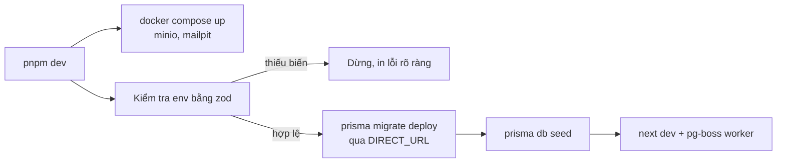

# M0 — Nền móng dự án

Xem đặc tả gốc: `docs/GIEOCHU_PROMPT_MVP_PHASE1.md` §"M0 — Nền móng dự án".

## Mục tiêu

Có monorepo chạy được, cấu hình an toàn (fail-fast), test harness sẵn sàng, trước khi bất kỳ module nghiệp vụ
nào bắt đầu.

## Luồng khởi động

Trạng thái thực tế sau phiên này: `ENV` (packages/config/src/env.ts), `MIG`/`SEED` (packages/db) đã có code;
`RUN` cần `.env` thật (Neon + S3 + secrets) để chạy hết chuỗi — xem `docs/DECISIONS.md` ADR-003/004.

## Những gì đã dựng

- **Monorepo**: pnpm workspaces (`apps/*`, `packages/*`) + Turborepo (`turbo.json` với các task
  `dev/build/lint/typecheck/test/test:unit/test:integration`).
- **`packages/config`**: `env.ts` — schema zod cho toàn bộ biến ở `.env.example` (mục 11), fail-fast qua
  `parseEnv`/`getEnv`; `brand.ts` — nguồn duy nhất cho chuỗi thương hiệu (mục 1.3); `eslint-preset.mjs` — cấu
  hình ESLint flat dùng chung + rule cấm import `@prisma/client` trần.
- **`packages/core`**: `errors.ts` — `AppError` (`code`, `httpStatus`, `expose`), các factory lỗi thường dùng
  (`unauthorized`, `forbidden`, `notFound`, `conflict`, `rateLimited`, `internalError`), `toHttpError()` map
  sang `{status, body}` đúng shape mục 6; `logger.ts` — `pino` với `redact` cho `password/token/secret/
  authorization/cookie`.
- **`packages/db`**: `prisma/schema.prisma` (model `User`, `Plan`, `CmsPage` — đủ cho seed M0, mở rộng dần);
  `prisma.config.ts` (CLI/migrate dùng `DIRECT_URL`); `src/client.ts` (`PrismaNeon` adapter + `DATABASE_URL`
  pooled); `prisma/seed.ts` (1 system admin qua argon2id, 3 plan mẫu, 1 trang CMS `home`).
- **`packages/auth|payments|storage|email|jobs`**: skeleton package (package.json, tsconfig, eslint,
  `src/index.ts` với comment trỏ tới module sẽ triển khai).
- **`apps/web`**: Next.js 16 App Router; `proxy.ts` (đổi tên từ `middleware.ts` theo Next 16, chỉ gắn
  `x-request-id`); `app/layout.tsx` + `app/page.tsx` — trang marketing tối giản đọc brand từ config; Tailwind
  4 (`@tailwindcss/postcss`); `next.config.ts` với CSP/`X-Content-Type-Options`/`Referrer-Policy`;
  `vitest.config.ts` cho `tests/integration/` (0 test ở M0, `passWithNoTests: true`).
- **`docker/docker-compose.yml`**: `minio` + job `minio-createbuckets` (tạo `gieochu-private`,
  `gieochu-public`), `mailpit`, `postgres:16` (`profile: local-db`, tuỳ chọn).
- **CI**: `.github/workflows/ci.yml` — install → lint → typecheck → unit → integration.
- **`scripts/count-tests.mjs`**: đếm số `it()`/`test()` trong hai bộ test, đối chiếu 91/50 (mục 9).

## Nghiệm thu

- [x] `pnpm i && pnpm lint && pnpm typecheck && pnpm test && pnpm build` — tất cả xanh, đã chạy thật trong
      phiên này (9 package/app).
- [x] `pnpm dev` chạy được, trang chủ trả 200 với đúng brand strings, CSP/security headers, `x-request-id` từ
      `proxy.ts` — xác minh bằng `curl` trong phiên này (dùng `.env` với `DATABASE_URL`/`DIRECT_URL`
      placeholder, vì trang chủ M0 chưa query DB).
- [ ] `prisma migrate dev` / `pnpm db:seed` thật — **cần một Neon branch thật** (hoặc tương đương) vì
      `@prisma/adapter-neon` không nói chuyện trực tiếp với `postgres:16` thường (ADR-004); chưa xác minh
      trong phiên này do không có kết nối DB thật.

## Test — Unit (4/4, đúng số lượng mục 9)

1. `packages/config/src/env.test.ts` — "accepts a fully valid configuration and fills defaults".
2. `packages/config/src/env.test.ts` — "throws EnvValidationError when a required variable is missing".
3. `packages/core/src/errors.test.ts` — "does not leak internal details in the response body when
   expose=false".
4. `packages/core/src/logger.test.ts` — "redacts sensitive fields (password, token, secret, authorization,
   cookie)".

## Test — Integration (0/0, đúng mục 9)

Không có test integration ở M0.
