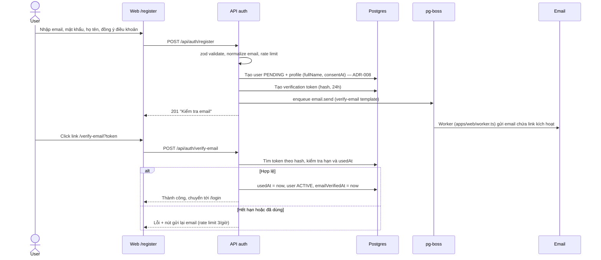
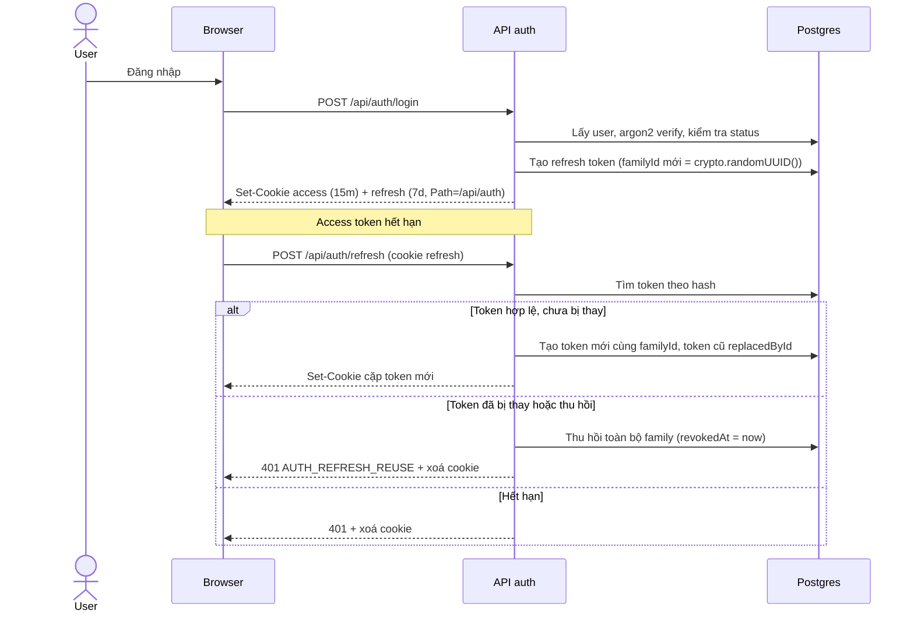
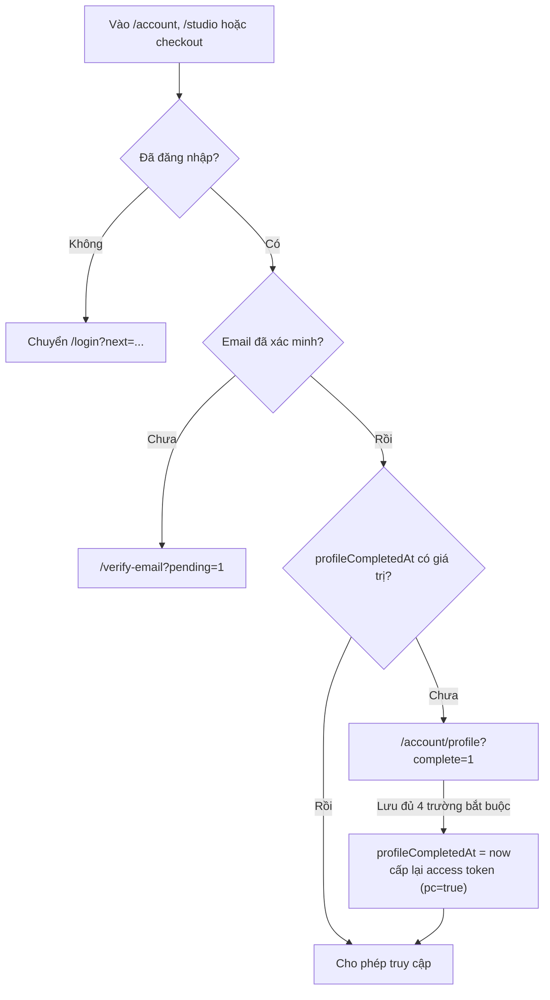

# M1 — Xác thực và định danh

Đặc tả gốc: `docs/GIEOCHU_PROMPT_MVP_PHASE1.md` §"M1 — Xác thực và định danh".

## Mục tiêu

Đăng ký, kích hoạt qua email, đăng nhập an toàn với JWT xoay vòng, bắt buộc hoàn thiện hồ sơ — trước khi bất
kỳ luồng tenant/thanh toán nào (M3+) có thể dùng danh tính người dùng.

## Sơ đồ — Đăng ký và kích hoạt

## Sơ đồ — Đăng nhập, refresh và phát hiện tái sử dụng token

## Sơ đồ — Chặn hoàn thiện hồ sơ

Triển khai: `apps/web/lib/session.ts` (`getCurrentUser`, `requireUser`, `requireRole`,
`requireVerifiedAndProfileComplete` — dùng trong route handler/API), `apps/web/lib/page-guards.ts`
(`requireCompleteAccountAccess`, `requireVerifiedAccess` — dùng trong Server Component, gọi `redirect()`).

## Những gì đã dựng

- **`packages/auth`** (logic thuần, không phụ thuộc DB): `password.ts` (argon2id hash/verify + chính sách mật
  khẩu), `email.ts` (chuẩn hoá), `profile.ts` (`isProfileComplete`), `rbac.ts` (`can(role, action)`),
  `tokens/access-token.ts` (JWT HS256 qua `jose`, claims `sub/sid/role/ver/pc`), `tokens/refresh-token.ts` +
  `tokens/verification-token.ts` (sinh/hash/đánh giá trạng thái token, không tự ghi DB).
- **`packages/db`**: thêm model `UserProfile`, `RefreshToken`, `VerificationToken` + quan hệ trên `User`
  (migration `20260917120846_m1_auth`, chạy thật trên Neon).
- **`packages/email`**: `EmailSender` (SMTP qua `nodemailer` / Resend qua `fetch`), template
  `renderVerifyEmailTemplate`, `renderResetPasswordEmailTemplate` (tiếng Việt).
- **`packages/jobs`**: `createJobQueue` (pg-boss qua `DIRECT_URL` — ADR-007), `QUEUE_NAMES.EMAIL_SEND`.
- **`apps/web/lib`**: `cookies.ts` (áp/xoá cookie access+refresh đúng thuộc tính mục 7.1), `jwt-context.ts`,
  `duration.ts`, `session.ts`, `page-guards.ts`, `rate-limit.ts` (in-memory, 3/giờ cho resend-verification),
  `jobs.ts` (enqueue email), `api-response.ts` (map lỗi + parse body zod), `request-meta.ts`.
- **9 API route** (`apps/web/app/api/auth/*`, `apps/web/app/api/me`): register, login, refresh, logout,
  verify-email, resend-verification, forgot-password, reset-password, `GET /api/me`.
- **`worker.ts`**: khung M11 — worker pg-boss xử lý job `email.send` bằng `packages/email`.
- **Trang**: `/register`, `/login`, `/verify-email`, `/forgot-password`, `/reset-password`,
  `/account/profile` (+ Server Action `completeProfileAction`), `/account/security` (+ đổi mật khẩu, đăng
  xuất mọi thiết bị), `/account/library` (stub tối thiểu chỉ để mang gate hồ sơ — nội dung thật ở M9).

## Quyết định đáng chú ý (xem `docs/DECISIONS.md`)

- ADR-007: `pg-boss` dùng `DIRECT_URL`, không qua pooler.
- ADR-008: `UserProfile` tạo một phần lúc đăng ký (`fullName` + `consentAt`), hoàn thiện `phone/occupation/
  province` sau.
- ADR-009: Integration test dùng chung Neon DB với dev (chưa có `TEST_DATABASE_URL` riêng), tự dọn dữ liệu.

## Nghiệm thu

- [x] `pnpm lint && pnpm typecheck && pnpm test && pnpm build` xanh (đã chạy thật).
- [x] Toàn bộ luồng chạy thật trên Neon (không phải mock): đăng ký → job `email.send` vào `pgboss.job` →
      kích hoạt → đăng nhập chặn khi chưa kích hoạt → đăng nhập set đúng cookie → refresh xoay vòng + phát
      hiện tái sử dụng → reset mật khẩu thu hồi phiên → gate hồ sơ chưa hoàn thiện.
- [x] Cookie đúng thuộc tính (`httpOnly`, `sameSite=lax`, refresh `path=/api/auth`) — xác minh trong test tích
      hợp.
- [x] Token cũ dùng lại bị thu hồi cả family — xác minh trong test tích hợp.
- [ ] Chưa xác minh Mailpit thực sự nhận được email (chưa chạy `docker compose up`/`pnpm worker` trong phiên
      này — xem `docs/BACKLOG.md`).

## Test — Unit (16/16, đúng mục 9)

`packages/auth/src/**/*.test.ts`: `password.test.ts` (3), `tokens/access-token.test.ts` (3),
`tokens/refresh-token.test.ts` (4), `tokens/verification-token.test.ts` (3), `email.test.ts` (1),
`profile.test.ts` (1), `rbac.test.ts` (1).

## Test — Integration (8/8, đúng mục 9)

`apps/web/tests/integration/auth.test.ts` — gọi trực tiếp hàm route handler (`POST`/`GET` export) với
`NextRequest` dựng tay, DB thật (Neon):

1. Đăng ký tạo user `PENDING` và enqueue email (kiểm tra `pgboss.job`).
2. Đăng ký trùng email → 409 `EMAIL_ALREADY_REGISTERED`.
3. Link kích hoạt chuyển user sang `ACTIVE`.
4. Đăng nhập khi chưa kích hoạt bị chặn (403 `EMAIL_NOT_VERIFIED`).
5. Đăng nhập thành công set đúng hai cookie (`httpOnly`, `sameSite=lax`, refresh `path=/api/auth`).
6. Refresh xoay vòng cookie; dùng lại refresh cũ → 401 `AUTH_REFRESH_REUSE`, cả family (kể cả token mới) bị
   thu hồi.
7. Reset mật khẩu thu hồi mọi refresh token đang hoạt động.
8. Chưa hoàn thiện hồ sơ bị chuyển hướng khỏi `/account/library` (`requireCompleteAccountAccess` ném
   `NEXT_REDIRECT` tới `/account/profile?complete=1`; xác minh thêm qua `curl` thật: 307 →
   `/login?next=...` khi chưa đăng nhập).
