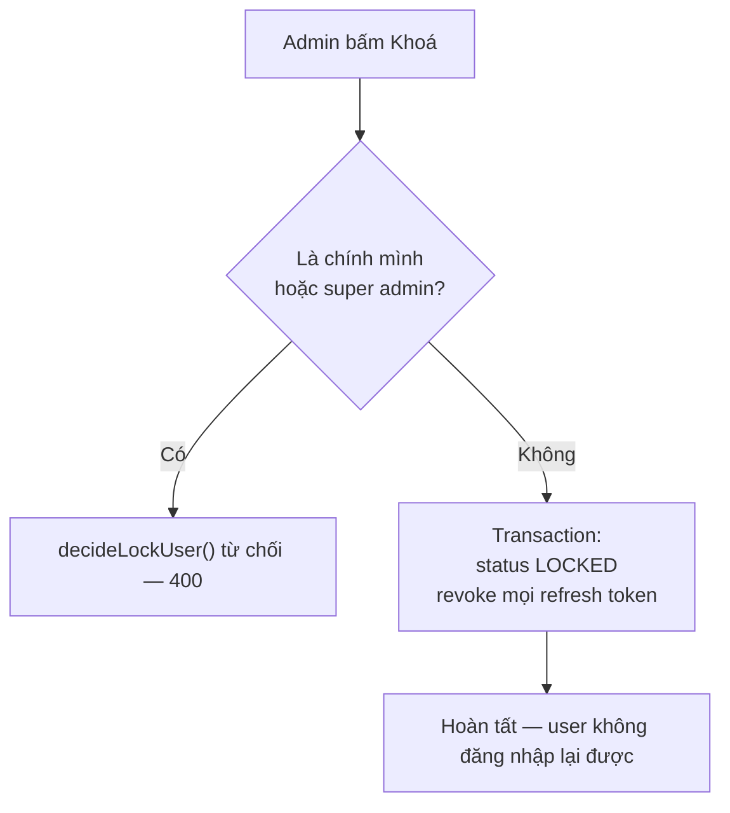

# M2 — System Admin Console (phần cơ bản)

Đặc tả gốc: `docs/GIEOCHU_PROMPT_MVP_PHASE1.md` §"M2 — System Admin Console".

## Phạm vi phiên này

Theo mục 10 ("Gợi ý thứ tự thực tế"), M2 chia hai đợt: **cơ bản** (users, plans, CMS, system settings, dashboard
tổng hợp — làm ngay sau M4) và **hoàn thiện** (Platform Payment UI + audit log viewer — chỉ làm được sau khi
có M7 và M12). Phiên này chỉ làm phần cơ bản; Platform Payment và Audit log viewer/Báo cáo vi phạm để lại
`docs/BACKLOG.md`.

## Sơ đồ — Khoá user

`isSuperAdmin` là cột mới trên `User` (chỉ true cho admin seed đầu tiên) thay vì suy luận "admin sớm nhất" —
tránh phụ thuộc `createdAt` dễ vỡ khi có nhiều admin.

## Bài học kỹ thuật: guard cho Server Component khác guard cho API/Action

Khi smoke-test `/admin` thật, phát hiện lỗi **500** thay vì redirect/404 — vì `requireRole()` (`lib/session.ts`,
dùng đúng cho API route/Server Action) ném `AppError`, nhưng gọi trực tiếp trong Server Component không có
`try/catch` nên Next hiển thị trang lỗi chung. Đã sửa bằng cách thêm `requireAdminAccess()` và
`requireTenantMemberPage()` vào `lib/page-guards.ts` (chuyển `AppError` → `redirect()`/`notFound()` đúng ngữ
cảnh trang), đồng thời sửa luôn 2 trang `/studio/[tenantSlug]/*` còn sót lỗi tương tự từ M4. Bài học: **mọi
Server Component** dùng guard ném lỗi phải đi qua bản dịch sang `redirect()`/`notFound()`, không gọi thẳng
`requireUser()/requireRole()/requireTenantMember()`.

## Những gì đã dựng

- **Schema**: `User.isSuperAdmin` (cột mới), `SystemSettings` (bảng singleton `id="default"`) — migration
  `20260918000236_m2_admin`. `SystemSettings.trialDays` giờ là nguồn thật cho M4's tạo tenant (thay vì đọc
  thẳng env `TRIAL_DAYS`) — env chỉ còn là giá trị seed mặc định.
- **`packages/core/src/admin/*`**: `decideLockUser`, `isValidPlanInput`, `cmsBlocksSchema`/`isValidCmsBlocks`,
  `buildAdminDashboardSummary` — 4/4 unit test.
- **`apps/web/lib`**: `admin-dashboard.ts` (đếm theo trạng thái, không đọc order/customer), `admin-users.ts`
  (lock/unlock/resend/grant — logic thuần để test gọi trực tiếp, giống pattern M4's `create-tenant.ts`),
  `pricing.ts` (`getActivePlans`), `page-guards.ts` (+`requireAdminAccess`, `requireTenantMemberPage`).
- **Trang admin**: `/admin` (dashboard), `/admin/users` (tìm kiếm, khoá/mở khoá, gửi lại kích hoạt, cấp quyền
  admin), `/admin/tenants` (danh sách, khoá/mở khoá — không có đơn hàng/khách hàng), `/admin/plans` (CRUD +
  bật/tắt), `/admin/cms` (CRUD trang CMS, block JSON validate qua `isValidCmsBlocks`), `/admin/settings`
  (tên nền tảng, email hỗ trợ, số ngày trial/grace).
- **Trang công khai**: `/pricing` (đọc `getActivePlans()`), `/p/[slug]` (render CMS page theo block).
- **API**: `GET /api/admin/dashboard` — 403 nếu không phải SYSTEM_ADMIN, chỉ trả số liệu tổng hợp.

## Nghiệm thu

- [x] `pnpm lint && pnpm typecheck && pnpm test && pnpm build` xanh.
- [x] Đã tự bắt và sửa 1 bug thật khi smoke-test (500 → redirect/404, xem phần "Bài học kỹ thuật" ở trên) —
      xác minh lại bằng đăng nhập thật (super admin thấy dashboard 200; user thường bị 404).
- [x] `curl` xác nhận: `/admin` chưa đăng nhập → 307 `/login`; user thường đã đăng nhập → 404; super admin →
      200 với đúng nội dung tiếng Việt; `/pricing` hiển thị đúng 2 gói seed.

## Test — Unit (4/4, đúng mục 9)

`packages/core/src/admin/*.test.ts`: `dashboard-summary.test.ts` (1), `plan-validation.test.ts` (1),
`cms-blocks.test.ts` (1), `user-lock.test.ts` (1).

## Test — Integration (4/4, đúng mục 9)

`apps/web/tests/integration/admin.test.ts`:

1. Non-admin gọi `GET /api/admin/dashboard` → 403.
2. `lockUser()` thu hồi mọi refresh token đang hoạt động; đăng nhập lại sau đó → 403 `ACCOUNT_LOCKED`.
3. Tạo gói mới qua Prisma trực tiếp → `getActivePlans()` (hàm `/pricing` dùng) trả về gói đó.
4. `GET /api/admin/dashboard` (admin thật) chỉ có `totalUsers`/`usersByStatus`/... — không có trường
   `users`/`tenants` (mảng chi tiết) hay email cá nhân nào trong response.
