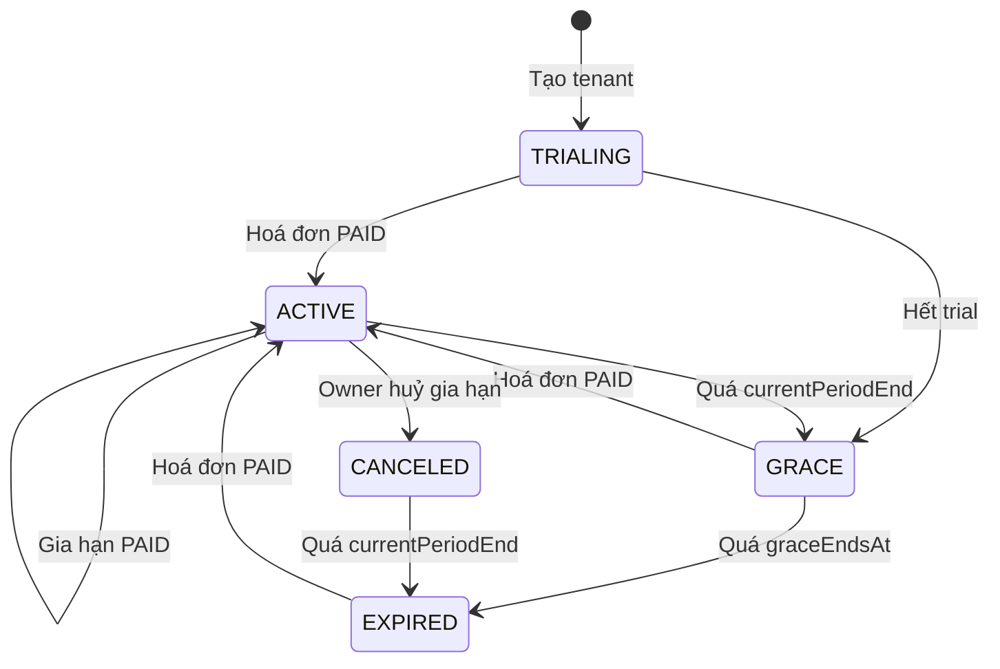
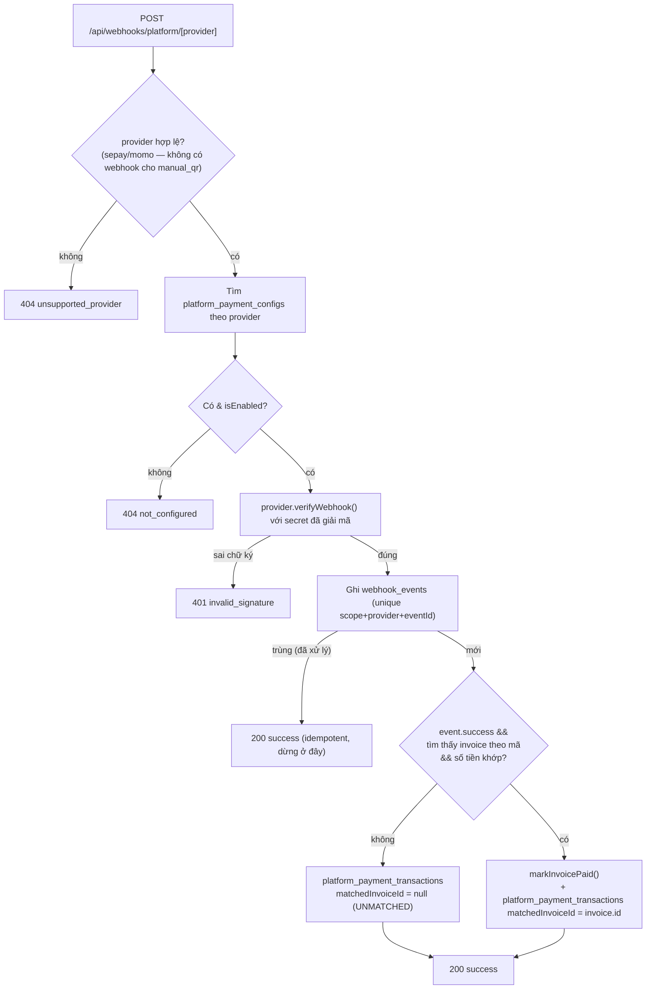
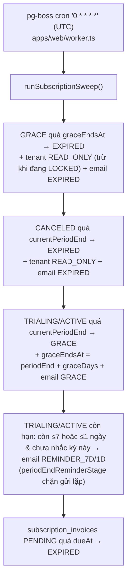
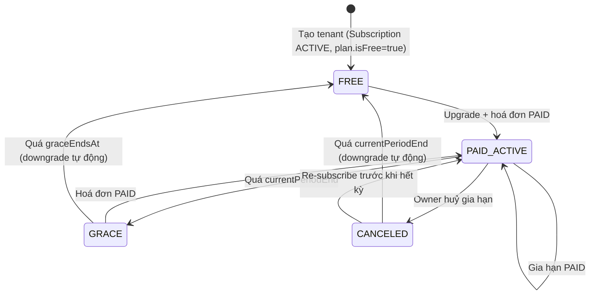

# M3 — Billing, Subscription & Entitlements

Đặc tả gốc: `docs/GIEOCHU_PROMPT_MVP_PHASE1.md` §"M3 — Subscription và Platform Billing". Từ v2 (xem mục
cuối file), tên module đổi theo `docs/GIEOCHU_HYBRID_MONETIZATION_BILLING_PROPOSAL_V2.md` §15 và ADR-021 —
nội dung dưới đây là **M3 v1** (bản gốc, giữ nguyên làm lịch sử); phần thay đổi thật ở cuối file.

## Trước khi code: đối chiếu với báo cáo tham khảo

Người dùng cung cấp một báo cáo kỹ thuật về module payment của hệ thống khác (TaniGos, đã chạy production —
`docs/bao-cao-ky-thuat-module-payment-2026-09-18.md`) để tham khảo trước khi làm module này. Miền "System
Center Billing" của báo cáo đó đối xứng gần như 1:1 với M3. Đã đối chiếu và giữ nguyên theo đặc tả Gieo Chữ ở
những điểm khác biệt cố ý:

- **Không tính proration khi đổi gói** — đặc tả Gieo Chữ nói rõ (khác TaniGos, có cộng ngày dư khi upgrade).
- **Sweep chạy hằng giờ qua pg-boss in-process** (không phải cron HTTP endpoint gọi từ ngoài như TaniGos) —
  nên không cần cơ chế `CRON_SECRET` fail-closed của báo cáo (không có endpoint public nào lộ ra).

Hai điểm áp dụng từ báo cáo (an toàn, không mâu thuẫn đặc tả) — xem ADR-013: dedupe hoá đơn `PENDING`, và tự
tắt `PlatformPaymentConfig` khi đổi tài khoản/secret.

## Sơ đồ — Vòng đời Subscription (đúng đặc tả)

`packages/core/src/billing/subscription-state.ts` mã hoá đúng sơ đồ này thành một bảng chuyển trạng thái
tường minh — `transitionSubscriptionStatus()` ném lỗi (không trả decision object) khi gặp sự kiện ngoài sơ
đồ, vì đây là lỗi lập trình chứ không phải kết quả hợp lệ cần hiển thị cho người dùng. `PAST_DUE` (khai báo
sẵn trên `SubscriptionStatus` từ M4) không được máy trạng thái M3 gán bao giờ — giữ nguyên trong schema,
cùng kiểu "khai báo nhưng chưa dùng" như `PlatformInvoiceStatus.VOID` trong báo cáo tham khảo.

## Sơ đồ — Webhook platform (SePay/MoMo)

Nguồn: `apps/web/app/api/webhooks/platform/[provider]/route.ts`, `apps/web/lib/subscription-billing.ts`.

## Sơ đồ — Sweep hằng giờ (`subscription.sweep`, pg-boss cron)

Nguồn: `apps/web/lib/subscription-sweep.ts`, đăng ký qua `apps/web/worker.ts` (`QUEUE_NAMES.SUBSCRIPTION_SWEEP`).

## Những gì đã dựng

- **Schema**: `SubscriptionInvoice` (L1 như `Subscription`/`Plan`, không RLS — gate ở tầng ứng dụng),
  `PlatformPaymentTransaction` (ghi mọi webhook đã verify chữ ký, matched hay UNMATCHED),
  `Subscription.periodEndReminderStage` (chặn gửi lặp email nhắc).
- **`packages/core/src/billing`**: `period.ts` (tính kỳ theo tháng/năm, clamp cuối tháng, `graceEndsAt`),
  `invoice-code.ts` (mã `SUB` + 8 ký tự), `subscription-state.ts` (máy trạng thái, ném lỗi khi sai),
  `plan-limits.ts` (kiểm tra giới hạn — hàm thuần, DB wrapper để M5 tự viết) — 10/10 unit test.
- **`apps/web/lib`**: `platform-payment.ts` (cấu hình Platform Payment, tự tắt khi đổi tài khoản/secret —
  ADR-013), `subscription-billing.ts` (`createRenewalInvoice` có dedupe, `markInvoicePaid`, admin
  `confirmManualInvoicePayment`), `subscription-sweep.ts` (job hằng giờ), `tenant-write-guard.ts`
  (`assertTenantCanWrite` — forward-declare cho M5/M8/M9).
- **Trang**: `/studio/[tenantSlug]/billing` (trạng thái, dung lượng, gia hạn/nâng gói, QR/redirect hoá đơn
  đang chờ với polling 3 giây, lịch sử hoá đơn), `/admin/billing/payment` (cấu hình TK Tani — 3 provider,
  "Kiểm tra kết nối" cho MoMo), `/admin/billing/invoices` (đối soát hoá đơn `MANUAL_QR` thủ công — không đọc
  đơn hàng/khách hàng của tenant, chỉ dữ liệu billing-của-tenant, đúng §7.9).
- **Route**: `POST /api/webhooks/platform/[provider]` (SePay/MoMo — MANUAL_QR không có webhook).
- **Job**: `subscription.sweep` đăng ký cron `0 * * * *` (UTC) trong `apps/web/worker.ts`, dùng
  `JobQueue.schedule()` mới thêm vào `packages/jobs`.
- **Email**: `renderSubscriptionStatusEmail()` (`packages/email`) — 4 stage (REMINDER_7D/1D, GRACE, EXPIRED).

## Nghiệm thu

- [x] `pnpm lint && pnpm typecheck && pnpm test && pnpm build` xanh (50/91 unit, 26/50 integration cộng dồn).
- [x] `curl` xác nhận thật: `/studio/.../billing` và `/admin/billing/*` chưa đăng nhập → 307; webhook platform
      SePay/MoMo chưa cấu hình → 404 `not_configured`; MANUAL_QR → 404 `unsupported_provider` (không có webhook).
- [x] Trial → hoá đơn PENDING → webhook SePay ký hợp lệ → PAID → subscription ACTIVE (test tích hợp #2).
- [x] Webhook trùng `providerEventId` xử lý idempotent, không tạo `platform_payment_transactions` thứ 2 (test #3).
- [x] Sweep chuyển đúng GRACE rồi EXPIRED, tenant READ_ONLY (test #4).
- [x] Tenant READ_ONLY chặn ghi (`assertTenantCanWrite` ném lỗi) nhưng sản phẩm đã PUBLISHED vẫn liệt kê được
      cho khách (`getPublishedProducts` không lọc theo trạng thái tenant) (test #5).

## Test — Unit (10/10, đúng mục 9)

`packages/core/src/billing/**/*.test.ts`: `period.test.ts` (5: kỳ theo tháng, kỳ theo năm, `graceEndsAt`, gia
hạn còn hiệu lực, gia hạn sau khi hết hạn), `invoice-code.test.ts` (1), `subscription-state.test.ts` (2: hợp
lệ + không hợp lệ), `plan-limits.test.ts` (2: số sản phẩm + dung lượng).

## Test — Integration (5/5, đúng mục 9)

`apps/web/tests/integration/subscription-billing.test.ts`:

1. Tạo tenant → subscription `TRIALING` gắn với một `Plan`.
2. Tạo hoá đơn gia hạn (gói `PRO_MONTHLY`) + webhook SePay ký đúng → `PAID`, subscription `ACTIVE`, đổi đúng
   `planId`/kỳ mới.
3. Webhook trùng `providerEventId` → xử lý idempotent (chỉ 1 `platform_payment_transactions`).
4. `runSubscriptionSweep()` chuyển subscription quá hạn → `GRACE`, rồi quá `graceEndsAt` → `EXPIRED` +
   tenant `READ_ONLY`.
5. Tenant `READ_ONLY`: `assertTenantCanWrite()` ném lỗi; `getPublishedProducts()` vẫn trả về sản phẩm đã
   `PUBLISHED` trước đó.

## Backlog phát sinh (xem docs/BACKLOG.md)

- DB wrapper thật của `assertPlanLimit(tenantId, kind)` (query Product/file thật) để M5 gọi — chỉ có hàm
  thuần `isWithinPlanLimit()` sẵn sàng.
- `/studio/.../billing` chưa hiển thị "dung lượng đã dùng / giới hạn gói" dưới dạng progress bar — chỉ hiện
  số MB đã dùng (giới hạn plan.storageMb chưa hiển thị vì chưa có UI thiết kế).
- Admin chưa có trang "danh sách toàn bộ subscription theo trạng thái + override thủ công" (kiểu
  `admin/billing/subscriptions` trong báo cáo tham khảo) — spec M3 không yêu cầu tường minh, để ngỏ tới khi
  cần vận hành thật.

---

# M3 v2 — Hybrid Monetization (Free Forever + Paid Subscription)

Đặc tả: `docs/GIEOCHU_HYBRID_MONETIZATION_BILLING_PROPOSAL_V2.md` (đề xuất người dùng cung cấp) + ADR-021.
Thay hẳn "Subscription-first" (mọi tenant mới `TRIALING`, hết trial không trả tiền → `READ_ONLY`) bằng
"Free Forever" (FREE là plan thật, bán được, không hết hạn; trả phí chỉ để mở rộng capacity/tính năng).

## Sơ đồ — Vòng đời Plan (thay cho sơ đồ Subscription v1 ở trên)

`FREE` không còn là trạng thái `Subscription.status` riêng — nó là **plan** (`plan.isFree = true`) trong khi
`status` vẫn luôn là `ACTIVE`. Điều quan trọng: `EXPIRED` không còn là trạng thái được lưu (dù enum
`SubscriptionStatus` vẫn khai báo `TRIALING`/`EXPIRED`/`PAST_DUE`, cùng kiểu "declared but unused" như
`PAST_DUE` từ v1) — `subscription-sweep.ts` khi GRACE/CANCELED kết thúc downgrade thẳng
(`planId → FREE, status → ACTIVE`) trong cùng một lượt, không đi qua `EXPIRED` làm trạng thái lưu trữ.
`transitionSubscriptionStatus()` (`packages/core/src/billing/subscription-state.ts`) **không đổi** — sweep
vẫn gọi nó để validate sự kiện hợp lệ trước khi hành động, chỉ đổi *hệ quả DB* của nhánh GRACE_ENDED/PERIOD_ENDED.

## Những gì đã dựng thêm

- `Plan.isFree`/`Plan.features` (Json) — mọi số liệu/tính năng từng gói customize qua `/admin/plans`
  (`updatePlanAction` mới, trước đây chỉ tạo/bật-tắt).
- `packages/core/src/billing/feature-gate.ts`: `canUsePlanFeature(features, key)` — business logic không
  bao giờ đọc `plan.code`.
- `create-tenant.ts`: gán thẳng plan `isFree:true`, `status:"ACTIVE"`, `currentPeriodStart =
  currentPeriodEnd = now` (không `TRIALING`/`TRIAL_DAYS` nữa).
- `subscription-sweep.ts`: mọi truy vấn sweep loại `plan: { isFree: false }`; GRACE/CANCELED kết thúc →
  `downgradeToFree()` (planId đổi, không đụng `tenant.status` — `READ_ONLY` giờ chỉ còn do moderation).
- `apps/web/lib/plan-limits.ts`: thêm `assertPlanFeature(tenantId, key)` (đọc `plan.features`) — **hàm đã
  có, chưa gate call site cụ thể nào** (coupon/analytics/...), ghi BACKLOG.
- Seed 4 gói FREE/CREATOR/PRO/BUSINESS (đã xoá 3 plan cũ `STARTER`/`PRO_MONTHLY`/`PRO_YEARLY` khỏi DB dev sau
  khi xác nhận không còn subscription nào tham chiếu).
- `/pricing` (4 cột + feature list), `/studio/.../billing` (progress bar giới hạn, cảnh báo ngưỡng 80%,
  ẩn nhãn "Đang dùng thử"), `/admin` (tách đếm subscription Free/Paid — `AdminDashboardSummary.subscriptionsByPlanType`).
- Email `subscription-billing.ts` (packages/email): đổi stage `EXPIRED` → `DOWNGRADED_TO_FREE`, sửa lại toàn
  bộ copy (không còn "tạm ngưng bán").

## Nghiệm thu (v2)

- [x] `pnpm lint && pnpm typecheck && pnpm test && pnpm build` xanh (88/91 unit, 46/50 integration cộng dồn).
- [x] Tạo tenant mới → `Subscription.status = ACTIVE`, `plan.isFree = true` ngay lập tức (không qua `TRIALING`).
- [x] Free-plan tenant bị `assertPlanLimit` chặn đúng lúc chạm `plan.maxProducts`.
- [x] Upgrade Free → Paid: `computeRenewalPeriod()` tính kỳ mới bắt đầu từ lúc thanh toán (không cần sửa gì
      ở `subscription-billing.ts`), `plan.isFree` đổi `false` ngay sau webhook PAID.
- [x] Sweep: GRACE hết hạn → downgrade về Free (`plan.isFree = true`, `status = ACTIVE`), `tenant.status`
      **không** đổi thành `READ_ONLY`.

## Test — Unit (11/11 cộng dồn, +1 so với v1)

`packages/core/src/billing/feature-gate.test.ts` (1 test mới: cờ tính năng chỉ đúng khi `=== true`, thiếu/
sai kiểu đều tính là tắt). `packages/core/src/admin/plan-validation.test.ts` mở rộng cùng 1 `it()` (không
tăng số test) để kiểm `isFree`/`features` hợp lệ.

## Test — Integration (7/7 cộng dồn, +2 so với v1)

`apps/web/tests/integration/subscription-billing.test.ts` (rewrite 1 test cũ + 2 test mới):
- (Sửa) "creating a tenant opens an ACTIVE subscription on the FREE plan, which never expires".
- (Sửa) "the hourly sweep downgrades an overdue paid subscription back to FREE, keeping the tenant sellable".
- (Mới) Free-plan tenant chặn đúng ở giới hạn sản phẩm (`assertPlanLimit`).
- (Mới) Upgrade Free → Paid tính đúng kỳ mới + đổi plan ngay sau thanh toán.

`apps/web/tests/integration/tenant.test.ts` sửa 1 test cũ tương ứng (không đổi tổng số test M4).

## Backlog phát sinh (v2)

- `assertPlanFeature()` đã có nhưng chưa gate bất kỳ call site nào (coupon/analytics/branding/SEO/automation/
  customDomain) — cần quyết định trước Free có coupon hay không trước khi gate lần đầu.
- MRR/GMV đầy đủ trên `/admin` vẫn chờ M12 (chỉ mới tách đếm Free/Paid, chưa tính tiền).
- `SystemSettings.trialDays` không còn được đọc ở đâu (trial không còn tồn tại) — chưa xoá khỏi schema, để
  nguyên vì không phải trọng tâm đợt này.
- Transaction fee, split payment, proration, usage billing theo API, `billing_accounts`/`usage_meters`/
  `billing_events` — cố tình không làm, xem ADR-021.
