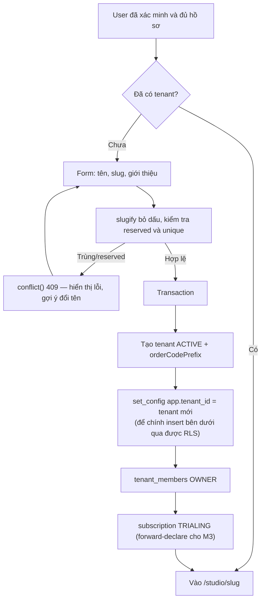
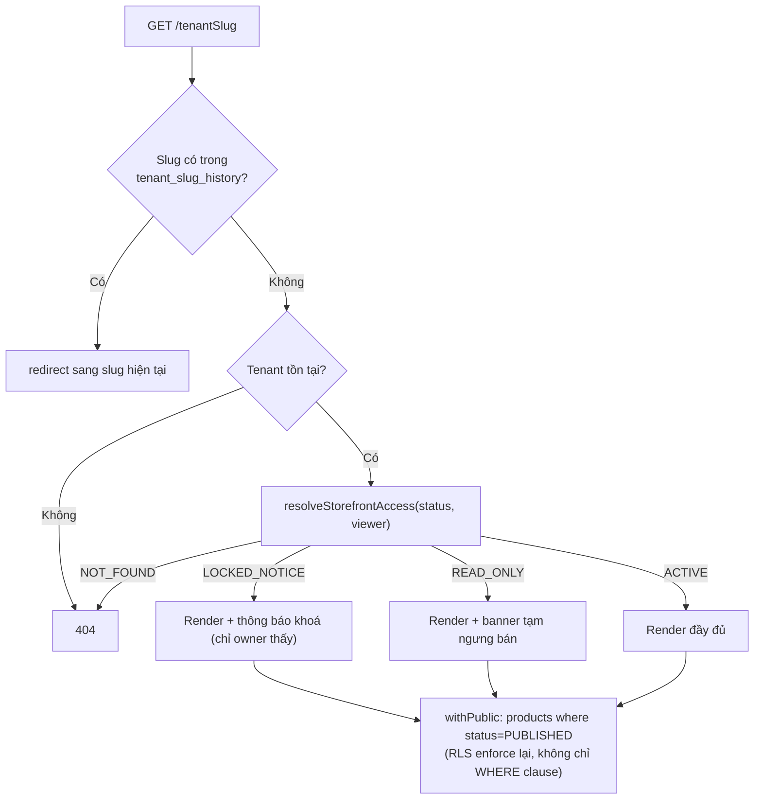

# M4 — Tenant Workspace và Storefront

Đặc tả gốc: `docs/GIEOCHU_PROMPT_MVP_PHASE1.md` §"M4 — Tenant Workspace và Storefront".

## Mục tiêu

Tenant owner mở "trang social tài liệu" riêng, truy cập qua slug — module L2 (tenant-scoped) đầu tiên, nên
đây cũng là nơi RLS (`docs` §5.4) lần đầu được bật thật.

## Phát hiện quan trọng: RLS cần role Postgres riêng

Khi viết test RLS, phát hiện role Neon mặc định (`neondb_owner`) có `BYPASSRLS`, khiến mọi policy RLS vô hiệu
với kết nối app — bất kể `ENABLE`/`FORCE ROW LEVEL SECURITY`. Đã dừng lại hỏi người dùng (không tự quyết vì
ảnh hưởng bảo mật) và được chọn phương án tạo role Postgres riêng cho app. Xem `docs/DECISIONS.md` ADR-010 và
`packages/db/scripts/setup-app-role.mts`.

Hệ quả kỹ thuật: biến môi trường tách làm 3 thay vì 2 — `DATABASE_URL`/`DIRECT_URL` (role `gieochu_app`, không
DDL, không bypass RLS) và `PRISMA_MIGRATE_URL` (role owner, chỉ CLI `prisma migrate`/`generate` dùng).

## Sơ đồ — Onboarding tenant

## Sơ đồ — Render storefront

## Những gì đã dựng

- **Schema**: `Tenant`, `TenantMember`, `TenantSlugHistory`, `Subscription` (tối thiểu, forward-declare cho
  M3), `Product` (tối thiểu: id/tenantId/slug/title/status, forward-declare cho M5). Migration
  `20260917232857_m4_tenant` + RLS thủ công `20260917232925_rls_m4` (bật RLS + policy cho `products` và
  `tenant_members`).
- **`packages/db/src/rls.ts`**: `withTenant`, `withCustomer`, `withPublic`, `withSystemJob` — set
  `set_config('app.scope'/'app.tenant_id'/'app.user_id', ..., true)` trong transaction, đúng mục 5.4.
- **`packages/core/src/tenant/*`**: `slugify`, `isReservedSlug`, `generateOrderCodePrefix`,
  `isValidHexColor`/`isValidSocialLink`, `resolveStorefrontAccess`, `canManageTenant` — 6/6 unit test.
- **`apps/web/lib`**: `tenant.ts` (`requireTenantMember` — dùng `withTenant` cho chính lookup membership, nếu
  không sẽ tự chặn nhầm cả owner hợp lệ), `create-tenant.ts` (`createTenantForUser`), `storefront.ts`
  (`findTenantBySlugForStorefront`, `findSlugRedirectTarget`, `getPublishedProducts` qua `withPublic`).
- **Trang**: `/studio` (onboarding hoặc redirect nếu đã có tenant), `/studio/[tenantSlug]` (dashboard, số liệu
  placeholder chờ M6/M8/M10), `/studio/[tenantSlug]/settings` (đổi thương hiệu + màu + mạng xã hội, đổi slug
  tối đa 1 lần/30 ngày), `/[tenantSlug]` (storefront công khai).
- **`packages/db/scripts/setup-app-role.mts`**: script tạo/cấp quyền role `gieochu_app` (không phải migration
  — role là đối tượng cấp project, chạy 1 lần/môi trường).

## Quyết định đáng chú ý (xem `docs/DECISIONS.md`)

ADR-010 (role Postgres riêng cho RLS). Không có ADR mới nào khác cho slug/branding vì spec đã đủ rõ để
implement thẳng.

## Nghiệm thu

- [x] `pnpm lint && pnpm typecheck && pnpm test && pnpm build` xanh.
- [x] RLS xác minh **thật** (không chỉ policy tồn tại mà còn thực sự chặn) qua integration test + qua việc
      sửa được 2 lỗi thật do RLS phát hiện (insert tenant_member lúc onboarding, và `requireTenantMember`
      từng có thể chặn nhầm owner hợp lệ).
- [x] `curl` xác nhận thật: `/studio` chưa đăng nhập → 307 `/login?next=/studio`; slug không tồn tại → 404;
      storefront tenant thật render đúng tên + footer thương hiệu.
- [ ] Chưa test UI onboarding/settings qua trình duyệt thật (chỉ test qua curl + Vitest gọi thẳng
      `createTenantForUser`/`requireTenantMember`).

## Test — Unit (6/6, đúng mục 9)

`packages/core/src/tenant/*.test.ts`: `slug.test.ts` (2), `order-code-prefix.test.ts` (1),
`branding.test.ts` (1), `access-policy.test.ts` (1), `membership.test.ts` (1).

## Test — Integration (5/5, đúng mục 9)

`apps/web/tests/integration/tenant.test.ts`:

1. Tạo tenant sinh membership OWNER và subscription TRIALING.
2. Slug trùng → 409 `SLUG_TAKEN`.
3. Owner tenant A truy cập `/studio/[slug B]` → 403 (mock cookie qua `next/headers`, giống pattern M1).
4. RLS: `withTenant(A)` truy vấn `products where tenantId = B` trả rỗng dù WHERE clause "nói dối".
5. Storefront (`getPublishedProducts`) chỉ trả sản phẩm `PUBLISHED`.
