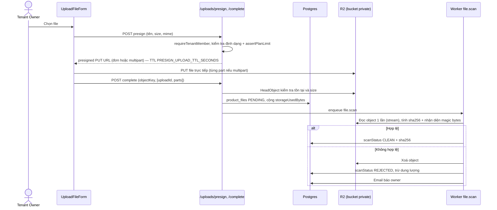
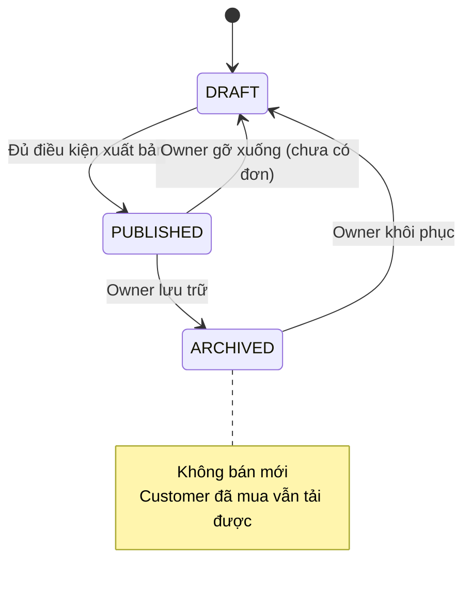

# M5 — Sản phẩm và File tài liệu

Đặc tả gốc: `docs/GIEOCHU_PROMPT_MVP_PHASE1.md` §"M5 — Sản phẩm và File tài liệu". Làm qua 2 giai đoạn trong
cùng phiên làm việc — xem ADR-014/ADR-017 cho lý do chia giai đoạn.

## Giai đoạn 1 — metadata/CRUD (không cần storage thật)

Máy đang code lúc đó không có Docker (không chạy được MinIO local). Đã hỏi người dùng và chọn: làm trước
phần không cần storage thật, hoãn upload thật sang sau.

- Schema `Product` (mở rộng đầy đủ theo ERD mục 5) + `ProductFile` (model + RLS).
- CRUD sản phẩm đầy đủ (tạo/sửa/xuất bản/gỡ/lưu trữ/khôi phục).
- 3 hàm logic thuần trong `packages/core/src/product/` + 2 hàm thuần trong `packages/storage` (validate định
  dạng/tên file/object key — không gọi mạng).

## Giai đoạn 2 — hạ tầng cấu hình + upload thật

Theo yêu cầu tường minh của người dùng, cấu hình storage (endpoint/bucket/access key R2) quản lý qua
**System Admin** thay vì biến môi trường — đã phân tích đánh đổi bảo mật (access key storage có quyền toàn
bộ file mọi tenant, nhạy hơn secret thanh toán từng tenant) và hỏi trước khi làm (ADR-017). Sau đó xây tiếp
toàn bộ luồng upload thật (presign/complete/file.scan) mà giai đoạn 1 đã hoãn.

- Bảng `SystemStorageConfig` (1 dòng, mã hoá bằng `STORAGE_ENCRYPTION_KEY` **riêng** — không dùng chung
  `PAYMENT_ENCRYPTION_KEY`), tự tắt khi đổi endpoint/bucket/access key (giống `PlatformPaymentConfig`,
  ADR-013). Trang `/admin/settings/storage` (form + nút "Kiểm tra kết nối" — `HeadBucketCommand` thật).
- Refactor: `encryptSecret`/`decryptSecret`/`maskSecret` chuyển từ `packages/payments` sang
  `packages/core/src/crypto/` — dùng chung được cho cả payments lẫn storage.
- `packages/storage`: `presign.ts` (PUT đơn cho file ≤ 50MB, multipart part 10MB cho file lớn hơn —
  `createPresignedMultipartUpload`/`completeMultipartUpload`, `headObject`, `deleteObject`,
  `createPresignedDownload` cho M9), `scan.ts` (`readObjectForScan` — stream 1 lần vừa hash sha256 incremental
  vừa lấy vài KB đầu để nhận diện magic bytes, không buffer cả file dù file lớn tới 200MB).
- `apps/web/lib/product-upload.ts`: `presignProductFileUpload`/`completeProductFileUpload` (file bán, bucket
  private, có `file.scan`) và `presignCoverImageUpload`/`completeCoverImageUpload` (ảnh bìa, bucket public,
  không `file.scan`, không tính vào `storageUsedBytes`).
- `apps/web/lib/file-scan.ts`: job `file.scan` — không có `CLAMAV_HOST` thật (không có client library) →
  **luôn** `CLEAN` sau khi qua được kiểm tra magic-bytes-khớp-đuôi, ghi log cảnh báo nếu có set biến này
  (ADR-018); sai định dạng → xoá object + `REJECTED` + trừ `storageUsedBytes` (atomic `decrement`) + email
  báo owner (`renderProductFileRejectedEmail`, `packages/email`).
- Route: `POST /api/studio/[tenantSlug]/uploads/presign`, `.../complete`, `.../cover-presign`,
  `.../cover-complete`. Job `file.scan` đăng ký trong `apps/web/worker.ts`.
- UI Studio: `UploadFileForm` (chọn file → presign → PUT thẳng lên S3 [đơn hoặc multipart theo từng phần] →
  complete → `router.refresh()`), `CoverImageUpload` (tương tự, bucket public, hiển thị ảnh ngay qua
  `publicBaseUrl`).

## Sơ đồ — Upload file tài liệu (đã cài đặt đúng theo sơ đồ đặc tả)

## Sơ đồ — Vòng đời sản phẩm

`apps/web/lib/product.ts` mã hoá đúng sơ đồ này — `publishProduct()` gọi `canPublishProduct()`
(`packages/core`) để kiểm đủ 5 điều kiện (file bán CLEAN, ảnh bìa, giá hợp lệ, tenant ACTIVE, chưa vượt giới
hạn số sản phẩm). `unpublishProduct()` hiện **không kiểm tra "chưa có đơn"** vì M8 (Order) chưa tồn tại — ghi
trong BACKLOG, nối lại khi M8 xong. `archiveProduct()`/`restoreProduct()` không đụng tới `ProductFile` — khớp
đúng "Xoá file... không xoá object" và "Customer đã mua vẫn tải được".

## Những gì đã dựng (tổng hợp cả 2 giai đoạn)

- **Schema**: `Product` đầy đủ, `ProductFile` (L2, RLS — public chỉ thấy `isPreview=true AND scanStatus=CLEAN
  AND removedAt IS NULL` của product `PUBLISHED`), `SystemStorageConfig` (L1).
- **`packages/storage`**: `file-format.ts`, `object-key.ts`, `s3-client.ts`, `connection-test.ts`,
  `presign.ts`, `scan.ts`.
- **`packages/core/src/product`**: `slug-suggestion.ts`, `publish-eligibility.ts`, `storage-accounting.ts`.
- **`apps/web/lib`**: `plan-limits.ts`, `product.ts`, `product-upload.ts`, `file-scan.ts`, `system-storage.ts`.
- **Trang Studio**: `/products`, `/products/new`, `/products/[id]` (form đầy đủ + ảnh bìa + upload/quản lý
  file). **Trang admin**: `/admin/settings/storage`.

## Nghiệm thu

- [x] `pnpm lint && pnpm typecheck && pnpm test && pnpm build` xanh (56/91 unit, 29/50 integration cộng dồn).
- [x] `curl` xác nhận: mọi route mới chưa đăng nhập → 401/307 tuỳ loại (API route → 401, trang → 307).
- [x] Xuất bản thất bại đúng khi chưa có file `CLEAN` (test tích hợp).
- [x] Lưu trữ sản phẩm không đụng tới file đã có (test tích hợp).
- [x] Presign chỉ trả URL cho owner của tenant, từ chối (403) người không phải thành viên (test tích hợp).
- [ ] "Upload file lớn qua multipart thật", "file giả mạo đuôi bị từ chối thật", "`complete` ghi
      `product_files` khi HeadObject thành công" — **cần R2 thật để verify hết**; code đã viết đầy đủ theo
      đúng cơ chế (đã typecheck/lint/build xanh) nhưng chưa chạy qua storage thật. Người dùng tự verify khi
      nhập credential R2 qua `/admin/settings/storage`.

## Test — Unit (6/6, đúng mục 9)

1. Định dạng theo đuôi + magic bytes — `packages/storage/src/file-format.test.ts`.
2. Kích thước tối đa theo gói — `packages/core/src/billing/plan-limits.test.ts` (tái dùng `isWithinPlanLimit`
   đã xây ở M3).
3. Sinh object key + sanitize tên file — `packages/storage/src/object-key.test.ts`.
4. Gợi ý slug khi trùng — `packages/core/src/product/slug-suggestion.test.ts`.
5. Điều kiện xuất bản — `packages/core/src/product/publish-eligibility.test.ts`.
6. Tính lại `storageUsedBytes` — `packages/core/src/product/storage-accounting.test.ts`.

## Test — Integration (3/4 — 1 còn lại cần storage thật)

`apps/web/tests/integration/product.test.ts`:
1. Xuất bản thất bại khi chưa có file `CLEAN`, trạng thái vẫn `DRAFT`.
2. Lưu trữ sản phẩm không ảnh hưởng file đã có.

`apps/web/tests/integration/product-upload.test.ts`:
3. Presign chỉ trả URL cho owner của tenant (dùng `SystemStorageConfig` giả — presign PUT đơn là ký chữ ký
   thuần, không gọi mạng thật nên không cần R2 thật để test phần xác thực).

**Còn thiếu**: "`complete` ghi `product_files` và enqueue job quét" — cần `HeadObject` thật lên bucket thật,
để dành cho khi có credential R2.

## Việc còn lại

Xem `docs/BACKLOG.md` mục M5 — tóm tắt: verify end-to-end với R2 thật (upload đơn, multipart, file giả mạo
đuôi bị `file.scan` từ chối thật); trang public `/{tenantSlug}/products/{productSlug}`; ClamAV thật (ADR-018);
`unpublishProduct()` kiểm tra "chưa có đơn" (chờ M8); rate limit cho 4 route upload mới.
