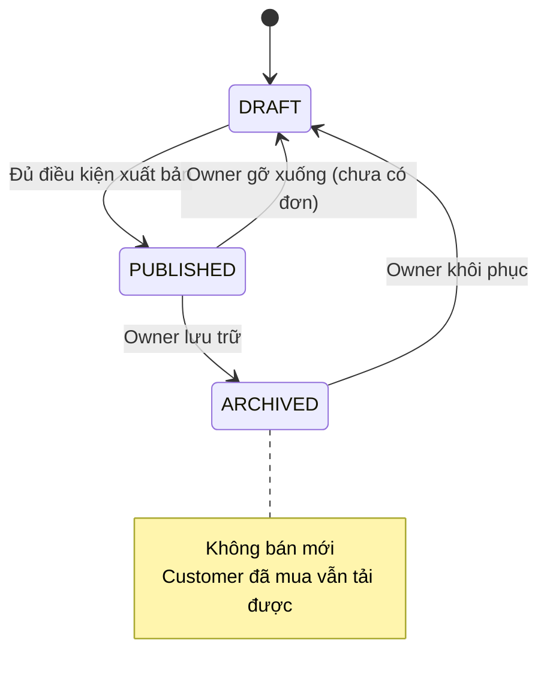

# M5 — Sản phẩm và File tài liệu (phần 1: metadata/CRUD — chưa upload thật)

Đặc tả gốc: `docs/GIEOCHU_PROMPT_MVP_PHASE1.md` §"M5 — Sản phẩm và File tài liệu".

## Phạm vi phiên này — xem ADR-014

Máy đang code không có Docker (không chạy được MinIO local như `.env` đang trỏ tới), nên phần **upload/
storage thật** (presign, `complete`, `file.scan`, S3 client) bị hoãn lại thành một module riêng làm sau
(hướng đã chốt: dùng Cloudflare R2 thật, không cần Docker — giống Neon đang dùng cho DB). Phiên này làm:

- Schema `Product` (mở rộng đầy đủ theo ERD mục 5) + `ProductFile` (model + RLS, chưa có object thật nào).
- CRUD sản phẩm đầy đủ (tạo/sửa/xuất bản/gỡ/lưu trữ/khôi phục).
- 3 hàm logic thuần trong `packages/core/src/product/` + 2 hàm thuần trong `packages/storage` (không gọi
  mạng — chỉ validate định dạng/tên file/object key).
- 6/6 unit test (đúng mục 9). 2/4 integration test (2 test còn lại — presign, `complete` — cần storage thật,
  để dành cho module upload).

## Sơ đồ — Vòng đời sản phẩm (đúng đặc tả)

`apps/web/lib/product.ts` mã hoá đúng sơ đồ này — `publishProduct()` gọi `canPublishProduct()`
(`packages/core`) để kiểm đủ 5 điều kiện (file bán CLEAN, ảnh bìa, giá hợp lệ, tenant ACTIVE, chưa vượt giới
hạn số sản phẩm — `assertPlanLimit` mới xây, hoàn thiện phần M3 đã hoãn). `unpublishProduct()` hiện **không
kiểm tra "chưa có đơn"** vì M8 (Order) chưa tồn tại — ghi trong BACKLOG, nối lại khi M8 xong.
`archiveProduct()`/`restoreProduct()` không đụng tới `ProductFile` — khớp đúng "Xoá file... không xoá
object" và "Customer đã mua vẫn tải được" của đặc tả (test tích hợp #4 xác nhận file vẫn còn nguyên sau khi
lưu trữ sản phẩm).

## Những gì đã dựng

- **Schema**: `Product` thêm `description/type/coverImageKey/tags/priceVnd/salePriceVnd(+range)/
  downloadLimit`. `ProductFile` (L2, RLS mới — `tenantId` denormalized theo đúng ERD; public chỉ thấy file
  `isPreview=true AND scanStatus=CLEAN AND removedAt IS NULL` của product `PUBLISHED`). `removedAt` trên
  `ProductFile` là soft-hide — không bao giờ xoá object S3 khi owner "xoá" file (chỉ `file.scan` mới thật sự
  xoá object, và chỉ khi file đó **chưa từng** `CLEAN`).
- **`packages/storage`** (từ khung rỗng): `file-format.ts` (allowlist 12 định dạng + đối chiếu với kết quả
  đọc magic bytes — nhóm OOXML mới doc/pptx/xlsx phân biệt được, nhóm OLE cũ doc/xls/ppt dùng chung chữ ký
  CFB nên chấp nhận chéo), `object-key.ts` (`sanitizeFileName`, `buildProductFileKey` đúng
  `tenants/{tenantId}/products/{productId}/{fileId}/{sanitizedFileName}`).
- **`packages/core/src/product`**: `slug-suggestion.ts` (`suggestSlug` — base/base-2/base-3...),
  `publish-eligibility.ts` (`canPublishProduct`, trả về danh sách lý do chặn), `storage-accounting.ts`
  (`applyStorageDelta`, không âm).
- **`apps/web/lib/plan-limits.ts`**: `assertPlanLimit(tenantId, kind, amount)` — wrapper DB thật mà M3 đã
  hoãn lại đúng vì "chờ schema Product/file" (xem BACKLOG M3).
- **`apps/web/lib/product.ts`**: CRUD (kèm `salePriceVnd`/`saleStartsAt`/`saleEndsAt` — validate
  `salePriceVnd < priceVnd`, chưa có logic tính giá hiệu lực, M6 xây) + 4 hàm chuyển trạng thái +
  `removeProductFile()` (soft-hide `removedAt`, trừ `storageUsedBytes` nguyên tử qua `decrement` — không cần
  storage thật vì không đụng object S3), đều qua `assertTenantCanWrite()` (M3).
- **Trang Studio**: `/studio/[tenantSlug]/products` (danh sách), `/products/new` (tạo), `/products/[id]`
  (sửa — gồm form giá ưu đãi, giờ nhập theo Asia/Ho_Chi_Minh — + nút chuyển trạng thái + danh sách file với
  nút "Ẩn"; hiện luôn rỗng cho tới khi có upload).

## Nghiệm thu

- [x] `pnpm lint && pnpm typecheck && pnpm test && pnpm build` xanh (56/91 unit, 28/50 integration cộng dồn).
- [x] `curl` xác nhận: `/studio/.../products`, `/products/new`, `/products/[id]` chưa đăng nhập → 307.
- [x] Xuất bản thất bại đúng khi chưa có file `CLEAN` (test tích hợp #3), trạng thái vẫn `DRAFT`.
- [x] Lưu trữ sản phẩm không đụng tới file đã có (test tích hợp #4).
- [ ] "Upload file lớn qua multipart", "file giả mạo đuôi bị từ chối" (nghiệm thu gốc của M5) — **chưa verify
      được**, thuộc phần upload hoãn lại (ADR-014).

## Test — Unit (6/6, đúng mục 9)

1. Định dạng theo đuôi + magic bytes — `packages/storage/src/file-format.test.ts`.
2. Kích thước tối đa theo gói — `packages/core/src/billing/plan-limits.test.ts` (tái dùng `isWithinPlanLimit`
   đã xây ở M3, viết test lần đầu ở đây).
3. Sinh object key + sanitize tên file — `packages/storage/src/object-key.test.ts`.
4. Gợi ý slug khi trùng — `packages/core/src/product/slug-suggestion.test.ts`.
5. Điều kiện xuất bản — `packages/core/src/product/publish-eligibility.test.ts`.
6. Tính lại `storageUsedBytes` — `packages/core/src/product/storage-accounting.test.ts`.

## Test — Integration (2/4 — 2 còn lại cần storage thật, xem ADR-014)

`apps/web/tests/integration/product.test.ts`:

1. Xuất bản thất bại khi chưa có file `CLEAN`, trạng thái vẫn `DRAFT`.
2. Lưu trữ sản phẩm không ảnh hưởng file đã có (buyer vẫn tải được về mặt dữ liệu).

**Còn thiếu** (cần R2/MinIO thật): "Presign chỉ trả URL cho owner của tenant", "`complete` ghi `product_files`
và enqueue job quét".

## Việc còn lại khi làm tiếp module upload

Xem `docs/BACKLOG.md` mục "Phát sinh trong lúc dựng M5" — tóm tắt: `packages/storage` cần `presign.ts` (PUT
đơn + multipart cho file > 50MB — `s3-client.ts` đã có sẵn từ hạ tầng cấu hình bên dưới); route
`presign`/`complete`; job `file.scan` (magic bytes qua Range GET + sha256 streaming + fallback CLEAN khi
không có `CLAMAV_HOST`, ghi ADR khi làm); UI upload ảnh bìa + quản lý file trong Studio; trang public
`/{tenantSlug}/products/{productSlug}` (đã đề xuất ở kế hoạch, hoãn theo cùng lý do).

## Hạ tầng cấu hình upload ở System Admin (ADR-017)

Theo yêu cầu tường minh của người dùng, cấu hình storage (endpoint/bucket/access key R2) chuyển từ biến môi
trường sang quản lý qua **System Admin** — đã phân tích đánh đổi bảo mật (access key storage có quyền toàn
bộ file mọi tenant, nhạy hơn secret thanh toán từng tenant) và hỏi trước khi làm.

- Bảng `SystemStorageConfig` (1 dòng, `publicConfig` + `encryptedSecrets` — mã hoá bằng `STORAGE_ENCRYPTION_KEY`
  **riêng**, không dùng chung `PAYMENT_ENCRYPTION_KEY`), tự tắt khi đổi endpoint/bucket/access key (giống
  `PlatformPaymentConfig`, ADR-013).
- Refactor: `encryptSecret`/`decryptSecret`/`maskSecret` chuyển từ `packages/payments` sang
  `packages/core/src/crypto/` — dùng chung được cho cả payments lẫn storage.
- `packages/storage`: `s3-client.ts` (`createS3Client`), `connection-test.ts` (`testS3Connection` —
  `HeadBucketCommand` thật lên cả 2 bucket).
- `apps/web/lib/system-storage.ts` + trang `/admin/settings/storage` (form + nút "Kiểm tra kết nối").
- 7 biến `S3_*` cũ xoá khỏi `env.ts`.

Đây là hạ tầng **cấu hình** — chưa dùng để upload thật (`presign.ts` vẫn hoãn). Khi người dùng nhập credential
R2 thật qua UI và bấm "Kiểm tra kết nối" thành công, phần upload còn lại (mục trên) có thể làm tiếp mà không
cần đưa secret cho tôi qua `.env` nữa.

**Chưa có test tự động** cho phần này (ngoài phạm vi bảng test mục 9 gốc, giữ đúng kỷ luật không tự ý
thêm/bớt số lượng) — verify bằng `pnpm lint/typecheck/test/build` xanh + `curl` xác nhận route yêu cầu đăng
nhập; việc nhập credential thật + bấm "Kiểm tra kết nối" người dùng tự làm qua trình duyệt.
