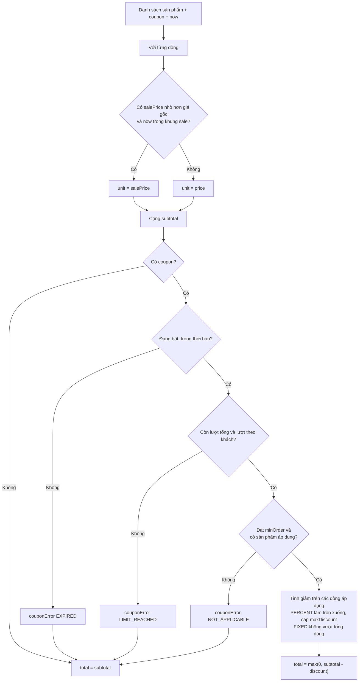

# M6 — Giá và Khuyến mãi

Đặc tả gốc: `docs/GIEOCHU_PROMPT_MVP_PHASE1.md` §"M6 — Giá và Khuyến mãi".

## Phạm vi phiên này

`calculatePrice()` là **pricing engine thuần** (không phụ thuộc DB) — làm đầy đủ 100%, đúng 14/14 unit test.
Phần còn lại của M6 (schema `Coupon`/`CouponRedemption`, CRUD, trang quản lý Studio, API preview công khai)
cũng làm đầy đủ. Chỉ có **1/2 integration test bị hoãn**: "Coupon chỉ bị tính lượt khi đơn `PAID`" — logic
"tiêu thụ" coupon (`usedCount++`, ghi `coupon_redemptions`) gắn liền với việc đơn hàng chuyển `PAID`, mà
`Order` chưa tồn tại (thuộc M8, đứng sau M6 trong thứ tự triển khai) — không có gì để test thật. Schema
`CouponRedemption` đã tạo sẵn, cột `orderId` là string thường (chưa có `@relation` tới `Order`) — M8 thêm
quan hệ khi Order ra đời, không cần sửa lại cột.

## Sơ đồ — Tính giá (đúng đặc tả)

`packages/core/src/pricing/calculate-price.ts` cài đúng luồng này. Điểm kỹ thuật đáng chú ý:

- **Không throw** khi coupon không hợp lệ — trả `couponError` + giá đầy đủ (không giảm), đúng tinh thần
  "khách vẫn thấy tổng tiền, chỉ là không được giảm" thay vì chặn hẳn luồng.
- **Phân bổ discount về từng dòng** để tổng các `line.discountVnd` khớp chính xác `result.discountVnd` (test
  #13) — dòng cuối cùng trong nhóm áp dụng nhận phần dư của phép chia làm tròn, không dùng tỷ lệ làm tròn độc
  lập cho từng dòng (tránh lệch 1-2 đồng do làm tròn nhiều lần).
- `productIds` rỗng/`null` trên coupon = áp dụng cho **mọi** sản phẩm của tenant (không phải "không sản phẩm
  nào") — khớp đúng cách đọc "giới hạn theo danh sách sản phẩm" trong đặc tả.

## Những gì đã dựng

- **`packages/core/src/pricing/calculate-price.ts`**: hàm `calculatePrice()` đúng chữ ký đặc tả — 14/14 unit
  test.
- **Schema**: `Coupon` (L2, RLS — public chỉ đọc coupon `isEnabled=true`, phục vụ API preview công khai),
  `CouponRedemption` (L2, RLS, `orderId` string thường chờ M8).
- **`apps/web/lib/coupon.ts`**: `createCoupon`/`updateCoupon` (validate `value` theo `type`, unique
  `tenantId+code`), `listCoupons`/`getCoupon`, `previewCouponPrice()` (đọc sản phẩm `PUBLISHED` + coupon
  `isEnabled` qua `withPublic`, gọi `calculatePrice()` — không tin số tiền client tính, giống nguyên tắc §7.5
  đã áp dụng xuyên suốt dự án).
- **Trang Studio**: `/studio/[tenantSlug]/coupons` (danh sách + thống kê `usedCount`/`usageLimit`),
  `/coupons/new`, `/coupons/[couponId]` (form đầy đủ + chọn sản phẩm áp dụng qua checkbox).
- **API công khai**: `POST /api/[tenantSlug]/coupons/preview` — không cần đăng nhập (khách vãng lai xem trước
  giá khi nhập mã), có đăng nhập thì đọc thêm `customerUsageCount` thật từ `coupon_redemptions` (nếu coupon có
  `perCustomerLimit`).

## Nghiệm thu

- [x] `pnpm lint && pnpm typecheck && pnpm test && pnpm build` xanh (70/91 unit, 30/50 integration cộng dồn).
- [x] `curl` xác nhận: `/studio/.../coupons` chưa đăng nhập → 307; preview cho tenant không tồn tại → 404.
- [x] API áp mã trả về tổng tiền tính lại ở server (test tích hợp).
- [ ] "Coupon chỉ bị tính lượt khi đơn PAID, hai đơn đồng thời không vượt usageLimit" — **hoãn tới M8** (cần
      Order thật để có sự kiện "chuyển PAID").

## Test — Unit (14/14, đúng mục 9)

`packages/core/src/pricing/calculate-price.test.ts` — đúng thứ tự 14 test trong đặc tả (giá gốc, giá sale
trong/ngoài khung, sale không nhỏ hơn giá gốc, coupon % / số tiền cố định, cap `maxDiscountVnd`, `minOrderVnd`
không đạt, coupon chưa bắt đầu/đã hết hạn, hết lượt tổng, hết lượt theo khách, giới hạn theo sản phẩm, làm
tròn/không âm, tổng 0 đồng).

## Test — Integration (1/2 — 1 còn lại chờ M8)

`apps/web/tests/integration/coupon.test.ts`:
1. API `/coupons/preview` áp coupon `PERCENT` hợp lệ, trả về `subtotalVnd`/`discountVnd`/`totalVnd` tính lại
   ở server đúng.

**Còn thiếu**: "Coupon chỉ bị tính lượt khi đơn PAID, hai đơn đồng thời không vượt usageLimit" — cần Order
(M8). Khi M8 xây xong luồng PAID, viết `UPDATE coupons SET usedCount = usedCount + 1 WHERE id = ... AND
usedCount < usageLimit` (atomic, chống vượt giới hạn khi đồng thời — đúng đặc tả), ghi `coupon_redemptions`,
và test này mới thực hiện được.

## Backlog phát sinh

- Trang public xem sản phẩm/áp mã trên storefront thật (UI khách hàng nhập mã, thấy giá gạch ngang + đếm
  ngược sale) — `calculatePrice()`/API preview đã sẵn sàng, chỉ thiếu UI vì chưa có trang chi tiết sản phẩm
  công khai (cùng lý do hoãn ở M5) và chưa có giỏ hàng/checkout (M8).
- `apps/web/lib/product-upload.ts`/route upload không đụng gì tới M6 — không có xung đột.
