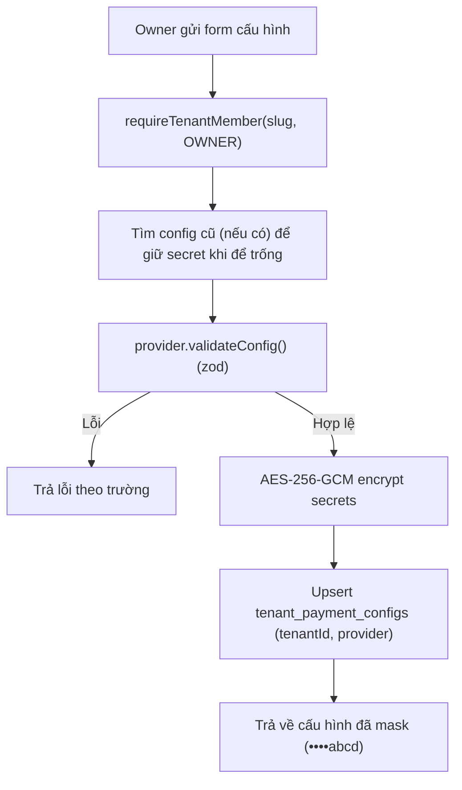
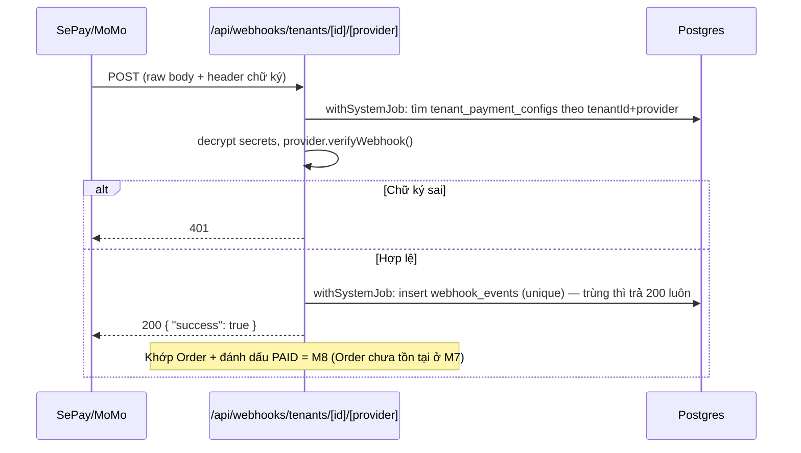

# M7 — Cấu hình Tenant Payment (thư viện provider dùng chung)

Đặc tả gốc: `docs/GIEOCHU_PROMPT_MVP_PHASE1.md` §"M7 — Cấu hình Tenant Payment".

## Phạm vi phiên này

Xây `packages/payments` (scope-agnostic, dùng chung Platform/Tenant qua `PaymentScope`) + toàn bộ phần
**Tenant**: schema, Studio UI, webhook route. **Không** làm UI Platform Payment (thuộc M2 "hoàn thiện", sau
M12) hay business logic Platform thật (tạo hoá đơn subscription — thuộc M3). Bảng `platform_payment_configs`
được tạo sớm ở đây (xem ADR-011) nhưng chỉ là bảng trống, chưa có UI/route nào ghi vào nó ngoài test.

## Trước khi code: xác minh tài liệu chính thức (mục 0.7)

- **VietQR/NAPAS EMVCo**: xác minh cấu trúc TLV (tag 38 lồng GUID `A000000727` + bank BIN + số tài khoản +
  service code `QRIBFTTA`) qua 3 nguồn độc lập. Phát hiện một mẫu tham khảo có lỗi (ADR-012) — tự dựng lại
  test vector từ thuật toán CRC chuẩn quốc tế thay vì tin mẫu đó.
- **SePay webhook**: xác minh qua `developer.sepay.vn` — header `Authorization: Apikey <key>` cho API_KEY;
  `X-SePay-Signature: sha256=<hex>` + `X-SePay-Timestamp` (ký `{timestamp}.{rawBody}`) cho HMAC_SHA256; response
  bắt buộc `{"success": true}` với status 200/201 trong 30 giây.
- **MoMo signature**: xác minh qua mã nguồn chính thức `github.com/momo-wallet/payment` (PHP + Go) — raw hash
  sắp xếp alphabet theo tên field, nối bằng `&`, HMAC-SHA256 hex. Dùng credential sandbox chính thức trong repo
  làm fixture test (không phải secret thật của Gieo Chữ).

## Sơ đồ — Lưu cấu hình thanh toán

## Sơ đồ — Webhook tenant (dừng ở idempotent-accept, khớp Order thuộc M8)

## Những gì đã dựng

- **Schema**: `TenantPaymentConfig` (L2, RLS — migration `..._rls_m7`), `PlatformPaymentConfig` (L1, bảng
  trống — ADR-011), `WebhookEvent` (idempotency, unique `scope+provider+providerEventId`), `BankBin` (seed 19
  ngân hàng NAPAS/VietQR chính).
- **`packages/payments`**: `types.ts` (`PaymentProvider`, `PaymentScope`, ...), `encryption.ts` (AES-256-GCM),
  `vietqr.ts` (CRC16-CCITT-FALSE + payload builder), `providers/manual-qr.ts`, `providers/sepay.ts`,
  `providers/momo.ts`, `registry.ts` (`getProvider`, `buildWebhookNotifyUrl` theo scope) — 10/10 unit test.
- **`apps/web/lib/tenant-payment.ts`**: `saveTenantProviderConfig` (giữ secret cũ nếu để trống khi sửa),
  `listTenantProviderConfigs` (mask), `getEnabledProviders` (M8 sẽ dùng cho checkout), `listBankBins`.
- **Trang**: `/studio/[tenantSlug]/settings/payments` (3 form: MANUAL_QR, SePay có hiển thị URL webhook,
  MoMo).
- **Route**: `POST /api/webhooks/tenants/[tenantId]/[provider]` — verify chữ ký, ghi `webhook_events`
  idempotent, dừng lại (chưa khớp Order).

## Nghiệm thu

- [x] `pnpm lint && pnpm typecheck && pnpm test && pnpm build` xanh.
- [x] `curl` xác nhận thật: trang cấu hình thanh toán chưa đăng nhập → 307 `/login`; webhook tới tenant chưa
      cấu hình → 404 `not_configured`.
- [x] Toàn bộ 10 unit test dùng test vector tự xác minh (không tin mù mẫu bên thứ 3) — xem ADR-012.

## Test — Unit (10/10, đúng mục 9)

`packages/payments/src/**/*.test.ts`: `encryption.test.ts` (2), `vietqr.test.ts` (2), `providers/sepay.test.ts`
(3), `providers/momo.test.ts` (2), `registry.test.ts` (1).

## Test — Integration (4/4, đúng mục 9)

`apps/web/tests/integration/tenant-payment.test.ts`:

1. Owner lưu cấu hình SePay → secret mã hoá trong DB (không chứa plaintext), `listTenantProviderConfigs()`
   chỉ trả bản mask.
2. Người không phải member của tenant → 403 khi `requireTenantMember()`.
3. Phương thức `isEnabled=false` không có trong `getEnabledProviders()`.
4. Webhook ký bằng secret platform bị `verifyWebhook()` từ chối khi xác minh với config tenant, và ngược lại
   — dùng dữ liệu `PlatformPaymentConfig` thật (ADR-011), cả 2 chiều đều đúng.
