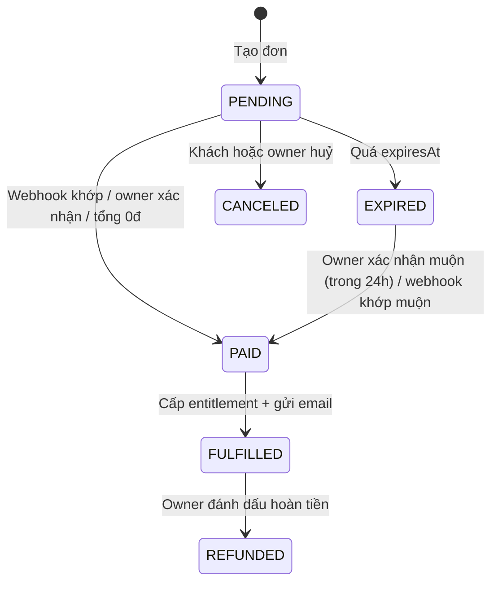
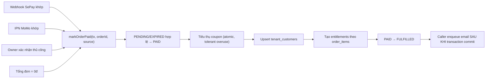
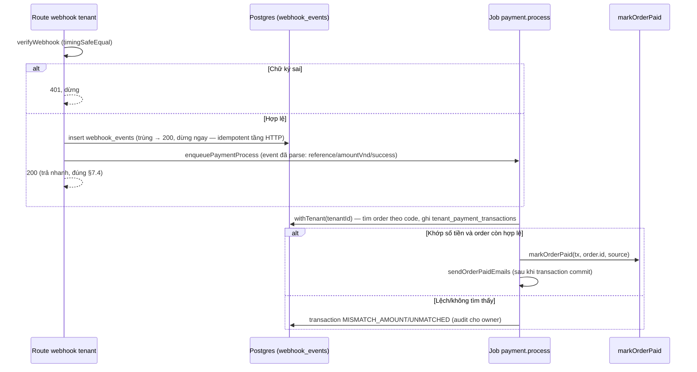

# M8 — Checkout và Đơn hàng

Đặc tả gốc: `docs/GIEOCHU_PROMPT_MVP_PHASE1.md` §"M8 — Checkout và Đơn hàng".

## Phạm vi phiên này

Làm đầy đủ: máy trạng thái đơn hàng, tạo đơn + áp coupon + khởi tạo checkout (dùng chung `packages/payments`
qua `scope:{kind:'TENANT',...}`), hàm `markOrderPaid(tx, orderId, source)` duy nhất theo đúng yêu cầu đặc tả,
job `payment.process` (webhook tenant giờ đẩy job thay vì dừng lại như M7 để lại), job `order.sweep`, trang
công khai chi tiết sản phẩm + checkout (mở lại quyết định hoãn từ M5), trang Studio đơn hàng/khách hàng, và
hoàn thành nốt 1 integration test hoãn từ M6. Không làm: luồng upload "ảnh biên lai" (`proofImageKey` có cột
nhưng chưa có UI — không nằm trong danh sách hàm bắt buộc), rate limit cho route/action mới (cùng khoảng
trống có sẵn từ M5), kiểm tra header `Origin` (idem).

## Sơ đồ — Trạng thái đơn hàng (đúng đặc tả)

`packages/core/src/order/state.ts` (`transitionOrderStatus`) cài đúng bảng chuyển này, ném `AppError` khi gặp
sự kiện không hợp lệ ở trạng thái hiện tại — cùng mẫu `billing/subscription-state.ts` (M3). `canManuallyConfirmOrder()`
(`order/expiry.ts`) trả `true` cho `PENDING` luôn, và cho `EXPIRED` chỉ khi còn trong 24h kể từ `expiresAt` —
dùng chung cho cả nhánh xác nhận thủ công **và** nhánh webhook khớp muộn (một hàm, hai chỗ gọi).

## Sơ đồ — `markOrderPaid` là điểm hội tụ duy nhất

`markOrderPaid` nhận `tx` (transaction đã mở sẵn qua `withTenant`/`withSystemJob` của caller) — không tự mở
transaction riêng, để 4 nơi gọi nó đều chạy trong đúng transaction/scope RLS của chính chúng. Idempotent: đơn
đã `PAID`/`FULFILLED` thì trả `{fulfilled:false}` ngay, không làm gì thêm. Việc `enqueueEmail()` luôn nằm
**ngoài** transaction, ở caller — đúng mẫu `notify()` sau khi ghi DB của `subscription-sweep.ts` (M3), không
phải trong `markOrderPaid` để tránh giữ transaction mở lâu chờ pg-boss.

## Sơ đồ — Webhook tenant giờ đẩy job (khác M3, xem ADR-019)

M7 để route webhook tenant dừng lại sau khi ghi `webhook_events` ("order matching lands in M8"). M8 nối tiếp
đúng như đặc tả §7.4 — route chỉ verify + ghi idempotent + đẩy job, **không** xử lý nặng ngay trong request.
(M3's platform webhook route xử lý đồng bộ, không qua job — một khoảng lệch đã biết, xem ADR-019/BACKLOG,
không sửa trong phiên này vì ngoài phạm vi M8.)

## Bug thật bắt được qua integration test

`payment-process.ts` bản đầu dùng `getPrismaClient()` trần (không qua `withTenant`) để đọc `orders` và ghi
`tenant_payment_transactions` — cả hai là bảng L2 có RLS. Hậu quả: `SELECT` bị RLS lọc âm thầm về rỗng (job
tưởng "không tìm thấy đơn" dù đơn tồn tại thật), `INSERT` bị Postgres từ chối thẳng (lỗi `42501`, vi phạm
row-level security policy). 3/9 integration test đầu tiên fail đúng vào lỗi này ngay lần chạy thật đầu tiên —
sửa bằng cách bọc toàn bộ thân hàm trong một `withTenant(data.tenantId, ...)` duy nhất (tenantId đã biết từ
tham số job, không cần `withSystemJob`). Đúng tinh thần quy ước "**bắt buộc** dùng RLS helper cho mọi bảng L2"
ở `CLAUDE.md` — vi phạm ở đây gây lỗi ồn ào (test đỏ ngay), không phải lỗi âm thầm nguy hiểm hơn (đọc thiếu
dữ liệu mà không ai để ý), nhưng vẫn là bài học: `withTenant`/`withSystemJob` không phải tuỳ chọn phong cách,
thiếu nó là lỗi thật.

## Những gì đã dựng

- **`packages/core/src/order/*`** (7 file, mỗi file 1 file test riêng) — 10/10 unit test: `state.ts`
  (`transitionOrderStatus`), `code.ts` (`generateOrderCode`/`isValidOrderCode` — bảng chữ base32 32 ký tự,
  loại `0/O/1/I`), `expiry.ts` (`computeOrderExpiresAt`/`canManuallyConfirmOrder`), `payment-match.ts`
  (`matchPaymentAmount`), `pricing.ts` (`calculateOrderPricing` — bọc `calculatePrice()` M6, **không có tham
  số "tổng tiền client gửi"** — đúng §7.5), `purchase-guard.ts` (`canPurchaseProduct` — chặn tự mua/mua lại),
  `customer-stats.ts` (`applyOrderToCustomerStats` — cộng dồn `tenant_customers`).
- **Schema**: `Order`/`OrderItem`/`TenantPaymentTransaction`/`TenantCustomer`/`Entitlement` (đều L2, RLS —
  `orders`/`order_items` có thêm chiều "khách hàng" trong policy, khác mọi bảng L2 khác chỉ có chiều tenant);
  `CouponRedemption.orderId` giờ có `@relation` thật tới `Order` (M6 để tạm string); `Order.confirmNote` thêm
  sau khi nhận ra cần chỗ lưu ghi chú xác nhận bắt buộc (giống `SubscriptionInvoice.confirmNote` — M3).
- **`apps/web/lib/order.ts`**: `createOrder` (chặn tự mua/mua lại qua `canPurchaseProduct`, chặn tenant
  không `ACTIVE` qua `assertTenantCanWrite` — tái dùng nguyên guard M3), `applyCouponToOrder`/
  `removeCouponFromOrder`, `initiateOrderCheckout` (gọi `packages/payments` với `scope:{kind:'TENANT',
  tenantId}` — không đụng bảng/secret Platform), `markOrderPaid` (mô tả ở trên), `confirmOrderManually`
  (bắt buộc ghi chú, chỉ cho trạng thái `canManuallyConfirmOrder`), `cancelOrder`/`markOrderRefunded` (thu
  hồi entitlement), `listOrders`/`getOrderDetail`/`getOrderForCustomer`/`listTenantCustomers`,
  `getOrderDashboardStats`, `runOrderSweep`.
- **`apps/web/lib/payment-process.ts`**: job `payment.process` — so khớp đơn theo mã, ghi
  `tenant_payment_transactions` (MATCHED/UNMATCHED/MISMATCH_AMOUNT), gọi `markOrderPaid` khi khớp.
- **Route webhook tenant** (`apps/web/app/api/webhooks/tenants/[tenantId]/[provider]/route.ts`) sửa lại theo
  đúng §7.4 — đẩy job thay vì dừng lại; kiểm tra thêm `event.success` (một giao dịch thất bại/hoàn tiền không
  bao giờ được khớp vào đơn, dù đúng mã tham chiếu và số tiền).
- **Trang công khai**: `/[tenantSlug]/products/[productSlug]` (chi tiết sản phẩm, nút "Mua ngay" — mở lại
  quyết định hoãn từ M5), `/[tenantSlug]/checkout/[orderCode]` (tóm tắt đơn, `CouponPanel`, `ProviderPanel`,
  hiện QR/redirect, `CheckoutPoll` — polling 3 giây, cùng mẫu `BillingPoll` của M3).
- **Trang Studio**: `/studio/[tenantSlug]/orders` (lọc theo trạng thái), `/orders/[orderId]` (chi tiết +
  `ConfirmForm`/hủy/hoàn tiền), `/studio/[tenantSlug]/customers`. Dashboard Studio nối 2 StatCard từng để
  trống "Cần M8" bằng dữ liệu thật (`getOrderDashboardStats`).
- **`packages/email`**: 2 template mới — `order-paid` (khách), `new-sale` (owner).
- **`packages/jobs`**: `PAYMENT_PROCESS`/`ORDER_SWEEP` queue; `worker.ts` đăng ký cả 2 (sweep chạy mỗi 5 phút
  — xem ADR-019, không phải mỗi giờ như `subscription.sweep`).

## Nghiệm thu

- [x] `pnpm lint && pnpm typecheck && pnpm test && pnpm build` xanh (80/91 unit, 39/50 integration cộng dồn).
- [x] Cả 9 integration test M8 chạy thật trên Neon: webhook ký HMAC thật, RLS thật, `UPDATE` atomic coupon
      thật (mô phỏng đồng thời qua `Promise.all`).
- [x] `markOrderPaid` là hàm duy nhất được gọi bởi cả 4 nguồn (SePay webhook, MoMo IPN, xác nhận thủ công, đơn
      0đ) — không có đường tắt nào tự transition đơn sang `PAID` mà bỏ qua hàm này.
- [x] Tổng tiền luôn tính lại ở server (`calculateOrderPricing`, không có tham số "client total").
- [ ] Chưa verify qua trình duyệt thật (chọn sản phẩm → mua → quét QR → polling) — cần R2 + provider thanh
      toán tenant đã cấu hình thật.

## Test — Unit (10/10, đúng mục 9)

`packages/core/src/order/*.test.ts`:
1. `state.test.ts` — chuyển trạng thái hợp lệ.
2. `state.test.ts` — chuyển trạng thái không hợp lệ ném `AppError`.
3. `code.test.ts` — mã đơn đúng định dạng `{prefix}{6 ký tự base32}`.
4. `expiry.test.ts` — tính `expiresAt` từ `now` + TTL phút.
5. `payment-match.test.ts` — số tiền khớp chính xác → `MATCHED`.
6. `payment-match.test.ts` — số tiền lệch → `MISMATCH_AMOUNT`.
7. `pricing.test.ts` — tính lại tổng tiền từ snapshot sản phẩm server, bỏ qua mọi giá client gửi.
8. `purchase-guard.test.ts` — chặn mua sản phẩm đã sở hữu hoặc của chính mình.
9. `customer-stats.test.ts` — cộng dồn `tenant_customers` (upsert).
10. `expiry.test.ts` — xác nhận thủ công chỉ cho `PENDING` hoặc `EXPIRED` trong 24h.

## Test — Integration (9/8 — 8 gốc M8 + 1 hoãn từ M6)

`apps/web/tests/integration/order.test.ts`:
1. Tạo đơn + checkout `MANUAL_QR` trả về QR đúng nội dung = mã đơn, đơn ở `PENDING`.
2. Owner xác nhận thủ công: bắt buộc ghi chú (rỗng → lỗi), thành công → `FULFILLED` + entitlement snapshot
   đúng `downloadLimit` + `tenant_customers` cộng dồn.
3. Webhook SePay ký HMAC thật: chữ ký sai → 401; chữ ký đúng → 200 + ghi `webhook_events`; gửi lại cùng event
   → vẫn 200, không ghi trùng (idempotent tầng HTTP).
4. `processPaymentEvent` khớp SePay → đơn `FULFILLED`, `tenant_payment_transactions` có dòng `MATCHED`.
5. `processPaymentEvent` khớp MoMo (cùng job, khác provider) → cũng `FULFILLED`.
6. Sai số tiền → đơn vẫn `PENDING`, ghi `MISMATCH_AMOUNT`.
7. `order.sweep`: đơn quá hạn → `EXPIRED`, coupon **không** bị tính lượt (chỉ tiêu thụ trong `markOrderPaid`).
8. RLS: tenant B không đọc được đơn của tenant A (`getOrderDetail`/`listOrders`); customer khác không đọc
   được đơn của người khác (`getOrderForCustomer`).
9. (Hoãn từ M6) Coupon chỉ tiêu thụ khi đơn `PAID`; 2 đơn xác nhận đồng thời (`Promise.all`) dùng chung 1
   coupon `usageLimit=1` → cả 2 đơn đều `FULFILLED` (đơn không phụ thuộc coupon còn lượt), nhưng chỉ 1
   `coupon_redemptions` được ghi, `usedCount` dừng ở đúng 1 — `UPDATE ... WHERE usedCount < usageLimit`
   atomic hoạt động đúng dưới đồng thời thật (không phải giả lập bằng mock).

## Backlog phát sinh

Xem `docs/BACKLOG.md` mục "Phát sinh trong lúc dựng M8" — tóm tắt: khoảng lệch webhook M3-vs-M8 (ADR-019,
không sửa M3), chưa có luồng upload ảnh biên lai, 4 route/action mới chưa rate-limit, chưa kiểm tra `Origin`,
chưa verify qua trình duyệt thật, StatCard "Sản phẩm bán chạy" có thể nối từ `order_items` nhưng chưa làm.
