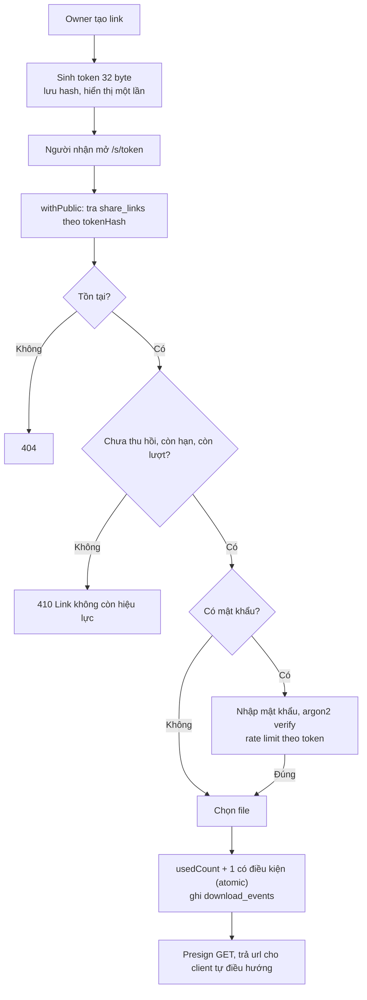

# M9 — Thư viện, Tải xuống và Link chia sẻ private

Đặc tả gốc: `docs/GIEOCHU_PROMPT_MVP_PHASE1.md` §"M9 — Thư viện, Tải xuống và Link chia sẻ private".

## Phạm vi phiên này

Làm đầy đủ: thư viện gom entitlement từ mọi tenant, lịch sử đơn hàng, luồng tải 2 bước (token dùng-một-lần),
link chia sẻ private (tạo/thu hồi/mật khẩu/hạn dùng/số lượt), tenant cấp thêm lượt/thu hồi entitlement của
khách. Trong lúc dựng, phát hiện và sửa 3 lỗ hổng RLS thật (không phải review — integration test bắt được)
kế thừa từ M4/M5. Không làm: luồng test qua trình duyệt thật (cần R2), rate limit theo IP (chỉ theo
user/token), trang thống kê chi tiết từng lượt tải theo share link (hàm lib đã sẵn, chưa có UI riêng).

## Sơ đồ — Tải tài liệu đã mua (đúng đặc tả)

```mermaid
sequenceDiagram
    actor C as Customer
    participant L as /account/library
    participant D as Download API
    participant DB as Postgres
    participant S3 as R2

    C->>L: Bấm Tải file
    L->>D: POST /api/downloads (fileId)
    D->>D: requireUser + rate limit 20/10 phút
    D->>DB: withCustomer đọc entitlement, file, kiểm tra còn lượt/chưa thu hồi
    alt Không hợp lệ
        D-->>L: 403
    else Hợp lệ
        D->>DB: Tạo download token (hash, 60 giây, dùng một lần)
        D-->>L: URL /api/downloads/token
        L->>D: GET /api/downloads/token
        D->>DB: Claim token atomic (usedAt IS NULL AND expiresAt > now)
        D->>DB: withTenant: tăng downloadsUsed atomic (điều kiện còn lượt) + ghi download_events
        D->>S3: Presign GET ≤600s, attachment; filename*=UTF-8''...
        D-->>C: 302 tới presigned URL
    end
```

Hai bước tách biệt (`requestDownload` rồi `consumeDownloadToken`) đúng đặc tả — nhưng **cả hai** bước đều tự
có một lớp "atomic claim" riêng ở bước 2 (không chỉ dựa vào lần kiểm tra ở bước 1): claim token
(`updateMany` điều kiện `usedAt IS NULL`) và tăng `downloadsUsed` (raw SQL điều kiện `downloadLimit=0 OR
downloadsUsed < downloadLimit`) — cùng mẫu chống-đua đã dùng cho coupon ở M8, phòng trường hợp cùng một URL
bị mở 2 lần (tab kép, click đúp, retry mạng).

## Sơ đồ — Link chia sẻ private (đúng đặc tả)



## Bug thật bắt được qua integration test — 3 lỗ hổng RLS (ADR-020)

Ba lỗ hổng, cùng một lớp lỗi đã gặp ở M8's `payment-process.ts` ("dùng `getPrismaClient()` trần/thiếu nhánh
RLS thay vì đúng RLS helper"), lần này bắt được **trước khi commit** nhờ chạy integration test thật ngay
trong lúc viết code:

1. **`product_files` (RLS từ M5) thiếu nhánh "customer"** — chỉ có tenant/public(preview+PUBLISHED)/
   system_job. Một khách hàng đã mua thật sự **không có cách nào đọc được file của chính họ** qua
   `withCustomer()`. Phát hiện khi viết `requestDownload()`.
2. **`products` (RLS từ M4) cùng lỗi** — phát hiện khi test "thư viện liệt kê tài liệu từ nhiều tenant" thất
   bại với `Cannot read properties of null (reading 'title')`: JOIN sang `products` bị RLS lọc về `null` vì
   không có nhánh customer.
3. **`consumeShareLinkDownload()` đọc `share_links` qua `getPrismaClient()` trần** thay vì `withPublic()` —
   không có `app.scope` nào được set nên RLS chặn hẳn, luôn trả "không tìm thấy link" dù link tồn tại thật.

Cả 3 sửa bằng migration RLS riêng (không sửa lại migration cũ — giữ lịch sử migration bất biến) + đổi
`getPrismaClient()` thành `withPublic()` đúng chỗ, xác minh lại bằng chính 5 integration test M9 chạy thật.

## Những gì đã dựng

- **Refactor**: `generateOpaqueToken`/`hashOpaqueToken` chuyển từ `packages/auth` sang
  `packages/core/src/crypto/random-token.ts` (comment gốc đã dự đoán "share-link tokens" từ trước) — cùng
  mẫu refactor `encryption.ts` ở M5 (ADR-017); `packages/auth` giờ có `@gieochu/core` làm dependency thật.
- **`packages/core/src/download/*`** — 6/7 unit test M9 (test 7 ở `packages/storage`): `token.ts`
  (`createDownloadToken`/`evaluateDownloadToken`), `entitlement-guard.ts` (`canDownloadEntitlement` — thu
  hồi/hết lượt, `downloadLimit=0`=không giới hạn), `share-link.ts` (`isShareLinkUsable` — hết hạn/hết lượt/
  thu hồi), `share-link-password.ts` (argon2id riêng, không phụ thuộc `packages/auth` — ADR-020).
- **`packages/storage/src/download-disposition.ts`**: `buildAttachmentDisposition()` (RFC 5987 —
  `filename*=UTF-8''...` cho tên file tiếng Việt có dấu — sửa luôn lỗi thật trong `createPresignedDownload()`
  vốn chỉ có `filename="..."` ASCII thường) + `clampDownloadTtlSeconds()` (≤600s, §7.6) — 1/7 unit test M9.
- **Schema**: `DownloadToken` (L1, không RLS — cùng mẫu RefreshToken/VerificationToken, có thêm `tenantId`
  denormalize từ entitlement để `consumeDownloadToken()` mở đúng một `withTenant()` ngay từ đầu),
  `ShareLink`/`DownloadEvent` (L2, RLS — `share_links` cho phép đọc public bất kể trạng thái để phân biệt
  404/410). Cộng 3 migration RLS sửa lỗ hổng nêu trên.
- **`apps/web/lib/download.ts`**: `requestDownload`/`consumeDownloadToken` — 2 bước, atomic claim ở cả token
  lẫn `downloadsUsed`.
- **`apps/web/lib/share-link.ts`**: `createShareLink`/`listShareLinks`/`getShareLinkDetail`/`revokeShareLink`
  (owner), `resolveShareLink`/`consumeShareLinkDownload` (public) — `fileIds` rỗng/null = mọi file đang bán,
  đúng mẫu `Coupon.productIds` (M6).
- **`apps/web/lib/library.ts`**: `listLibraryEntitlements` (gom theo tenant), `listCustomerOrders` (lịch sử
  đơn, mở lại checkout cho đơn PENDING).
- **`apps/web/lib/entitlement.ts`**: `grantExtraDownloads`/`revokeEntitlement` — nối vào trang chi tiết đơn
  hàng Studio (M8) đã có sẵn.
- **Trang**: `/account/library` (hoàn thiện từ stub M1, nhóm theo tenant, nút tải), `/account/orders` (mới),
  `/s/[token]` (công khai, ô mật khẩu khi cần), `/studio/[tenantSlug]/products/[productId]/share-links`
  (tạo/thu hồi, token hiện đúng một lần khi tạo).
- **Route**: `POST /api/downloads`, `GET /api/downloads/[token]`, `POST /api/share-links/[token]/download` —
  rate limit 20/10 phút theo user (downloads) và theo token (share-link, chống dò mật khẩu).

## Nghiệm thu

- [x] `pnpm lint && pnpm typecheck && pnpm test && pnpm build` xanh (87/91 unit, 44/50 integration cộng dồn).
- [x] Cả 5 integration test M9 chạy thật trên Neon, RLS thật — bắt được và sửa 3 lỗ hổng RLS thật ngay trong
      lần chạy đầu tiên.
- [x] Token tải dùng-một-lần: retry cùng URL sau khi đã tiêu thụ → 410, không tăng `downloadsUsed` lần 2.
- [x] Share link hết hạn/hết lượt/thu hồi → 410 (không lộ khác biệt "hết lượt" hay "bị thu hồi" ra ngoài,
      đúng tinh thần đặc tả "Link không còn hiệu lực" chung).
- [ ] Chưa verify qua trình duyệt thật (bấm tải, mở `/s/{token}` thật) — cần R2 thật.

## Test — Unit (7/7, đúng mục 9)

1. `packages/core/src/download/token.test.ts` — sinh token, hash, TTL 60s mặc định, đánh giá trạng thái
   (valid/used/expired).
2. `packages/core/src/download/entitlement-guard.test.ts` — chặn khi hết lượt (`downloadLimit=0`=không
   giới hạn).
3. `packages/core/src/download/entitlement-guard.test.ts` — chặn entitlement đã thu hồi.
4. `packages/core/src/download/share-link.test.ts` — share link hết hạn.
5. `packages/core/src/download/share-link.test.ts` — share link hết lượt (`maxUses=null`=không giới hạn).
6. `packages/core/src/download/share-link-password.test.ts` — hash/verify mật khẩu share link.
7. `packages/storage/src/download-disposition.test.ts` — presign luôn có `attachment` (+ `filename*=UTF-8`)
   và TTL bị clamp ≤600 giây.

## Test — Integration (5/5, đúng mục 9)

`apps/web/tests/integration/download.test.ts`:
1. Thư viện liệt kê entitlement từ 2 tenant khác nhau, nhóm đúng theo tenant.
2. Tải thành công: `consumeDownloadToken` trả về URL presigned thật, `downloadsUsed` tăng đúng 1,
   `download_events` ghi đúng 1 dòng; retry cùng token → 410, không tăng lần 2.
3. Hết lượt tải → `requestDownload` chặn ngay ở bước 1 (403 `DOWNLOAD_LIMIT_REACHED`).
4. Share link có mật khẩu: sai mật khẩu → 403; đúng mật khẩu → tải được, URL presigned hợp lệ.
5. Share link đã thu hồi → `resolveShareLink` trả 410.

## Backlog phát sinh

Xem `docs/BACKLOG.md` mục "Phát sinh trong lúc dựng M9" — tóm tắt: chưa verify qua trình duyệt thật, chưa
ghi audit cho cấp-thêm-lượt/thu-hồi (chờ M12), rate limit share-link chỉ theo token không theo IP, chưa có
trang thống kê chi tiết từng lượt tải theo share link. Cũng ghi nhận muộn một khoảng thiếu từ M8 (trang
customers thiếu ghi chú nội bộ/xuất CSV/xem đơn theo khách — đặc tả M8, bỏ sót lúc viết `docs/modules/M8.md`).
