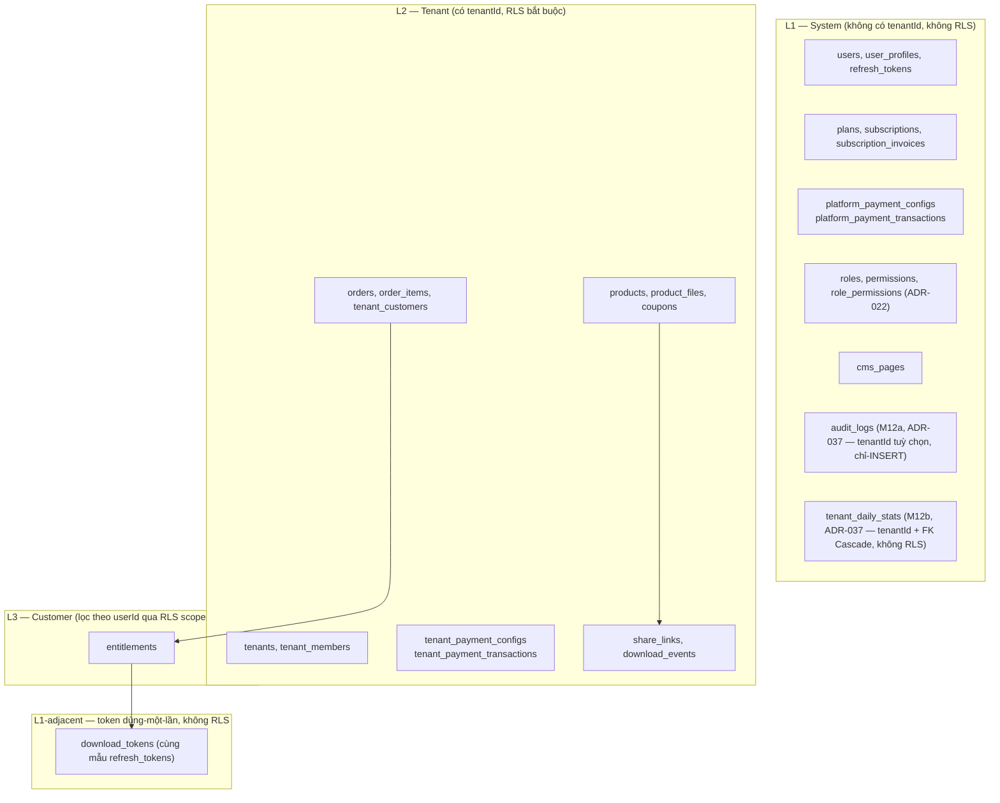
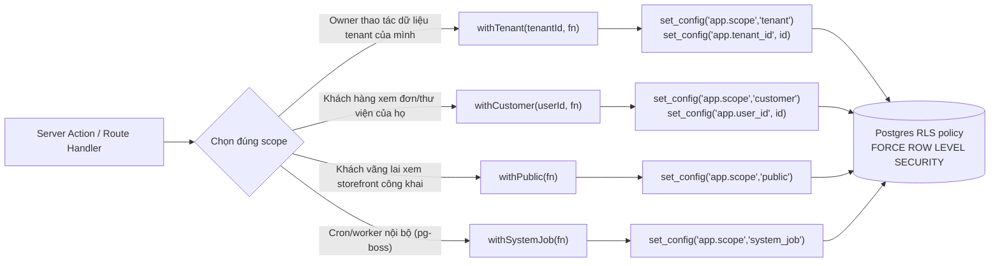
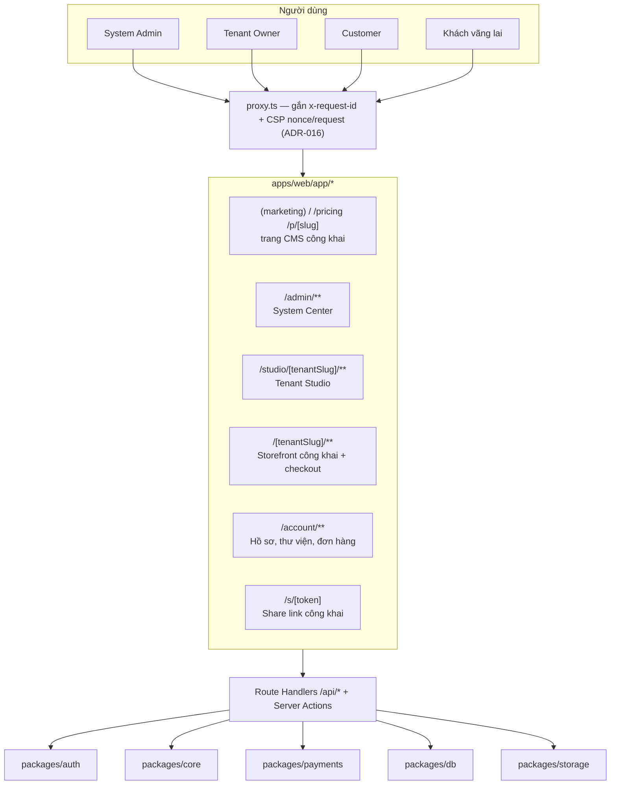

---
tags:
  - spec
  - architecture
  - status/living
date: 2026-09-26
updated: 2026-10-16
author: System Architect
---

# 📐 Đặc Tả: Tổng Quan Kiến Trúc Hệ Thống (Architecture Overview)

## 1. Mục Tiêu & Phạm Vi (Scope)

Gieo Chữ là nền tảng SaaS đa người thuê (multi-tenant) cho giáo viên/coach/chuyên gia mở "gian hàng" riêng
(storefront) để bán tài liệu số (ebook, khoá học PDF, template...) cho khách hàng. Hệ thống được thiết kế theo
mô hình **3 tầng dữ liệu (L1/L2/L3)**, thực thi cách ly dữ liệu bằng Postgres Row-Level Security (RLS) — không
chỉ bằng điều kiện `WHERE tenantId = ...` ở tầng ứng dụng.

Nguồn gốc đặc tả: [GIEOCHU_PROMPT_MVP_PHASE1.md](../../docs/GIEOCHU_PROMPT_MVP_PHASE1.md); sơ đồ đầy đủ và cập nhật
nhất luôn nằm ở [docs/ARCHITECTURE.md](../../docs/ARCHITECTURE.md) — file này là bản tóm tắt cho Knowledge Base.

---

## 2. Mô Hình 3 Tầng Dữ Liệu (L1 / L2 / L3)

### 2.1. L1 — System (nền tảng, xuyên tenant)

- **Dữ liệu:** `User`, `UserProfile`, `RefreshToken`, `VerificationToken`, `Plan`, `Subscription`,
  `SubscriptionInvoice`, `PlatformPaymentConfig`, `PlatformPaymentTransaction`, `SystemSettings`,
  `SystemStorageConfig`, `CmsPage`, `Role`/`Permission`/`RolePermission` (ADR-022), `WebhookEvent`, `BankBin`.
- **Đặc điểm:** không có cột `tenantId`, không bật RLS — chặn quyền truy cập hoàn toàn ở tầng ứng dụng qua
  `requireRole(SYSTEM_ADMIN)` / `requireAdminAccess()`.
- **Vai trò:** System Admin (`User.systemRole = SYSTEM_ADMIN`, hoặc `isSuperAdmin`) quản trị người dùng, gói
  dịch vụ, thanh toán nền tảng, cấu hình hệ thống, nội dung marketing.

### 2.2. L2 — Tenant (gian hàng, cách ly bằng RLS)

- **Dữ liệu:** `Tenant`, `TenantMember`, `Product`, `ProductFile`, `Coupon`, `CouponRedemption`,
  `TenantPaymentConfig`, `Order`, `OrderItem`, `TenantPaymentTransaction`, `TenantCustomer`, `ShareLink`,
  `DownloadEvent`, `StorefrontMessage` (ADR-023), `TenantMediaAsset` (ADR-028), `Review` (ADR-029, M10a), `Post` (ADR-029, M10b) — mọi bảng
  này mang `tenantId` (riêng `OrderItem` suy tenant qua đơn cha) và **bắt buộc** đi qua RLS helper.
  Riêng `Tenant` chính nó **không bật RLS** (tra cứu theo slug là public theo bản chất).
- **Vai trò:** Tenant Owner (`TenantMember.role = OWNER`) quản trị gian hàng qua `/studio/[tenantSlug]/*`.
  `TenantMemberRole.STAFF` đã có trong schema nhưng chưa có luồng nào tạo bản ghi thật (xem
  [[Tenant-RBAC-And-Permissions]]).

### 2.3. L3 — Customer (khách hàng, một tài khoản toàn cục)

- **Dữ liệu:** `Entitlement` (quyền tải tài liệu đã mua), truy cập chéo tenant qua `withCustomer(userId)`.
- **Nguyên tắc:** một `User` có **một** thư viện gom mọi tài liệu đã mua từ **mọi** tenant
  (`/account/library`, `/account/orders`) — không phải một thư viện riêng cho từng gian hàng.

---

## 3. Cơ Chế Thực Thi RLS: 4 Scope Bắt Buộc

`packages/db/src/rls.ts` xuất đúng 4 hàm — mỗi hàm mở 1 `prisma.$transaction`, set 1 Postgres session variable
bằng `set_config(key, value, true)` (`true` = chỉ có hiệu lực **trong transaction đó**), rồi mọi RLS policy đọc
lại qua `current_setting('app.scope', true)`:

**Bắt buộc dùng đúng scope** — dùng nhầm `getPrismaClient()` trần trên một bảng L2 đã gây ra 2 lớp lỗi thật đã
bắt được qua integration test (không phải qua review): `SELECT` bị RLS âm thầm filter về rỗng (tưởng "không
tìm thấy"), `INSERT` bị chặn hẳn (`42501`) — xem `apps/web/lib/payment-process.ts` (M8) và
`consumeShareLinkDownload()` (M9, ADR-020 trong [docs/DECISIONS.md](../../docs/DECISIONS.md)).

**Mẫu policy tách theo lệnh (từ ADR-023, bảng `storefront_messages`):** khi quyền không đối xứng giữa các scope,
tách policy riêng cho từng lệnh thay vì 1 policy `tenant_isolation` — public chỉ `INSERT`, tenant
`SELECT/UPDATE/DELETE` đúng `tenantId`. Hệ quả: ghi bằng scope không có SELECT phải dùng INSERT không `RETURNING`
(Prisma `createMany`) ✅ — xem [[Storefront-CMS-Specs]] §5.

**Siết RLS 7 bảng — tách đọc/ghi (ADR-029 mục 0, migration `20260927130000_rls_adr029_split_write_policies`)** ✅ đọc
SQL: `products`, `product_files`, `coupons`, `share_links`, `orders`, `order_items`, `entitlements` trước đây dùng 1 policy
`tenant_isolation` `FOR ALL USING (...)` không `WITH CHECK` → nhánh đọc của scope public/customer cũng thành nhánh **ghi**
ở tầng DB (public UPDATE/DELETE được mọi share link hoặc sản phẩm `PUBLISHED`; customer UPDATE được
`downloadsUsed/downloadLimit` entitlement của mình). Nay mỗi bảng có 4 policy:

| Policy | Lệnh | Điều kiện |
| :-- | :-- | :-- |
| `select_access` | `SELECT` | Giữ nguyên điều kiện đọc cũ (tenant / public / customer / `system_job`) |
| `write_insert` | `INSERT` (`WITH CHECK`) | `tenantId = app.tenant_id` **hoặc** `app.scope = 'system_job'` |
| `write_update` | `UPDATE` (`USING` + `WITH CHECK`) | như trên |
| `write_delete` | `DELETE` (`USING`) | như trên |

`order_items` không có cột `tenantId` → mọi policy ghi xét qua đơn cha (`EXISTS orders.tenantId = app.tenant_id`) hoặc
`system_job`. Hệ quả: dưới `withPublic`/`withCustomer` **chỉ đọc** được 7 bảng này; mọi ghi (tăng `usedCount` share link,
tăng `downloadsUsed`, cấp/thu hồi entitlement, cập nhật cache điểm `products.ratingSum/ratingCount`) phải chạy dưới
`withTenant` hoặc `withSystemJob`. Theo comment migration, code hiện không ghi dưới 2 scope kia nên không đổi nghiệp vụ 🟡.
Chưa có integration test cho thay đổi này ❓ (nợ trong `docs/BACKLOG.md`).

**Quy tắc cho bảng L2 mới (ADR-029):** có nhánh public/customer ⇒ **tách policy theo lệnh**, không dùng `FOR ALL`.
Khi tenant và customer cùng được UPDATE một bảng nhưng mỗi bên chỉ được đổi một nhóm cột, không dùng được column GRANT
(cả hai chạy chung role `gieochu_app`) ⇒ dùng mẫu **trigger `BEFORE UPDATE` giới hạn cột theo `app.scope`** — bản đầu
tiên là `reviews_guard_columns` (M10a) ✅; xem [[03-API-Contracts/Database-Schema-Reference|Database-Schema-Reference]] §7 và
[[02-System-Specs/Reviews-Specs|Reviews-Specs]] §4. M10b dùng lại mẫu này (`posts_guard_columns` — chỉ `system_job` đặt/gỡ
`HIDDEN`) và thêm trigger kiểm quan hệ cùng tenant (`posts_guard_product_tenant`) ✅ — xem
[[02-System-Specs/Posts-Specs|Posts-Specs]] §3.

**Vì sao role kết nối app quan trọng (ADR-010):** role Neon mặc định (`neondb_owner`) có `rolbypassrls`,
khiến Postgres bỏ qua RLS bất kể `FORCE`. App phải kết nối bằng role riêng `gieochu_app`
(`NOBYPASSRLS`, tạo qua `packages/db/scripts/setup-app-role.mts`) — role owner chỉ dành cho CLI migrate
(`PRISMA_MIGRATE_URL`).

---

## 4. Cấu Trúc Next.js App Router (`apps/web`)

**Quy tắc bất biến:** `proxy.ts` **chỉ** gắn `x-request-id` và CSP nonce, làm redirect thô — không xác thực,
không phân quyền. Mọi Server Component/Server Action/Route Handler nhạy cảm **tự** gọi lại
`requireUser()`/`requireRole()`/`requireTenantMember()` — không tin proxy đã lọc đủ (xem
[[Tenant-RBAC-And-Permissions]] mục guard).

---

## 5. Các Nguyên Tắc Kiến Trúc Bắt Buộc (Living Architectural Rules)

1. **Không import `@prisma/client` trực tiếp trong `apps/web`** — chỉ qua helper của `@gieochu/db`
   (ESLint `no-restricted-imports`, `packages/config/eslint-preset.mjs`).
2. **Mọi bảng L2 (có `tenantId`) phải đi qua `withTenant`/`withCustomer`/`withPublic`/`withSystemJob`** —
   `getPrismaClient()` trực tiếp chỉ dành cho bảng L1.
3. **Hai hệ thống thanh toán (Platform vs Tenant) không bao giờ chung bảng, secret hay route** — mọi hàm thanh
   toán nhận `PaymentScope` (`{kind:'PLATFORM'}` hoặc `{kind:'TENANT', tenantId}`) — xem [[Payment-And-Billing]].
4. **System Admin không có route nào đọc `orders`/`order_items`/`tenant_customers` của tenant** — chỉ đọc
   `tenant_daily_stats` (M12b — [[02-System-Specs/Tenant-Stats-Specs|Tenant-Stats-Specs]]) và bảng L1 — xem [[User-Management-System-Center-Specs]]. Nhật ký `audit_logs` (L1, M12a) có
   `tenantId` nhưng không RLS; dòng hành động của khách chỉ hiện email đã che với admin — xem [[02-System-Specs/Audit-Log-Specs|Audit-Log-Specs]].
5. **Tiền tệ VND: số nguyên (`Int`), không dùng `float`**; thời gian lưu UTC, hiển thị `Asia/Ho_Chi_Minh`.
6. **ID: cuid2** (`@default(cuid(2))`) cho mọi `@id` — không dùng UUID (ADR-001).

---

## 6. Tài Liệu Liên Quan

* [[Order-State-Machine]] — Vòng đời trạng thái đơn hàng ([Order-State-Machine.md](./Order-State-Machine.md))
* [[Tenant-RBAC-And-Permissions]] — Mô hình phân quyền System/Tenant/Customer ([Tenant-RBAC-And-Permissions.md](./Tenant-RBAC-And-Permissions.md))
* [[Payment-And-Billing]] — Hai hệ thống thanh toán Platform/Tenant ([Payment-And-Billing.md](./Payment-And-Billing.md))
* [[File-Storage-And-Downloads-Specs]] — Lưu trữ file, presigned URL, share link ([File-Storage-And-Downloads-Specs.md](./File-Storage-And-Downloads-Specs.md))
* [[User-Management-System-Center-Specs]] — System Admin console ([User-Management-System-Center-Specs.md](./User-Management-System-Center-Specs.md))
* [[Storefront-CMS-Specs]] — Storefront CMS + hộp thư liên hệ ([Storefront-CMS-Specs.md](./Storefront-CMS-Specs.md))
* Nguồn: [docs/ARCHITECTURE.md](../../docs/ARCHITECTURE.md), [docs/GIEOCHU_TENANT_MODULE_STRUCTURE_V1.0.md](../../docs/GIEOCHU_TENANT_MODULE_STRUCTURE_V1.0.md), [docs/DECISIONS.md](../../docs/DECISIONS.md)
