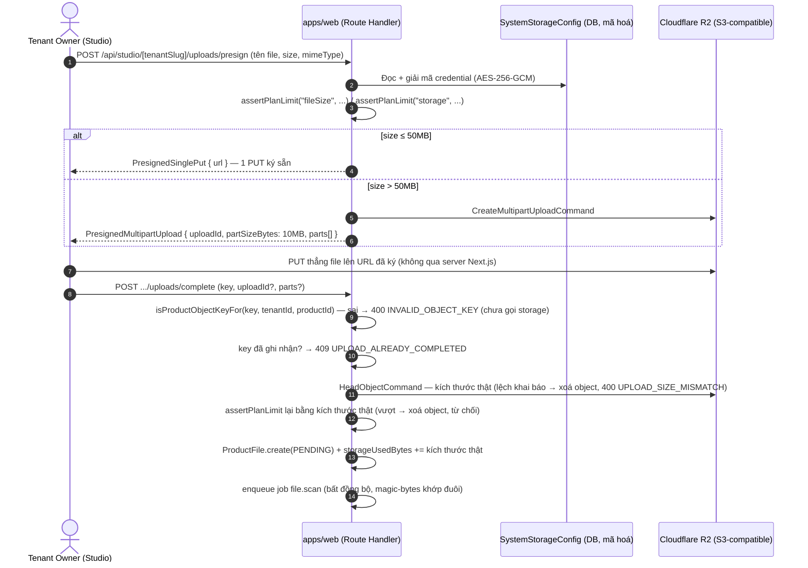
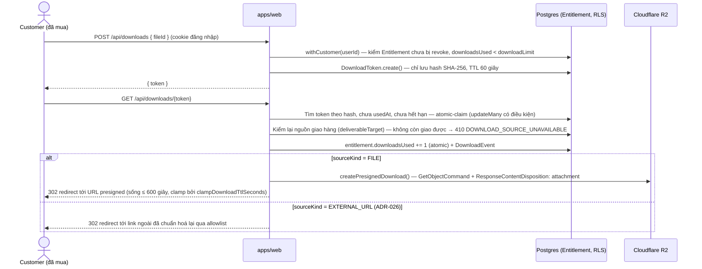
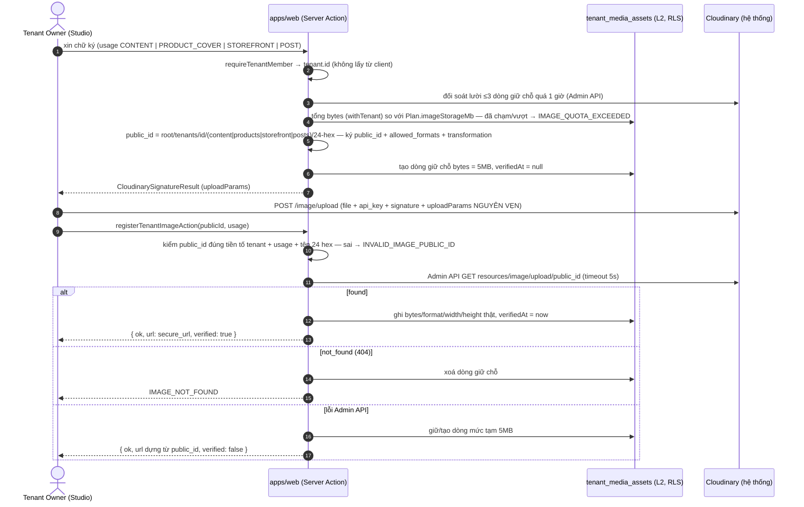

---
tags:
  - spec
  - storage
  - downloads
  - security
  - status/living
date: 2026-09-26
updated: 2026-09-28
author: System Architect
---

# 📐 Đặc Tả: Lưu Trữ File & Cơ Chế Tải Xuống (File Storage & Downloads Specs)

> Đổi tên từ `Media-Storage-Cloudinary-Specs.md`. Gieo Chữ dùng **hai** hệ thống lưu trữ tách biệt, không dùng
> chung: (1) storage S3-compatible (Cloudflare R2) cho **file sản phẩm bán** (bucket private, presigned URL);
> (2) **Cloudinary hệ thống** cho **ảnh** — ảnh CMS của System Admin, và từ ADR-023/027/028 cả ảnh storefront, ảnh
> bìa sản phẩm, ảnh trong mô tả của tenant (có hạn mức theo gói). Mục 1–5 nói về (1); mục 6–7 nói về (2).

## 1. Mục Tiêu & Kiến Trúc Tổng Thể (File Sản Phẩm)

`packages/storage` cung cấp lớp trừu tượng S3-compatible (`@aws-sdk/client-s3`), không gắn cứng vào một nhà
cung cấp — production dùng **Cloudflare R2** (ADR-014/ADR-017 trong
[docs/DECISIONS.md](../../docs/DECISIONS.md)), **không phải Cloudinary**. Nguyên tắc cốt lõi (CLAUDE.md §7.6):

1. **Bucket private tuyệt đối** cho file bán — không có URL public trực tiếp tới object.
2. **URL tải chỉ là presigned, sống ≤ 10 phút**, `Content-Disposition: attachment` — không bao giờ cho phép
   trình duyệt hiển thị nội dung file thay vì tải xuống.
3. **Cấu hình credential (endpoint/bucket/access key R2) quản lý qua System Admin + DB mã hoá**
   (`SystemStorageConfig`), không phải biến môi trường tĩnh — đã cân nhắc đánh đổi bảo mật với người dùng
   trước khi làm (ADR-017): mã hoá bằng key riêng `STORAGE_ENCRYPTION_KEY`, **không dùng chung**
   `PAYMENT_ENCRYPTION_KEY` — lộ 1 key chỉ lộ đúng 1 miền secret.

---

## 2. Luồng Upload File Sản Phẩm (Presigned PUT / Multipart)

- **Bảo mật bước `complete` (ADR-026 §1)** ✅ đọc `apps/web/lib/product-upload.ts` 2026-09-27: 4 bước kiểm trong sơ đồ
  trên chạy theo đúng thứ tự đó; chi tiết + mã lỗi: [[02-System-Specs/Product-Editor-And-Publishing-Specs|Product-Editor-And-Publishing-Specs]] §2.
  (Sơ đồ bản trước đặt `file.scan` đồng bộ trong `complete` — sai với code: scan luôn là job riêng.)
- **Ngưỡng multipart:** `MULTIPART_THRESHOLD_BYTES = 50MB` (`packages/storage/src/presign.ts`) — file ≤ 50MB
  dùng 1 `PutObjectCommand` ký sẵn; lớn hơn dùng multipart, mỗi phần `MULTIPART_PART_SIZE_BYTES = 10MB`.
- **Ảnh bìa sản phẩm — luồng R2 cũ** qua cặp hàm riêng (`presignCoverImageUpload`/`completeCoverImageUpload`) — bucket
  **công khai** (khác bucket file bán), không qua `file.scan`, không tính vào `storageUsedBytes`; `cover-complete` từ
  ADR-026 cũng kiểm `isProductObjectKeyFor(..., "cover")`. **Từ ADR-027 editor dùng ảnh bìa Cloudinary**
  (`Product.coverImageUrl`), R2 chỉ còn là fallback cho dữ liệu cũ — xem §6–§7.
- **Link tài liệu ngoài (ADR-026)** không đi qua upload: không object, không quét, không tính dung lượng.

---

## 3. Kiểm Tra File (`file.scan`) — Chưa Có ClamAV Thật (ADR-018)

`apps/web/lib/file-scan.ts`: mọi file qua được kiểm tra `matchesDeclaredExtension` (magic bytes khớp đuôi khai
báo, `packages/storage/src/file-format.ts`) đều đánh dấu **`CLEAN`**, bất kể có set biến `CLAMAV_HOST` hay
không (nếu có set mà chưa có client thật, chỉ ghi log cảnh báo — không chặn luồng). File sai định dạng bị xoá
khỏi object storage + đánh dấu `REJECTED` + trừ lại dung lượng đã cộng + gửi email báo owner.

`readObjectForScan()` (`packages/storage/src/scan.ts`) đọc object **một lần duy nhất** (stream), vừa hash
SHA-256 vừa lấy đầu file để nhận diện magic bytes — tránh buffer cả file vào memory.

---

## 4. Tải Xuống — `DownloadToken` (Presigned GET, TTL 60s)

- **Link tài liệu ngoài (ADR-026)** ✅ đọc `apps/web/lib/{download,library,share-link}.ts` 2026-09-27:
  - `deliverableTarget()` quyết định dòng nào giao được: `FILE` phải `CLEAN` và có `objectKey`; `EXTERNAL_URL` phải
    còn qua `normalizeExternalDocumentUrl` (**kiểm ở cả 2 bước** — phòng allowlist bị thu hẹp sau khi đã lưu).
  - Bước 1 không giao được → 404; bước 2 kiểm lại **trước khi trừ lượt** → `410 DOWNLOAD_SOURCE_UNAVAILABLE`
    (token đã bị claim nhưng `downloadsUsed` không tăng).
  - Link đi cùng luồng entitlement/`downloadLimit`/`DownloadEvent` như file — mỗi lần mở link ăn 1 lượt.
  - Thư viện (`listLibraryEntitlements`, kiểu `LibraryFile`): mỗi mục có `kind: "FILE" | "EXTERNAL_URL"`; chỉ liệt kê file `CLEAN` và link còn qua
    allowlist; nút hiện "Mở link tài liệu" cho link. `LibraryFile` **không chứa URL link** (chỉ `id, kind, fileName,
    sizeBytes`) — URL chỉ lộ ra qua 302 ở bước 2.
  - RLS nhánh customer của `product_files` đọc được dòng `EXTERNAL_URL` khi có entitlement (xem
    [[03-API-Contracts/Database-Schema-Reference|Database-Schema-Reference]] §7).
  - **Share link không bao giờ giao link ngoài** — chỉ `FILE`, không preview, `CLEAN`, chưa gỡ (§5).

- **`DownloadToken` là bảng L1, không RLS** — cùng mẫu `RefreshToken`/`VerificationToken`: ranh giới bảo mật là
  "ai đang giữ token thô" (chỉ lưu `tokenHash`, không lưu token gốc — CLAUDE.md §7.2), không phải lọc theo
  dòng dữ liệu. Có `tenantId` denormalize từ `entitlement.tenantId` để mở đúng `withTenant()` ngay từ đầu.
- **`buildAttachmentDisposition()`** (`packages/storage/src/download-disposition.ts`) dùng cú pháp RFC 5987
  (`filename*=UTF-8''...`) — bắt buộc cho tên file tiếng Việt có dấu; `filename="..."` ASCII thường sẽ lỗi.
- **`clampDownloadTtlSeconds()`**: giới hạn cứng `MAX_DOWNLOAD_PRESIGN_TTL_SECONDS = 600` (10 phút) — đúng
  CLAUDE.md §7.6 "URL tải chỉ là presigned, sống ≤ 10 phút" — áp dụng ngay trong `createPresignedDownload()`,
  không chỉ ở test.
- **`downloadLimit = 0` nghĩa là không giới hạn số lượt tải** (ADR-015) — snapshot từ `Product.downloadLimit`
  tại thời điểm mua vào `Entitlement.downloadLimit`, một thay đổi sau đó trên `Product` không ảnh hưởng khách
  đã mua.
- **Rate limit chống dò:** 20 lượt/10 phút mỗi user cho `/api/downloads`.

---

## 5. Share Link — Chia Sẻ Công Khai Có Mật Khẩu (`ShareLink`)

Owner tạo link tải riêng cho 1 sản phẩm tại `/studio/[tenantSlug]/products/[productId]/share-links`, không cần
người nhận đăng nhập:

- **`tokenHash`**: chỉ lưu hash — token thô chỉ hiện đúng **một lần** lúc tạo (CLAUDE.md §7.2).
- **`passwordHash`** (tuỳ chọn): dùng **argon2id riêng trong `packages/core`**
  (`packages/core/src/download/share-link-password.ts`) — không gọi lại `packages/auth`'s password functions,
  để giữ đúng chiều phụ thuộc package (`core` không phụ thuộc `auth`, ADR-020).
- **`fileIds` null/rỗng** = mọi file đang bán của sản phẩm (cùng quy ước "rỗng = không giới hạn" với
  `Coupon.productIds`, M6).
- **`maxUses`/`expiresAt`/`revokedAt`**: hết lượt/hết hạn/bị thu hồi → trả **410**; token không tồn tại → 404 —
  RLS trên `share_links` **không lọc theo status** ở nhánh public, để phân biệt đúng 2 mã lỗi này. Từ ADR-029 mục 0
  (migration `20260927130000_rls_adr029_split_write_policies`) nhánh public này chỉ còn trong policy **đọc**
  `select_access`; tăng `usedCount` chạy dưới `withTenant` ✅ (theo comment migration). Trước đó scope public ghi được
  mọi share link ở tầng DB (bỏ `revokedAt`, đặt lại `usedCount`).
- **Rate limit:** 20 lượt/10 phút mỗi token — chống dò mật khẩu.
- **Route công khai:** `GET /s/[token]` (trang nhập mật khẩu nếu cần), `POST /api/share-links/{token}/download`.
- **Chỉ file (ADR-026)** ✅: share link là kênh ẩn danh nên chỉ nhận dòng `sourceKind = FILE` — link tài liệu ngoài
  không bao giờ đi qua share link.

**3 lỗ hổng RLS thật đã phát hiện và sửa qua chính integration test (ADR-020)** — không phải qua review:
`products`/`product_files` (RLS từ M4/M5) từng thiếu nhánh "customer đã mua" (khách mua rồi vẫn không đọc được
sản phẩm/file của chính mình một khi sản phẩm bị gỡ khỏi `PUBLISHED`); `consumeShareLinkDownload()` từng đọc
`share_links` qua `getPrismaClient()` trần thay vì `withPublic()`. Cả 3 đã sửa bằng migration RLS riêng, không
sửa lại policy gốc trong migration cũ (giữ lịch sử migration bất biến).

**Siết ghi (ADR-029 mục 0)** ✅ đọc SQL: `products`, `product_files`, `share_links`, `entitlements` (cùng `coupons`,
`orders`, `order_items`) chuyển từ 1 policy `tenant_isolation` `FOR ALL` sang `select_access` (giữ nguyên điều kiện đọc
nêu ở trang này) + `write_insert/update/delete` chỉ tenant hoặc `system_job`. Khách không còn tự UPDATE được
`downloadsUsed/downloadLimit` của entitlement ở tầng DB. Xem [[02-System-Specs/Architecture-Overview|Architecture-Overview]] §3.

---

## 6. Cloudinary Hệ Thống — Bối Cảnh

Tài khoản Cloudinary hệ thống cấu hình ở `/admin/settings/cloudinary` (`SystemCloudinaryConfig`, secret mã hoá bằng
`STORAGE_ENCRYPTION_KEY`; đổi cloud name/key/secret thì tự tắt cho tới khi admin "Kiểm tra kết nối" lại — cùng cơ chế
auto-disable của R2/SePay/MoMo) ✅ `apps/web/lib/system-cloudinary.ts`. Ban đầu chỉ phục vụ ảnh Landing Page CMS; sau
đó dùng thêm cho ảnh storefront tenant (ADR-023), ảnh bìa sản phẩm (`Product.coverImageUrl`, ADR-027) và ảnh trong mô
tả sản phẩm (ADR-028). File tài liệu bán **vẫn chỉ ở R2 private**. Ảnh không đi qua server Next.js: trình duyệt upload
thẳng lên Cloudinary bằng chữ ký do server cấp, ảnh phục vụ từ CDN `res.cloudinary.com`.

---

## 7. Ảnh Tenant Trên Cloudinary Hệ Thống — Chữ Ký, Hạn Mức, Tối Ưu (ADR-028)

Đối chiếu code 2026-09-27 ✅: `apps/web/lib/tenant-media.ts`, `apps/web/lib/system-cloudinary.ts`,
`apps/web/lib/cloudinary-signature.ts`, `apps/web/app/studio/[tenantSlug]/media-actions.ts`,
`apps/web/app/_ui/cloudinary-actions.ts`, `packages/core/src/content/{cloudinary-url,sanitize-html}.ts`,
`packages/core/src/tenant/storefront-sections.ts`. ADR: [[01-Architecture-Decisions/ADR-014-System-Cloudinary-Image-Quota|ADR-014 (≙ ADR-028)]].

### 7.1 Luồng ký → upload → register

- **Ký `public_id` đầy đủ, không ký `folder`** ✅: một chữ ký chỉ tạo/ghi đè đúng 1 asset — không dùng lại chữ ký để
  upload hàng loạt trong 1 giờ hiệu lực. Chuỗi ký = mọi tham số (trừ `file`, `cloud_name`, `resource_type`,
  `api_key`) sắp theo alphabet, nối `key=value` bằng `&`, cộng `apiSecret`, SHA-1. Client phải gửi **nguyên vẹn**
  `uploadParams` — thêm/bớt/sửa một tham số là Cloudinary từ chối.
- **Định dạng tenant:** `allowed_formats` = png, jpg, jpeg, webp (không SVG, không GIF) — nằm trong chữ ký ✅.
- **Incoming transformation** `c_limit,w_2000,h_2000` nằm trong chữ ký: Cloudinary thu cạnh dài về ≤2000px trước khi
  lưu bản gốc, không phóng ảnh nhỏ ✅.
- **Giữ chỗ hạn mức lúc ký** ✅: mọi chữ ký đã cấp bị tính 5MB (`UNVERIFIED_IMAGE_BYTES`) cho tới khi xác minh — không
  lách hạn mức bằng cách "upload rồi không báo". Dòng giữ chỗ quá 1 giờ (hết hiệu lực chữ ký) chưa xác minh được đối
  soát lười **tối đa 3 dòng mỗi lần xin chữ ký** (Admin API có rate limit): Cloudinary báo không có → xoá; có → ghi số
  thật; Admin API lỗi → dừng, để lần sau.
- **Số liệu chỉ lấy từ server** ✅: `bytes/format/width/height` đọc qua Admin API (Basic Auth `api_key:api_secret`),
  không nhận từ client. `secure_url` trả về chỉ được dùng khi đúng cloud hệ thống, nếu không thì dùng URL dựng từ
  `public_id`.
- **Hành vi đã biết — Cloudinary bị tắt giữa lúc ký và register** (Quốc chấp nhận 2026-09-27) ✅: register dùng
  `getSystemCloudinaryLocation()` (không kiểm `isEnabled`) nên vẫn qua bước kiểm `public_id`, nhưng Admin API chỉ đọc
  cấu hình đang bật → trả nhánh lỗi: ảnh được nhận với `verified:false`, giữ mức tạm 5MB (không trả
  `CLOUDINARY_NOT_CONFIGURED`). Số thật được đối soát ở lần xin chữ ký sau khi Cloudinary bật lại.
- **So hạn mức lúc cấp chữ ký** (`usedBytes >= limitBytes` → từ chối): ảnh cuối cùng có thể đẩy tổng vượt hạn mức tối
  đa bằng một ảnh ✅ (đọc code — ghi nhận hành vi hiện tại).
- **Chưa có:** job dọn asset mồ côi (ảnh đã register nhưng không còn được dùng vẫn tính hạn mức); UI hiển thị "Đã dùng
  X/Y MB ảnh"; upload preset chặn cứng dung lượng file ở Cloudinary (BACKLOG).

### 7.2 Hạn mức theo gói

| Gói (dữ liệu khởi tạo) | `Plan.imageStorageMb` |
|---|---|
| FREE | 100 |
| CREATOR | 1024 |
| PRO | 2048 |
| BUSINESS | 5120 |

✅ migration `20260927110000_adr028_image_quota_media_assets` (default 100 + UPDATE theo `code`) và `seed.ts`. Chỉ là
dữ liệu khởi tạo — System Admin sửa ở `/admin/plans` (ô "Dung lượng ảnh (MB)", số nguyên ≥ 0 qua
`packages/core/src/admin/plan-validation.ts`); logic không đọc `plan.code` (ADR-021). Hạn mức cộng chung ảnh mô tả +
ảnh bìa + ảnh storefront (tổng `bytes` của `tenant_media_assets` theo tenant). Gói xác định từ `subscription` của
tenant như `assertPlanLimit`. Hạn mức ảnh **tách riêng** với `storageUsedBytes` (dung lượng file R2).

### 7.3 Chữ ký dùng chung (admin) và chữ ký tenant

| Action | Guard | Ký gì | Dùng ở |
|---|---|---|---|
| `getCloudinaryUploadSignatureAction` (`app/_ui/cloudinary-actions.ts`) | `requireRole("SYSTEM_ADMIN")` | `folder` = root, `allowed_formats` png/jpg/jpeg/webp/svg | `ImageUploadField` mặc định (CMS, nhận diện thương hiệu, danh mục), editor mô tả danh mục |
| `getContentImageUploadSignatureAction` (`studio/[tenantSlug]/media-actions.ts`) | `requireTenantMember` | `public_id` `tenants/<id>/content/…` | Editor mô tả sản phẩm |
| `getProductCoverUploadSignatureAction` (`studio/[tenantSlug]/products/actions.ts`) | `requireTenantMember` | `public_id` `tenants/<id>/products/…` | Card Ảnh đại diện |
| `getTenantCloudinaryUploadSignatureAction` (`studio/[tenantSlug]/storefront/actions.ts`) | `requireTenantMember` | `public_id` `tenants/<id>/storefront/…` | Storefront editor |

Trước 2026-09-27 chữ ký dùng chung chỉ `requireUser()` (mọi tài khoản, kể cả khách mua hàng, lấy được chữ ký upload vào
folder gốc) — đã siết ✅. SVG giữ cho logo admin (hiển thị qua `` nên không thực thi script). Ảnh admin **không**
tính hạn mức và không ghi `tenant_media_assets`.

### 7.4 Tối ưu hiển thị — `cloudinaryDeliveryUrl`

`cloudinaryDeliveryUrl(secureUrl, { width })` (`packages/core/src/content/cloudinary-url.ts`, subpath
`@gieochu/core/cloudinary-url` để client component import) chèn `f_auto,q_auto,c_limit,w_<N>` sau `/image/upload/`, N
kẹp về [1, 1600] ✅. Chỉ áp cho `https://res.cloudinary.com/<cloud>/image/upload/...`; URL khác (R2, host ngoài,
`image/fetch`) trả nguyên. Idempotent (thay `w_` cũ), giữ transformation có sẵn khác, nối bộ tối ưu vào cuối chuỗi
transformation.

| Ngữ cảnh | `width` | Nơi gọi ✅ |
|---|---|---|
| Thẻ tài liệu storefront | 800 | `app/[tenantSlug]/_ui/products.tsx` |
| Ảnh bìa trang chi tiết | 1200 | `app/[tenantSlug]/_ui/product-detail.tsx` |
| Ảnh trong mô tả (lúc render) | 1200 | `product-detail.tsx` → `sanitizeRichTextHtml(..., { imageWidth: 1200 })` |
| Hero storefront | 1000 | `app/[tenantSlug]/_ui/hero.tsx` |
| Avatar testimonial / icon dịch vụ | 200 | `testimonials.tsx`, `services.tsx` |
| Preview trong `ImageUploadField` | 600 | `app/admin/_ui/image-upload-field.tsx` |
| Logo | không áp | không có lời gọi `cloudinaryDeliveryUrl` cho logo (theo brief: logo giữ nguyên URL) |

### 7.5 Sanitizer & kiểm URL ảnh

- `sanitizeRichTextHtml(html, { imageCloudName, imageWidth? })` ✅: `img` chỉ giữ khi `src` là
  `https://res.cloudinary.com/<imageCloudName>/image/upload/...`; ảnh host/cloud khác bị **bỏ hẳn thẻ**.
  `imageCloudName = null` (chưa cấu hình Cloudinary) → loại mọi ảnh. Khi **lưu** không truyền `imageWidth` (DB giữ URL
  gốc); khi **render** truyền `imageWidth` để viết lại `src` qua `cloudinaryDeliveryUrl`. Áp ở mô tả sản phẩm (lưu +
  render trang chi tiết + trang Xem trước) và mô tả danh mục (admin, lúc lưu).
- `isCloudinaryImageUrl(value, cloudName?)` ✅: không truyền `cloudName` = chỉ kiểm host `res.cloudinary.com` (schema zod
  thuần/client); truyền chuỗi = bắt buộc tiền tố `/<cloudName>/image/upload/`; truyền `null` = luôn false. Server dùng
  bản có cloud name khi lưu `coverImageUrl` (`products/actions.ts`) và ảnh storefront (`storefront/actions.ts`).
- Cloud name đọc qua `getSystemCloudinaryLocation()` — đọc **cả khi cấu hình đang tắt** (ảnh đã lưu vẫn hiển thị và lọc
  đúng cloud), `cache()` gộp trong một request.
- `coverImageUrl` nay kiểm đúng cloud hệ thống nhưng **chưa kiểm folder** `tenants/<id>/products` — tenant về lý thuyết
  dán được URL ảnh của tenant khác cùng cloud (BACKLOG).

### 7.6 Chưa verify ❓
Upload thật lên Cloudinary với chữ ký `public_id` + `transformation`; phản hồi Admin API thật (404, timeout, rate
limit); ảnh `f_auto` qua CSP `img-src` trên trình duyệt; tenant gói FREE chạm 100MB trên dev server.

---

## 8. Tài Liệu Tham Chiếu & Liên Kết

* [[Architecture-Overview]] — Tổng quan kiến trúc hệ thống ([Architecture-Overview.md](./Architecture-Overview.md))
* [[Order-State-Machine]] — `Entitlement` được tạo khi đơn `FULFILLED` ([Order-State-Machine.md](./Order-State-Machine.md))
* [docs/DECISIONS.md](../../docs/DECISIONS.md) — ADR-014 (chia 2 phần M5), ADR-017 (storage qua System Admin),
  ADR-018 (file.scan chưa có ClamAV), ADR-020 (RLS/argon2 share link), ADR-028 (ảnh Cloudinary hệ thống)
* Mã nguồn: `packages/storage/src/*.ts`, `apps/web/lib/{product-upload,file-scan,download,share-link,system-storage,system-cloudinary,tenant-media}.ts`,
  `packages/core/src/download/*.ts`
* [[02-System-Specs/Product-Editor-And-Publishing-Specs|Product-Editor-And-Publishing-Specs]] — ADR-026/027 ([Product-Editor-And-Publishing-Specs.md](./Product-Editor-And-Publishing-Specs.md))
* [[01-Architecture-Decisions/ADR-014-System-Cloudinary-Image-Quota|ADR-014 (≙ ADR-028)]] — ảnh Cloudinary hệ thống + hạn mức ([ADR-014-System-Cloudinary-Image-Quota.md](../01-Architecture-Decisions/ADR-014-System-Cloudinary-Image-Quota.md))
* [[03-API-Contracts/Endpoint-Directory|Endpoint-Directory]] §11 — contract action ảnh ([Endpoint-Directory.md](../03-API-Contracts/Endpoint-Directory.md))

*Quay lại: [[MOC-Home]] (../00-Index/MOC-Home.md)*
