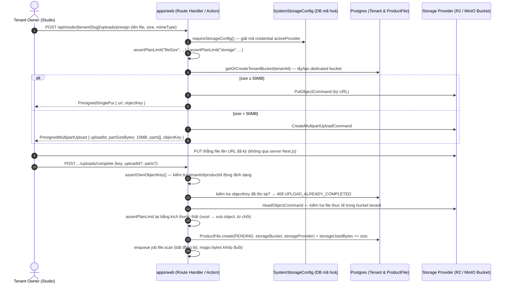
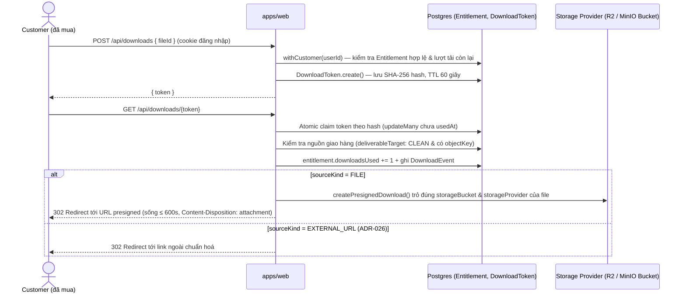
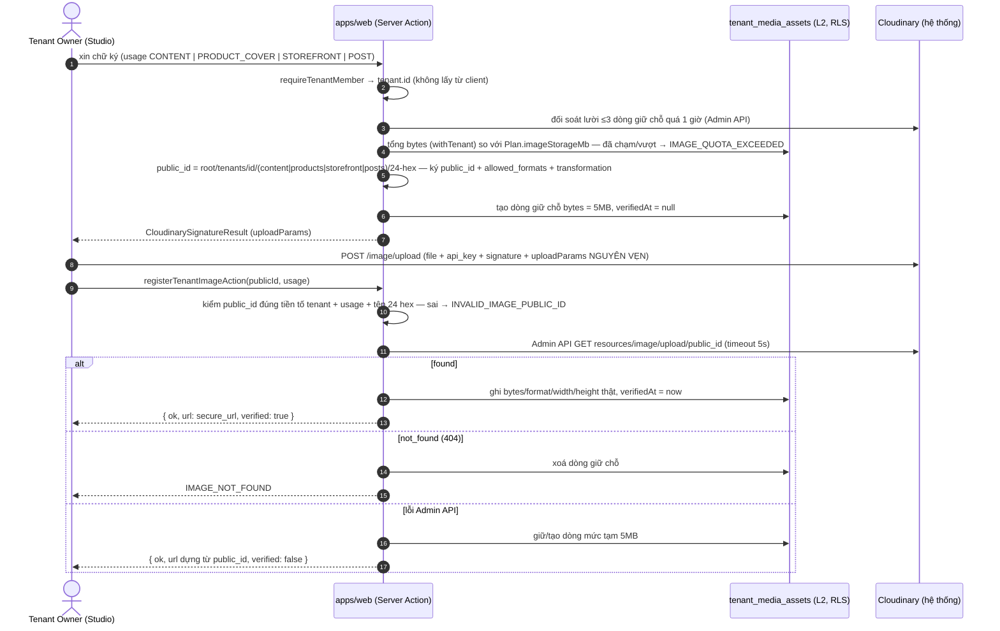

---
tags:
  - spec
  - storage
  - downloads
  - security
  - multi-tenant
  - status/living
date: 2026-09-26
updated: 2026-10-17
author: System Architect
---

# 📐 Đặc Tả: Lưu Trữ File & Cơ Chế Tải Xuống (File Storage & Downloads Specs)

> Gieo Chữ dùng **hai** hệ thống lưu trữ tách biệt, không dùng chung:
> 1. **Storage S3-compatible (Cloudflare R2 song song MinIO)**: Lưu trữ **file sản phẩm bán** (bucket private tuyệt đối, presigned URL $\le 10$ phút, mô hình **Dedicated Bucket riêng cho từng gian hàng**, kèm Công cụ Đồng bộ Dữ liệu và Màn hình Giám sát Dung lượng Bucket theo ADR-014/ADR-017/ADR-038).
> 2. **Cloudinary hệ thống**: Lưu trữ **ảnh** — ảnh CMS của System Admin, và từ ADR-023/027/028 cả ảnh storefront, ảnh bìa sản phẩm, ảnh trong mô tả và bài viết của tenant (có hạn mức theo gói).
>
> Mục 1–6 đặc tả hệ thống (1); mục 7–8 đặc tả hệ thống (2).

---

## 1. Mục Tiêu & Kiến Trúc Tổng Thể (File Sản Phẩm)

`packages/storage` cung cấp lớp trừu tượng S3-compatible (`@aws-sdk/client-s3`), không gắn cứng vào một nhà cung cấp cụ thể. Hệ thống vận hành kiến trúc **Dual Storage Provider** hỗ trợ song song **Cloudflare R2** và **MinIO tự host** ([[01-Architecture-Decisions/ADR-013-Dual-Storage-MinIO-R2-Dedicated-Buckets|ADR-013 (≙ ADR-038)]]).

Nguyên tắc cốt lõi (CLAUDE.md §7.6 & ADR-038):

1. **Bucket private tuyệt đối** cho file bán — không có URL public trực tiếp tới object (cả trên R2 lẫn MinIO).
2. **URL tải chỉ là presigned, sống $\le$ 10 phút**, header `Content-Disposition: attachment` bắt buộc — không bao giờ cho phép trình duyệt hiển thị nội dung file trực tiếp thay vì tải xuống.
3. **Cấu hình credential quản lý qua System Admin + DB mã hoá** (`SystemStorageConfig`, bảng L1 một dòng): Quản lý độc lập cả 2 nhà cung cấp `CLOUDFLARE_R2` và `MINIO`, chọn nhà cung cấp chính qua `activeProvider`. Secret (`accessKeyId`, `secretAccessKey`) được mã hoá AES-256-GCM bằng key riêng `STORAGE_ENCRYPTION_KEY`, **không dùng chung** `PAYMENT_ENCRYPTION_KEY` — lộ 1 key chỉ lộ đúng 1 miền secret (ADR-017).
4. **Mô hình Dedicated Bucket riêng biệt cho từng gian hàng (Tenant):** Mỗi gian hàng sở hữu một bucket riêng biệt chuẩn S3 dạng `${bucketPrefix}tenant-${tenantId}`. Hệ thống tự động cấp phát hoặc lazy-provisioning khi phát sinh upload đầu tiên. Bản ghi `Tenant` và `ProductFile` lưu vết `storageBucket` và `storageProvider` để định tuyến chính xác.
5. **Bộ công cụ Quản trị Dữ liệu (Storage Sync Engine & Bucket Monitoring):** Hỗ trợ chuyển đổi luồng stream S3-to-S3 trực tiếp giữa 2 provider mà không qua RAM/ổ cứng máy chủ, cùng màn hình trực quan giám sát dung lượng thực tế so với hạn mức gói thuê bao (`Plan.storageMb`).

---

## 2. Luồng Upload File Sản Phẩm (Presigned PUT / Multipart)

- **Định tuyến Dedicated Bucket khi Upload:**
  - `presignProductFileUpload` (`apps/web/lib/product-upload.ts`): Gọi `getOrCreateTenantBucket(tenantId)`. Nếu hệ thống đang dùng `MINIO` hoặc tenant đã có bucket riêng, file sẽ được presign thẳng vào bucket riêng của tenant trên provider tương ứng.
  - Cấu trúc `objectKey` bất biến: `tenants/{tenantId}/products/{productId}/{uuid}/{fileName}`. Đảm bảo cô lập logic bổ trợ cho cô lập vật lý cấp bucket.
- **Bảo mật bước `complete` (ADR-026 §1):**
  1. `assertOwnObjectKey`: Kiểm tra chuỗi key khớp đúng `tenantId` và `productId`, đuôi file nằm trong danh mục cho phép.
  2. Kiểm tra trùng lặp `objectKey` trên bảng `product_files` (`@unique`).
  3. `HeadObjectCommand`: Xác thực object đã nằm trên bucket đích với kích thước thực tế khớp khai báo.
  4. `assertPlanLimit`: Tái kiểm tra hạn mức gói (`fileSize` và tổng `storageUsedBytes`) bằng kích thước thực tế từ header S3.
  5. Tạo dòng `ProductFile` ghi nhận đầy đủ `storageBucket` và `storageProvider` tương ứng, cập nhật `tenant.storageUsedBytes`.
- **Ngưỡng multipart:** `MULTIPART_THRESHOLD_BYTES = 50MB`, mỗi phần `MULTIPART_PART_SIZE_BYTES = 10MB`.
- **Link tài liệu ngoài (ADR-026):** Không qua upload S3, không object, không quét, không tính dung lượng.

---

## 3. Kiểm Tra File (`file.scan`) — Xác Nhận An Toàn & Magic Bytes

`apps/web/lib/file-scan.ts` xử lý việc quét định dạng file sau khi upload hoàn tất:

1. **Định tuyến Provider & Bucket:** Hàm `runFileScan(productFileId)` đọc `storageBucket` và `storageProvider` từ bản ghi `ProductFile`. Nếu file lưu ở provider khác `activeProvider`, hệ thống tự động khởi tạo client của provider đó qua `createClientForProvider(file.storageProvider)`. Fallback về `storageConfig.bucketPrivate` và `storageConfig.activeProvider` cho dữ liệu cũ.
2. **Cơ chế một lần đọc (Single-pass Stream):** `readObjectForScan()` (`packages/storage/src/scan.ts`) stream trực tiếp object từ S3/MinIO, vừa tính toán mã băm SHA-256 vừa trích xuất các byte đầu để kiểm tra magic bytes (`matchesDeclaredExtension`) — hoàn toàn không đệm toàn bộ file vào bộ nhớ RAM.
3. **Trạng thái quét:** File hợp lệ được đánh dấu `CLEAN`. File sai định dạng bị xoá khỏi bucket tương ứng (`deleteObject`), đánh dấu `REJECTED`, trừ lại dung lượng `storageUsedBytes` và gửi email thông báo cho chủ gian hàng.
4. **Xử lý nền (ADR-036):** Được kích hoạt bất đồng bộ qua `after()` ngay sau response upload complete hoặc được quét dọn bởi cron hằng ngày `GET /api/cron/daily`.

---

## 4. Tải Xuống — `DownloadToken` (Presigned GET, TTL 60s)

- **Định tuyến chính xác theo bản ghi file:**
  - `apps/web/lib/download.ts` lấy `storageBucket` và `storageProvider` từ `product_files`.
  - Bucket được chọn: `productFile.storageBucket || storageConfig.bucketPrivate`.
  - Nếu `storageProvider` của file khác `activeProvider` hiện tại, hệ thống nạp đúng client của provider lưu file (`CLOUDFLARE_R2` hoặc `MINIO`).
- **An toàn tải xuống:**
  - Presigned GET URL luôn kèm `ResponseContentDisposition: attachment; filename*=UTF-8''...` (RFC 5987 hỗ trợ tên tiếng Việt có dấu).
  - Giới hạn cứng TTL presigned GET qua `clampDownloadTtlSeconds()`: tối đa 600 giây (10 phút) theo CLAUDE.md §7.6.
  - `downloadLimit = 0` nghĩa là không giới hạn số lượt tải (ADR-015).
  - Bảng `DownloadToken` thuộc Layer L1 không RLS, bảo vệ bằng mã băm SHA-256 dùng một lần (TTL 60s).

---

## 5. Share Link — Chia Sẻ File Công Khai Có Mật Khẩu (`ShareLink`)

Chủ gian hàng tạo link tải trực tiếp tại `/studio/[tenantSlug]/products/[productId]/share-links`:
- Token thô chỉ hiển thị **một lần duy nhất** khi tạo, DB chỉ lưu mã băm `tokenHash`.
- Mật khẩu tuỳ chọn mã hoá bằng `argon2id` riêng trong `packages/core` (giữ tính độc lập của core package).
- Khi khách mở link tải (`POST /api/share-links/{token}/download`), hàm `consumeShareLinkDownload` định tuyến lấy presigned URL từ đúng `storageBucket` và `storageProvider` được ghi nhận trên `ProductFile`.
- Share link chỉ áp dụng cho tài liệu tệp (`sourceKind = FILE`), không áp dụng cho link ngoài.

---

## 6. Kiến Trúc Dedicated Bucket, Dual Storage Provider & Bộ Công Cụ Quản Trị Storage (ADR-038)

Theo quyết định [[01-Architecture-Decisions/ADR-013-Dual-Storage-MinIO-R2-Dedicated-Buckets|ADR-013 (≙ ADR-038)]], hệ thống chuyển đổi từ mô hình lưu trữ tập trung sang kiến trúc đa nền tảng kết hợp cô lập cấp bucket.

### 6.1 Mô Hình Dedicated Bucket Cho Gian Hàng
- **Mục tiêu:** Tách biệt triệt để dữ liệu giữa các giáo viên/coach, hạn chế rủi ro lộ lọt chéo, tạo điều kiện thuận lợi cho việc sao lưu, di chuyển hoặc thực thi chính sách tuân thủ dữ liệu riêng biệt.
- **Quy tắc sinh tên bucket (`deriveTenantBucketName`):**
  - Tiêu chuẩn đặt tên: Tuân thủ nghiêm ngặt regex S3/MinIO: `^[a-z0-9][a-z0-9.-]{1,61}[a-z0-9]$`.
  - Cấu trúc: `${bucketPrefix}tenant-${cleanTenantId}` (độ dài kẹp từ 3 đến 63 ký tự, chuyển toàn bộ thành chữ thường, loại bỏ ký tự đặc biệt).
- **Cơ chế cấp phát tự động:**
  - Cấp phát ngay khi đăng ký gian hàng (`createTenantForUser`).
  - Khởi tạo lười (*lazy-provisioning*): Nếu một gian hàng cũ chưa có bucket, hệ thống tự động sinh tên, lưu vào `Tenant.storageBucket` và gọi `ensureBucketExists` ngay khi upload file đầu tiên.
  - Khởi tạo thủ công: System Admin có thể bấm "Khởi tạo bucket" trực tiếp từ giao diện Giám sát Bucket.

### 6.2 Cấu Hình Dual Storage Provider Trong `SystemStorageConfig`
Quản trị viên cấu hình độc lập hai nền tảng lưu trữ tại `/admin/settings/storage`:

| Tham số | Cloudflare R2 (`CLOUDFLARE_R2`) | MinIO (`MINIO`) |
|---|---|---|
| **Định danh / Host** | `endpoint` (URL Cloudflare R2) | `host` (Domain hoặc IP) + `port` (vd: 9000) |
| **Giao thức SSL** | Mặc định HTTPS | Tuỳ chọn `useSSL: boolean` (HTTP / HTTPS) |
| **Khu vực (Region)** | `auto` hoặc khu vực R2 | Mặc định `us-east-1` |
| **Tiền tố Bucket** | — | `bucketPrefix` (vd: `gc-`) |
| **Bucket chung (Fallback)** | `bucketPrivate` & `bucketPublic` | Tự động ghép theo prefix (`${prefix}private`) |
| **Hạn mức tải lên** | Giới hạn theo Cloudflare R2 | `maxUploadMb` (cấu hình tuỳ chọn, vd: 500MB) |
| **Khoá xác thực** | `accessKeyId` & `secretAccessKey` (AES-256-GCM) | `accessKeyId` & `secretAccessKey` (AES-256-GCM) |

- Cờ `activeProvider` quyết định provider nào sẽ tiếp nhận các file mới tải lên.
- Nút "Kiểm tra kết nối" thực hiện gọi lệnh `HeadBucketCommand` / `testS3Connection` thật lên từng provider để xác thực credential trước khi bật kích hoạt.

### 6.3 Công Cụ Quản Trị Đồng Bộ Dữ Liệu (Storage Sync Engine)
- **Vị trí:** Tích hợp trong System Admin tại `/admin/settings/storage` (panel "Đồng bộ dữ liệu").
- **Chiều đồng bộ:** Cho phép chọn `R2_TO_MINIO` hoặc `MINIO_TO_R2`.
- **Cơ chế Stream Copy (Zero-Disk / Zero-RAM Buffering):**
  - Hàm `copyObjectBetweenClients` (`packages/storage/src/stream-copy.ts`) lấy `Body` (luồng stream) từ `GetObjectCommand` của source client truyền thẳng sang `PutObjectCommand` của target client.
  - Không tải toàn bộ file về bộ nhớ máy chủ web Next.js, không ghi ra file tạm trên đĩa cứng, bảo đảm an toàn cho các file dung lượng lớn hàng trăm MB.
  - Tự động gọi `ensureBucketExists` để tạo bucket trên provider đích nếu chưa có.
  - Kiểm tra tính toàn vẹn thông qua kích thước byte truyền (`ContentLength`) và mã băm `ETag`.
  - Cập nhật trường `ProductFile.storageBucket` và `ProductFile.storageProvider` sau khi hoàn tất sao chép thành công.

### 6.4 Màn Hình Giám Sát Dung Lượng & Bucket Gian Hàng (Bucket Monitoring)
- **Vị trí:** Tab "Giám sát Bucket & Dung lượng" tại `/admin/settings/storage`.
- **Dữ liệu giám sát thời gian thực:**
  - Danh sách tất cả gian hàng trong hệ thống: Tên, Slug, Trạng thái hoạt động.
  - Bucket riêng (`storageBucket`) và Provider đang gán (`storageProvider`).
  - Số lượng file bán (`fileCount`).
  - Dung lượng sử dụng thực tế (`storageUsedBytes`).
  - Hạn mức gói thuê bao (`Plan.storageMb`).
  - Thanh tiến trình % dung lượng kèm mã màu cảnh báo trực quan:
    + 🟢 **Xanh lá:** Sử dụng dưới 75% hạn mức.
    + 🟡 **Vàng / Cam:** Sử dụng từ 75% đến 90% hạn mức (cần chú ý).
    + 🔴 **Đỏ:** Sử dụng vượt 90% hoặc chạm ngưỡng hạn mức gói.
- **Thao tác nhanh cho Admin:**
  - Nút "Kiểm tra bucket" (`headBucket`): Xác minh kết nối vật lý tới bucket trên S3/MinIO.
  - Nút "Khởi tạo bucket": Tạo ngay dedicated bucket cho các gian hàng cũ mà không cần chờ lượt upload đầu tiên.

---

## 7. Cloudinary Hệ Thống — Bối Cảnh

Tài khoản Cloudinary hệ thống cấu hình ở `/admin/settings/cloudinary` (`SystemCloudinaryConfig`, secret mã hoá bằng `STORAGE_ENCRYPTION_KEY`; đổi cloud name/key/secret thì tự tắt cho tới khi admin "Kiểm tra kết nối" lại — cùng cơ chế auto-disable của R2/SePay/MoMo) ✅ `apps/web/lib/system-cloudinary.ts`.

Ban đầu chỉ phục vụ ảnh Landing Page CMS; sau đó dùng thêm cho ảnh storefront tenant (ADR-023), ảnh bìa sản phẩm (`Product.coverImageUrl`, ADR-027) và ảnh trong mô tả sản phẩm (ADR-028). File tài liệu bán **vẫn chỉ ở R2/MinIO private**. Ảnh không đi qua server Next.js: trình duyệt upload thẳng lên Cloudinary bằng chữ ký do server cấp, ảnh phục vụ từ CDN `res.cloudinary.com`.

---

## 8. Ảnh Tenant Trên Cloudinary Hệ Thống — Chữ Ký, Hạn Mức, Tối Ưu (ADR-028)

Đối chiếu code 2026-09-27 ✅: `apps/web/lib/tenant-media.ts`, `apps/web/lib/system-cloudinary.ts`, `apps/web/lib/cloudinary-signature.ts`, `apps/web/app/studio/[tenantSlug]/media-actions.ts`, `apps/web/app/_ui/cloudinary-actions.ts`, `packages/core/src/content/{cloudinary-url,sanitize-html}.ts`, `packages/core/src/tenant/storefront-sections.ts`. ADR: [[01-Architecture-Decisions/ADR-014-System-Cloudinary-Image-Quota|ADR-014 (≙ ADR-028)]].

### 8.1 Luồng ký → upload → register

- **Ký `public_id` đầy đủ, không ký `folder`** ✅: Một chữ ký chỉ tạo/ghi đè đúng 1 asset. Chuỗi ký = mọi tham số sắp theo alphabet, nối `key=value` bằng `&`, cộng `apiSecret`, SHA-1.
- **Định dạng tenant:** `allowed_formats` = png, jpg, jpeg, webp (không SVG, không GIF).
- **Incoming transformation** `c_limit,w_2000,h_2000` nằm trong chữ ký: Cloudinary thu cạnh dài về $\le 2000$px trước khi lưu bản gốc.
- **Giữ chỗ hạn mức lúc ký** ✅: Mỗi chữ ký đã cấp bị tính tạm 5MB (`UNVERIFIED_IMAGE_BYTES`) cho tới khi xác minh. Dòng giữ chỗ quá 1 giờ chưa xác minh được đối soát lười tối đa 3 dòng mỗi lần xin chữ ký.
- **Số liệu chỉ lấy từ server** ✅: `bytes/format/width/height` đọc qua Admin API, không nhận từ client.

### 8.2 Hạn mức theo gói

| Gói (dữ liệu khởi tạo) | `Plan.imageStorageMb` |
|---|---|
| FREE | 100 |
| CREATOR | 1024 |
| PRO | 2048 |
| BUSINESS | 5120 |

Hạn mức cộng chung ảnh mô tả + ảnh bìa + ảnh storefront + ảnh bài viết. Hạn mức ảnh **tách riêng** với `storageUsedBytes` (dung lượng file bán R2/MinIO).

### 8.3 Chữ ký dùng chung (admin) và chữ ký tenant

| Action | Guard | Ký gì | Dùng ở |
|---|---|---|---|
| `getCloudinaryUploadSignatureAction` (`app/_ui/cloudinary-actions.ts`) | `requireRole("SYSTEM_ADMIN")` | `folder` = root, `allowed_formats` png/jpg/jpeg/webp/svg | `ImageUploadField` mặc định (CMS, thương hiệu, danh mục) |
| `getContentImageUploadSignatureAction` (`studio/[tenantSlug]/media-actions.ts`) | `requireTenantMember` | `public_id` `tenants/<id>/content/…` | Editor mô tả sản phẩm |
| `getProductCoverUploadSignatureAction` (`studio/[tenantSlug]/products/actions.ts`) | `requireTenantMember` | `public_id` `tenants/<id>/products/…` | Card Ảnh đại diện |
| `getTenantCloudinaryUploadSignatureAction` (`studio/[tenantSlug]/storefront/actions.ts`) | `requireTenantMember` | `public_id` `tenants/<id>/storefront/…` | Storefront editor |

### 8.4 Tối ưu hiển thị — `cloudinaryDeliveryUrl`

`cloudinaryDeliveryUrl(secureUrl, { width })` (`packages/core/src/content/cloudinary-url.ts`) chèn `f_auto,q_auto,c_limit,w_<N>` sau `/image/upload/`, N kẹp về [1, 1600]. Chỉ áp dụng cho URL Cloudinary hệ thống; URL khác trả nguyên trạng.

### 8.5 Sanitizer & kiểm URL ảnh

- `sanitizeRichTextHtml(html, { imageCloudName, imageWidth? })`: Thẻ `img` chỉ giữ khi `src` là `https://res.cloudinary.com/<imageCloudName>/image/upload/...`. Ảnh host khác bị loại bỏ hoàn toàn.
- `isCloudinaryImageUrl(value, cloudName?)`: Kiểm tra URL hợp lệ theo đúng cloud name hệ thống khi lưu trữ ảnh bìa hoặc ảnh storefront.

---

## 9. Tài Liệu Tham Chiếu & Liên Kết

* [[Architecture-Overview]] — Tổng quan kiến trúc hệ thống ([Architecture-Overview.md](./Architecture-Overview.md))
* [[Order-State-Machine]] — Vòng đời đơn hàng & cấp quyền Entitlement ([Order-State-Machine.md](./Order-State-Machine.md))
* [[01-Architecture-Decisions/ADR-005-Storage-Config-System-Admin|ADR-005 (≙ ADR-017)]] — Cấu hình Storage quản lý qua System Admin + DB mã hoá.
* [[01-Architecture-Decisions/ADR-013-Dual-Storage-MinIO-R2-Dedicated-Buckets|ADR-013 (≙ ADR-038)]] — Kiến trúc Dual Storage MinIO & R2, Dedicated Bucket per Tenant, Storage Sync Engine.
* [[01-Architecture-Decisions/ADR-014-System-Cloudinary-Image-Quota|ADR-014 (≙ ADR-028)]] — Ảnh Cloudinary hệ thống & hạn mức ảnh theo gói.
* [[02-System-Specs/Product-Editor-And-Publishing-Specs|Product-Editor-And-Publishing-Specs]] — Editor sản phẩm, kiểm soát upload và điều kiện xuất bản.
* [[03-API-Contracts/Database-Schema-Reference|Database-Schema-Reference]] — Lược đồ Prisma cho `Tenant`, `ProductFile` và `SystemStorageConfig`.
* [docs/DECISIONS.md](../../docs/DECISIONS.md) — ADR-014, ADR-017, ADR-018, ADR-020, ADR-028, ADR-038.
* Mã nguồn cốt lõi:
  - `packages/storage/src/{bucket,stream-copy,presign,scan,s3-client}.ts`
  - `apps/web/lib/{tenant-storage,storage-sync,system-storage,product-upload,download,file-scan,share-link}.ts`
  - `apps/web/app/admin/settings/storage/{page,actions,storage-form,bucket-monitoring,storage-sync-panel}.tsx`

*Quay lại: [[MOC-Home]] (../00-Index/MOC-Home.md)*
