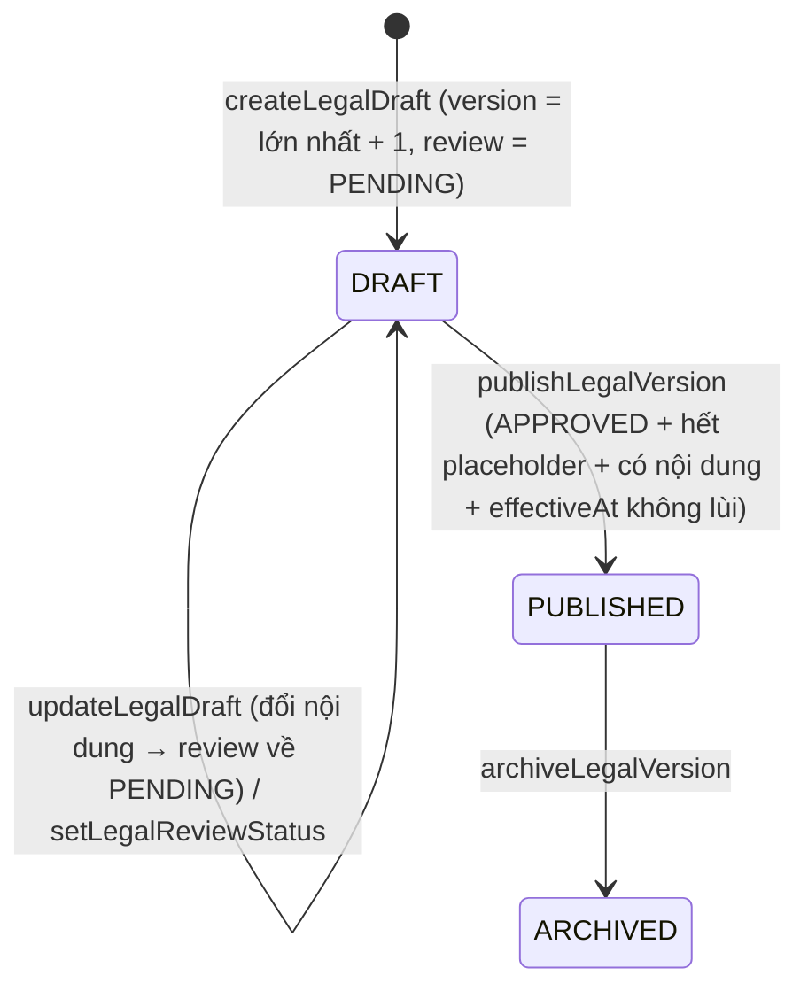

---
tags:
  - spec
  - legal
  - auth
  - system-admin
  - database
  - security
  - seo
  - status/living
date: 2026-10-23
updated: 2026-10-25
author: Long
---

# 📐 Đặc Tả: Văn Bản Pháp Lý Có Phiên Bản + Ghi Nhận Chấp Thuận (ADR-050 mục 3 + ADR-054)

Quyết định: [[01-Architecture-Decisions/ADR-035-Menu-Home-Seo-Versioned-Terms|ADR-035 KB (≙ ADR-050)]] mục 3 + "Bổ sung ADR-050" (a)–(c); đợt 2
[[01-Architecture-Decisions/ADR-040-Legal-Pages-Phase-2-Root-Urls-Consent|ADR-040 KB (≙ ADR-054)]]. Quy trình vận hành xuất bản:
[[04-Operations-Runbooks/Legal-Terms-Publishing-Runbook|Legal-Terms-Publishing-Runbook]].

> **Trạng thái 2026-10-24:** đợt 1 (ADR-050) — migration `20261023090000_adr050_legal_documents` **đã chạy trên DB dùng chung** 🟡. Đợt 2
> (ADR-054) — code xong ở working tree, **chưa commit** ✅ `git status`; migration `20261024150000_adr053_legal_document_meta` **đã chạy trên DB dùng chung** 🟡
> (chủ dự án xác nhận 2026-10-24, brief Quốc 2026-10-25; DB khác vẫn phải chạy migration này **trước** code đợt 2, xem §2). **Chưa có phiên bản nào được xuất bản** ❓ (Long không đọc DB) —
> các dự thảo `docs/legal/drafts/*.md` còn placeholder, chưa qua luật sư. Giao diện trang công khai: [[04-Operations-Runbooks/UI-Design-System|UI-Design-System]] §22.
> Mức xác minh: ✅ Long đọc code/SQL working tree · 🟡 brief/báo cáo Quốc · ❓ cần môi trường thật.

---

## 1. Phạm vi

### 1.1. Đợt 1 (ADR-050) ✅
- Một văn bản `terms`; điểm chấp thuận duy nhất là **đăng ký tài khoản**. Người dùng cũ **không** bị buộc chấp thuận lại.

### 1.2. Đợt 2 (ADR-054) ✅ code
- **7 văn bản**, khai báo ở `LEGAL_DOCUMENT_DEFS` (`packages/core/src/legal/legal-document.ts`, subpath `@gieochu/core/legal`). Thứ tự khai báo = thứ
  tự trong editor và cột footer "Thông tin":

  | Khoá | URL cấp gốc | Tiêu đề (dùng khi tạo dòng lần đầu) |
  | :-- | :-- | :-- |
  | `terms` | `/dieu-khoan-su-dung` | Điều khoản sử dụng |
  | `privacy` | `/chinh-sach-bao-mat` | Chính sách bảo mật |
  | `content_policy` | `/chinh-sach-noi-dung` | Chính sách nội dung |
  | `copyright` | `/cam-ket-ban-quyen` | Cam kết bản quyền và nguồn gốc tài liệu |
  | `usage_license` | `/quyen-su-dung-tai-lieu` | Quyền sử dụng tài liệu |
  | `seller` | `/chinh-sach-nguoi-ban` | Chính sách người bán |
  | `contact` | `/lien-he` | Liên hệ và thông tin pháp lý |

- Hoàn tiền vẫn nằm trong Điều khoản (không tách trang). **Không có trang tổng hợp (hub).** Xuất bản từng văn bản riêng qua cổng của ADR-050.
- Điểm chấp thuận: **đăng ký** (Điều khoản + Chính sách bảo mật) và **mở gian hàng** (Chính sách người bán) — §6.
- Ngoài phạm vi đợt 2 🟡 ADR-054 mục 9: cam kết "không bán dữ liệu cá nhân"; hai vấn đề chờ luật sư ("chỉ khoá, không xoá user" so với quyền yêu cầu
  xoá dữ liệu; danh mục nội dung bị cấm).

---

## 2. Dữ liệu — 3 bảng L1 ✅ (đọc migration + `schema.prisma`)

Cả 3 bảng **L1** (không `tenantId`) → **không RLS**, đọc/ghi bằng `getPrismaClient()`; ghi văn bản chỉ qua Server Action `requireRole("SYSTEM_ADMIN")` + audit.

| Bảng (model) | Cột chính | Ràng buộc |
| :-- | :-- | :-- |
| `legal_documents` (`LegalDocument`) | `key` unique, `slug` unique, `title`, **`summary?`, `seoTitle?`, `seoDescription?`** (ADR-054), `createdAt`, `updatedAt` | CHECK `legal_documents_key_format`: `key` khớp `^[a-z0-9]+([_-][a-z0-9]+)*$` (**ADR-054 nới** để nhận `_`), `slug` khớp `^[a-z0-9]+(-[a-z0-9]+)*$` (giữ luật cũ). CHECK `legal_documents_meta_length` (ADR-054): `summary` ≤ 320, `seoTitle` ≤ 120, `seoDescription` ≤ 320. Dòng tạo lười (`ensureLegalDocument` — upsert theo `key`) khi admin tạo bản nháp đầu **hoặc** lưu mô tả/SEO lần đầu, **không seed** |
| `legal_document_versions` (`LegalDocumentVersion`) | `documentId` (FK `Restrict`), `version Int`, `status` (`DRAFT` mặc định / `PUBLISHED` / `ARCHIVED`), `reviewStatus` (`PENDING_LEGAL_REVIEW` mặc định / `APPROVED`), `contentHtml`, `changeSummary?`, `effectiveAt?`, `publishedAt?`, `publishedById?`, `createdById?` (2 cột id người **không FK**), **`isDraftRelease` (mặc định `false`, ADR-057 — §5.2)**, `createdAt`, `updatedAt` | Unique `(documentId, version)`; index `(documentId, status, effectiveAt)`; CHECK `legal_document_versions_shape`: `version ≥ 1`, `contentHtml` ≤ 200 000 ký tự, `changeSummary` ≤ 1000, bản không phải `DRAFT` **bắt buộc** có `effectiveAt` + `publishedAt` |
| `user_legal_acceptances` (`UserLegalAcceptance`) | `userId` (FK `users` **Cascade**), `versionId` (FK `Restrict`), `acceptedAt` | Unique `(userId, versionId)`; index `versionId`. **Không lưu IP/User-Agent** (chủ dự án chốt) |

**Trigger bất biến** `legal_document_versions_freeze_content` (BEFORE UPDATE): khi bản cũ **không còn `DRAFT`**, từ chối (ERRCODE `42501`) mọi thay đổi
`contentHtml`, `version`, `documentId`, `effectiveAt`, `publishedAt`, `changeSummary`, `isDraftRelease` (từ ADR-057), mọi chuyển về `DRAFT`, và mọi chuyển ra khỏi `ARCHIVED`. Chỉ
còn cho phép `PUBLISHED → ARCHIVED` và đổi `reviewStatus`. Sửa nội dung = tạo phiên bản mới. Mô tả/SEO nằm trên `legal_documents` nên **không** theo
phiên bản (sửa được bất kỳ lúc nào).

**Quyền `gieochu_app`** (bọc `IF EXISTS`): `legal_documents`, `legal_document_versions` — `SELECT, INSERT, UPDATE, DELETE`; `user_legal_acceptances` —
`REVOKE ALL` rồi chỉ `SELECT, INSERT, DELETE` (**append-only**); `EXECUTE` hàm trigger. Migration ADR-054 không GRANT thêm (quyền bảng phủ cột mới).

**Migration ADR-054** (`20261024150000_adr053_legal_document_meta`, expand — tên thư mục giữ số cũ, KB-Audit §36) **đã chạy trên DB dùng chung** 🟡 (chủ dự án xác nhận 2026-10-24). Theo comment SQL: code cũ chạy được trên schema mới; code
ADR-054 cần migration chạy **trước** — `getLegalDocumentMeta`/`updateLegalDocumentMeta` đọc/ghi 3 cột mới (metadata trang văn bản, editor), và tạo nháp
`content_policy`/`usage_license` cần CHECK `key_format` đã nới. `getEffectiveLegalVersion` (dùng cho đăng ký, mở gian hàng) **không** đọc cột mới ✅.

**Chính sách không xoá user** ("Bổ sung ADR-050" (a)): FK `Cascade` từ `user_legal_acceptances` chỉ để dọn dữ liệu test — **không có luồng nghiệp vụ xoá
user**. Xem [[02-System-Specs/User-Management-System-Center-Specs|User-Management-System-Center-Specs]] §3.4.

---

## 3. Luật nghiệp vụ ✅ (`apps/web/lib/legal.ts` + `packages/core/src/legal/legal-document.ts`)

### 3.1. Vòng đời phiên bản

- **Tạo nháp:** số phiên bản = lớn nhất + 1 trong transaction; hai admin tạo cùng lúc → unique `P2002` → 409 `LEGAL_VERSION_CONFLICT`. Nội dung
  trống được phép (soạn dần). Nhãn hiển thị `legalVersionLabel(n)` = `"n.0"`.
- **Sửa nháp:** chỉ bản `DRAFT` (khác → 409 `LEGAL_VERSION_NOT_DRAFT`; trigger DB là lớp thứ hai). Nội dung **thay đổi** → `reviewStatus` tự về
  `PENDING_LEGAL_REVIEW`; chỉ đổi tóm tắt thì giữ trạng thái rà soát.
- **Đổi trạng thái rà soát:** chỉ bản `DRAFT`.
- **Khoá lạc quan:** mọi UPDATE (sửa, rà soát, xuất bản) kèm điều kiện `updatedAt` không đổi + trạng thái mong đợi; `count = 0` → 409 `LEGAL_VERSION_CONFLICT`.
- **Lưu trữ:** chỉ bản `PUBLISHED` (khác → 409 `LEGAL_VERSION_NOT_PUBLISHED`). Lưu trữ bản đang hiệu lực → bản PUBLISHED trước đó (nếu còn, có
  `effectiveAt ≤ now`) **tự hiệu lực lại** theo §3.4; không còn bản nào → văn bản "trống" (trang công khai 404, link menu/footer tự ẩn, form không ghi
  chấp thuận văn bản đó).

### 3.2. Cổng xuất bản — `legalPublishBlockers(version)`

Rỗng mới được xuất bản; server kiểm lại cả trong câu UPDATE. 4 lý do (`LEGAL_PUBLISH_BLOCKER_MESSAGES`, gộp thành một thông báo 422 `LEGAL_PUBLISH_BLOCKED`):

| Blocker | Điều kiện |
| :-- | :-- |
| `NOT_DRAFT` | Bản không phải `DRAFT` |
| `EMPTY` | Chữ sau khi bỏ thẻ HTML (và `&nbsp;`) rỗng |
| `PLACEHOLDER` | `contentHtml` **hoặc** chữ đã bỏ thẻ còn chứa `LEGAL_PLACEHOLDER_MARKER = "[[CẦN XÁC NHẬN"` |
| `NOT_APPROVED` | `reviewStatus ≠ APPROVED` |

### 3.3. Ngày hiệu lực

- Ô `datetime-local` **giờ Việt Nam** → `parseVnDateTimeLocal` → UTC (UTC+7 cố định). Trống → **ngay bây giờ**; sai định dạng → "Ngày hiệu lực không hợp lệ."
- **Không lùi ngày hiệu lực:** `effectiveAt < now − 5 phút` → 400 `LEGAL_INVALID_INPUT`. Đặt ngày **tương lai** được phép (bản "đã lên lịch").
- Xuất bản ghi `effectiveAt`, `publishedAt = now`, `publishedById`.

### 3.4. Bản đang hiệu lực

`getEffectiveLegalVersion(key, now)` = bản `PUBLISHED` có `effectiveAt ≤ now`, sắp `effectiveAt` giảm dần rồi `version` giảm dần, lấy bản đầu
(`pickEffectiveLegalVersion` là bản thuần cùng luật). **Nhiều bản PUBLISHED cùng lúc được phép**; bản có `effectiveAt` tương lai tự hiệu lực đúng thời
điểm (không cần cron). `getEffectiveLegalKeys()` (ADR-054) — **một truy vấn**, `cache()` theo request — trả tập khoá **đã khai báo** đang có bản hiệu lực,
dùng để ẩn/hiện link menu/footer.

### 3.5. Nội dung, sanitize, link, token `{brand}`

- Lưu: `sanitizeLegalHtml` = `sanitizeRichTextHtml(html, { imageCloudName: null, trustedLinks: { siteOrigin } })` (whitelist Tiptap, **không cho
  ảnh**); quá 200 000 ký tự sau sanitize → 400. Tóm tắt thay đổi trim, ≤ 1000, rỗng → `null`.
- **Chế độ `trustedLinks`** (ADR-054 mục 7, **chỉ** cho văn bản pháp lý do System Admin soạn) ✅ `packages/core/src/content/sanitize-html.ts`:
  `target`/`rel` có sẵn trong HTML luôn bị bỏ rồi dựng lại theo `classifyRichTextLink(href, siteOrigin)`:
  - **nội bộ** (`#…`, `/…` không phải `//`/`/\`, đường dẫn tương đối, URL tuyệt đối cùng origin `siteOrigin`) → cùng tab, không `rel`;
  - **ngoài** (`http(s)` khác origin, protocol-relative `//host`, `/\host`, `\\host`) → `target="_blank" rel="noopener noreferrer"` (không `nofollow`);
  - `mailto:` → không `target`.
  - Không truyền `trustedLinks` = hành vi cũ cho mọi nội dung khác (tenant) — xem lệch ở KB-Audit §35.
- Render: sanitize **lại**, **sau đó** mới `replaceBrandTokenInHtml(html, brandName)` — tên thương hiệu được escape HTML trước khi thay. Thứ tự
  sanitize → thay token là bắt buộc; rồi `buildLegalToc` gắn `id` cho H2.

### 3.6. Mô tả ngắn + SEO (ADR-054 mục 4) ✅

- `updateLegalDocumentMeta(spec, input)`: schema `cmsSeoSchema` (dùng chung SEO trang chủ — giới hạn 120/320) + `summary` ≤ `LEGAL_SUMMARY_MAX = 320`;
  trim, chuỗi rỗng → `null`; **lưu thẳng** (không nháp — như SEO trang chủ ADR-050 lần 2), áp ngay cho trang đang hiệu lực. Tạo dòng văn bản nếu chưa
  có (soạn SEO trước khi có phiên bản được).
- `getLegalDocumentMeta(key)` đọc riêng (không gộp vào `getEffectiveLegalVersion`).

---

## 4. Trang công khai — URL cấp gốc `/{slug}` (ADR-054) ✅

- 7 thư mục route mỏng `apps/web/app/{slug}/page.tsx` (`dieu-khoan-su-dung`, `chinh-sach-bao-mat`, `chinh-sach-noi-dung`, `cam-ket-ban-quyen`,
  `quyen-su-dung-tai-lieu`, `chinh-sach-nguoi-ban`, `lien-he`), mỗi route truyền đúng một khoá vào `LegalDocumentPage` +
  `legalDocumentMetadata` (`app/_ui/legal-document-page.tsx`), `dynamic = "force-dynamic"`. Route tĩnh thắng `app/[tenantSlug]`.
- Chưa có bản hiệu lực → **404** (`notFound()`); metadata khi không có bản: `title = brand`, `robots: noindex, nofollow`.
- Có bản: **title** = `seoTitle` (thay token `{brand}`) hoặc `"{tiêu đề} | {brand}"`; **description** = `seoDescription` hoặc `summary` (thay `{brand}`),
  không có cả hai → không đặt; **canonical** = `${APP_URL}/{slug}`.
- Nội dung: tiêu đề, "Phiên bản n.0 · Có hiệu lực từ dd/mm/yyyy" (giờ VN), mục lục từ H2 (`app/_ui/legal-toc.ts`); `container-page` + lưới
  `220px | minmax(0,768px)`. Chi tiết UI: [[04-Operations-Runbooks/UI-Design-System|UI-Design-System]] §22.
- **URL cũ** `/phap-ly/{slug}` → `app/phap-ly/[slug]/route.ts` (`GET`, `HEAD`): slug là văn bản đã khai báo → **308** `Location: /{slug}{query}` (đường
  dẫn tương đối, không dựng origin từ `request.url`); slug lạ → 404 text. **Không đọc DB** — văn bản chưa hiệu lực vẫn redirect, trang đích tự 404.
  Trang `app/phap-ly/[slug]/page.tsx` và `_ui/legal-toc.ts` cũ đã xoá (chuyển lên `app/_ui/`).
- **Slug dành riêng:** `RESERVED_SLUGS` (tenant, `packages/core/src/tenant/slug.ts`) giữ `phap-ly` và thêm `...LEGAL_DOCUMENT_ROOT_SLUGS` — đọc thẳng từ
  `LEGAL_DOCUMENT_DEFS`, thêm văn bản mới thì tự vào danh sách ✅. Quét DB không có tenant trùng 7 slug: ✅ Hiếu quét DB (chỉ đọc), báo qua Quốc 2026-10-24: DB có 1 tenant, không trùng 7 slug mới và `phap-ly`. Không cần
  `RESERVED_PRODUCT_SLUGS` (route không nằm dưới `app/[tenantSlug]/`).

---

## 5. Editor "Chính sách sử dụng" `/admin/cms/phap-ly` + Bản dự thảo (ADR-057 + bổ sung) ✅ đọc code 2026-10-25 (chưa commit)

Quyết định: [[01-Architecture-Decisions/ADR-042-Legal-Drafts-Import-Preview-Draft-Release|ADR-042 KB (≙ ADR-057)]]. Ghi theo code working tree sau báo cáo
"xong GĐ C" của Hiếu (qua Quốc, 2026-10-25). Contract Server Action: [[03-API-Contracts/Endpoint-Directory|Endpoint-Directory]] §26.4; quy trình thao tác:
[[04-Operations-Runbooks/Legal-Terms-Publishing-Runbook|Legal-Terms-Publishing-Runbook]] §1.

### 5.1. Editor một nội dung
- Trang `requireAdminAccess("/admin/cms/phap-ly")`, tiêu đề "Chính sách sử dụng — {tên văn bản}"; segment tĩnh thắng `/admin/cms/[slug]`. Chọn văn bản bằng
  **`?van-ban=<khoá>`** (khoá lạ → `terms`); hàng chọn hiện trạng thái từ `listLegalDocumentStatuses()` (một truy vấn): `NONE` / `DRAFT_ONLY` / `EFFECTIVE` /
  `SCHEDULED` + `hasDraft` + **`isDraftRelease`** (bản đang hiệu lực — hoặc, khi chưa có, bản hẹn hiệu lực gần nhất — là bản dự thảo). Link chọn văn bản
  gắn `useLeaveGuard` (ADR-058).
- **Không lộ phiên bản:** `getLegalEditorData(key)` trả một nội dung — bản nháp làm việc (`pickWorkingLegalDraft`: DRAFT mới nhất **có nội dung**; mọi DRAFT
  trống → DRAFT mới nhất), không có thì nội dung bản PUBLISHED mới nhất; kèm `hasUnpublishedChanges`, `lastUpdatedAt` ("Cập nhật lúc …"), `previewHref`, `meta`,
  **`draftReleaseAvailable`** (= `LEGAL_DRAFT_RELEASE_AVAILABLE`).
- 3 Server Action theo bản nháp làm việc (`saveLegalDraftAction`, `setLegalReviewAction`, `publishLegalAction`), chống ghi đè giữa tab bằng
  `expectedUpdatedAt` (lệch → `LEGAL_VERSION_CONFLICT` 409). Sau thao tác: revalidate `/admin/cms/phap-ly`, `/{slug}`, `/register`, `/studio`,
  `revalidatePath("/", "layout")`. 5 action theo phiên bản cũ và nút **Lưu trữ** đã bỏ; `archiveLegalVersion` còn trong lib, không action nào gọi.
- Sidebar chặn nút Xuất bản kèm lý do: còn thay đổi chưa lưu; chưa có nháp; nội dung trống; với bản chính thức thêm: còn `[[CẦN XÁC NHẬN`, chưa tích
  "Đã rà soát nội dung". Ô rà soát khoá khi còn thay đổi chưa lưu/chưa có nháp. Server kiểm lại.
- Khung **"Mô tả & SEO"** (`LegalMetaForm`) dưới nội dung, thu gọn mặc định, lưu thẳng qua `saveLegalDocumentMetaAction` (§3.6). Cả editor và khung meta đăng
  ký `useUnsavedChanges` (thay `beforeunload` riêng).

### 5.2. Bản dự thảo — dữ liệu và xuất bản
- Cột **`legal_document_versions.isDraftRelease BOOLEAN NOT NULL DEFAULT false`** ✅ `schema.prisma`. Migration expand-only
  `20261025120000_adr057_legal_draft_release`: thêm cột + `CREATE OR REPLACE` function trigger `legal_document_versions_freeze_content` — **trigger đóng băng
  giờ phủ cả `isDraftRelease`** (bản đã PUBLISHED/ARCHIVED không đổi được cờ; muốn thành bản chính thức phải xuất bản bản mới) ✅ đọc SQL. Migration **đã chạy
  2026-10-25** 🟡 ("Bổ sung ADR-058" (c) — Long không đọc DB). Bảng L1, không RLS, không cần GRANT thêm.
- `LEGAL_DRAFT_RELEASE_AVAILABLE = true` ✅ (`lib/legal.ts`; đặt `false` để tắt tạm: editor khoá ô tích, server từ chối `asDraftRelease`).
- `publishLegalVersion(key, versionId, { effectiveAt, actorId, asDraftRelease })`: với `asDraftRelease` **bỏ qua** cổng `PLACEHOLDER` + `NOT_APPROVED`, chỉ còn
  kiểm **`NOT_DRAFT`** và **`EMPTY`**; câu UPDATE bỏ điều kiện `reviewStatus = APPROVED`, ghi `isDraftRelease = true`. Luật ngày hiệu lực (§3.3) giữ nguyên.
  Bản chính thức vẫn đủ 4 điều kiện ADR-050 (§3.2).
- Audit `LEGAL_VERSION_PUBLISHED` metadata thêm **`isDraftRelease`** (cạnh `key`, `version`, `effectiveAt`) ✅ `actions.ts`.

### 5.3. Hai hàm đọc bản hiệu lực — hiển thị vs ghi đồng ý

| Hàm | Dùng cho | Hành vi |
| :-- | :-- | :-- |
| `getEffectiveLegalVersion(key, now?)` | **Hiển thị**: trang công khai, form đăng ký (link) | PUBLISHED, `effectiveAt <= now`, mới nhất — **kể cả bản dự thảo**; trả `EffectiveLegalVersion` có **`isDraftRelease`** |
| `getAcceptanceLegalVersion(key, now?)` | **Ghi đồng ý**: `POST /api/auth/register`, mở gian hàng (`app/studio/page.tsx` + `app/studio/actions.ts`) | Gọi hàm trên; bản đang hiển thị là bản dự thảo → **`null`** — kể cả khi trước đó đã có bản chính thức cũ hơn (Quốc chốt: người dùng chỉ thấy bản dự thảo nên không ghi đồng ý cho nội dung họ không được xem) |

Lớp phòng thủ thứ hai: `resolveAcceptedLegalVersion` và `resolveSellerPolicyAcceptance` trả `null` khi `effective.isDraftRelease` ✅.

### 5.4. Ghi đồng ý khi văn bản là bản dự thảo
- **Đăng ký:** văn bản dự thảo vẫn có link trong ô đồng ý nhưng `RegisterTermsInfo.versionId = null` (`register/page.tsx`) → không ghi `user_legal_acceptances`
  cho văn bản đó, chỉ ghi `UserProfile.consentAt` như trước ADR-050 ✅.
- **Mở gian hàng:** Chính sách người bán là bản dự thảo → `getAcceptanceLegalVersion` = `null` → **ẩn ô đồng ý** và server bỏ qua ✅.
- **Bắt buộc id khớp** ✅ (Hiếu báo xong 2026-10-25; đọc code `resolveAcceptedLegalVersion`: `submittedVersionId !== effective.versionId` → 409): khi văn bản đã có
  bản **chính thức**, client **phải** gửi id khớp — không gửi id hoặc id lệch đều 409 ("vui lòng tải lại trang"). Bỏ luật cũ "không gửi id thì dùng bản hiện hành".
  Trên thực tế `termsVersionId`, `privacyVersionId`, `sellerPolicyVersionId` **bắt buộc** khi văn bản có bản chính thức. Mỗi văn bản giữ mã lỗi riêng:
  Điều khoản **`LEGAL_TERMS_CHANGED`** (contract ADR-050), Chính sách bảo mật + Chính sách người bán **`LEGAL_DOCUMENT_CHANGED`**. §6 dưới đã chỉnh theo.

### 5.5. Hiển thị
- `LegalDocumentView` (`app/_ui/legal-document-page.tsx`): `[[CẦN XÁC NHẬN: …]]` → `(đang cập nhật)` bằng
  `replaceLegalPlaceholders` (chạy **sau** sanitize + thay `{brand}`); bản dự thảo có banner "Bản dự thảo" dưới H1, dòng meta "Công bố ngày" thay "Hiệu lực từ" ✅.
- Menu + footer coi bản dự thảo là **"có trang"**: `getEffectiveLegalKeys()` lấy mọi văn bản có bản PUBLISHED `effectiveAt <= now`, không lọc cờ ✅.
- Trang xem trước `/phap-ly/xem-truoc?van-ban=&phien-ban=` (chỉ SYSTEM_ADMIN, noindex, `getLegalVersionForPreview`) truyền `isDraftRelease` vào view và thêm
  "Bản dự thảo" vào dòng trạng thái ✅.

### 5.6. Contract kiểu dữ liệu đổi
`EffectiveLegalVersion.isDraftRelease: boolean` · `LegalVersionRow.isDraftRelease` · `LegalDocumentAdminStatusInfo.isDraftRelease: boolean` ·
`LegalEditorData.draftReleaseAvailable: boolean` · `RegisterTermsInfo.versionId: string | null` (`register-form.tsx`) ✅.

---

## 6. Ghi chấp thuận ✅

### 6.1. Đăng ký — Điều khoản + Chính sách bảo mật

`app/(auth)/register/page.tsx` đọc bản hiệu lực của `terms` **và** `privacy` (độc lập — văn bản chưa hiệu lực thì `null`):
- Có Điều khoản → link `/dieu-khoan-su-dung`, gửi `termsVersionId`. Có Chính sách bảo mật → cụm "chính sách xử lý dữ liệu cá nhân" thành link
  `/chinh-sach-bao-mat`, gửi `privacyVersionId`. Cùng **một** ô đồng ý `consent`.

`POST /api/auth/register` (contract: [[03-API-Contracts/Endpoint-Directory|Endpoint-Directory]] §3.1):
1. `consent` bắt buộc như cũ; `UserProfile.consentAt` ghi như cũ.
2. `resolveRegistrationTermsVersion` (409 **`LEGAL_TERMS_CHANGED`**) và `resolveRegistrationPrivacyVersion` (409 **`LEGAL_DOCUMENT_CHANGED`**): không có bản
   hiệu lực **chính thức** (`getAcceptanceLegalVersion`) → bỏ qua văn bản đó; có bản + client gửi id khác **hoặc không gửi id** → 409 (bổ sung ADR-057 — luật cũ
   "không gửi id → dùng bản đang hiệu lực" đã bỏ — §5.4).
3. `recordLegalAcceptances(tx, userId, [ids…], now)` trong **cùng transaction** tạo `User` + `UserProfile` + `VerificationToken` (`createMany … skipDuplicates`).

### 6.2. Mở gian hàng — Chính sách người bán (ADR-054 mục 5)

- `app/studio/page.tsx` đọc bản **chính thức** của `seller` (`getAcceptanceLegalVersion` — bản dự thảo coi như chưa có, §5.4); có → `StudioOnboardingForm` hiện checkbox `sellerPolicyAccepted` + hidden `sellerPolicyVersionId`
  + link `/chinh-sach-nguoi-ban`; chưa có → không hiện ô.
- Server Action tạo gian hàng (`app/studio/actions.ts`) tự đọc bản hiệu lực (không tin việc client hiện/ẩn checkbox) → `resolveSellerPolicyAcceptance`:
  không có bản → bỏ qua; có bản mà **không tích** → 400 **`LEGAL_ACCEPTANCE_REQUIRED`** ("Bạn cần đồng ý {tiêu đề} để mở gian hàng."); id gửi lên khác
  bản hiệu lực **hoặc không gửi id** → 409 `LEGAL_DOCUMENT_CHANGED` (§5.4).
- `createTenantForUser(user, { …, acceptedLegalVersionIds })` (`lib/create-tenant.ts`) ghi `user_legal_acceptances` **trong cùng transaction tạo tenant**
  (lỗi ghi → rollback cả tenant); đã có `(userId, versionId)` thì bỏ qua (`ON CONFLICT DO NOTHING` — bảng append-only, không cần UPDATE).
- Ghi chấp thuận **không** ghi audit (bản ghi `user_legal_acceptances` chính là vết).

---

## 7. Menu CMS + footer (ADR-054 mục 6) ✅

- `NAV_LINK_KINDS` thêm loại **`legal`** (nhãn "Văn bản pháp lý"; đích = khoá văn bản; URL = `legalDocumentPath(key)`) — `packages/core/src/admin/site-menu.ts`.
- Khi render (`resolveSiteMenu` + `getSiteMenu` ở `lib/site-menu.ts`): link `legal` tới văn bản **chưa có bản hiệu lực** bị bỏ (mọi vị trí: mục
  header, menu con, CTA, link footer); cột footer không còn link nào → ẩn cả cột.
- **Menu mặc định** thêm cột footer **"Thông tin"** (`col-info`) gồm 7 link `legal` theo thứ tự §1.2 (nhãn ngắn: "Điều khoản sử dụng", "Chính sách bảo
  mật", "Chính sách nội dung", "Cam kết bản quyền", "Quyền sử dụng tài liệu", "Chính sách người bán", "Liên hệ"). Menu đã xuất bản trên DB **không** tự
  có cột này — admin phải thêm trong CMS ❓ (không đọc DB). Chi tiết menu: [[02-System-Specs/System-Cms-Menu-Home-Seo-Specs|System-Cms-Menu-Home-Seo-Specs]].

---

## 8. Audit ✅

6 action scope `SYSTEM` — **không** ghi nội dung:
- 5 action phiên bản (`targetType: "LegalDocumentVersion"`, `targetId` = id phiên bản, metadata `{ key, version }` + `reviewStatus`/`effectiveAt`):
  `LEGAL_VERSION_CREATED`, `LEGAL_VERSION_UPDATED`, `LEGAL_REVIEW_STATUS_CHANGED`, `LEGAL_VERSION_PUBLISHED`, `LEGAL_VERSION_ARCHIVED`.
- **`LEGAL_DOCUMENT_META_UPDATED`** (ADR-054, nhãn "Cập nhật mô tả/SEO văn bản pháp lý"): `targetType: "LegalDocument"`, `targetId` = khoá văn bản,
  metadata `{ key, hasSummary, hasSeoTitle, hasSeoDescription }` (chỉ cờ).

Xem [[02-System-Specs/Audit-Log-Specs|Audit-Log-Specs]] §4.

---

## 9. Mã lỗi (`LEGAL_ERROR_CODES`) ✅

| Mã | HTTP | Khi nào |
| :-- | :-: | :-- |
| `LEGAL_PUBLISH_BLOCKED` | 422 | Cổng xuất bản §3.2 |
| `LEGAL_VERSION_NOT_DRAFT` | 409 | Sửa / đổi rà soát bản không phải nháp |
| `LEGAL_VERSION_NOT_FOUND` | 404 | Id phiên bản không thuộc văn bản |
| `LEGAL_VERSION_NOT_PUBLISHED` | 409 | Lưu trữ bản chưa xuất bản |
| `LEGAL_INVALID_INPUT` | 400 | Khoá văn bản/id/nội dung/tóm tắt/ngày hiệu lực/mô tả/SEO sai |
| `LEGAL_VERSION_CONFLICT` | 409 | Trùng số phiên bản hoặc thay đổi xen giữa |
| `LEGAL_TERMS_CHANGED` | 409 | Đăng ký với `termsVersionId` không còn là bản hiệu lực |
| `LEGAL_DOCUMENT_CHANGED` | 409 | (ADR-054) Văn bản khác Điều khoản (Bảo mật, Người bán) vừa có bản hiệu lực mới giữa lúc mở form và lúc gửi |
| `LEGAL_ACCEPTANCE_REQUIRED` | 400 | (ADR-054) Văn bản có bản hiệu lực nhưng chưa tích đồng ý (Chính sách người bán khi mở gian hàng) |

Server Action trả `{ error: message }` (không ném) cho `AppError` `expose`; route đăng ký trả dạng chuẩn `{ error: { code, message, requestId } }`.

---

## 10. Nhật ký tải 12 tháng (ADR-054 mục 8) ✅

Bước cron `download_events.purge` — `purgeExpiredDownloadEvents()` (`lib/download.ts`) xoá `download_events` có `createdAt` cũ hơn 12 tháng (bảng có IP).
Chi tiết: [[02-System-Specs/Background-Jobs-Specs|Background-Jobs-Specs]].

---

## 11. Test ✅

`apps/web/tests/integration/legal.test.ts` — **3 integration** (`describe("ADR-050 legal documents")`), dùng khoá văn bản riêng theo lượt chạy, không
gửi email, dọn ở `afterAll`:
1. Ghi chấp thuận đúng phiên bản hiệu lực lúc đăng ký và từ chối phiên bản cũ (409 `LEGAL_TERMS_CHANGED`); sửa nội dung bản đã xuất bản bị trigger từ chối.
2. Từ chối xuất bản khi còn placeholder hoặc chưa APPROVED; nội dung được sanitize; (ADR-054, thêm vào case có sẵn) phân loại link `trustedLinks` — nội
   bộ cùng tab, ngoài + protocol-relative tab mới `noopener noreferrer`, `target`/`rel` có sẵn bị dựng lại.
3. (ADR-054) Ghi chấp thuận Điều khoản + Bảo mật lúc đăng ký; mở gian hàng bắt buộc + ghi chấp thuận Chính sách người bán trong transaction tạo tenant.

Unit (không thêm case): `packages/core/src/admin/site-menu.test.ts` kiểm loại link `legal` + cột footer "Thông tin"; `packages/core/src/tenant/slug.test.ts`
kiểm 7 slug + `phap-ly` dành riêng. Chưa có test cho redirect 308 ❓.

`pnpm test:count` 2026-10-24 = **100/100 unit, 66/66 integration** ✅ (ADR-054 +1 integration, trần unit giữ nguyên).

---

## 12. Liên kết

* [[01-Architecture-Decisions/ADR-035-Menu-Home-Seo-Versioned-Terms|ADR-035 KB (≙ ADR-050)]] · [[01-Architecture-Decisions/ADR-040-Legal-Pages-Phase-2-Root-Urls-Consent|ADR-040 KB (≙ ADR-054)]] · [[04-Operations-Runbooks/Legal-Terms-Publishing-Runbook|Legal-Terms-Publishing-Runbook]] ([Legal-Terms-Publishing-Runbook.md](../04-Operations-Runbooks/Legal-Terms-Publishing-Runbook.md))
* [[03-API-Contracts/Database-Schema-Reference|Database-Schema-Reference]] §3.1, §7 · [[03-API-Contracts/Endpoint-Directory|Endpoint-Directory]] §3, §17, §26.4
* [[02-System-Specs/User-Management-System-Center-Specs|User-Management-System-Center-Specs]] §3.4 — chính sách không xoá user · [[02-System-Specs/Audit-Log-Specs|Audit-Log-Specs]] · [[02-System-Specs/System-Cms-Menu-Home-Seo-Specs|System-Cms-Menu-Home-Seo-Specs]]
* Nguồn: `docs/ke-hoach-trang-phap-ly-dot-2-2026-10-24.md`, `docs/legal/drafts/*.md` (dự thảo), `docs/legal/LEGAL_REVIEW_CHECKLIST.md`

*Quay lại: [[MOC-Home]] (../00-Index/MOC-Home.md)*
