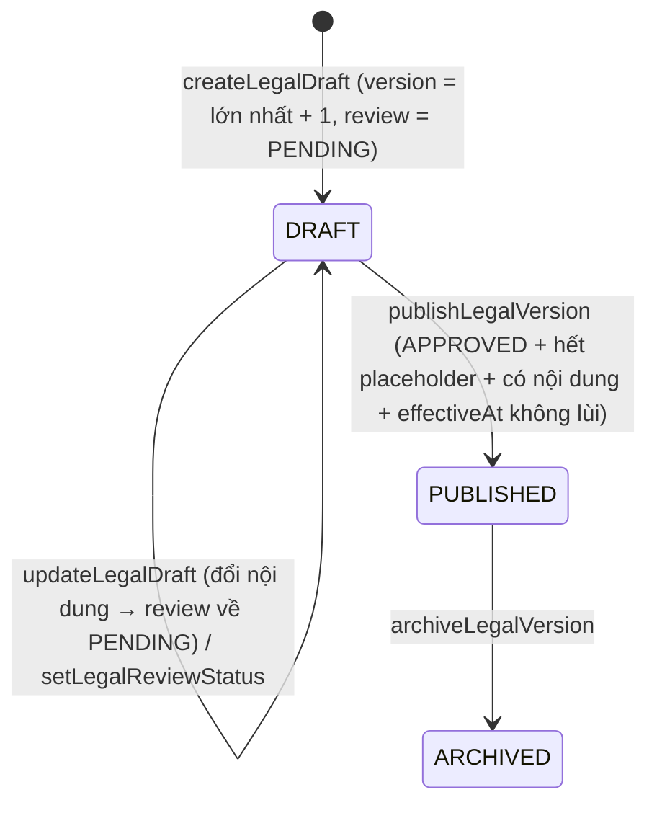

---
tags:
  - spec
  - legal
  - auth
  - system-admin
  - database
  - security
  - status/living
date: 2026-10-23
updated: 2026-10-23
author: Long
---

# 📐 Đặc Tả: Văn Bản Pháp Lý Có Phiên Bản + Ghi Nhận Chấp Thuận (ADR-050 mục 3)

Quyết định: [[01-Architecture-Decisions/ADR-035-Menu-Home-Seo-Versioned-Terms|ADR-035 KB (≙ ADR-050)]] mục 3 + "Bổ sung ADR-050" (a)–(c). Quy trình
vận hành xuất bản: [[04-Operations-Runbooks/Legal-Terms-Publishing-Runbook|Legal-Terms-Publishing-Runbook]].

> **Trạng thái 2026-10-23:** code xong ở working tree, **chưa commit** ✅ `git status`; migration `20261023090000_adr050_legal_documents` **đã chạy
> trên DB dùng chung** 🟡 (brief Quốc); **chưa có phiên bản nào được xuất bản** ❓ (Long không đọc DB) — dự thảo `docs/legal/drafts/dieu-khoan-su-dung.md`
> còn placeholder nên chưa xuất bản được. Giao diện trang công khai (mục lục, lưới 220px | 768px, in) Phong đã làm — xem
> [[04-Operations-Runbooks/UI-Design-System|UI-Design-System]] §22.
> Mức xác minh: ✅ Long đọc code/SQL working tree · 🟡 brief/báo cáo Quốc · ❓ cần môi trường thật.

---

## 1. Phạm vi đợt 1 ✅

- Một văn bản: `LEGAL_DOCUMENT_DEFS.terms = { key: "terms", slug: "dieu-khoan-su-dung", title: "Điều khoản sử dụng" }`
  (`packages/core/src/legal/legal-document.ts`, subpath `@gieochu/core/legal`). Khoá ổn định trong code → slug URL dưới `LEGAL_BASE_PATH = "/phap-ly"`.
- Điểm chấp thuận duy nhất: **đăng ký tài khoản**. Người dùng cũ **không** bị buộc chấp thuận lại (quyết ở giai đoạn pháp lý).
- Hoãn: trang pháp lý khác, hub `/phap-ly`, chấp thuận khi mở gian hàng/xuất bản, công bố bản dự thảo, xoá tài khoản, thông tin pháp nhân.

---

## 2. Dữ liệu — 3 bảng L1 ✅ (đọc migration + `schema.prisma`)

Cả 3 bảng **L1** (không `tenantId`) → **không RLS**, đọc/ghi bằng `getPrismaClient()`; ghi văn bản chỉ qua Server Action `requireRole("SYSTEM_ADMIN")` + audit.

| Bảng (model) | Cột chính | Ràng buộc |
| :-- | :-- | :-- |
| `legal_documents` (`LegalDocument`) | `key` unique, `slug` unique, `title`, `createdAt`, `updatedAt` | CHECK `legal_documents_key_format`: `key` và `slug` khớp `^[a-z0-9]+(-[a-z0-9]+)*$`. Dòng tạo lười (`ensureLegalDocument` — upsert theo `key`) khi admin tạo bản nháp đầu, **không seed** |
| `legal_document_versions` (`LegalDocumentVersion`) | `documentId` (FK `Restrict`), `version Int`, `status` (`DRAFT` mặc định / `PUBLISHED` / `ARCHIVED`), `reviewStatus` (`PENDING_LEGAL_REVIEW` mặc định / `APPROVED`), `contentHtml`, `changeSummary?`, `effectiveAt?`, `publishedAt?`, `publishedById?`, `createdById?` (2 cột id người **không FK**), `createdAt`, `updatedAt` | Unique `(documentId, version)`; index `(documentId, status, effectiveAt)`; CHECK `legal_document_versions_shape`: `version ≥ 1`, `contentHtml` ≤ 200 000 ký tự, `changeSummary` ≤ 1000, bản không phải `DRAFT` **bắt buộc** có `effectiveAt` + `publishedAt` |
| `user_legal_acceptances` (`UserLegalAcceptance`) | `userId` (FK `users` **Cascade**), `versionId` (FK `Restrict`), `acceptedAt` | Unique `(userId, versionId)`; index `versionId`. **Không lưu IP/User-Agent** (chủ dự án chốt) |

**Trigger bất biến** `legal_document_versions_freeze_content` (BEFORE UPDATE): khi bản cũ **không còn `DRAFT`**, từ chối (ERRCODE `42501`) mọi thay đổi
`contentHtml`, `version`, `documentId`, `effectiveAt`, `publishedAt`, `changeSummary`, mọi chuyển về `DRAFT`, và mọi chuyển ra khỏi `ARCHIVED`. Chỉ
còn cho phép `PUBLISHED → ARCHIVED` và đổi `reviewStatus`. Sửa nội dung = tạo phiên bản mới.

**Quyền `gieochu_app`** (bọc `IF EXISTS`): `legal_documents`, `legal_document_versions` — `SELECT, INSERT, UPDATE, DELETE`; `user_legal_acceptances` —
`REVOKE ALL` rồi chỉ `SELECT, INSERT, DELETE` (**append-only**: không UPDATE; DELETE để dọn dữ liệu test / Cascade theo user); `EXECUTE` hàm trigger.

**Chính sách không xoá user** ("Bổ sung ADR-050" (a), chủ dự án chốt 2026-10-23): FK `Cascade` từ `user_legal_acceptances` chỉ để dọn dữ liệu test —
**không có luồng nghiệp vụ xoá user**; người dùng vi phạm/ngừng dùng chỉ bị khoá. Xem
[[02-System-Specs/User-Management-System-Center-Specs|User-Management-System-Center-Specs]] §3.4.

---

## 3. Luật nghiệp vụ ✅ (`apps/web/lib/legal.ts` + `packages/core/src/legal/legal-document.ts`)

### 3.1. Vòng đời phiên bản

- **Tạo nháp:** số phiên bản = lớn nhất + 1 trong transaction; hai admin tạo cùng lúc → unique `P2002` → 409 `LEGAL_VERSION_CONFLICT`. Nội dung
  trống được phép (soạn dần). Nhãn hiển thị `legalVersionLabel(n)` = `"n.0"`.
- **Sửa nháp:** chỉ bản `DRAFT` (khác → 409 `LEGAL_VERSION_NOT_DRAFT`; trigger DB là lớp thứ hai). Nội dung **thay đổi** → `reviewStatus` tự về
  `PENDING_LEGAL_REVIEW` (bản đã duyệt không còn là bản này); chỉ đổi tóm tắt thì giữ trạng thái rà soát.
- **Đổi trạng thái rà soát:** chỉ bản `DRAFT` (admin tích/bỏ tích "Đã rà soát pháp lý").
- **Khoá lạc quan:** mọi UPDATE (sửa, rà soát, xuất bản) kèm điều kiện `updatedAt` không đổi + trạng thái mong đợi; `count = 0` → 409
  `LEGAL_VERSION_CONFLICT` ("Phiên bản vừa được thay đổi ở nơi khác…").
- **Lưu trữ:** chỉ bản `PUBLISHED` (khác → 409 `LEGAL_VERSION_NOT_PUBLISHED`). Lưu trữ bản đang hiệu lực → bản PUBLISHED trước đó (nếu còn, có
  `effectiveAt ≤ now`) **tự hiệu lực lại** theo luật §3.4 ("Bổ sung ADR-050 lần 2"); không còn bản nào → văn bản "trống" (trang công khai 404, đăng ký
  quay về không ghi chấp thuận).

### 3.2. Cổng xuất bản — `legalPublishBlockers(version)`

Rỗng mới được xuất bản; server kiểm lại cả trong câu UPDATE (`status = DRAFT AND reviewStatus = APPROVED AND updatedAt = …`). 4 lý do
(`LEGAL_PUBLISH_BLOCKER_MESSAGES`, gộp thành một thông báo 422 `LEGAL_PUBLISH_BLOCKED`):

| Blocker | Điều kiện |
| :-- | :-- |
| `NOT_DRAFT` | Bản không phải `DRAFT` |
| `EMPTY` | Chữ sau khi bỏ thẻ HTML (và `&nbsp;`) rỗng |
| `PLACEHOLDER` | `contentHtml` **hoặc** chữ đã bỏ thẻ còn chứa `LEGAL_PLACEHOLDER_MARKER = "[[CẦN XÁC NHẬN"` |
| `NOT_APPROVED` | `reviewStatus ≠ APPROVED` |

### 3.3. Ngày hiệu lực

- Ô `datetime-local` **giờ Việt Nam** (`YYYY-MM-DDTHH:mm`) → `parseVnDateTimeLocal` → UTC (UTC+7 cố định). Trống → **ngay bây giờ**; sai định dạng →
  "Ngày hiệu lực không hợp lệ."
- **Không lùi ngày hiệu lực:** `effectiveAt < now − 5 phút` (`LEGAL_EFFECTIVE_BACKDATE_TOLERANCE_MS`, dung sai lệch đồng hồ) → 400
  `LEGAL_INVALID_INPUT` "Ngày hiệu lực không được ở quá khứ." Đặt ngày **tương lai** được phép (bản "đã lên lịch").
- Xuất bản ghi `effectiveAt`, `publishedAt = now`, `publishedById`.

### 3.4. Bản đang hiệu lực

`getEffectiveLegalVersion(key, now)` = bản `PUBLISHED` có `effectiveAt ≤ now`, sắp `effectiveAt` giảm dần rồi `version` giảm dần, lấy bản đầu
(`pickEffectiveLegalVersion` là bản thuần cùng luật, dùng ở editor). **Nhiều bản PUBLISHED cùng lúc được phép** — bản cũ không tự lưu trữ khi xuất
bản bản mới; bản có `effectiveAt` tương lai chưa hiệu lực cho tới đúng thời điểm (không cần cron).

### 3.5. Nội dung, sanitize, token `{brand}`

- Lưu: `sanitizeLegalHtml` = `sanitizeRichTextHtml(html, { imageCloudName: null })` (whitelist Tiptap, **không cho ảnh**); quá 200 000 ký tự sau
  sanitize → 400. Tóm tắt thay đổi trim, ≤ 1000, rỗng → `null`.
- Render: sanitize **lại**, **sau đó** mới `replaceBrandTokenInHtml(html, brandName)` (`packages/core/src/content/brand-token.ts`) — tên thương hiệu
  được escape HTML (`& < > " '`) trước khi thay, nên tên chứa ký tự đặc biệt không chèn được thẻ/thuộc tính. Thứ tự sanitize → thay token là bắt buộc.

---

## 4. Trang công khai `/phap-ly/[slug]` ✅

- `app/phap-ly/[slug]/page.tsx`: slug → `legalKeyFromSlug`; slug lạ **hoặc** chưa có bản hiệu lực → **404** (`notFound()`); metadata khi không có bản:
  `robots: noindex, nofollow`. Có bản: title `"{title} | {brand}"`, canonical `${APP_URL}/phap-ly/{slug}`.
- Nội dung: tiêu đề, "Phiên bản n.0 · Có hiệu lực từ dd/mm/yyyy" (giờ VN), mục lục dựng từ H2, giữa `SiteHeader`/`SiteFooter`; khung
  `container-page` + lưới `220px | minmax(0,768px)` ("Bổ sung ADR-050 lần 2" — hợp ADR-024, không thêm `container-doc`). Chi tiết UI:
  [[04-Operations-Runbooks/UI-Design-System|UI-Design-System]] §22.
- `phap-ly` thêm vào `RESERVED_SLUGS` (slug **tenant**, `packages/core/src/tenant/slug.ts`) vì route tĩnh cấp gốc thắng `app/[tenantSlug]`; đã quét
  DB không có tenant trùng 🟡 (Quốc). Không cần thêm vào `RESERVED_PRODUCT_SLUGS` (route không nằm dưới `app/[tenantSlug]/`).

---

## 5. Editor `/admin/cms/phap-ly` ✅

- Trang `requireAdminAccess("/admin/cms/phap-ly")`; segment tĩnh thắng `/admin/cms/[slug]`. Đợt 1 cố định văn bản `terms`. Danh sách mọi phiên bản (mới
  nhất trước) kèm nhãn trạng thái, "đang hiệu lực" và "đã lên lịch" (PUBLISHED, `effectiveAt` tương lai).
- 5 Server Action (`app/admin/cms/phap-ly/actions.ts`) — contract ở [[03-API-Contracts/Endpoint-Directory|Endpoint-Directory]] §26.4. Sau mỗi
  thao tác: revalidate `/admin/cms/phap-ly`, `/phap-ly/dieu-khoan-su-dung`, `/register`.

---

## 6. Ghi chấp thuận khi đăng ký ✅

`app/(auth)/register/page.tsx` đọc bản hiệu lực của `terms`:
- **Có** → form hiện "Tôi đồng ý với [Điều khoản sử dụng] (mở trong tab mới) và chính sách xử lý dữ liệu cá nhân" (link tới `/phap-ly/dieu-khoan-su-dung`)
  và gửi kèm `termsVersionId`.
- **Chưa có** → checkbox giữ chữ cũ, không gửi `termsVersionId`.

`POST /api/auth/register` (contract: [[03-API-Contracts/Endpoint-Directory|Endpoint-Directory]] §3.1):
1. Checkbox `consent` vẫn bắt buộc như cũ; `UserProfile.consentAt` vẫn ghi như cũ.
2. `resolveRegistrationTermsVersion(effective, termsVersionId)`: không có bản hiệu lực → `null` (đăng ký như trước ADR-050, `termsVersionId` gửi lên bị
   bỏ qua); có bản hiệu lực + client gửi id **khác** → **409 `LEGAL_TERMS_CHANGED`** ("Điều khoản sử dụng vừa được cập nhật. Vui lòng tải lại
   trang…"); client **không** gửi id (form cũ còn cache) → dùng bản đang hiệu lực.
3. `recordLegalAcceptance(tx, userId, versionId, now)` chạy **trong cùng transaction** tạo `User` + `UserProfile` + `VerificationToken` — tạo user lỗi thì
   không có dòng chấp thuận và ngược lại. `acceptedAt` = cùng `now` với `consentAt`.

---

## 7. Audit ✅

5 action scope `SYSTEM`, `targetType: "LegalDocumentVersion"`, `targetId` = id phiên bản, metadata `{ key, version }` (+ `reviewStatus` khi đổi rà
soát, + `effectiveAt` ISO khi xuất bản) — **không** nội dung: `LEGAL_VERSION_CREATED`, `LEGAL_VERSION_UPDATED`, `LEGAL_REVIEW_STATUS_CHANGED`,
`LEGAL_VERSION_PUBLISHED`, `LEGAL_VERSION_ARCHIVED`. Ghi chấp thuận khi đăng ký **không** ghi audit (bản ghi `user_legal_acceptances` chính là vết).
Xem [[02-System-Specs/Audit-Log-Specs|Audit-Log-Specs]] §4.

---

## 8. Mã lỗi (`LEGAL_ERROR_CODES`) ✅

| Mã | HTTP | Khi nào |
| :-- | :-: | :-- |
| `LEGAL_PUBLISH_BLOCKED` | 422 | Cổng xuất bản §3.2 |
| `LEGAL_VERSION_NOT_DRAFT` | 409 | Sửa / đổi rà soát bản không phải nháp |
| `LEGAL_VERSION_NOT_FOUND` | 404 | Id phiên bản không thuộc văn bản |
| `LEGAL_VERSION_NOT_PUBLISHED` | 409 | Lưu trữ bản chưa xuất bản |
| `LEGAL_INVALID_INPUT` | 400 | Khoá văn bản/id/nội dung/tóm tắt/ngày hiệu lực sai |
| `LEGAL_VERSION_CONFLICT` | 409 | Trùng số phiên bản hoặc thay đổi xen giữa |
| `LEGAL_TERMS_CHANGED` | 409 | Đăng ký với `termsVersionId` không còn là bản hiệu lực |

Server Action trả `{ error: message }` (không ném) cho `AppError` `expose`; route đăng ký trả dạng chuẩn `{ error: { code, message, requestId } }`.

---

## 9. Test ✅

`apps/web/tests/integration/legal.test.ts` — **2 integration** (`describe("ADR-050 legal documents")`), dùng khoá văn bản riêng theo lượt chạy, gọi
đúng các hàm route đăng ký và editor dùng, không gửi email, dọn ở `afterAll`:
1. Ghi chấp thuận đúng phiên bản hiệu lực lúc đăng ký và từ chối phiên bản cũ (409 `LEGAL_TERMS_CHANGED`); sửa nội dung bản đã xuất bản bị trigger từ chối.
2. Từ chối xuất bản khi còn placeholder hoặc chưa APPROVED; nội dung được sanitize.

---

## 10. Liên kết

* [[01-Architecture-Decisions/ADR-035-Menu-Home-Seo-Versioned-Terms|ADR-035 KB (≙ ADR-050)]] · [[04-Operations-Runbooks/Legal-Terms-Publishing-Runbook|Legal-Terms-Publishing-Runbook]] ([Legal-Terms-Publishing-Runbook.md](../04-Operations-Runbooks/Legal-Terms-Publishing-Runbook.md))
* [[03-API-Contracts/Database-Schema-Reference|Database-Schema-Reference]] §3.1, §7 · [[03-API-Contracts/Endpoint-Directory|Endpoint-Directory]] §3, §26.4
* [[02-System-Specs/User-Management-System-Center-Specs|User-Management-System-Center-Specs]] §3.4 — chính sách không xoá user · [[02-System-Specs/Audit-Log-Specs|Audit-Log-Specs]]
* Nguồn: `docs/legal/drafts/dieu-khoan-su-dung.md` (dự thảo), `docs/legal/LEGAL_REVIEW_CHECKLIST.md`, `docs/claude-code-gieochu-legal-pages-implementation-brief.md`

*Quay lại: [[MOC-Home]] (../00-Index/MOC-Home.md)*
