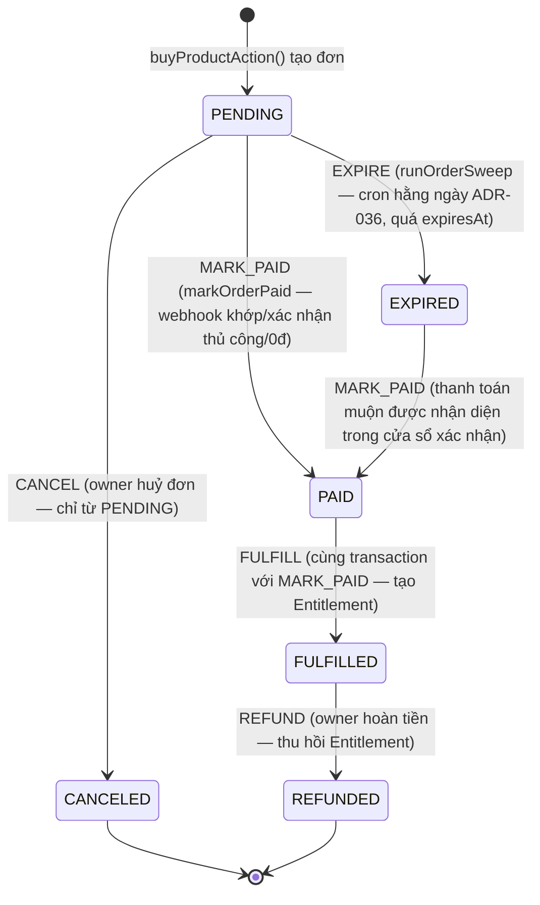

---
tags:
  - spec
  - order
  - status/living
date: 2026-09-26
updated: 2026-10-17
author: System Architect
---

# 📐 Đặc Tả: Vòng Đời Trạng Thái Đơn Hàng (Order State Machine)

## 1. Trạng Thái Đơn Hàng Chuẩn (OrderStatus Enum)

Gieo Chữ bán tài liệu số — đơn hàng **không có** giao hàng vật lý, chuẩn bị món, hay shipper. `OrderStatus`
định nghĩa tại `packages/db/prisma/schema.prisma`:

| Mã Trạng Thái | Người/Sự Kiện Kích Hoạt | Mô Tả Nghiệp Vụ |
| :--- | :--- | :--- |
| `PENDING` | Khách bấm "Mua ngay" (`buyProductAction`) | Đơn vừa tạo, đang chờ thanh toán, có `expiresAt` |
| `PAID` | `markOrderPaid()` — webhook/IPN khớp, xác nhận thủ công, hoặc đơn 0đ | Đã nhận đủ tiền, đúng số tiền |
| `FULFILLED` | Ngay sau `PAID`, cùng trong `markOrderPaid()` | Đã tạo `Entitlement` cho từng `OrderItem` — khách tải được ngay |
| `EXPIRED` | `runOrderSweep()` (từ ADR-036: cron hằng ngày `/api/cron/daily`) ghi DB — nhưng mọi luồng đọc/thanh toán đã coi `PENDING` quá `expiresAt` là `EXPIRED` ngay (`effectiveOrderStatus`, §3.4) | Hết hạn thanh toán, chưa nhận được tiền |
| `CANCELED` | Owner bấm "Huỷ đơn" (`cancelOrder`) | Chỉ hợp lệ từ `PENDING` |
| `REFUNDED` | Owner bấm "Hoàn tiền" (`markOrderRefunded`) | Chỉ hợp lệ từ `FULFILLED` — thu hồi mọi `Entitlement` |

**Khác biệt quan trọng so với đơn hàng vật lý:** `PAID` và `FULFILLED` xảy ra **trong cùng một hàm, cùng một
transaction** (`markOrderPaid()`, `apps/web/lib/order.ts`) — tài liệu số không cần bước "đóng gói/giao hàng"
riêng, việc "giao hàng" chính là tạo `Entitlement` (quyền tải file) ngay khi tiền về.

---

## 2. Sơ Đồ Chuyển Trạng Thái (State Diagram)

Máy trạng thái thuần được cài ở `packages/core/src/order/state.ts` (`transitionOrderStatus`, bảng
`TRANSITIONS` — ném `AppError("INVALID_ORDER_TRANSITION")` nếu chuyển sai, không có transition "âm thầm bỏ
qua"):

**Trạng thái kết (terminal):** `CANCELED` và `REFUNDED` không có transition đi ra (`TRANSITIONS.CANCELED = {}`,
`TRANSITIONS.REFUNDED = {}`).

---

## 3. Quy Tắc Chuyển Dịch & Điều Kiện Ràng Buộc (Business Rules)

### 3.1. `markOrderPaid(tx, orderId, source)` — hàm duy nhất, idempotent

Mọi nguồn tiền vào đều gọi đúng một hàm này (`apps/web/lib/order.ts`), nhận `tx` đã mở sẵn bởi caller qua
`withTenant`/`withSystemJob` — không tự mở transaction riêng:

- **Nguồn gọi (`MarkOrderPaidSource`):** `SEPAY_WEBHOOK`, `MOMO_IPN`, `MANUAL_CONFIRM`, `ZERO_AMOUNT`.
- **Idempotent:** đơn đã `PAID` hoặc `FULFILLED` → trả `{ fulfilled: false }` ngay, không làm lại.
- **Trong 1 lần chạy:** chuyển `PENDING`/`EXPIRED` → `PAID` → `FULFILLED`; cộng dồn `TenantCustomer`
  (`ordersCount`/`totalSpentVnd`); nếu có `couponCode`, tăng `Coupon.usedCount` bằng
  `UPDATE ... WHERE "usedCount" < "usageLimit"` (raw SQL, atomic — 2 đơn thanh toán đồng thời không thể vượt
  `usageLimit`); tạo `Entitlement` cho từng `OrderItem` (snapshot `downloadLimit` từ `Product` tại thời điểm
  mua).
- **Sản phẩm đang bị khoá kiểm duyệt (bổ sung ADR-039 (c), 2026-10-16) ✅:** nếu `Product.moderationLockedAt` khác null, entitlement
  tạo ra ở `remedyStatus = PENDING_CHOICE` (+ `remedyRequestedAt`, `remedyReportId` = báo cáo `ARCHIVE_PRODUCT` mới nhất của sản phẩm) —
  khách đã trả tiền luôn có 2 lựa chọn tải lần cuối / yêu cầu hoàn tiền
  ([[02-System-Specs/Abuse-Reports-Specs|Abuse-Reports-Specs]] §6.5). Trigger `entitlements_guard_remedy` cho phép đúng trường hợp
  này dưới scope tenant.
- **Kết quả (`MarkOrderPaidResult`):** `{ fulfilled, productIds, couponOverused }` — caller dùng `fulfilled` để quyết định gửi email
  (§3.7), `productIds` để tính lại `soldCount`, `couponOverused` để ghi audit sau commit (`auditMarkOrderPaid`).
- **`EXPIRED → PAID`:** một đơn đã hết hạn (`expiresAt` đã qua — dù sweep đã ghi `EXPIRED` hay DB còn `PENDING`) vẫn có thể
  được nhận diện thanh toán muộn và chuyển thẳng sang `PAID` — đây là "cửa sổ xác nhận muộn" của đặc tả M8, không phải bug.
- **Cửa sổ 24h (chủ dự án chốt giữ 2026-10-16, ADR-036) ✅:** webhook `payment.process` (`processPaymentEvent`) và xác nhận tay
  (`confirmOrderManually`) cùng dùng `canManuallyConfirmOrder(status, expiresAt, now)` (`packages/core/src/order/expiry.ts`): đơn
  hiệu lực `PENDING` → được; hiệu lực `EXPIRED` → chỉ được khi `now ≤ expiresAt + 24h`. Webhook khớp số tiền nhưng trễ hơn 24h:
  giao dịch vẫn ghi `tenant_payment_transactions` với `matchStatus = MATCHED`, **không** tự fulfil — tenant đối soát/xử lý tay.
  Từ ADR-036 hàm này xét theo `effectiveOrderStatus`, nên đơn DB còn `PENDING` nhưng đã quá hạn cũng chỉ có 24h (trước đây
  xác nhận được vô thời hạn nếu sweep không chạy).

### 3.2. Huỷ đơn (`cancelOrder`)

Chỉ hợp lệ khi đơn đang `PENDING` (`transitionOrderStatus(status, "CANCEL")` ném lỗi 409 nếu không). Không có
đường huỷ cho đơn đã `PAID`/`FULFILLED` — phải dùng hoàn tiền. Từ ADR-036 ✅: `cancelOrder` truyền **trạng thái hiệu lực** vào máy
trạng thái — đơn `PENDING` đã quá `expiresAt` bị coi là `EXPIRED` nên **không huỷ được** (giống sau khi sweep chạy).

### 3.3. Hoàn tiền (`markOrderRefunded`)

Chỉ hợp lệ khi đơn đang `FULFILLED`. Khi hoàn tiền, mọi `Entitlement` được tạo bởi đơn này bị
`revokedAt = now()` (`updateMany` trên toàn bộ `OrderItem` của đơn) — khách mất quyền tải ngay, không xoá lịch
sử đơn hàng.

Từ ADR-039 ✅: trong cùng transaction, **sau** lệnh thu hồi, entitlement của đơn đang `remedyStatus = REFUND_REQUESTED` (khách yêu cầu
hoàn tiền vì tài liệu bị gỡ do vi phạm) chuyển `REFUNDED` + `remedyResolvedAt = now()` — ngoại lệ duy nhất mà trigger
`entitlements_guard_remedy` cho phép ngoài `system_job`. Đánh giá đang bị khoá kiểm duyệt bị bỏ qua khi tự ẩn đánh giá (trigger
`reviews_guard_moderation` sẽ làm hỏng cả transaction hoàn tiền) ✅. Audit `ORDER_REFUNDED`.

### 3.4. Hết hạn: trạng thái hiệu lực (`effectiveOrderStatus`) + đồng bộ DB (`runOrderSweep`)

Nguồn: ADR-036 mục 3 + "Chủ dự án chốt (2026-10-16)" trong `docs/DECISIONS.md`. Đối chiếu code working tree 2026-10-16 (**chưa
commit/deploy**) ✅.

- **Trạng thái hiệu lực:** `effectiveOrderStatus(status, expiresAt, now)` (`packages/core/src/order/expiry.ts`, export từ
  `@gieochu/core`) trả `EXPIRED` khi `status = PENDING` và `expiresAt < now` (cùng ranh giới với `runOrderSweep`), ngược lại trả
  nguyên `status`. Không ghi DB. Áp vào ✅:
  - `applyCouponToOrder`, `removeCouponFromOrder`, `initiateOrderCheckout` — đơn quá hạn → `409 ORDER_NOT_PENDING`;
  - `cancelOrder` (§3.2); `canManuallyConfirmOrder` (§3.1 — webhook + xác nhận tay);
  - đọc: `getOrderForCustomer` (trang checkout), `getOrderDetail`, `listOrders` trả `status` hiệu lực; bộ lọc `listOrders`:
    `PENDING` loại đơn quá hạn (`expiresAt ≥ now`), `EXPIRED` gồm cả đơn `PENDING` quá hạn;
  - `listCustomerOrders` (`apps/web/lib/library.ts`, tab đơn của khách) — đơn quá hạn hiện `EXPIRED`, không còn link thanh toán;
  - `getOrderDashboardStats` — ô "Đơn chờ xác nhận" chỉ đếm `PENDING` có `expiresAt ≥ now`.
- **Đồng bộ DB:** `runOrderSweep()` quét mọi đơn `PENDING` có `expiresAt < now()`, chuyển `EXPIRED` qua `withSystemJob()`, **trả
  số đơn đã chuyển** (trước đây `void`). Không đụng `Coupon.usedCount` — con số này chỉ tăng trong `markOrderPaid()`.
- **Lịch chạy:** từ ADR-036, trên Vercel sweep chạy **một lần mỗi ngày** trong `GET /api/cron/daily` (03:00 giờ VN) — gọi trực tiếp,
  không qua hàng đợi. Lịch cũ "mỗi 5 phút" (ADR-019, job `order.sweep`) chỉ còn khi chạy `apps/web/worker.ts` local/server riêng
  (worker vẫn `schedule("*/5 * * * *")`) ✅. Vì đã có trạng thái hiệu lực, việc sweep trễ không làm khách thanh toán được đơn quá hạn.
  Chi tiết job/cron: [[02-System-Specs/Background-Jobs-Specs|Background-Jobs-Specs]].

### 3.5. Snapshot giá & tiêu đề (`OrderItem`)

`OrderItem.titleSnapshot`/`unitPriceVnd`/`finalPriceVnd` được chốt tại thời điểm mua — một thay đổi giá/tiêu đề
sau đó trên `Product` không viết lại đơn đã đặt.

### 3.6. Không tin số tiền từ client

`createOrder`/`applyCouponToOrder` luôn gọi lại `calculatePrice()` (`packages/core/src/pricing`, M6) ở server —
không nhận tham số "tổng tiền" từ request của client (CLAUDE.md §7.5).

### 3.7. Email sau thanh toán (`sendOrderPaidEmails`) — sửa lỗi RLS (2026-10-16)

- Gửi `order_paid` (khách) + `new_sale` (chủ gian hàng) qua `sendEmailNow` **sau** khi transaction của `markOrderPaid` commit, và **chỉ
  khi lần gọi đó thật sự fulfil đơn** (`paid.fulfilled`) — không gửi lặp ở đơn 0đ / xác nhận tay; webhook (`processPaymentEvent`) vốn chỉ
  gửi khi fulfil ✅.
- **Lỗi cũ đã sửa ✅ (đọc `git diff`):** `sendOrderPaidEmailsInner` trước đây đọc `orders` bằng `getPrismaClient()` không scope — bảng
  `orders` bật RLS `FORCE`, client không đặt `app.scope` thấy **0 dòng** → hàm `return` sớm, **email `order_paid`/`new_sale` chưa từng được
  gửi** trên môi trường dùng role `gieochu_app`. Nay đọc dưới `withSystemJob`, chỉ chọn trường cần cho email. Cùng lỗi ở
  `resolveUniqueOrderCode` (kiểm trùng mã đơn luôn "không trùng") — nay kiểm dưới `withSystemJob` (`orders.code` unique toàn hệ thống).
  Mức ảnh hưởng thực tế trước khi sửa (đơn nào không nhận email) — Long không kiểm DB ❓.
- Sau phần email đơn hàng (kể cả khi dừng sớm, `finally`) chạy `notifyPurchaseRemedyForOrder` — email 2 lựa chọn cho entitlement
  `PENDING_CHOICE` của đơn (§3.1, ADR-039).
- **Sau deploy, email đơn hàng sẽ bắt đầu gửi thật lần đầu** 🟡 (brief Quốc) — xem
  [[04-Operations-Runbooks/Deploy-Vercel-Runbook|Deploy-Vercel-Runbook]] §9.8. Gửi thật tới hộp thư ❓.

### 3.8. Chặn thanh toán khi tài liệu không còn bán (`PRODUCT_UNAVAILABLE`, bổ sung ADR-039)

`assertOrderProductsPurchasable` (gọi trong `initiateOrderCheckout` và `applyCouponToOrder`, sau kiểm `ORDER_NOT_PENDING`) ✅: tenant không
`ACTIVE` **hoặc** đơn có sản phẩm không `PUBLISHED` → **409 `PRODUCT_UNAVAILABLE`**. Áp cho đơn `PENDING` tạo trước khi tài liệu bị
gỡ/lưu trữ/chuyển nháp hoặc gian hàng bị khoá/tạm ngưng.

- ⚠️ **Thay đổi hành vi:** tenant `READ_ONLY` cũng không `ACTIVE` → đơn `PENDING` của gian hàng đó **không thanh toán tiếp được** (trước đây
  được). "Bổ sung ADR-039 lần 2" (g) tạm giữ chặn (`READ_ONLY` từ M3 v2 chỉ còn là biện pháp quản trị; khách chưa bị trừ tiền); **chủ dự án
  đã chốt chặn qua ADR-040 mục 4** (2026-10-17 —
  [[01-Architecture-Decisions/ADR-026-Only-Active-Tenant-Shows-Documents|ADR-026 KB]]). Cùng ADR: khách của gian hàng `READ_ONLY` không
  còn thấy tài liệu (trang tài liệu 404) nên không tạo được đơn mới từ storefront; khách đã mua vẫn tải từ Thư viện.
- **Không** chặn webhook / xác nhận tay cho giao dịch **đã trả tiền** — các đường đó không qua hàm này; fulfil bình thường (sản phẩm bị
  khoá kiểm duyệt → `PENDING_CHOICE`, §3.1).

---

## 4. Ranh Giới Bảo Mật (RLS) Áp Dụng Cho `orders`/`order_items`

Khác các bảng L2 khác chỉ có chiều tenant, `orders` có **thêm một chiều "khách hàng"** trong policy RLS: đọc
được nếu `tenantId` khớp (owner) **HOẶC** `customerId` khớp dưới `app.scope='customer'` (người mua) **HOẶC**
`system_job`. `order_items` không có cột `tenantId` riêng — scope qua JOIN tới `orders`.
Từ ADR-029 mục 0 (migration `20260927130000_rls_adr029_split_write_policies`) ✅ đọc SQL: điều kiện trên chỉ còn là
policy **đọc** `select_access`; policy ghi `write_insert/update/delete` chỉ cho `tenantId` khớp hoặc `system_job`
(`order_items` qua đơn cha) — khách (`scope='customer'`) không còn UPDATE/DELETE được đơn của mình ở tầng DB.
Hoàn tiền (`markOrderRefunded`) và thu hồi entitlement giờ còn tự ẩn đánh giá liên quan (lý do `REFUNDED`) trong cùng
transaction — xem [[02-System-Specs/Reviews-Specs|Reviews-Specs]] §5. Xem thêm
[[Architecture-Overview]] mục 3 và [docs/GIEOCHU_TENANT_MODULE_STRUCTURE_V1.0.md](../../docs/GIEOCHU_TENANT_MODULE_STRUCTURE_V1.0.md) mục 2.2.

---

## 5. Tài Liệu Tham Chiếu & Liên Kết

* [[Architecture-Overview]] — Kiến trúc 3 tầng dữ liệu và RLS ([Architecture-Overview.md](./Architecture-Overview.md))
* [[Payment-And-Billing]] — Cơ chế thanh toán Tenant (SePay/MoMo/Manual QR) đứng sau `markOrderPaid` ([Payment-And-Billing.md](./Payment-And-Billing.md))
* [[File-Storage-And-Downloads-Specs]] — `Entitlement` quyết định quyền tải sau khi `FULFILLED` ([File-Storage-And-Downloads-Specs.md](./File-Storage-And-Downloads-Specs.md))
* [[02-System-Specs/Background-Jobs-Specs|Background-Jobs-Specs]] — hàng đợi pg-boss, `after()` + cron hằng ngày (ADR-036) ([Background-Jobs-Specs.md](./Background-Jobs-Specs.md))
* [[02-System-Specs/Abuse-Reports-Specs|Abuse-Reports-Specs]] — quyền lợi người mua khi tài liệu bị gỡ do vi phạm (ADR-039) ([Abuse-Reports-Specs.md](./Abuse-Reports-Specs.md))
* Mã nguồn: `packages/core/src/order/state.ts` (máy trạng thái), `packages/core/src/order/expiry.ts` (`effectiveOrderStatus`,
  `canManuallyConfirmOrder`), `apps/web/lib/order.ts` (`markOrderPaid`, `cancelOrder`, `markOrderRefunded`, `runOrderSweep`),
  `apps/web/lib/payment-process.ts`, enum: `packages/db/prisma/schema.prisma`

*Quay lại: [[MOC-Home]] (../00-Index/MOC-Home.md)*
