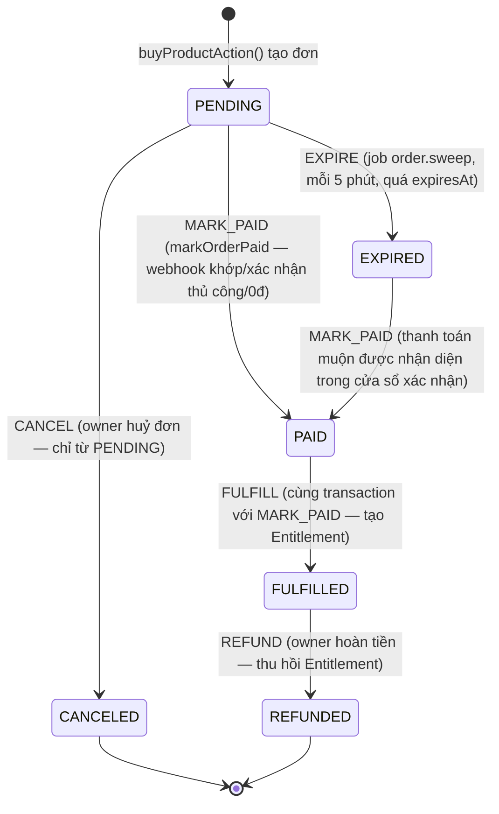

---
tags:
  - spec
  - order
  - status/living
date: 2026-09-26
updated: 2026-09-28
author: System Architect
---

# 📐 Đặc Tả: Vòng Đời Trạng Thái Đơn Hàng (Order State Machine)

## 1. Trạng Thái Đơn Hàng Chuẩn (OrderStatus Enum)

Gieo Chữ bán tài liệu số — đơn hàng **không có** giao hàng vật lý, chuẩn bị món, hay shipper. `OrderStatus`
định nghĩa tại `packages/db/prisma/schema.prisma`:

| Mã Trạng Thái | Người/Sự Kiện Kích Hoạt | Mô Tả Nghiệp Vụ |
| :--- | :--- | :--- |
| `PENDING` | Khách bấm "Mua ngay" (`buyProductAction`) | Đơn vừa tạo, đang chờ thanh toán, có `expiresAt` |
| `PAID` | `markOrderPaid()` — webhook/IPN khớp, xác nhận thủ công, hoặc đơn 0đ | Đã nhận đủ tiền, đúng số tiền |
| `FULFILLED` | Ngay sau `PAID`, cùng trong `markOrderPaid()` | Đã tạo `Entitlement` cho từng `OrderItem` — khách tải được ngay |
| `EXPIRED` | Job `order.sweep` (mỗi 5 phút) — `PENDING` quá `expiresAt` | Hết hạn thanh toán, chưa nhận được tiền |
| `CANCELED` | Owner bấm "Huỷ đơn" (`cancelOrder`) | Chỉ hợp lệ từ `PENDING` |
| `REFUNDED` | Owner bấm "Hoàn tiền" (`markOrderRefunded`) | Chỉ hợp lệ từ `FULFILLED` — thu hồi mọi `Entitlement` |

**Khác biệt quan trọng so với đơn hàng vật lý:** `PAID` và `FULFILLED` xảy ra **trong cùng một hàm, cùng một
transaction** (`markOrderPaid()`, `apps/web/lib/order.ts`) — tài liệu số không cần bước "đóng gói/giao hàng"
riêng, việc "giao hàng" chính là tạo `Entitlement` (quyền tải file) ngay khi tiền về.

---

## 2. Sơ Đồ Chuyển Trạng Thái (State Diagram)

Máy trạng thái thuần được cài ở `packages/core/src/order/state.ts` (`transitionOrderStatus`, bảng
`TRANSITIONS` — ném `AppError("INVALID_ORDER_TRANSITION")` nếu chuyển sai, không có transition "âm thầm bỏ
qua"):

**Trạng thái kết (terminal):** `CANCELED` và `REFUNDED` không có transition đi ra (`TRANSITIONS.CANCELED = {}`,
`TRANSITIONS.REFUNDED = {}`).

---

## 3. Quy Tắc Chuyển Dịch & Điều Kiện Ràng Buộc (Business Rules)

### 3.1. `markOrderPaid(tx, orderId, source)` — hàm duy nhất, idempotent

Mọi nguồn tiền vào đều gọi đúng một hàm này (`apps/web/lib/order.ts`), nhận `tx` đã mở sẵn bởi caller qua
`withTenant`/`withSystemJob` — không tự mở transaction riêng:

- **Nguồn gọi (`MarkOrderPaidSource`):** `SEPAY_WEBHOOK`, `MOMO_IPN`, `MANUAL_CONFIRM`, `ZERO_AMOUNT`.
- **Idempotent:** đơn đã `PAID` hoặc `FULFILLED` → trả `{ fulfilled: false }` ngay, không làm lại.
- **Trong 1 lần chạy:** chuyển `PENDING`/`EXPIRED` → `PAID` → `FULFILLED`; cộng dồn `TenantCustomer`
  (`ordersCount`/`totalSpentVnd`); nếu có `couponCode`, tăng `Coupon.usedCount` bằng
  `UPDATE ... WHERE "usedCount" < "usageLimit"` (raw SQL, atomic — 2 đơn thanh toán đồng thời không thể vượt
  `usageLimit`); tạo `Entitlement` cho từng `OrderItem` (snapshot `downloadLimit` từ `Product` tại thời điểm
  mua).
- **`EXPIRED → PAID`:** một đơn đã hết hạn (`expiresAt` đã qua, job sweep đã chuyển `EXPIRED`) vẫn có thể được
  nhận diện thanh toán muộn và chuyển thẳng sang `PAID` — đây là "cửa sổ xác nhận muộn" của đặc tả M8, không
  phải bug.

### 3.2. Huỷ đơn (`cancelOrder`)

Chỉ hợp lệ khi đơn đang `PENDING` (`transitionOrderStatus(status, "CANCEL")` ném lỗi 409 nếu không). Không có
đường huỷ cho đơn đã `PAID`/`FULFILLED` — phải dùng hoàn tiền.

### 3.3. Hoàn tiền (`markOrderRefunded`)

Chỉ hợp lệ khi đơn đang `FULFILLED`. Khi hoàn tiền, mọi `Entitlement` được tạo bởi đơn này bị
`revokedAt = now()` (`updateMany` trên toàn bộ `OrderItem` của đơn) — khách mất quyền tải ngay, không xoá lịch
sử đơn hàng.

### 3.4. Hết hạn tự động (`runOrderSweep`)

Job `order.sweep` (đăng ký trong `apps/web/worker.ts`, chạy **mỗi 5 phút** — không phải mỗi giờ như
`subscription.sweep`, vì TTL đơn `PENDING` mặc định chỉ 60 phút, ADR-019) quét mọi đơn `PENDING` có
`expiresAt < now()` và chuyển sang `EXPIRED` qua `withSystemJob()`. Không đụng tới `Coupon.usedCount` — con số
này chỉ tăng trong `markOrderPaid()`.

### 3.5. Snapshot giá & tiêu đề (`OrderItem`)

`OrderItem.titleSnapshot`/`unitPriceVnd`/`finalPriceVnd` được chốt tại thời điểm mua — một thay đổi giá/tiêu đề
sau đó trên `Product` không viết lại đơn đã đặt.

### 3.6. Không tin số tiền từ client

`createOrder`/`applyCouponToOrder` luôn gọi lại `calculatePrice()` (`packages/core/src/pricing`, M6) ở server —
không nhận tham số "tổng tiền" từ request của client (CLAUDE.md §7.5).

---

## 4. Ranh Giới Bảo Mật (RLS) Áp Dụng Cho `orders`/`order_items`

Khác các bảng L2 khác chỉ có chiều tenant, `orders` có **thêm một chiều "khách hàng"** trong policy RLS: đọc
được nếu `tenantId` khớp (owner) **HOẶC** `customerId` khớp dưới `app.scope='customer'` (người mua) **HOẶC**
`system_job`. `order_items` không có cột `tenantId` riêng — scope qua JOIN tới `orders`.
Từ ADR-029 mục 0 (migration `20260927130000_rls_adr029_split_write_policies`) ✅ đọc SQL: điều kiện trên chỉ còn là
policy **đọc** `select_access`; policy ghi `write_insert/update/delete` chỉ cho `tenantId` khớp hoặc `system_job`
(`order_items` qua đơn cha) — khách (`scope='customer'`) không còn UPDATE/DELETE được đơn của mình ở tầng DB.
Hoàn tiền (`markOrderRefunded`) và thu hồi entitlement giờ còn tự ẩn đánh giá liên quan (lý do `REFUNDED`) trong cùng
transaction — xem [[02-System-Specs/Reviews-Specs|Reviews-Specs]] §5. Xem thêm
[[Architecture-Overview]] mục 3 và [docs/GIEOCHU_TENANT_MODULE_STRUCTURE_V1.0.md](../../docs/GIEOCHU_TENANT_MODULE_STRUCTURE_V1.0.md) mục 2.2.

---

## 5. Tài Liệu Tham Chiếu & Liên Kết

* [[Architecture-Overview]] — Kiến trúc 3 tầng dữ liệu và RLS ([Architecture-Overview.md](./Architecture-Overview.md))
* [[Payment-And-Billing]] — Cơ chế thanh toán Tenant (SePay/MoMo/Manual QR) đứng sau `markOrderPaid` ([Payment-And-Billing.md](./Payment-And-Billing.md))
* [[File-Storage-And-Downloads-Specs]] — `Entitlement` quyết định quyền tải sau khi `FULFILLED` ([File-Storage-And-Downloads-Specs.md](./File-Storage-And-Downloads-Specs.md))
* Mã nguồn: `packages/core/src/order/state.ts` (máy trạng thái), `apps/web/lib/order.ts` (`markOrderPaid`,
  `cancelOrder`, `markOrderRefunded`, `runOrderSweep`), enum: `packages/db/prisma/schema.prisma`
