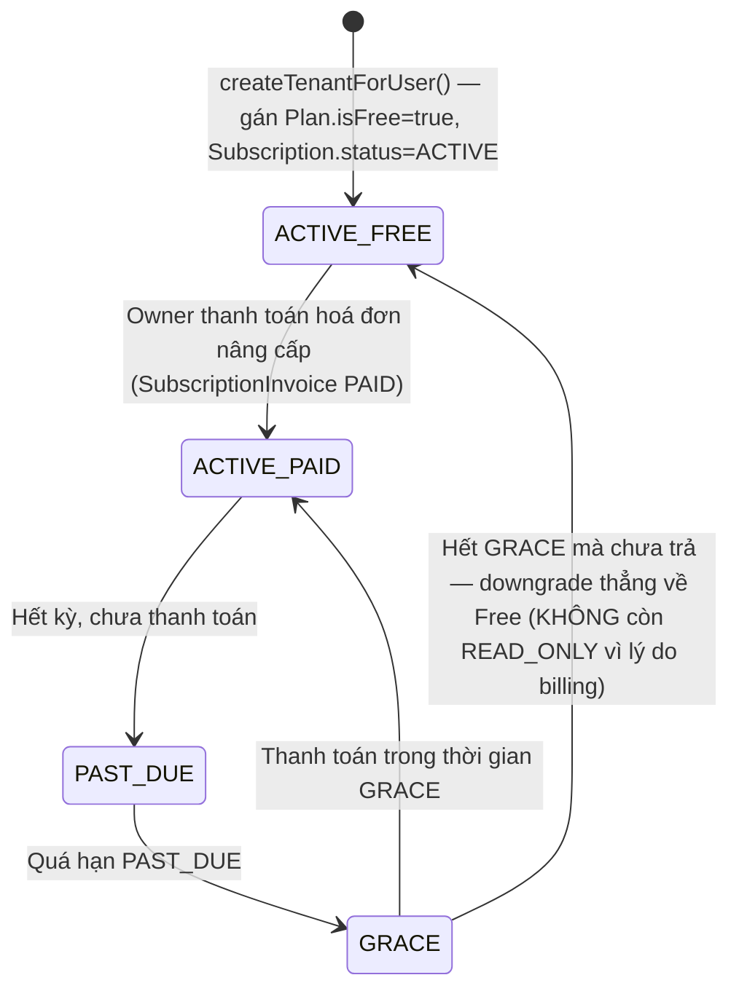

---
tags:
  - spec
  - payment
  - billing
  - status/living
date: 2026-09-26
updated: 2026-11-26
author: System Architect
---

# 📐 Đặc Tả: Thanh Toán & Billing (Payment & Billing Specs)

## 1. Tổng Quan: Hai Hệ Thống Thanh Toán Tách Biệt

Gieo Chữ có **hai** hệ thống thanh toán dùng chung code (`packages/payments`) nhưng **không bao giờ** chung
bảng, secret, hay route (CLAUDE.md, ranh giới layer):

| | Platform Billing | Tenant Billing |
| :--- | :--- | :--- |
| **Ai trả tiền cho ai** | Tenant trả **Gieo Chữ** để mua/gia hạn gói dịch vụ | Customer trả **Tenant** để mua tài liệu |
| **`PaymentScope`** | `{kind: 'PLATFORM'}` | `{kind: 'TENANT', tenantId}` |
| **Bảng cấu hình** | `PlatformPaymentConfig` (L1, 1 dòng/provider) | `TenantPaymentConfig` (L2, RLS, `@@unique([tenantId, provider])`) |
| **Bảng giao dịch** | `PlatformPaymentTransaction` | `TenantPaymentTransaction` |
| **Đối tượng thanh toán** | `SubscriptionInvoice` | `Order` |
| **Route webhook** | `POST /api/webhooks/platform/[provider]` | `POST /api/webhooks/tenants/[tenantId]/[provider]` |

Mọi hàm trong `packages/payments` (`createCheckout`, `verifyWebhook`, `parseWebhook`) nhận `PaymentScope` làm
tham số đầu — không có "chế độ mặc định" ngầm định nào trộn lẫn 2 luồng.

---

## 2. Nhà Cung Cấp Thanh Toán (`PaymentProviderId`)

```prisma
enum PaymentProviderId { MANUAL_QR  SEPAY  MOMO  MOMO_MANUAL }
```

`MOMO_MANUAL` thêm ở ADR-059 bổ sung lần 3 (migration `20261026150000_adr059_momo_manual` — **đã áp**, Quốc kiểm `prisma migrate status` 2026-10-27), §5J.

- **`MANUAL_QR`**: tự dựng payload VietQR (EMVCo TLV + CRC-16/CCITT-FALSE, `packages/payments/src/vietqr.ts`)
  từ số tài khoản/BIN ngân hàng đã cấu hình — không gọi API bên thứ 3, owner tự đối soát bằng mắt hoặc xác
  nhận thủ công.
- **`SEPAY`**: `authType` là `API_KEY` hoặc `HMAC_SHA256`, có `paymentPrefix` (khớp `Tenant.orderCodePrefix`
  hoặc `"SUB"` cho platform) để đối soát nội dung chuyển khoản. Từ ADR-059 bổ sung lần 2 tiền tố **không khoá**: platform sinh mã hoá
  đơn SePay theo `paymentPrefix`, gian hàng thử cả `paymentPrefix` lẫn `orderCodePrefix` khi đọc webhook — §5H ✅.
  **Từ ADR-065 (2026-11-24, working tree) ✅ code:** `paymentPrefix` bắt buộc **2–5 chữ cái**; mã thanh toán SePay = tiền tố + **8 chữ số** cho cả hoá đơn gói lẫn
  đơn gian hàng (đơn dùng cột riêng `orders.paymentRef`); secret tuỳ chọn mới **`apiToken`** chỉ phục vụ "Kiểm tra kết nối" — §5L, §5M.
- **`MOMO_MANUAL`** (ADR-059 bổ sung lần 3, đã commit `fa29d99`, migration đã áp) ✅ code: ví MoMo cá nhân, khách chuyển tay, người nhận xác nhận tay; không webhook. Dùng cho **cả**
  PLATFORM lẫn TENANT, bật song song được với chuyển khoản ngân hàng. Chi tiết §5J. **`MOMO`** (MoMo API) giữ nguyên cấu hình và code.
- **Loại xác nhận tay** (`MANUAL_CONFIRM_PROVIDERS` / `isManualConfirmProvider`, `packages/payments/src/registry.ts`) ✅: **`MANUAL_QR`, `MOMO_MANUAL`** — dùng chung
  email báo, nút và luật xác nhận tay / xác nhận trễ.
- **`MOMO`**: `partnerCode`/`accessKey`/`secretKey`, môi trường `sandbox`/`production`, dùng `createCheckout`
  redirect (`CheckoutRedirectResult`) thay vì QR tĩnh.

**Mã hoá secret:** `encryptedSecrets` (AES-256-GCM, `encryptSecret`/`decryptSecret`/`maskSecret` —
`packages/core/src/crypto/`, chuyển từ `packages/payments` sang `core` ở ADR-017 để dùng chung được với
storage) — secret **không bao giờ** trả về client, UI chỉ hiện `••••abcd` (CLAUDE.md §7.3).

**Tự tắt khi đổi định danh tài khoản (ADR-013):** khi admin/owner sửa số tài khoản/BIN (hoặc `partnerCode`
MoMo) hay secret, hệ thống tự đặt `isEnabled=false` + xoá `lastVerifiedAt` — phải lưu lại và bật lại chủ động
để xác nhận cấu hình mới. Sửa các trường không ảnh hưởng định danh (tên chủ TK, `authType`...) không kích hoạt
việc này. Cơ chế này chỉ có ở cấu hình **platform** (`savePlatformProviderConfig`); thêm/đổi SePay `apiToken` **không** làm cổng tự tắt (`TEST_ONLY_SECRET_KEYS`,
2026-11-24) ✅ code — §5L.

---

## 3. Webhook — Xác Thực Trước, Idempotent, Trả 2xx Nhanh (CLAUDE.md §7.4)

```mermaid
sequenceDiagram
    participant P as Provider (SePay/MoMo)
    participant R as Route Handler (/api/webhooks/tenants/[id]/[provider])
    participant DB as webhook_events (idempotency)
    participant J as Job Queue (pg-boss)
    participant O as apps/web/lib/payment-process.ts

    P->>R: POST webhook (chữ ký/HMAC trong header)
    R->>R: verifyWebhook() — so sánh bằng timingSafeEqual, KHÔNG parse nghiệp vụ trước khi xác thực
    alt Provider lạ / config không tồn tại hoặc tắt
        R-->>P: 404 unsupported_provider / not_configured
    else Chữ ký sai
        R-->>P: 401 invalid_signature
    else Body không phải JSON / thiếu trường bắt buộc (ADR-059)
        R-->>P: 400 invalid_body (+ log warn)
    else Chữ ký đúng
        R->>DB: INSERT webhook_events (scope, provider, providerEventId) — unique constraint chặn trùng
        R->>J: enqueuePaymentProcess(...) — KHÔNG xử lý nghiệp vụ nặng trong request
        R-->>P: 200 OK ngay
        Note over R,J: ADR-036 — after() chạy drainQueues ngay sau response (fetch → complete/fail); cron hằng ngày dọn job sót
        J->>O: job "payment.process" — so khớp orderId theo mã tham chiếu
        O->>DB: withTenant(tenantId) — ghi TenantPaymentTransaction (MATCHED/UNMATCHED/MISMATCH_AMOUNT)
        O->>O: markOrderPaid() nếu khớp và đơn còn hiệu lực PENDING (từ ADR-061 không còn cửa sổ trễ 24h)
    end
```

- **`timingSafeEqual`**: so sánh chữ ký/API key trong `packages/payments/src/providers/sepay.ts` và
  `momo.ts` — chống timing attack, không dùng `===` trên chuỗi bí mật.
- **`webhook_events`** (`@@unique([scope, provider, providerEventId])`): cùng một event id từ provider không
  bao giờ được xử lý 2 lần cho cùng scope+provider — ghi qua `withSystemJob` (chưa có tenant session lúc
  webhook thô vừa tới).
- **Ai xử lý job `payment.process` (ADR-036, chưa deploy) ✅:** trên Vercel không có worker thường trực — route webhook tenant gọi
  `scheduleQueueDrain([PAYMENT_PROCESS])` (`apps/web/lib/job-runner.ts`) **sau** khi đã enqueue, bọc `after()` của Next.js: response
  200 trả trước, rồi trong cùng function (`maxDuration = 60`) bộ xử lý lấy job bằng pg-boss `fetch`, gọi `processPaymentEvent`, đánh
  dấu `complete`/`fail`. Lỗi → job còn trong hàng đợi, thử lại sau (`retryDelay` 60 giây + backoff); cron `GET /api/cron/daily` dọn
  phần sót. `scheduleQueueDrain` không bao giờ ném lỗi nên không biến 2xx thành 500. Chi tiết:
  [[02-System-Specs/Background-Jobs-Specs|Background-Jobs-Specs]].
- **Webhook về sau hạn giữ đơn** — từ đợt 1 ADR-061 (2026-10-27, working tree) ✅ code: **không còn cửa sổ trễ 24h**; tiền về khi đơn đã hết hạn → giao dịch ghi
  `MATCHED` nhưng **không** tự fulfil, hiện ở Studio "Giao dịch cần xử lý" với nhãn "Về sau hạn giữ đơn" ([[Order-State-Machine]] §3.1, §3.11). (Trước ADR-061: chỉ
  không fulfil khi trễ hơn 24h — chủ dự án chốt 2026-10-16.)
- **Khoảng lệch đã biết giữa 2 module (ADR-019):** route webhook **Tenant** (M8) làm đúng đặc tả — chỉ xác
  thực + ghi `webhook_events` + đẩy job `payment.process`. Route webhook **Platform** (M3,
  `POST /api/webhooks/platform/[provider]`) xử lý đồng bộ trong request (gọi `markInvoicePaid()` trực tiếp) —
  **chưa được đồng bộ hoá lại** với M8 vì rủi ro sửa một module thanh toán đã ổn định/đã có test xanh ngoài
  phạm vi công việc đang làm; ghi vào `docs/BACKLOG.md`. Từ ADR-059 (B2) vẫn đồng bộ, nhưng **ghi `platform_payment_transactions` trước
  rồi mới gọi `markInvoicePaid`** — §5G ✅.
- **Mã trạng thái (đối chiếu code 2026-10-26) ✅:** cả 2 route: provider ngoài `SEPAY`/`MOMO` → 404 `unsupported_provider`; chưa cấu hình/tắt →
  404 `not_configured`; **chữ ký sai → 401 `invalid_signature`**; body hỏng/thiếu trường (sau khi chữ ký đúng) → **400 `invalid_body`** (ADR-059 bổ sung
  lần 2 — trước đây `TypeError` thành 500); sự kiện trùng → 200 `{ success: true }`. Trang này trước 2026-10-26 ghi "chữ ký sai → 404" — sai, xem
  KB-Audit §41.
- **Kiểm payload SePay** (`parseSepayWebhook`) ✅: body phải là object; bắt buộc `id` (chuỗi/số khác rỗng), `transferType ∈ {in, out}`, `transferAmount`
  số nguyên ≥ 0 (nhận cả chuỗi số), `transactionDate` chuỗi.

---

## 4. `markOrderPaid()` — Điểm Hội Tụ Duy Nhất Của Tenant Billing

Mọi nguồn tiền vào cho `Order` (webhook SePay, IPN MoMo, xác nhận thủ công của owner, đơn 0đ) đều đi qua
**đúng một hàm** `markOrderPaid(tx, orderId, source)` — xem chi tiết máy trạng thái tại
[[Order-State-Machine]]. Đây là nguyên tắc kiến trúc quan trọng nhất của Tenant Billing: không có đường tắt
nào khác ghi `Order.status = PAID`.

**Cập nhật có điều kiện (ADR-068 "Bổ sung" mục 7, 2026-11-25 — đã commit `2ccc2fc`) ✅ code:** `markOrderPaid` ghi
`updateMany({ where: { id, status: <trạng thái vừa đọc> } })`. Hai nguồn áp cùng lúc (webhook/job + người bán xác nhận, hai lần bấm…) cùng đọc PENDING → lần sau chờ khoá
dòng của lần trước, Postgres đánh giá lại `WHERE` trên bản đã commit → **0 dòng → no-op** (`fulfilled: false`), **không** tính lượt mã giảm giá, thống kê khách, email,
audit lần hai. Người bán xác nhận mà thua cuộc → 409 `ORDER_ALREADY_PAID` (rollback ghi chú) — [[Order-State-Machine]] §3.1, §3.14.

---

## 5. Platform Billing — Mô Hình Free Forever + Paid Subscription (ADR-021)

Thay cho mô hình "Trial rồi hết hạn" ban đầu, mọi tenant mới **vào thẳng gói FREE thật, bán được, không bao
giờ hết hạn**:



- **4 gói:** FREE / CREATOR / PRO / BUSINESS — số liệu (giá, `maxProducts`, `storageMb`, `maxFileMb`,
  `imageStorageMb` (ADR-028, hạn mức ảnh Cloudinary: khởi tạo 100 / 1024 / 2048 / 5120 MB), `features` JSON)
  **customize được qua `/admin/plans`**, không hard-code.
  `Plan.features` là JSON cờ tính năng — business logic (`canUsePlanFeature()`,
  `packages/core/src/billing/feature-gate.ts`) đọc `plan.features`, **không bao giờ** đọc `plan.code` — giữ
  packaging thương mại tách khỏi logic.
- **`TenantStatus.READ_ONLY`** chỉ còn dùng cho moderation/khoá thủ công — **không còn** là hệ quả tự động của
  billing hết hạn (khác thiết kế ban đầu). `LOCKED` (khoá cứng bởi Admin) là trạng thái riêng, không liên quan.
- **`SubscriptionInvoice`** (L1, không RLS) snapshot `amountVnd`/`periodStart`/`periodEnd` từ `Plan` tại thời
  điểm tạo — đổi giá gói sau đó không viết lại hoá đơn đã phát hành.
- **Dedupe hoá đơn PENDING (ADR-013):** bấm "Gia hạn" nhiều lần liên tiếp khi hoá đơn `PENDING` cũ còn hạn sẽ
  tái sử dụng hoá đơn đó, không tạo hoá đơn trùng cho cùng kỳ.
- **Sweep** (`subscription-sweep.ts`) loại trừ Free khỏi mọi truy vấn (`plan: { isFree: false }`). Lịch chạy (ADR-036, chưa
  deploy) ✅: trên Vercel gọi trực tiếp **mỗi ngày một lần** trong HTTP cron `GET /api/cron/daily` (03:00 giờ VN) — chuyển trạng
  thái thuê bao có thể trễ tới ~24h; lịch pg-boss hằng giờ (`0 * * * *`) chỉ còn khi chạy `apps/web/worker.ts` local/server riêng.

### 5A. Hạn mức gói, cờ tính năng, gói năm (ADR-041 A) — đã commit `7f8360b`, deploy ❓

Mức xác minh: ✅ Long đối chiếu working tree 2026-10-17 · 🟡 theo báo cáo · ❓ cần môi trường thật.

- **Ngữ nghĩa hạn mức (ADR-041 A.4 + bổ sung lần 2)** ✅ `packages/core/src/billing/plan-limits.ts`: `0` = **không được phép**
  (0 tài liệu / 0 byte), `PLAN_LIMIT_UNLIMITED = -1` = **không giới hạn**. Áp cho `maxProducts`, `storageMb`, `maxFileMb`,
  `imageStorageMb`. Giá trị âm khác bị `isValidPlanInput` từ chối; lọt vào DB vẫn coi là không được phép.
  - `isWithinPlanLimit`, `canPublishProduct` (`PRODUCT_LIMIT_REACHED` bỏ qua khi `-1`), `getTenantImageQuota` (`-1` → `limitBytes =
    Infinity`) dùng chung nghĩa này ✅.
  - Hiển thị dùng `describePlanLimit` (`NONE`/`UNLIMITED`/`LIMITED`) + `formatPlanLimit` ("Không có" / "Không giới hạn" / "50 tài liệu",
    "500 MB", "5 GB" — ≥ 1.024 MB đổi GB, 1 chữ số thập phân, tính bằng số nguyên) ✅. Billing Studio: `-1` không có thanh % ✅.
  - Form `/admin/plans` cho nhập `min=-1`, gợi ý "0 = không được phép · -1 = không giới hạn" ✅.
  - ❓ Trước ADR-041, Billing coi `limit === 0` là "không giới hạn" — gói trên prod đang để `0` với ý đó sẽ thành "không được phép". Long
    không kiểm dữ liệu `plans` trên DB (kế hoạch §4.1 A3 giao Quốc chạy truy vấn chỉ đọc).
- **Cờ tính năng (ADR-041 A.3)** ✅ `packages/core/src/billing/feature-gate.ts`: `PLAN_FEATURE_KEYS` (6 cờ), `PLAN_FEATURE_LABELS`,
  `IMPLEMENTED_PLAN_FEATURES = []` — chưa cờ nào được chặn theo gói (không có lời gọi `assertPlanFeature`), nên trang Bảng giá **không**
  quảng cáo cờ nào. Quy ước: khi gắn `assertPlanFeature` cho một tính năng thật, thêm khoá vào hằng này trong cùng commit.
- **Gói năm (ADR-041 A.2):** không đổi schema — admin tạo `Plan` `interval = YEAR`; CMS Bảng giá ghép cặp tháng ↔ năm bằng
  `altPlanId`; % tiết kiệm tính từ giá thật (`computeCycleSavingsPercent`, số nguyên, làm tròn xuống) ✅. Không quà tặng tháng, không dùng
  thử, không thẻ Enterprise. Chi tiết: [[02-System-Specs/Pricing-Page-Specs|Pricing-Page-Specs]].
- **Đổi gói giữa kỳ (ADR-041 A.5):** giữ hành vi hiện hành — không tính chênh lệch, kỳ mới nối sau 🟡 (theo ADR, Long chưa đối chiếu lại
  `subscription-billing.ts` đợt này).
- **Billing nhận `?plan={planId}`** ✅ (`studio/[tenantSlug]/billing/page.tsx`): chỉ nhận gói trả phí đang bật; sai/không có → gói hiện tại.

### 5B. Hoàn tiền gói trả phí (ADR-041 B + 2 lần bổ sung) — đã commit `7f8360b`, deploy ❓; migration đã áp 2026-10-17

**Quy tắc** (chủ dự án chốt): trong **7 ngày** kể từ `paidAt`, **chỉ hoá đơn gói PAID đầu tiên** của mỗi tenant, hoàn **100%** (=
`amountVnd` của hoá đơn). Admin **tự chuyển khoản tay** rồi bấm "Đã hoàn" — cổng QR/MoMo không tự hoàn. Tenant đã có **hoá đơn gói PAID
thứ hai** thì **mất quyền** yêu cầu (bổ sung lần 2).

**Dữ liệu** ✅ (migration `20261017100000_adr041_subscription_refunds`): `SubscriptionInvoiceStatus.REFUNDED`, enum
`SubscriptionRefundStatus` (`REQUESTED`/`APPROVED_REFUNDED`/`REJECTED`), bảng **L1** `subscription_refund_requests` (không RLS; `tenantId` và
`invoiceId` đều unique → mỗi tenant tối đa 1 yêu cầu) + 3 CHECK. Chi tiết cột:
[[03-API-Contracts/Database-Schema-Reference|Database-Schema-Reference]] §3.1, §4, §7.

**Điều kiện** ✅ `evaluateRefundEligibility` (`packages/core/src/billing/subscription-refund.ts`, hàm thuần):

| Lý do không đủ điều kiện | Khi nào |
| :-- | :-- |
| `NO_PAID_INVOICE` | Chưa có hoá đơn `PAID`/`REFUNDED` có `paidAt` |
| `ALREADY_REQUESTED` | Tenant đã có yêu cầu (mọi trạng thái) |
| `LATER_PAYMENT` | Có hoá đơn gói `PAID` khác hoá đơn đầu → server ném `AppError` 409 `REFUND_LATER_PAYMENT_EXISTS` |
| `NOT_FIRST_PAYMENT` | Hoá đơn đầu không còn `PAID` (đã `REFUNDED`) |
| `WINDOW_EXPIRED` | `now > paidAt + 7 ngày` (mốc UTC tuyệt đối, không theo ngày lịch) |
| `ZERO_AMOUNT` | Hoá đơn 0đ |

**Luồng** ✅ (`apps/web/lib/subscription-refund.ts`):
1. **Gửi** — Billing Studio, `requestSubscriptionRefundAction` (chỉ `OWNER` qua `requireTenantMember`). Form gửi lý do (tuỳ chọn, ≤ 500) +
   thông tin nhận tiền (ngân hàng theo `bank_bins`, số TK 6–19 chữ số, tên chủ TK chuẩn hoá in hoa không dấu); **không** gửi id hoá
   đơn/số tiền — server tính lại. Thông tin nhận tiền lưu `payoutEncrypted` = JSON mã hoá **AES-256-GCM** bằng `PAYMENT_ENCRYPTION_KEY`.
   Audit `SUBSCRIPTION_REFUND_REQUESTED` (chỉ `invoiceId`, `amountVnd`), email `subscription_refund_requested`.
2. **Admin xem** — `/admin/billing/refunds` (lọc theo trạng thái `?status=`): danh sách chỉ hiện ngân hàng + số TK che `••••1234`; "Xem
   đầy đủ" giải mã theo yêu cầu, audit `SUBSCRIPTION_REFUND_PAYOUT_VIEWED` (chỉ id). Yêu cầu đã xử lý → 409 `REFUND_NOT_PENDING`.
3. **Đã hoàn** — `approveRefundRequest`, một transaction: kiểm lại hoá đơn PAID thứ hai (có → 409, chỉ được Từ chối; UI `approveBlocked`
   ẩn nút); yêu cầu → `APPROVED_REFUNDED` + `payoutEncrypted = NULL`; hoá đơn `PAID → REFUNDED`; thuê bao về **gói Free đang bật** ngay
   (`downgradeToFree`, dùng lại từ sweep — không mất dữ liệu). Điều kiện trạng thái nằm trong câu `UPDATE` (chống bấm 2 lần / 2 admin).
   Thiếu gói Free đang bật → 409 `FREE_PLAN_MISSING`. Audit `SUBSCRIPTION_REFUNDED`, email `subscription_refund_refunded`.
4. **Từ chối** — `rejectRefundRequest`: lý do bắt buộc (≤ 500), `payoutEncrypted = NULL`, gói không đổi. Audit
   `SUBSCRIPTION_REFUND_REJECTED`, email `subscription_refund_rejected` (kèm lý do).
- `markInvoicePaid` bỏ qua hoá đơn `REFUNDED` — webhook/xác nhận tay đến muộn không áp lại hoá đơn đã hoàn ✅.
- Email không chứa số tài khoản; thông tin nhận tiền không vào audit/log ✅.
- Bảng chưa tồn tại (P2021) → `REFUND_UNAVAILABLE` 503 "chức năng hoàn tiền chưa sẵn sàng", không 500 ✅ (`isRefundSchemaMissing`).
- Ranh giới: admin chỉ đọc bảng L1 (tenant, hoá đơn gói) — không đọc đơn/khách của tenant (§7.9) ✅ comment + truy vấn.

**Kiểm dữ liệu thật** 🟡 (Hiếu báo 2026-10-17, gọi lib trực tiếp, email mock): `payoutEncrypted` là ciphertext; reveal có audit chỉ id; Đã
hoàn → hoá đơn `REFUNDED` + Free + payout `NULL`; từ chối cần lý do; hoá đơn thứ hai → 409; quá 7 ngày bị từ chối. **Chưa** kiểm qua UI có
đăng nhập, **chưa** SMTP thật ❓.

### 5C. System Center — lịch sử hoá đơn gói + "Đơn hàng gói dịch vụ" (ADR-056) — working tree, chưa commit ✅ `git status`

Quyết định: [[01-Architecture-Decisions/ADR-041-System-Center-Subscription-Invoices-Bank-Transfer-Qr|ADR-041 KB (≙ ADR-056)]]. Không migration.

- **`/admin/billing/invoices`** — 2 tab bằng `?tab=cho-doi-soat|tat-ca` ✅ (tab lạ → "Chờ đối soát"):
  - *Chờ đối soát*: `listPendingManualInvoices()` như cũ (MANUAL_QR PENDING), nút "Xác nhận đã nhận tiền" → `confirmManualInvoicePayment` (không đổi).
  - *Tất cả*: `listSubscriptionInvoices({ status, provider, page, pageSize })` — mọi trạng thái/cổng, mới nhất trước (`createdAt desc, id desc`),
    `pageSize` kẹp 1–100 (trang dùng 10/20/50/100, mặc định 20). Cột: mã, gian hàng, gói, cổng, số tiền, trạng thái, ngày tạo, hạn thanh toán, ngày thu.
    Nút xác nhận **chỉ** ở dòng `provider = MANUAL_QR` và `status = PENDING`. *(Từ ADR-066: nút `ManualConfirmButton` ở mọi dòng PENDING/EXPIRED, mọi cổng — §5N.)*
- **`/admin/subscriptions`** (menu Kinh doanh → "Đơn hàng", tiêu đề "Đơn hàng gói dịch vụ") ✅ — `listSubscriptions({ planCode, status, page, pageSize })`:
  - Lọc `?plan=` (mã gói; chỉ nhận mã có trong `listPlanFilterOptions()` — mọi gói kể cả đã ngừng bán, xếp theo giá) và `?status=` (6 giá trị
    `SubscriptionStatus`); có `page`/`pageSize`.
  - Sắp xếp `plan.isFree asc` → `currentPeriodEnd asc` → `id asc`: gói trả phí hết hạn sớm nhất lên đầu, **gói miễn phí xếp sau**; cột "Hết hạn" của gói
    miễn phí hiện **"Không thời hạn"** (Free có `currentPeriodEnd = currentPeriodStart` — comment code).
  - "Hoá đơn gần nhất" = hoá đơn mới nhất của tenant (`createdAt desc`, lấy 1). Tên gian hàng link tới `/admin/tenants/[tenantId]` (trang chi tiết gian hàng, ADR-072 — KB ADR-056, ✅ code, chưa commit).
    Từ ADR-066: ô hiện mã / trạng thái / "số tiền · cổng" và có cột mới **"Thao tác"** — §5N.
- `parseEnumParam(allowed, value)` — query không thuộc danh sách → `undefined` (bỏ lọc), không ném lỗi ✅.
- Nhãn/tông badge dùng chung ở `app/admin/_ui/billing-labels.ts` (`INVOICE_STATUS_LABEL`, `INVOICE_PROVIDER_LABEL`, `SUBSCRIPTION_STATUS_LABEL`, …,
  `formatAdminDateTime`/`formatAdminDate` theo `DISPLAY_TIME_ZONE`) ✅.
- **Ranh giới:** bốn hàm chỉ đọc `subscription_invoices`, `subscriptions`, `plans` + tên/slug gian hàng — không đọc đơn/khách của tenant (§7.9) ✅.
- Kiểm bằng integration test có sẵn (`subscription-billing.test.ts`, thêm assert lọc `PAID`+`SEPAY`, `MANUAL_QR`, `CREATOR`+`ACTIVE`, `latestInvoice`) ✅ đọc test;
  xem UI thật với phiên SYSTEM_ADMIN ❓.

### 5D. Khối chuyển khoản dùng chung `BankTransferPanel` (ADR-056 mục 4) ✅ đọc code

`apps/web/app/_ui/bank-transfer-panel.tsx` (client, thuần trình bày — không tự truy vấn). Dùng ở:
- Studio `/studio/{slug}/billing` — hoá đơn gói đang chờ, `checkoutPayload.kind === "QR"` (PaymentScope PLATFORM); `referenceNoun = "hoá đơn"`.
- Checkout `/{tenantSlug}/checkout/{orderCode}` — đơn PENDING có QR (PaymentScope TENANT); `referenceNoun = "đơn hàng"`; số tiền truyền vào là `order.totalVnd`.

Hành vi:
- **"Tải ảnh QR"** là `<a href={qrImageDataUrl} download="QR-<mã>.png">` — QR là data URL PNG sinh ở server; **không `fetch()`** vì CSP `connect-src` không
  có `data:` ✅ comment code.
- Bảng `dl` các dòng: Ngân hàng (chỉ khi tìm được tên theo BIN — không hiện BIN thô), Số tài khoản, Chủ tài khoản, Số tiền, Nội dung chuyển khoản (= mã đơn/mã hoá
  đơn, nền nhấn + câu nhắc nhập đúng nguyên văn). Mỗi dòng một nút "Sao chép"; **số tiền sao chép là số nguyên trơn** (`String(Math.trunc(amountVnd))`, không
  dấu chấm/"đ"), còn hiển thị dạng `formatVndFull`.
- Kết quả sao chép đọc qua **một** vùng `role="status"` `aria-live="polite"` chung của khối (không phải mỗi dòng một vùng); clipboard lỗi → câu hướng dẫn chép tay.
- Tên ngân hàng (bảng L1 `bank_bins`): checkout gọi `getBankByBin(bin)` (hàm mới trong `lib/tenant-payment.ts`, trả `{ shortName, name } | null`); Studio billing
  tra trong danh sách `banks` đã nạp sẵn ở trang (không gọi `getBankByBin`) ✅.

### 5E. Lưu cấu hình cổng platform — kết quả trả về + form nạp lại (2026-10-24/25) ✅ `git diff`

- `savePlatformProviderConfig(input)` (`lib/platform-payment.ts`) nay trả **`{ isEnabled, autoDisabled }`** (trước: `void`): `isEnabled` là trạng thái thật đã lưu,
  `autoDisabled = identityChanged && input.isEnabled` — admin bật nhưng bị **tự tắt** vì định danh tài khoản/secret đổi (ADR-013).
- 3 Server Action `saveManualQrAction`/`saveSepayAction`/`saveMomoAction` trả `PlatformPaymentActionState.message` khi `autoDisabled`: "Đã lưu. Phương thức đang
  tắt vì thông tin tài khoản vừa thay đổi — bật lại và bấm Lưu thêm một lần để xác nhận."; không có thì form hiện "Đã lưu.".
- Ba form (`manual-qr-form.tsx`, `sepay-form.tsx`, `momo-form.tsx`) đặt `key` theo dữ liệu đã lưu (`JSON.stringify(initial)`; MoMo bỏ `lastVerifiedAt` khỏi key
  để "Kiểm tra kết nối" không xoá chữ đang gõ) → form dựng lại khớp DB sau mỗi lần lưu (React 19 reset form nhưng `<select defaultValue>`/Toggle không theo).
- Điểm đọc cấu hình cổng platform mới `getPlatformPaymentConfigRow(provider)` — dùng ở `createRenewalInvoice` và webhook `POST /api/webhooks/platform/[provider]`
  (thay `findUnique` trực tiếp); tách ra để integration test mock (xem
  [[04-Operations-Runbooks/Publish-And-Rollback-Runbook|Publish-And-Rollback-Runbook]] §2.2.1).

### 5F. Hoá đơn gói chờ đối soát: email báo admin + xác nhận trễ hoá đơn EXPIRED (ADR-059 B1 + bổ sung) — đã commit `fa29d99` ✅ đọc code

Quyết định: [[01-Architecture-Decisions/ADR-044-Beta-Payments-Manual-Confirm-Emails-Sepay|ADR-044 KB (≙ ADR-059)]]. Không migration.

- **Email `invoice_pending_manual`** ✅ (`notifyAdminOfPendingManualInvoice`, `lib/subscription-billing.ts`; template
  `renderInvoiceAwaitingReconciliationEmail` ở `packages/email/src/templates/manual-payment-pending.ts`):
  - Người nhận: **"Email hỗ trợ"** — `getSupportEmail()` (`lib/system-settings.ts`) đọc `system_settings.supportEmail` **mỗi lần gửi** (không cache); trống/lỗi đọc
    → `null` → bỏ qua + `logger.warn`, không lỗi.
  - Chỉ khi `createRenewalInvoice` **vừa tạo** hoá đơn (`created = true`, không phải hoá đơn chờ được dùng lại) **và** cổng là loại xác nhận tay
    (`isManualConfirmProvider` — MANUAL_QR, MOMO_MANUAL) **và** caller truyền `options.scheduleNotification`. Studio billing (`renewSubscriptionAction`)
    truyền `(task) => after(task)`; test/script không truyền → không gửi.
  - Lúc chạy (sau response) đọc lại hoá đơn; đã không còn PENDING / không còn MANUAL_QR → bỏ qua. Nội dung chỉ dữ liệu L1: mã hoá đơn, tên + slug gian hàng,
    tên gói, số tiền, hạn thanh toán (giờ VN), link `/admin/billing/invoices` (§7.9).
  - Có ghi `email_send_log` (không thuộc `TENANT_CUSTOMER_FACING_TYPES`).
- **Xác nhận tay theo trạng thái** (`confirmManualInvoicePayment`) ✅:
  | Hoá đơn (MANUAL_QR / MOMO_MANUAL) | Kết quả |
  | :-- | :-- |
  | PENDING | `markInvoicePaid(source: ADMIN_MANUAL_CONFIRM)` — kỳ đã lưu (như cũ) |
  | EXPIRED | `confirmExpiredManualInvoice` (dưới) |
  | PAID | no-op |
  | VOID / REFUNDED | **409 `INVOICE_NOT_CONFIRMABLE`** |
  | ~~cổng tự đối soát (SEPAY, MOMO)~~ | ~~400 `NOT_MANUAL_INVOICE` (như cũ)~~ — **bỏ từ ADR-066** (2026-11-24): mọi cổng đi theo các dòng trên, cả nhánh EXPIRED — §5N |
- **`confirmExpiredManualInvoice`** ✅ — một transaction: khoá dòng `subscriptions` của gian hàng (`FOR UPDATE`) → đọc lại hoá đơn (PAID/REFUNDED → no-op
  idempotent; không phải EXPIRED + cổng xác nhận tay → `INVOICE_NOT_CONFIRMABLE`) → chặn **`NEWER_INVOICE_EXISTS` 409** nếu có hoá đơn khác của gian hàng
  `createdAt` sau hoá đơn này đang PENDING (kể cả đã quá hạn, chưa sweep) hoặc PAID → áp thanh toán với **kỳ tính lại**
  `computeRenewalPeriod(now, subscription.currentPeriodEnd, plan)`, ghi đè `periodStart/periodEnd` của hoá đơn, `paidAt = now`. Cập nhật hoá đơn có điều
  kiện `status = EXPIRED` → hai admin bấm cùng lúc chỉ một lần gia hạn.
  - `paidAt` = lúc xác nhận nên cửa sổ hoàn tiền 7 ngày (§5B) tính từ lúc xác nhận; vẫn là "hoá đơn PAID đầu tiên" nếu trước đó chưa có hoá đơn PAID 🟡 (theo
    ADR; `evaluateRefundEligibility` không đổi ✅).
  - Audit `SUBSCRIPTION_PAID`, `source: ADMIN_MANUAL_CONFIRM` + `previousInvoiceStatus: "EXPIRED"`, `lateConfirmation: true`, `dueAt`,
    `storedPeriodStart/End` (kỳ cũ), `periodRecomputed: true`, `periodStart/End` (kỳ mới) — [[02-System-Specs/Audit-Log-Specs|Audit-Log-Specs]] §4.
  - UI: nút **"Xác nhận trễ…"** ở dòng cổng xác nhận tay + EXPIRED (tab "Tất cả") — `ExpiredConfirmButton` ✅ code; xem trình duyệt ❓. *(Từ ADR-066: thay bằng
    `ManualConfirmButton`, mọi cổng; điều kiện "không phải cổng xác nhận tay → `INVOICE_NOT_CONFIRMABLE`" trong `confirmExpiredManualInvoice` đã bỏ — §5N.)*
- Test: assert thêm trong `subscription-billing.test.ts` (case có sẵn) ✅ đọc `git diff --stat`; chạy xanh 🟡 (Quốc báo). Gửi SMTP thật ❓.

### 5G. Áp hoá đơn nguyên tử, webhook ghi giao dịch trước, tab "Giao dịch cổng" (ADR-059 B2) ✅ `git diff`

- **Khoá chung** `lockSubscriptionRow(tx, tenantId)` = `SELECT … FROM subscriptions WHERE tenantId = … FOR UPDATE` (bảng L1). Dùng ở `createRenewalInvoice`,
  `markInvoicePaid`, `confirmExpiredManualInvoice`, `confirmInvoiceFromPlatformTransaction`.
- **`createRenewalInvoice`** — checkout (có thể gọi API cổng) tạo **trước** transaction để không giữ khoá qua mạng; rồi trong transaction có khoá: còn hoá đơn
  PENDING chưa quá hạn → trả hoá đơn đó (`created = false`, bỏ checkout vừa tạo); không thì đọc lại thuê bao dưới khoá, tính kỳ, tạo hoá đơn. Hai lần tạo song song
  không sinh 2 hoá đơn (thay cho dedupe chỉ-đọc của ADR-013 — vẫn cùng ý nghĩa).
- **`markInvoicePaid`** — chỉ áp hoá đơn **PENDING**; mọi trạng thái khác (PAID, EXPIRED, VOID, REFUNDED) → no-op, không audit. Cập nhật có điều kiện
  `status = PENDING` (`updateMany`), `count = 0` → no-op. Webhook và admin cùng lúc → chỉ 1 lần áp, 1 audit. Hoá đơn EXPIRED **không** đi đường này.
  `InvoicePaidSource` vẫn chỉ `PLATFORM_WEBHOOK | ADMIN_MANUAL_CONFIRM`.
- **Webhook platform** — tìm hoá đơn theo danh sách mã ứng viên (§5H); khớp mã **và** đúng số tiền → `matchedInvoiceId`; ghi `platform_payment_transactions`
  **trước**, rồi mới `markInvoicePaid` nếu hoá đơn PENDING. Áp lỗi giữa chừng → giao dịch vẫn còn (khớp, hoá đơn chưa thanh toán) để admin thấy.
- **Tab "Giao dịch cổng"** `/admin/billing/invoices?tab=giao-dich` (`lib/platform-transactions.ts` — `listPlatformTransactions`, chỉ bảng L1, §7.9). Bảng
  không có cột trạng thái — **suy ra** từ `matchedInvoiceId` + trạng thái hoá đơn, với giao dịch chưa khớp thì từ `rawPayload` (cùng quy tắc mã của webhook):
  | `state` | Nhãn | Khi nào |
  | :-- | :-- | :-- |
  | `APPLIED` | Đã áp | Đã khớp, hoá đơn PAID (hoặc REFUNDED sau đó) |
  | `MATCHED_NOT_APPLIED` | Khớp, chưa áp | Đã khớp, hoá đơn chưa thanh toán (vd hết hạn khi tiền về) |
  | `AMOUNT_MISMATCH` | Sai số tiền | Chưa khớp, có hoá đơn mang mã đọc được (webhook chỉ khớp khi đúng tiền) |
  | `INVOICE_NOT_FOUND` | Không tìm thấy hoá đơn | Có mã đúng tiền tố nhưng không có hoá đơn |
  | `NO_REFERENCE` | Thiếu mã hoá đơn | Nội dung không chứa mã |
  | `NOT_INCOMING` | Không phải tiền vào | SePay `transferType ≠ in` / MoMo `resultCode ≠ 0` |
  - Lọc `?loai=` (SQL): `chua-khop` (`matchedInvoiceId` null) · `khop-chua-ap` · `da-ap`; phân trang `page`/`pageSize` (kẹp 1–100, mặc định 20). Cột phụ:
    `duplicateOfInvoice` (≥ 2 giao dịch khớp cùng hoá đơn — khách trả trùng), `differenceVnd`, `confirmable` (hiện nút xác nhận — §5H).

### 5H. Xác nhận hoá đơn từ giao dịch SePay + tiền tố (ADR-059 B2b) ✅ `git diff`

- **`confirmInvoiceFromPlatformTransaction(transactionId, invoiceCode, actorId)`** (Server Action `confirmInvoiceFromTransactionAction`, `requireRole("SYSTEM_ADMIN")`;
  form chỉ gửi mã hoá đơn, server kiểm lại hết):
  1. Mã rỗng → 400 `INVOICE_CODE_REQUIRED`; không có hoá đơn → 404 `INVOICE_NOT_FOUND`.
  2. Transaction: khoá `subscriptions` + dòng giao dịch (`FOR UPDATE`; không có → 404 `TRANSACTION_NOT_FOUND`). Chỉ giao dịch **SePay tiền vào** (`rawPayload.transferType
     = in`), khác → 400 `TRANSACTION_NOT_USABLE`.
  3. Giao dịch đã gắn hoá đơn khác → 409 `TRANSACTION_ALREADY_USED`; hoá đơn PAID/REFUNDED → 409 `INVOICE_ALREADY_PAID`; không phải PENDING/EXPIRED → 409
     `INVOICE_NOT_CONFIRMABLE`.
  4. **Thiếu tiền** (`txn.amountVnd < invoice.amountVnd`) → 409 `TRANSACTION_UNDERPAID`. Đúng/thừa → tiếp.
  5. Hoá đơn **EXPIRED** (mọi cổng, kể cả SEPAY — **chỉ qua đường này**) → chặn `NEWER_INVOICE_EXISTS` như §5F, áp với kỳ tính lại; PENDING → kỳ đã lưu.
  6. Gắn `matchedInvoiceId` có điều kiện (chưa gắn hoặc gắn đúng hoá đơn này) → mỗi giao dịch dùng một lần.
  7. Audit `SUBSCRIPTION_PAID`, **`source: ADMIN_TRANSACTION_CONFIRM`**, `transactionId`, `transactionProvider`, `receivedAmountVnd`, `amountVnd`, **`differenceVnd`**
     (+ metadata trễ nếu EXPIRED). Phần thừa admin hoàn ngoài hệ thống 🟡.
> **Đã thay bởi ADR-065 (2026-11-24)** — ba gạch đầu dòng "Tiền tố platform", "Tiền tố gian hàng", "Đọc mã" dưới đây mô tả hành vi ADR-059, giữ để tra cứu. Hành vi
> hiện hành: §5M.

- **Tiền tố platform:** hoá đơn **SEPAY mới** sinh mã `normalizeInvoiceCodePrefix(paymentPrefix)` + 8 ký tự; prefix hợp lệ = chữ/số 1–10 ký tự sau khi viết hoa, không
  hợp lệ → `SUB` + `logger.warn`. Cổng khác vẫn `SUB`. Mã đã có không đổi. Webhook/tab Giao dịch đọc mã bằng `sepayInvoiceReferenceCandidates(payload, prefix)`: thử
  tiền tố đã cấu hình rồi `SUB`, đúng **8** ký tự (`INVOICE_CODE_SUFFIX_LENGTH`). Lưu cấu hình SePay (`/admin/billing/payment`) luôn kèm câu cảnh báo/nhắc dạng mã;
  đổi tiền tố khi tiền tố cũ khác `SUB` → cảnh báo hoá đơn chờ cũ không còn tự khớp.
- **Tiền tố gian hàng:** **không đổi** cách sinh mã đơn (`orderCodePrefix` + 6 ký tự). Webhook tenant thử cả `paymentPrefix` lẫn `orderCodePrefix`, đúng **6** ký tự
  (`ORDER_CODE_SUFFIX_LENGTH`); job nhận `referenceCandidates` (job cũ chỉ có `reference` vẫn chạy). Lưu cấu hình SePay Studio trả `warning` khi `paymentPrefix` khác
  `orderCodePrefix` (vẫn lưu thành công).
- **Đọc mã** (`extractSepayReferences`, `packages/payments`) — tiền tố được **escape** regex; `code` (SePay tự nhận diện) trước, rồi `content`; `codeLength` cắt đúng độ
  dài nên nội dung bị ngân hàng nối liền (`SUBABCDEFGHNGUYENVANA`) vẫn tách đúng mã. `extractSepayReference` cũ giữ, gọi qua hàm mới.

### 5I. Danh mục email thanh toán do ADR-059 thêm ✅ code

| `type` | Người nhận | Khi nào | Nơi gửi | Ghi `email_send_log` |
| :-- | :-- | :-- | :-- | :-- |
| `order_pending_manual` | Chủ gian hàng | Đơn chọn cổng xác nhận tay — **một lần/đơn** (mốc `ownerManualNotifiedAt`, từ đợt 1 ADR-061); có `methodLabel` | `notifyOwnerOfPendingManualOrder` (`lib/order.ts`), `after()` | Không |
| `invoice_pending_manual` | "Email hỗ trợ" | Hoá đơn gói xác nhận thủ công (QR thủ công / MoMo thủ công) vừa tạo — nội dung có `methodLabel` | `notifyAdminOfPendingManualInvoice` (`lib/subscription-billing.ts`), `after()` | Có |
| `payment_mismatch` | Chủ gian hàng | Giao dịch cổng tiền vào khớp mã đơn, sai số tiền | `notifyOwnerOfPaymentMismatch` (`lib/payment-process.ts`), sau commit trong job | Không |

Chi tiết phía đơn hàng: [[02-System-Specs/Order-State-Machine|Order-State-Machine]] §3.10–§3.11. **Chưa có** email cho giao dịch `UNMATCHED` và cho giao dịch khớp tiền nhưng
về sau hạn giữ đơn ✅ code. Gửi tới hộp thư thật ❓. Email luồng mua của khách (ADR-061/062): §5K. Email trạng thái thanh toán (ADR-070 — thành công gói, hết hạn, sai số tiền
cho khách, MoMo thất bại, bị huỷ): §5Q.

### 5K. Email luồng mua của khách + mốc chống gửi trùng (ADR-061 Q7/Q9/Q10/Q12, ADR-062 Q1 + bổ sung mục 6) — working tree, chưa commit ✅ đọc code 2026-10-27

Quyết định: [[01-Architecture-Decisions/ADR-046-Customer-Purchase-Flow-Pending-Orders-Notifications|ADR-046 KB (≙ ADR-061)]],
[[01-Architecture-Decisions/ADR-048-Checkout-Layout-Declared-Paid-Guest-Session|ADR-048 KB (≙ ADR-062)]]. Nghiệp vụ đơn: [[02-System-Specs/Order-State-Machine|Order-State-Machine]] §3.12.
Ba loại mới đều thuộc `TENANT_CUSTOMER_FACING_TYPES` (`lib/email-dispatch.ts`) → **không** ghi `email_send_log`; tiêu đề chỉ có mã đơn.

| `type` | Người nhận | Khi nào | Nơi gửi | Chống trùng |
| :-- | :-- | :-- | :-- | :-- |
| `order_payment_customer` | Khách | Chọn hoặc **đổi** phương thức (`initiateOrderCheckout` lên lịch, `after()`) — chỉ khi phương thức hiện tại **khác** lần đã gửi | `notifyCustomerOfPaymentInstructions` (`lib/order-customer.ts`) | Nhận mốc `customerPaymentEmailedProvider`/`customerPaymentEmailedAt`; **tối đa 3 email/đơn** (`MAX_PAYMENT_EMAILS_PER_ORDER`) đếm bằng số dòng audit `ORDER_PAYMENT_EMAIL_SENT` của đơn |
| `order_payment_reminder` | Khách | **1 lần** khi đơn còn chờ, **đã chọn** phương thức, còn ≤ 24 giờ (`PAYMENT_REMINDER_WINDOW_HOURS`) — bước cron `order.payment_reminders` | `runOrderPaymentReminders` (`lib/order-customer.ts`) | Nhận mốc `customerReminderSentAt`; tối đa 500 đơn/lần chạy |
| `guest_activation` | Khách vãng lai (tài khoản tạo lúc mua) | Tạo tài khoản ở trang thanh toán; gửi lại qua resend / quên mật khẩu — "Kích hoạt tài khoản {brand} và đặt mật khẩu", link 7 ngày, một lần | `lib/guest-checkout.ts` (`after()` khi mua; đồng bộ khi gửi lại) | **Có ghi `email_send_log`** (email tài khoản, không thuộc `TENANT_CUSTOMER_FACING_TYPES`); gửi lại 3/email/giờ (rate limit DB) — [[02-System-Specs/Auth-Session-Specs|Auth-Session-Specs]] §9A |
| `order_customer_declared_paid` | Chủ gian hàng | Khách bấm "Tôi đã chuyển khoản" — tiêu đề "Khách báo đã chuyển đơn {mã}", có `methodLabel` + lúc báo + link Studio | `notifyOwnerOfDeclaredPaid` (`lib/order-customer.ts`), `after()` | Nhận mốc `ownerDeclaredPaidNotifiedAt` — một lần/đơn (hoàn tác rồi báo lại không gửi nữa) |

- **Nội dung email khách** (`renderOrderPaymentInstructionsEmail`, `packages/email/src/templates/order-payment.ts`): mã đơn, tên tài liệu, tổng tiền, hạn giữ đơn, phương
  thức (nhãn cho khách — `CUSTOMER_PROVIDER_LABELS`: "Chuyển khoản ngân hàng", "Chuyển khoản (xác nhận tự động)" cho SePay, **"Ví MoMo"** cho `MOMO_MANUAL`; `MOMO` (API) là **"Ví MoMo (tự động)"** (Quốc quyết 2026-10-27, đã có code ✅ working tree)), các
  dòng chuyển tiền dạng chữ lấy từ `checkoutPayload` hiện tại (ngân hàng/số TK/chủ TK/số tiền/nội dung; ví MoMo: ví, số điện thoại, tên chủ, số tiền, nội dung),
  nút về trang thanh toán. **Không nhúng ảnh QR**. Cổng xác nhận tay có câu nhắc bấm "Tôi đã chuyển khoản". Email nhắc đổi tiêu đề "Nhắc thanh toán đơn {mã} — hết hạn …".
- **`order_pending_manual`** nay có `methodLabel` (§5I) và gửi một lần/đơn kể cả khi khách đổi phương thức (`ownerManualNotifiedAt`).
- **`order_paid`** (khách, M8): nút **"Tải tài liệu"** (thay liên kết chữ) trỏ **Thư viện** `APP_URL/account/library?tai-lieu={productId}` (tài liệu đầu tiên của đơn) —
  bắt đăng nhập, không bao giờ link tải trực tiếp/presigned (ADR-061 Q12, ADR-062 Q7). Dưới nút có dòng dán liên kết dự phòng.
- **Email người bán khi thanh toán thành công:** `new_sale` có sẵn (M8), gửi cho mọi cổng kể cả SePay — khớp ADR-061 Q9 ✅ code.
- **6 cột mốc trên `orders`** (migration `20261026180000_adr061_purchase_flow`): `customerDeclaredPaidAt`, `customerPaymentEmailedAt`, `customerPaymentEmailedProvider`,
  `customerReminderSentAt`, `ownerDeclaredPaidNotifiedAt`, `ownerManualNotifiedAt`. Mọi mốc email được **nhận nguyên tử** bằng `updateMany … WHERE <mốc> IS NULL` (hoặc
  khác phương thức) trước khi gửi → không gửi trùng khi `after()`/cron chạy lại. Chi tiết cột: [[03-API-Contracts/Database-Schema-Reference|Database-Schema-Reference]].
- Lưu ý ✅ code: mốc và dòng audit `ORDER_PAYMENT_EMAIL_SENT` được ghi **trước** khi gửi — email gửi lỗi vẫn bị tính vào giới hạn 3 lần và không gửi lại (**Quốc chấp nhận
  2026-10-27** — mục đích của giới hạn là chống spam). Email nhắc
  (`order_payment_reminder`) **không** tính vào giới hạn 3 và không ghi audit.
- Gửi tới hộp thư thật ❓.

### 5J. MoMo cá nhân xác nhận tay — `MOMO_MANUAL` (ADR-059 bổ sung lần 3, B3) — đã commit `fa29d99`; **migration đã áp** (Quốc kiểm `prisma migrate status` — up to date, 2026-10-27) ✅ đọc code

Quyết định: [[01-Architecture-Decisions/ADR-044-Beta-Payments-Manual-Confirm-Emails-Sepay|ADR-044 KB (≙ ADR-059)]] §3.6, §3.7.

> **Bổ sung ADR-059 lần 4 (2026-10-27, chủ dự án chốt; code working tree chưa commit ✅ `git diff`): MoMo thủ công KHÔNG có QR.** Bỏ hẳn ô "Số tài khoản VietQR của ví" và
> hằng `MOMO_VIETQR_BIN`; cấu hình chỉ còn **số điện thoại + tên chủ ví**; checkout luôn `qr: null` (nhánh F1). Runbook kiểm chứng QR
> ([[04-Operations-Runbooks/MoMo-Manual-Verification-Runbook|MoMo-Manual-Verification-Runbook]]) **không còn áp dụng**. Không migration. Các dòng dưới đã sửa theo lần 4.

- **Phạm vi:** provider mới cho **cả PLATFORM** (`/admin/billing/payment`, hoá đơn gói) **lẫn TENANT** (`/studio/{slug}/settings/payments`, đơn tài liệu). Form
  `momo-manual-form.tsx` ở hai nơi, đọc chung `readMomoManualForm` (`apps/web/lib/momo-manual-config.ts`).
- **Cấu hình** (`momoManualProvider.validateConfig`, `packages/payments/src/providers/momo-manual.ts`) — không có secret:
  | Trường | Nhãn form | Luật |
  | :-- | :-- | :-- |
  | `phone` | Số điện thoại MoMo | Chuẩn hoá `0xxxxxxxxx` (nhận `+84`/`84`, bỏ dấu cách/chấm/gạch), đầu số `03/05/07/08/09` |
  | `accountName` | Tên chủ ví | Bỏ dấu, `đ` → `D`, VIẾT HOA, 2–70 ký tự `A–Z0–9` và khoảng trắng |
  | ~~`vietQrAccountNo`~~ | ~~Số tài khoản VietQR của ví (tuỳ chọn)~~ | **Đã bỏ ở lần 4** — form không còn ô này; schema `z.object` mặc định **loại bỏ khoá lạ** nên cấu hình cũ còn `vietQrAccountNo` vẫn hợp lệ, trường đó bị bỏ qua (không cần migration) |
- **Checkout kiểu `WALLET`** (`CheckoutWalletResult`, `packages/payments/src/types.ts`): `{ kind: "WALLET", wallet: "MOMO", phone, accountName, content, amountVnd, qr }`.
  `content` = mã đơn / mã hoá đơn (cùng luật tiền tố như MANUAL_QR). **Từ lần 4: `createCheckout` luôn trả `qr: null`** = phương án F1 (chỉ thông tin + nút sao chép);
  trường `qr` **giữ trong kiểu** `CheckoutWalletResult` để payload cũ đã lưu trên đơn/hoá đơn vẫn đúng kiểu (giao diện vẫn vẽ QR nếu một payload cũ có `qr` ✅ code —
  KB-Audit §47). Lần 3 từng sinh VietQR với BIN `970454` khi có `vietQrAccountNo` — đã bỏ. `CheckoutResult` nay là `CheckoutQrResult | CheckoutRedirectResult | CheckoutWalletResult`.
- **Giao diện:** `WalletTransferPanel` (`apps/web/app/_ui/wallet-transfer-panel.tsx`) dùng ở checkout đơn tài liệu và trang gói Studio: các ô chỉ đọc có nút sao chép
  (Số điện thoại MoMo, Tên chủ ví, Số tiền, Nội dung chuyển khoản), **không có ảnh QR** (lần 4), "Chuyển khoản sau" (link), "Tôi đã chuyển khoản" chỉ hiện lời
  nhắn tại chỗ — **không** đổi trạng thái đơn. Markup tối thiểu, Phong hoàn thiện sau 🟡 (comment code). Nhãn cổng (chủ dự án chốt 2026-10-27, working tree ✅ grep):
  **"MoMo (thủ công)"** ở Studio, System Center và email `payment_mismatch`/admin (email người bán `order_pending_manual` + "khách báo đã chuyển" giữ `methodLabel` dạng câu
  mô tả — Quốc chấp nhận 2026-10-27); **"Ví MoMo"** cho khách (checkout, email khách) — MoMo API cho khách là **"Ví MoMo (tự động)"** (đã có code ✅, `CUSTOMER_PROVIDER_LABELS.MOMO`); **"Ví MoMo (thủ công)"** ở Bảng giá; tiêu đề form
  cấu hình "MoMo cá nhân (xác nhận thủ công)". (Trước đó: "MoMo (chuyển tay)" / "Ví MoMo (chuyển tay)".)
- **Xác nhận:** cùng luật MANUAL_QR — đơn tài liệu: chủ gian hàng xác nhận tay (`canManuallyConfirmOrder`); hoá đơn gói: `confirmManualInvoicePayment` (PENDING) và
  **xác nhận trễ** `confirmExpiredManualInvoice` (EXPIRED — chặn `NEWER_INVOICE_EXISTS`, tính lại kỳ), tab "Chờ đối soát" lọc mọi cổng xác nhận tay
  (`notIn` các cổng tự đối soát) ✅ code.
- **Không webhook:** `verifyWebhook` luôn `false`, `parseWebhook` ném lỗi. Route `/api/webhooks/platform/momo_manual` và `/api/webhooks/tenants/{id}/momo_manual`
  → **404 `unsupported_provider`** (không nằm trong `VALID_PROVIDERS`) ✅ code.
- **Email:** `invoice_pending_manual` (báo admin) truyền `methodLabel` — "chuyển tiền MoMo (xác nhận thủ công)" (trước: "…(xác nhận tay)") hoặc "chuyển khoản QR thủ công" ✅. `order_pending_manual`
  (báo người bán) cũng gửi cho MOMO_MANUAL nhưng **template không có `methodLabel`** — câu chữ vẫn "Khách vừa chọn chuyển khoản…" ✅ code — KB-Audit §43.
- **Tự tắt khi đổi định danh (ADR-013) — chỉ cấu hình platform:** `accountIdentity` (`lib/platform-payment.ts`) với MOMO_MANUAL = `{ phone }` (lần 4; lần 3 gồm cả số TK
  VietQR) → **chỉ đổi số điện thoại** làm cổng **tự tắt**, phải lưu lại lần nữa; đổi tên chủ ví không tự tắt. Cấu hình tenant không có cơ chế tự tắt (như các cổng tenant khác) ✅ code.
- **Trước khi áp migration** (nay đã áp — giữ để hiểu hành vi trên DB khác): DB chưa có giá trị enum → Postgres 22P02; `isMissingEnumValueError` (`lib/db-errors.ts`) bắt ở 2 action lưu cấu hình → báo
  `MOMO_MANUAL_NOT_READY_MESSAGE` ("Hệ thống chưa sẵn sàng cho MoMo cá nhân…"), danh sách hoá đơn lọc `MOMO_MANUAL` coi như rỗng — không 500 ✅ code.
- **MoMo API (`MOMO`)** giữ nguyên cấu hình và code, để trạng thái tắt — không xoá, không tự sửa dữ liệu (thay quyết định "tạm ẩn" ở ADR-059 mục 2) 🟡 ADR.
- **Việc cần làm — Chính sách người bán** 🟡 (ADR-059 lần 3 mục 5): số điện thoại và tên chủ ví MoMo của người bán **công khai ở trang thanh toán** → phải ghi rõ trong
  "Chính sách người bán". **Chưa sửa** văn bản trong CMS (ngoài phạm vi; ghi ở `docs/PLAN.md`).
- **Test:** `pnpm test:count` = **100/100 unit, 66/66 integration** ✅ (Long chạy). Kiểm thật với ví MoMo + app ngân hàng ❓ (runbook).

### 5L. Cấu hình SePay — key webhook ngẫu nhiên, API Token, "Kiểm tra kết nối" (2026-11-24) — đã commit `14f08ba` (key + API Token + kiểm tra) ✅ đọc code

Áp dụng **cả hai phía**: System Center `/admin/billing/payment` (PaymentScope PLATFORM) và Studio `/studio/{slug}/settings/payments` (PaymentScope TENANT). Không thuộc văn
bản ADR-065 gốc — ghi ở `docs/PLAN.md` mục ADR-065 "kèm phiên này". Phần lớn đã ở commit `14f08ba` ✅ `git show --stat`; working tree chỉ sửa thêm `secret-key-field.tsx` và
các chuỗi hướng dẫn (`apps/web/lib/sepay-setup.ts`, chưa track) ✅ `git status`.

- **Ô "Secret / API key" webhook** (`SecretKeyField`, `apps/web/app/admin/_ui/secret-key-field.tsx`, dùng chung hai form) ✅ code:
  - Nút **"Tạo key ngẫu nhiên"**: 48 ký tự chữ/số (A–Z, a–z, 0–9) bằng `crypto.getRandomValues` **của trình duyệt**, loại byte ≥ 248 để phân bố đều. Chỉ chữ/số → dán
    vào header `Authorization: Apikey <key>` không cần escape.
  - Sau khi tạo: hiện key + **khung nhắc sao chép trước khi lưu**; form reset (sau khi lưu) hoặc sửa tay khác key → ẩn khung.
  - Ô vẫn là ô bí mật: để trống = giữ secret đã lưu; key gửi lên như khi gõ tay, server mã hoá **AES-256-GCM** (`PAYMENT_ENCRYPTION_KEY`), **không bao giờ trả về client**
    (form chỉ thấy bản che `maskSecret`).
  - Gợi ý theo `authType` (`sepaySecretHint`): `API_KEY` → "SePay gửi header Authorization: Apikey <key>…"; `HMAC_SHA256` → dán cùng secret vào ô HMAC bên SePay.
- **Ô "API Token (để kiểm tra kết nối)"** — secret **tuỳ chọn** `apiToken` (`sepayConfigSchema.apiToken: z.string().optional()`), gợi ý: lấy ở **my.sepay.vn → Cấu hình
  Công ty → API Access**; chỉ dùng cho kiểm tra kết nối, không ảnh hưởng nhận tiền ✅ code (đường dẫn trên SePay: 🟡 theo chuỗi gợi ý trong code, Long chưa xem giao diện SePay).
  - Để trống = giữ token đã lưu; secret tuỳ chọn **chưa từng nhập** thì **không lưu khoá rỗng `""`** (lọc trước khi `validateConfig` — cả `savePlatformProviderConfig`
    lẫn `saveTenantProviderConfig`) ✅ code.
  - Platform: thêm/đổi `apiToken` **không** làm cổng tự tắt — `TEST_ONLY_SECRET_KEYS = {"apiToken"}` bị loại khỏi so sánh định danh (ADR-013 chỉ áp cho định danh nhận
    tiền: số TK/BIN + secret webhook) ✅ code. Audit `PAYMENT_CONFIG_UPDATED` vẫn có cờ `credentialsChanged` (tính trên toàn bộ secret).
- **Nút "Kiểm tra kết nối"** — chạy trên cấu hình **đã lưu** (`testSepayConnection`, `packages/payments/src/providers/sepay.ts`) ✅ code:
  - Gọi `GET https://my.sepay.vn/userapi/bankaccounts/list` với `Authorization: Bearer <apiToken>`, timeout **10 giây** (`AbortSignal.timeout`). Comment code: User API
    giới hạn 2 request/giây/IP.
  - Kết quả: chưa có token → hướng dẫn lấy token; lỗi mạng/quá giờ; 401/403 → token không hợp lệ/đã tắt; 429 → đợi rồi thử lại; HTTP khác → "SePay trả lỗi HTTP N";
    phản hồi không có mảng `bankaccounts` → không hợp lệ; **không thấy số tài khoản** đã cấu hình; tài khoản thuộc **ngân hàng khác** (`bank_bin` ≠ BIN cấu hình);
    tài khoản **tạm khoá** (`active ≠ 1`); thành công → "Kết nối thành công — tài khoản … ••••1234 đang hoạt động trên SePay". Thông báo chỉ có 4 số cuối, không có token.
  - **Không kiểm được secret webhook** (SePay không có API cho việc này) — webhook chỉ kiểm được bằng giao dịch thật.
  - Thành công → đặt `lastVerifiedAt = now`, **tự BẬT cổng** (`isEnabled = true`) + audit `PAYMENT_CONFIG_UPDATED` (`verified: true`, `wasEnabled`):
    platform `testPlatformProviderConnection` (`getPrismaClient`, bảng L1); tenant **`testTenantProviderConnection`** (`lib/tenant-payment.ts`, đọc/ghi qua **`withTenant`**,
    audit scope TENANT) ✅ code. Server Action: `testSepayConnectionAction` (System Center `requireRole("SYSTEM_ADMIN")`; Studio `requireTenantMember`).
- **Test** ✅ đọc `git diff`: unit "test connection: rejects a bad token or an unlinked account, accepts a linked active account" (`sepay.test.ts`, `fetch` giả).
  Gọi SePay thật với token thật ❓ **chưa thử giao dịch thật**.

### 5M. Mã thanh toán SePay dùng chung System + Studio (ADR-065) — working tree, chưa commit ✅ đọc code 2026-11-24; migration đã áp DB dev (Neon, `.env`) 🟡 Quốc báo; production (VPS) chưa áp ❓ — bước bắt buộc khi deploy

> [!WARNING] Deploy
> Production (VPS) dùng **DB riêng**, khác DB của `.env` máy dev (Quốc xác minh 2026-11-24 bằng truy vấn chỉ đọc 🟡). Phải chạy `prisma migrate deploy` (migration
> `20261124120000_adr065_order_payment_ref`) trên DB production **trước/khi** deploy code ADR-065 — code mới đọc/ghi `orders.paymentRef`. KB-Audit §50 mục 12.

Quyết định: [[01-Architecture-Decisions/ADR-049-Sepay-Numeric-Payment-Code-Shared|ADR-049 KB (≙ ADR-065)]]. Thay hành vi tiền tố/đọc mã của §5H.

- **Định dạng** (`packages/core/src/billing/payment-code.ts`): `generatePaymentCode(prefix)` = tiền tố **2–5 chữ cái in hoa** + **8 chữ số** (chữ số đầu 1–9), CSPRNG Web Crypto;
  `normalizePaymentCodePrefix` (trim + in hoa, sai → `null`); `isPaymentCode(code, prefix?)`. Lý do 🟡 (ADR + comment): SePay "Cấu trúc mã thanh toán" chỉ nhận diện hậu tố
  toàn số, độ dài cố định; sai dạng → SePay ghi "Mã thanh toán: —" và **không gọi webhook**.
- **Hoá đơn gói (PLATFORM):** `generateInvoiceCode(prefix = "SUB")` = `generatePaymentCode` → mã hoá đơn **chính là** nội dung chuyển khoản. SePay: tiền tố = `paymentPrefix`
  đã cấu hình (`normalizeInvoiceCodePrefix` nay = `normalizePaymentCodePrefix`; không hợp lệ → `SUB` + `logger.warn`); cổng khác: `SUB`. `INVOICE_CODE_SUFFIX_LENGTH` = 8.
- **Đơn hàng gian hàng (TENANT):** cột **`orders.paymentRef`** (`String?`, unique `(tenantId, paymentRef)`):
  - Sinh trong `buildTenantCheckoutPayload` khi `provider = SEPAY` (`resolveSepayPaymentRef`): giữ mã cũ nếu `isPaymentCode(mã, tiền tố hiện hành)`, không thì sinh mới, kiểm
    trùng trong gian hàng qua `withTenant`, tối đa **10** lần rồi `internalError` "Không tạo được mã thanh toán…"; unique index là chốt chặn cuối.
  - Tiền tố `tenantSepayPrefix(paymentPrefix, orderCodePrefix)`: `paymentPrefix` hợp lệ → dùng; không → tiền tố mã đơn; không nữa → `"SHOP"`.
  - `createCheckout` nhận `reference = paymentRef` (SePay) hoặc `orders.code` (cổng khác) → QR/nội dung CK SePay = `paymentRef`. **Mã đơn, URL checkout, QR thủ công,
    MoMo giữ `orders.code`**; `description` gửi cổng vẫn "Thanh toan don hang {mã đơn}".
  - Ghi `paymentRef` cùng `checkoutPayload` ở `initiateOrderCheckout`, `applyCouponToOrder`, `removeCouponFromOrder` (áp/gỡ mã giảm giá tạo lại payload nhưng giữ
    `paymentRef`). Chọn cổng khác sau SePay: `paymentRef` cũ **được giữ** trên đơn (không xoá) ✅ code.
  - `getOrderDetailView` trả `paymentRef`; trang chi tiết đơn Studio hiện "Mã thanh toán SePay" dưới "Mã đơn" khi có.
- **Đọc mã từ webhook** — `extractSepayPaymentCodes(body, prefixes)` (`@gieochu/payments`): bỏ tiền tố không hợp lệ, bắt **đúng 8 chữ số không theo sau bởi chữ số**
  (`extractSepayReferences(..., { codeLength: 8, numeric: true })`), `code` SePay trước rồi `content`.
  - Platform: `sepayInvoiceReferenceCandidates(payload, paymentPrefix)` thử `[paymentPrefix, "SUB"]` — dùng cho webhook **và** tab "Giao dịch cổng".
  - Tenant: ứng viên = mã thanh toán theo `[paymentPrefix, orderCodePrefix]` **rồi** mã đơn (`orderCodePrefix` + 6 ký tự, `ORDER_CODE_SUFFIX_LENGTH`, cho khách tự gõ mã
    đơn), bỏ trùng. Job `payment.process` tìm đơn `tenantId = …` **và** (`paymentRef IN ứng viên` **hoặc** `code IN ứng viên`), lấy đơn khớp ứng viên đầu tiên.
- **Bỏ qua giao dịch tài khoản khác** — `sepayAccountMatches(body, accountNo)` ở cả hai route webhook, **sau** khi xác thực chữ ký và parse body, **trước** khi ghi
  `webhook_events`: `accountNumber` (so chỉ chữ số) khác số TK cấu hình → **200 `{ success: true }`**, không ghi `webhook_events`/giao dịch, `logger.warn … ignored: other bank
  account`. Payload thiếu `accountNumber` → coi là khớp.
- **Form cấu hình hai phía** — Server Action zod: trim + in hoa rồi `^[A-Z]{2,5}$` (thông báo "…2–5 chữ cái (không dấu, không số)"); ô nhập `pattern="[A-Za-z]{2,5}"`;
  provider `validateConfig` cũng bắt `^[A-Z]{2,5}$` (chỉ khi lưu). Chuỗi ở `apps/web/lib/sepay-setup.ts` ✅ đọc code (bản cuối 2026-11-24):
  - thông báo sau lưu `sepayCodeStructureInstruction`: *"Trên SePay → Công ty → Cấu hình chung → Cấu trúc mã thanh toán: tiền tố "X", hậu tố dài 8 ký tự, "Là số nguyên"; chỉ
    giữ một mẫu."*;
  - gợi ý ô tiền tố `sepayPrefixHint(prefix, fallback)`: *"2–5 chữ cái không dấu. Mã thanh toán = tiền tố + 8 chữ số, VD: X40718256. VietinBank bắt buộc SEVQR."*;
  - khối hướng dẫn `sepaySetupSteps(prefix, fallback)` (3 bước): hậu tố dài 8 ký tự *"(đặt từ 8 đến 8, hoặc khoảng có chứa 8)"*, "Là số nguyên"; không để hai mẫu cùng tiền
    tố; đổi tiền tố ở app thì đổi mẫu bên SePay cùng lúc. Câu "hoặc khoảng có chứa 8" chưa được kiểm trên SePay thật ❓ (KB-Audit §50 mục 13).
  Trình bày: [[04-Operations-Runbooks/UI-Design-System|UI-Design-System]] §27.4. VietinBank bắt buộc `SEVQR`. System Center vẫn cảnh báo khi đổi
  tiền tố cũ (khác `SUB`) — hoá đơn chờ mang tiền tố cũ không còn tự khớp. Studio **bỏ** cảnh báo "tiền tố khác mã đơn"; state đổi `warning` → `message`.
- **Không xử lý** hoá đơn/đơn tạo trước thay đổi (mã cũ SePay không nhận diện) — xác nhận tay (§5N cho hoá đơn gói; đơn gian hàng: người bán xác nhận ở chi tiết đơn,
  [[02-System-Specs/Order-State-Machine|Order-State-Machine]] §3.1) 🟡 ADR.
- **Test** ✅ đọc `git diff` + đếm: unit "generates prefix + 8 digits…", "extracts only prefix + 8-digit payment codes, SePay's own `code` first", "ignores a transaction credited to
  another bank account…"; integration "a SePay checkout uses a numeric paymentRef as transfer content and the webhook job fulfills the order by it". `pnpm test:count` =
  **105/105, 69/69** ✅. Webhook SePay thật với mã mới ❓ **chưa thử giao dịch thật**.

### 5N. Admin xác nhận tay hoá đơn gói mọi cổng (ADR-066) — working tree, chưa commit, không migration ✅ đọc code 2026-11-24

Quyết định: [[01-Architecture-Decisions/ADR-050-Admin-Manual-Confirm-Invoice-Any-Provider|ADR-050 KB (≙ ADR-066)]]. Thay quy tắc ADR-059 "SePay/MoMo chỉ PAID qua webhook
hoặc qua giao dịch".

- **`confirmManualInvoicePayment(invoiceId, actorId, note?)`** — bỏ kiểm `isManualConfirmProvider`: PENDING → `markInvoicePaid(source: ADMIN_MANUAL_CONFIRM, note)` (kỳ đã lưu);
  EXPIRED → `confirmExpiredManualInvoice` (khoá `subscriptions`, chặn `NEWER_INVOICE_EXISTS`, tính lại kỳ — §5F) cho **mọi cổng**; PAID → no-op; khác → 409
  `INVOICE_NOT_CONFIRMABLE`.
- **Ghi chú** không bắt buộc: trim, cắt 500 ký tự (`MANUAL_CONFIRM_NOTE_MAX`), trống → bỏ; chỉ ghi vào metadata audit `SUBSCRIPTION_PAID` (khoá `note`, cùng
  `source: ADMIN_MANUAL_CONFIRM`) — [[02-System-Specs/Audit-Log-Specs|Audit-Log-Specs]] §4. Không cột mới.
- **UI** — `ManualConfirmButton` (hai bước, khung xác nhận: mã + cổng + số tiền; cổng tự xác nhận nhắc chỉ dùng khi đã đối chiếu sao kê mà hệ thống chưa ghi; hoá đơn hết hạn
  nêu kỳ tính lại; "Không hoàn tác được"; ô ghi chú `maxLength=500`; hộp `<dialog>` `showModal()`, thành công thì đóng hộp — chi tiết trình bày
  [[04-Operations-Runbooks/UI-Design-System|UI-Design-System]] §27.1–§27.2, §27.5):
  - `/admin/billing/invoices` tab "Chờ đối soát" (vẫn chỉ cổng xác nhận tay) và tab "Tất cả" (mọi cổng, dòng PENDING/EXPIRED).
  - `/admin/subscriptions` cột mới **"Thao tác"** — nút cho hoá đơn gần nhất đang PENDING/EXPIRED; cột "Hoá đơn gần nhất" hiện mã (trên), nhãn trạng thái (dưới), "số tiền ·
    cổng". `listSubscriptions` trả `latestInvoice { id, code, status, amountVnd, provider }`.
  - Action revalidate cả hai trang; `confirmInvoiceFromTransactionAction` cũng revalidate thêm `/admin/subscriptions`.
- **Ranh giới:** chỉ bảng L1 (`subscription_invoices`, `subscriptions`, `plans`, tên/slug gian hàng), không đọc đơn/khách tenant (§7.9) ✅.
- **Test:** không thêm case — assert thêm trong `subscription-billing.test.ts` (xác nhận tay hoá đơn SePay kèm ghi chú → PAID + audit có `note`) ✅ đọc `git diff`; xem UI thật ❓.
- **Từ ADR-067 (2026-11-25):** ở cột "Thao tác" `/admin/subscriptions` và tab "Tất cả", `ManualConfirmButton` được thay bằng hộp "Đổi trạng thái…" (§5O); tab "Chờ đối soát"
  giữ nguyên ✅ code.

### 5O. "Đổi trạng thái…" hoá đơn gói — huỷ / mở lại / đã thanh toán (ADR-067 + Bổ sung) — đã commit `2ccc2fc`, không migration ✅ đọc code 2026-11-25

Quyết định: [[01-Architecture-Decisions/ADR-051-Subscription-Invoice-Status-Change-Void-Reopen|ADR-051 KB (≙ ADR-067)]]. Chỉ System Admin, mọi cổng, chỉ bảng L1 (§7.9).

**Bảng chuyển** (`invoiceStatusTargets(status)`, `lib/subscription-billing.ts` — xét trạng thái **lưu trong DB**; UI chỉ hiện lựa chọn trong bảng, server kiểm lại dưới khoá):

| Từ | → `PAID` | → `PENDING` (mở lại) | → `VOID` (huỷ) |
| :-- | :-: | :-: | :-: |
| `PENDING` | ✅ `markInvoicePaid` (kỳ đã lưu) | — | ✅ |
| `EXPIRED` | ✅ xác nhận trễ (§5F, tính lại kỳ) | ✅ | ✅ |
| `VOID` | — | ✅ | — |
| `PAID`, `REFUNDED` | — | — | — (luồng hoàn tiền §5B) |

Hoá đơn DB còn `PENDING` nhưng đã quá `dueAt` (sweep chưa chạy) vẫn coi là `PENDING` → chỉ có PAID/VOID ✅ code.

**Huỷ — `voidSubscriptionInvoice(invoiceId, actorId, note?)`** ✅: transaction khoá dòng `subscriptions` → đọc lại → cập nhật có điều kiện `status IN (PENDING, EXPIRED)` → `VOID`.
Không đổi thuê bao/gói; hoá đơn `VOID` không chặn `createRenewalInvoice` (chỉ dùng lại `PENDING` còn hạn). Webhook về sau cho hoá đơn `VOID` → `markInvoicePaid` no-op (chỉ áp
`PENDING`); giao dịch vẫn ghi ở "Giao dịch cổng" (§5G).

**Mở lại — `reopenSubscriptionInvoice(invoiceId, actorId, note?)`** ✅ — dưới khoá, theo thứ tự:
1. Hoá đơn đang `EXPIRED`/`VOID` — không thì `INVOICE_NOT_REOPENABLE`.
2. Gói của hoá đơn còn bán (`plan.isActive`) — không thì `PLAN_INACTIVE` (Bổ sung 2026-11-25; **409** ở đây, còn `createRenewalInvoice` ném cùng mã với **400**).
3. Hoá đơn **mới nhất** của gian hàng (`createdAt desc, id desc`) — không thì `INVOICE_NOT_LATEST`.
4. Không có hoá đơn `PENDING` **khác** (kể cả quá hạn chưa sweep) — không thì `PENDING_INVOICE_EXISTS`.
5. `dueAt` = bây giờ + `invoicePendingTtlHours` (đọc trước transaction); kỳ = `computeRenewalPeriod(now, subscription.currentPeriodEnd, plan)` ghi đè `periodStart/End`.
6. Cập nhật có điều kiện theo trạng thái đã đọc; giữ **mã, số tiền, cổng, `checkoutPayload`** (số tiền là giá lúc tạo hoá đơn, không lấy lại giá gói hiện tại ✅ code).
   Mã cũ dạng chữ + số (trước ADR-065) SePay không nhận diện → admin xác nhận tay 🟡 ADR. Không gửi lại email `invoice_pending_manual` ✅ code.

**Đã thanh toán:** `confirmManualInvoicePayment` (§5N) không đổi.

**Ghi chú:** không bắt buộc, trim, cắt 500 ký tự, trống → bỏ; chỉ vào metadata audit (`note`). Audit mới `SUBSCRIPTION_INVOICE_VOIDED` / `SUBSCRIPTION_INVOICE_REOPENED`
(scope `SYSTEM` + `tenantId`) — [[02-System-Specs/Audit-Log-Specs|Audit-Log-Specs]] §4; chủ gian hàng thấy cả ghi chú ở Studio → Hoạt động (chủ dự án xác nhận giữ).

**Mã lỗi (`AppError`, Server Action trả `{ error: message }`):**

| Mã | HTTP | Khi |
| :-- | :-: | :-- |
| `INVOICE_NOT_FOUND` | 404 | Hoá đơn không tồn tại (huỷ/mở lại) |
| `INVOICE_NOT_VOIDABLE` | 409 | Huỷ hoá đơn không phải PENDING/EXPIRED, hoặc đã đổi trạng thái song song |
| `INVOICE_NOT_REOPENABLE` | 409 | Mở lại hoá đơn không phải EXPIRED/VOID, hoặc đã đổi song song |
| `PLAN_INACTIVE` | 409 | Mở lại hoá đơn của gói đã ngừng bán |
| `INVOICE_NOT_LATEST` | 409 | Mở lại hoá đơn không phải mới nhất |
| `PENDING_INVOICE_EXISTS` | 409 | Gian hàng đang có hoá đơn PENDING khác |
| `INVOICE_NOT_CONFIRMABLE`, `NEWER_INVOICE_EXISTS` | 409 | Nhánh PAID (§5F/§5N, không đổi) |

**UI:** `changeInvoiceStatusAction` + `InvoiceStatusButton` ở cột "Thao tác" `/admin/subscriptions` (hoá đơn gần nhất) và tab "Tất cả" `/admin/billing/invoices` (mọi dòng); không
còn lựa chọn → "—". Contract: [[03-API-Contracts/Endpoint-Directory|Endpoint-Directory]] §32; trình bày: [[04-Operations-Runbooks/UI-Design-System|UI-Design-System]] §27.7.
Cột "Thao tác" chỉ nhận `statusTargets` theo trạng thái — điều kiện "mới nhất / không có PENDING khác / gói còn bán" của mở lại chỉ biết khi bấm (lỗi hiện trong hộp) ✅ code.

**Test:** không thêm case — mở rộng `subscription-billing.test.ts` (chạy 7/7 🟡 Quốc báo); `pnpm test:count` 105/69 ✅. Trình duyệt / production ❓.
*Code ADR-067 đã nằm trong commit `2ccc2fc` ✅ `git show --stat` (sau lúc ghi mục này). Từ ADR-069: cột "Thao tác" là menu "⋯" — §5P.*

### 5P. Chi tiết đơn hàng gói `/admin/subscriptions/[subscriptionId]` + menu "⋯" (ADR-069) — đã commit `b18d97a`, không migration ✅ đọc code 2026-11-25

> **Từ ADR-071 (2026-11-26, working tree):** phần "Nhật ký thao tác" dưới đây đã thay bằng nhật ký chi tiết — §5R (nguồn thanh toán, giao dịch ngân hàng, tạo hoá đơn, email đã gửi;
> metadata không còn giới hạn ở `fromStatus`/`toStatus`/`note`).

Quyết định: [[01-Architecture-Decisions/ADR-053-Admin-Subscription-Detail-Row-Menu|ADR-053 KB (≙ ADR-069)]]. Contract: [[03-API-Contracts/Endpoint-Directory|Endpoint-Directory]] §33.

- **Cột "Thao tác"** ở `/admin/subscriptions` và tab "Tất cả" `/admin/billing/invoices` = menu "⋯" (`InvoiceRowMenu`): **"Xem chi tiết"** + **"Đổi trạng thái hoá đơn…"** (khi
  `statusTargets` khác rỗng, hộp §5O). `/admin/subscriptions` luôn có "Xem chi tiết" → không còn "—"; tab "Tất cả" chỉ "—" khi hoá đơn không gắn thuê bao **và** không còn trạng thái
  để chuyển. Tab "Chờ đối soát" giữ `ManualConfirmButton` (§5N).
- **Trang chi tiết** (System Admin, `requireAdminAccess`; không có thuê bao → 404): **Thông tin thuê bao** (gian hàng, gói + giá, trạng thái, bắt đầu kỳ, hết hạn, hạn ân hạn) ·
  **Lịch sử hoá đơn gói** của gian hàng (mới nhất trước, ≤ 500; kỳ, số tiền, cổng, trạng thái, ngày tạo/hạn/thu; "Đổi trạng thái…" từng dòng khi được) · **Nhật ký thao
  tác** (≤ 100 dòng audit mới nhất của hoá đơn gói + yêu cầu hoàn tiền gói của gian hàng: action, người làm — "Hệ thống" khi không có actor, "Tài khoản đã xoá" khi user bị xoá —
  mã hoá đơn, trạng thái cũ → mới, ghi chú).
- **Ranh giới:** chỉ L1 + `audit_logs` (lọc `tenantId` + đúng đối tượng hoá đơn/yêu cầu hoàn tiền gói), không đọc đơn hàng/khách hàng của gian hàng (§7.9) ✅ code. Metadata chỉ
  `fromStatus`/`toStatus`/`note` (+ suy luận `previousInvoiceStatus`, `SUBSCRIPTION_PAID` → `PAID`); không lộ metadata thô (giao dịch cổng, chênh tiền).
- **Revalidate:** 3 action hoá đơn gói gọi `revalidateBillingPages()` — thêm `revalidatePath("/admin/subscriptions/[subscriptionId]", "page")`.
- **Test:** không thêm case (105/69 ✅); `subscription-billing` 7/7 🟡 Quốc báo. Trình duyệt / deploy ❓.

### 5Q. Email thông báo trạng thái thanh toán — hoá đơn gói (A1–A5) + đơn tài liệu (B2–B5) (ADR-070, đợt 1/4) — đã commit `dbf9984`, không migration ✅ đọc code 2026-11-25

Quyết định: [[01-Architecture-Decisions/ADR-054-Payment-Status-Emails|ADR-054 KB (≙ ADR-070)]]. Code: `apps/web/lib/payment-status-notify.ts` (mới), mẫu
`packages/email/src/templates/payment-status.ts` (mới — `renderSubscriptionInvoiceEmail`, `renderOrderStatusEmail`). Gửi **sau khi commit**, hàm gửi **không bao giờ ném**
(lỗi chỉ `logger.warn`) → không làm hỏng thanh toán/sweep. Thương hiệu qua `getEffectiveBrand()`. Người nhận = email tài khoản: chủ gian hàng (`tenant.owner.email`) / khách
của đơn (`order.customer.email`). Gửi hộp thư thật / production ❓ **chưa thử**.

| # | `type` | Sự kiện | Người nhận | Chỗ gửi (✅ code) | Một lần nhờ | `email_send_log` |
| :-: | :-- | :-- | :-- | :-- | :-- | :-: |
| A1 | `subscription_invoice_paid` | Hoá đơn gói thanh toán thành công | Chủ gian hàng | `markInvoicePaid` (webhook truyền `scheduleNotification` → `after()`; admin xác nhận PENDING → gửi tại chỗ); `confirmExpiredManualInvoice` (xác nhận trễ); `confirmInvoiceFromPlatformTransaction` (từ giao dịch) | Chỉ khi lần đó thật sự áp (cập nhật có điều kiện PENDING/EXPIRED → PAID; giao dịch chỉ gắn một lần) | Có |
| A2 | `subscription_invoice_expired` | Sweep chuyển PENDING quá `dueAt` → EXPIRED | Chủ gian hàng | `runSubscriptionSweep` (`lib/subscription-sweep.ts`) — một lệnh `UPDATE … RETURNING "id"` rồi gửi lần lượt | Chỉ dòng do **lần sweep này** chuyển (sweep chồng nhau không nhận lại dòng) | Có |
| A3 | `subscription_invoice_amount_mismatch` | Webhook nền tảng: đúng mã hoá đơn chưa trả nhưng sai số tiền | Chủ gian hàng | route `POST /api/webhooks/platform/[provider]`, `runAfterResponseOrNow` | `webhook_events` ghi **lần đầu** (lặp lại bị chặn trước) | Có |
| A4 | `subscription_invoice_payment_failed` | MoMo nền tảng báo thất bại/huỷ (`resultCode ≠ 0`) cho hoá đơn PENDING/EXPIRED | Chủ gian hàng | như A3 | như A3 | Có |
| A5 | `subscription_invoice_voided` | Admin huỷ hoá đơn (ADR-067) | Chủ gian hàng | `voidSubscriptionInvoice`, sau commit — **không** chứa ghi chú admin | Cập nhật có điều kiện → VOID | Có |
| B1 | `order_paid` (có sẵn, M8) | Đơn tài liệu thành công | Khách | `sendOrderPaidEmails` (`lib/order.ts`) — giữ; tiền nay "150.000 đ" | `markOrderPaid` có điều kiện (ADR-068 mục 7) | Không |
| B2 | `order_expired_customer` | Sweep chuyển đơn PENDING quá hạn → EXPIRED, **chỉ đơn đã có `provider`** (khách đã chọn cách trả) | Khách | `runOrderSweep` — `updateMany` có điều kiện từng đơn, gửi sau commit dưới `withTenant` | Chỉ đơn do lần sweep này chuyển | Không |
| B3 | `order_amount_mismatch_customer` | Giao dịch cổng gian hàng khớp mã, sai số tiền, đơn còn PENDING/EXPIRED | Khách (người bán vẫn nhận `payment_mismatch`) | `processPaymentEvent` (`lib/payment-process.ts`) sau commit | Gắn với lần ghi giao dịch (unique giao dịch) | Không |
| B4 | `order_payment_failed_customer` | MoMo gian hàng báo thất bại/huỷ cho đơn PENDING/EXPIRED | Khách | như B3 | như B3 | Không |
| B5 | `order_canceled_customer` | Người bán huỷ đơn (ADR-068) | Khách | `sellerCancelOrder` sau cập nhật có điều kiện — **không** chứa ghi chú người bán | Cập nhật có điều kiện | Không |

- **Không ghi `email_send_log`:** 4 loại B2–B5 thêm vào `TENANT_CUSTOMER_FACING_TYPES` (`lib/email-dispatch.ts`) — email luồng tenant↔khách, §7.9. 5 loại A1–A5 (L1, tiêu đề chỉ mã
  hoá đơn + tên gói) **có** ghi ✅ code.
- **Nội dung chung** ✅ code:
  - Tiền **"150.000 đ"** (có khoảng trắng, `formatEmailVnd`) — áp cả `order_paid`; ngày **dd/mm/yyyy** giờ VN; hạn thanh toán lại (B4) "HH:mm dd/mm/yyyy".
  - Cổng trong câu: "chuyển khoản ngân hàng (QR)" (MANUAL_QR), "chuyển khoản ngân hàng" (SEPAY), "ví MoMo" (MOMO), "chuyển tiền MoMo" (MOMO_MANUAL) — `PROVIDER_LABELS` (soát câu chữ: Phong 🟡).
  - **Sai số tiền tách THIẾU/THỪA** ("thiếu 10.000 đ" / "thừa …"): THIẾU → "Vui lòng **không chuyển bù** phần thiếu — liên hệ…"; THỪA → "chưa ghi nhận tự động… liên hệ để
    xử lý phần chênh lệch". Kèm câu an toàn ở email hết hạn/thất bại: "Nếu bạn đã chuyển tiền… đừng chuyển lại / đừng thanh toán lại — hãy liên hệ…".
  - **Nút hành động:** hoá đơn gói — "Xem gói dịch vụ" (A1, A5), "Gia hạn gói dịch vụ" (A2), "Liên hệ hỗ trợ" `mailto:` kèm tiêu đề "Đối soát hoá đơn {mã}" (A3; chưa cấu hình
    Email hỗ trợ → "Xem gói dịch vụ"), "Thanh toán lại" (A4) — đều trỏ `/studio/{slug}/billing`. Đơn tài liệu — "Mua lại tài liệu" (B2, trang tài liệu nếu còn PUBLISHED; không
    thì "Xem trang gian hàng"), "Liên hệ người bán" (B3, B5 → trang gian hàng), "Thanh toán lại" (B4 → `/{slug}/checkout/{mã}`).
  - **Liên hệ:** hoá đơn gói → "Email hỗ trợ" (System Settings, `mailto:`; trống → "bộ phận hỗ trợ của {brand}"); đơn tài liệu → trang gian hàng. Chữ ký đơn tài liệu "{brand} —
    thay mặt «gian hàng»".
- **Mở lại** (ADR-067/068) **không** gửi email ✅ code (không gọi).
- **Test:** không thêm case (105/69 ✅). Assert thêm trong case có sẵn ✅ đọc `git diff`: `order.test.ts` — B5 (1 email, không chứa ghi chú), B4 (1 email, link checkout, định
  dạng hạn), B3 (1 email, "thiếu 10.000 đ", "không chuyển bù", job chạy lại không gửi lại), B2 (đơn có `provider` nhận 1 email, đơn chưa chọn không nhận, sweep lần sau không gửi
  lại); `subscription-billing.test.ts` — A1 (xác nhận trễ 2 lần bấm song song → 1 email; webhook áp → 1 email, nút về Gói dịch vụ), A5 (1 email, không chứa ghi chú admin).
**Mock chặn gửi thật:** `subscription-billing.test.ts` chặn mọi email `subscription_*`; `order.test.ts` chặn 4 loại B2–B5 và 4 loại email sweep thuê bao
  (`subscription_reminder_7d`, `subscription_reminder_1d`, `subscription_grace`, `subscription_downgraded_to_free`) — **trước đây email GRACE/DOWNGRADED do sweep chạy trong test
  gửi thật** 🟡 (theo brief/comment test). Integration `order` + `subscription-billing` 17/17 🟡 Quốc báo. A4 chưa có test integration ❓.

### 5R. Nhật ký chi tiết trang Chi tiết đơn hàng gói (ADR-071 đợt 2 — 2A) — working tree, chưa commit, không migration ✅ đọc code 2026-11-26

Quyết định: [[01-Architecture-Decisions/ADR-055-Subscription-Activity-Log-Detail-Gian-Hang-Label|ADR-055 KB (≙ ADR-071)]]. Contract: [[03-API-Contracts/Endpoint-Directory|Endpoint-Directory]]
§35; trình bày: [[04-Operations-Runbooks/UI-Design-System|UI-Design-System]] §27.9. Chỉ áp ở `/admin/subscriptions/[subscriptionId]` (§5P) — Nhật ký chung + Studio Hoạt động chưa đổi.

**Nguồn dữ liệu** (`getAdminSubscriptionDetail` — chỉ L1, §7.9):

| Dòng (`kind`) | Nguồn | Ghi chú |
| :-- | :-- | :-- |
| `INVOICE_CREATED` | audit **`SUBSCRIPTION_INVOICE_CREATED`** (mới) | `createRenewalInvoice(…, { actorId })` ghi **chỉ khi tạo mới** (dùng lại hoá đơn chờ → không ghi), sau commit; actor = người bấm gia hạn (`renewSubscriptionAction`), script/test → null |
| `INVOICE_CREATED` (suy ra, `inferred`) | `subscription_invoices.createdAt` của hoá đơn **chưa có** audit tạo (kiểm riêng, không bị trần 100 giới hạn) | id `created:{invoiceId}`; UI "Không rõ người tạo"; trạng thái → Chờ thanh toán |
| `PAYMENT` | audit `SUBSCRIPTION_PAID` | Nguồn `paymentSource`: `metadata.source` `ADMIN_MANUAL_CONFIRM` → `ADMIN_MANUAL`; `ADMIN_TRANSACTION_CONFIRM` → `ADMIN_FROM_TRANSACTION`; còn lại theo cổng hoá đơn → `AUTO_SEPAY` / `AUTO_MOMO` / `AUTO_OTHER`. `lateConfirmation` = `metadata.lateConfirmation` hoặc `previousInvoiceStatus = EXPIRED`. `fromStatus` thiếu → suy ra `EXPIRED` (xác nhận trễ) / `PENDING`; `toStatus` → `PAID` |
| `PAYMENT` — giao dịch ngân hàng | `platform_payment_transactions` có `matchedInvoiceId` = hoá đơn (+ giao dịch admin chọn `metadata.transactionId`, không trùng) | Chỉ 5 trường: cổng, mã GD (SePay `id` ?? `referenceCode`; MoMo `transId`), thời điểm (SePay `transactionDate` hiểu là giờ VN **+07:00**; MoMo `responseTime` ms), nội dung CK một dòng ≤ 80 ký tự, số tiền. **Không** trả `rawPayload`. `receivedVnd` = `metadata.receivedAmountVnd` ?? tổng giao dịch; `differenceVnd` = nhận − số tiền hoá đơn |
| `INVOICE_VOIDED` / `INVOICE_REOPENED` | audit ADR-067 | `fromStatus`/`toStatus`/`note` |
| `EMAIL` | `email_send_log` — **chỉ 5 loại** `subscription_invoice_*` (ADR-070), tiêu đề **chứa mã hoá đơn** của gian hàng (mã dài nhất khớp, tránh mã là tiền tố của mã khác) | id `email:{logId}`; `status` SENT/FAILED; người nhận = email chủ **hiện tại** → không hiện địa chỉ; khác → che `ng•••@domain`. **Không** gồm email nhắc hạn / ân hạn / hạ gói (Bổ sung 2026-11-26 — `email_send_log` không có cột gắn gian hàng) |
| `OTHER` | audit khác của hoá đơn / yêu cầu hoàn tiền gói | Hiện theo nhãn audit |

- **Người làm:** `actor = { label: họ tên ?? email, role }` — `role` = `SYSTEM_ADMIN` (`users.systemRole`), `TENANT_OWNER` (là chủ gian hàng), `OTHER`; actor không còn → "Tài
  khoản đã xoá"; không actor → `null` (UI "Tự động").
- **Gộp:** audit (≤ 100 mới nhất) + dòng suy ra + email (≤ 100), sắp `createdAt desc`, cắt **100 dòng**.
- **Test:** không thêm case; `subscription-billing.test.ts` assert audit tạo (1 dòng khi 2 lần tạo song song), dòng huỷ/mở lại, thanh toán trễ (Quản trị viên, EXPIRED → PAID), tạo
  hoá đơn (audit + suy ra), email — mock ghi `email_send_log` **chỉ** cho địa chỉ test `m3test_*` rồi xoá ở `afterAll` ✅ đọc `git diff`. Integration 7/7 🟡 Quốc báo.

---

### 5S. Email khoá / mở khoá gian hàng (ADR-072 — KB ADR-056) — working tree, chưa commit, không migration ✅ đọc code 2026-11-26

Danh mục email thêm bởi Đợt 3 (không thuộc luồng thanh toán nhưng ghi ở đây vì cùng nhóm email gửi chủ gian hàng):

| Loại (`type`) | Người nhận | Nội dung chính | Ghi chú |
| :-- | :-- | :-- | :-- |
| `tenant_locked` | Chủ gian hàng (`owner.email`) | Tiêu đề `Gian hàng "{tên}" đã bị khoá — {tên ứng dụng}`; lý do quản trị viên nhập; email hỗ trợ; link Studio | Gửi sau commit khi khoá từ `/admin/tenants` hoặc trang chi tiết |
| `tenant_unlocked` | Chủ gian hàng | Tiêu đề `… đã được mở khoá — …`; lý do; email hỗ trợ; link Studio | Gửi sau commit khi mở khoá |

- Template: `packages/email/src/templates/tenant-lock.ts` (`renderTenantLockedEmail`, `renderTenantUnlockedEmail`), export qua `@gieochu/email`. ✅
- Gửi qua `sendEmailNow` (`apps/web/lib/email-dispatch.ts`) → ghi `email_send_log` cả thành công lẫn thất bại. Lỗi gửi chỉ log, hàm trả `emailSent: false` để hộp xác nhận hiện cảnh báo. ✅ (`apps/web/lib/tenant-lock.ts` `notifyOwner`)
- **Một email mỗi lần đổi trạng thái.** Không gửi khi khoá từ báo cáo vi phạm — luồng đó dùng `content_moderated` có cờ `tenantLocked: true` ([[02-System-Specs/Abuse-Reports-Specs|Abuse-Reports-Specs]] §7). ✅ (`apps/web/lib/abuse-report.ts`)
- Email chứa lý do quản trị viên nhập — vì vậy hộp xác nhận ghi rõ "lý do sẽ gửi cho chủ gian hàng" (ADR-072 mục 3). Không đưa ghi chú nội bộ vào lý do.
- Chưa gửi thật qua SMTP ❓.

---

## 6. Nguyên Tắc Bảo Mật Bắt Buộc (CLAUDE.md §7, không đổi theo module)

1. Không tin số tiền/trạng thái từ client — luôn tính lại ở server (`calculatePrice()`, `markOrderPaid`).
2. Secret cổng thanh toán (Platform lẫn Tenant) mã hoá AES-256-GCM trước khi lưu DB — không bao giờ trả về
   client dạng plaintext.
3. Webhook xác thực chữ ký **trước** khi parse nghiệp vụ, so sánh bằng `timingSafeEqual`, idempotent qua
   `webhook_events`, trả 2xx nhanh rồi xử lý nặng trong job.
4. Route Handler ghi dữ liệu kiểm tra header `Origin` (CSRF cho non-Server-Action).

---

## 7. Tài Liệu Tham Chiếu & Liên Kết

* [[Order-State-Machine]] — Vòng đời đơn hàng đứng sau `markOrderPaid` ([Order-State-Machine.md](./Order-State-Machine.md))
* [[Architecture-Overview]] — Ranh giới L1/L2 và RLS ([Architecture-Overview.md](./Architecture-Overview.md))
* [docs/DECISIONS.md](../../docs/DECISIONS.md) — ADR-011 (bảng platform config sớm), ADR-012 (xác minh VietQR/CRC16),
  ADR-013 (dedupe/tự tắt config), ADR-019 (webhook Tenant qua job, khoảng lệch với Platform), ADR-021 (Hybrid
  Monetization), ADR-041 (Bảng giá CMS, hạn mức -1/0, hoàn tiền gói 7 ngày), ADR-056 (lịch sử hoá đơn gói, Đơn hàng gói dịch vụ, khối chuyển khoản, mã giảm giá tạo lại QR),
  ADR-059 (beta: email báo xác nhận tay, xác nhận trễ hoá đơn EXPIRED, giao dịch cổng, tiền tố SePay), ADR-065 (mã thanh toán SePay tiền tố + 8 chữ số,
  `orders.paymentRef`), ADR-066 (xác nhận tay hoá đơn gói mọi cổng), ADR-067 (đổi trạng thái hoá đơn gói — huỷ/mở lại), ADR-068 mục 7 (`markOrderPaid` có điều kiện)
* [[01-Architecture-Decisions/ADR-051-Subscription-Invoice-Status-Change-Void-Reopen|ADR-051 KB (≙ ADR-067)]] ([ADR-051-Subscription-Invoice-Status-Change-Void-Reopen.md](../01-Architecture-Decisions/ADR-051-Subscription-Invoice-Status-Change-Void-Reopen.md)) ·
  [[01-Architecture-Decisions/ADR-052-Studio-Order-Status-Change-Reopen-Late-Confirm|ADR-052 KB (≙ ADR-068)]] ([ADR-052-Studio-Order-Status-Change-Reopen-Late-Confirm.md](../01-Architecture-Decisions/ADR-052-Studio-Order-Status-Change-Reopen-Late-Confirm.md)) ·
  [[01-Architecture-Decisions/ADR-053-Admin-Subscription-Detail-Row-Menu|ADR-053 KB (≙ ADR-069)]] ([ADR-053-Admin-Subscription-Detail-Row-Menu.md](../01-Architecture-Decisions/ADR-053-Admin-Subscription-Detail-Row-Menu.md)) ·
  [[01-Architecture-Decisions/ADR-054-Payment-Status-Emails|ADR-054 KB (≙ ADR-070)]] ([ADR-054-Payment-Status-Emails.md](../01-Architecture-Decisions/ADR-054-Payment-Status-Emails.md)) ·
  [[01-Architecture-Decisions/ADR-055-Subscription-Activity-Log-Detail-Gian-Hang-Label|ADR-055 KB (≙ ADR-071)]] ([ADR-055-Subscription-Activity-Log-Detail-Gian-Hang-Label.md](../01-Architecture-Decisions/ADR-055-Subscription-Activity-Log-Detail-Gian-Hang-Label.md))
* [[01-Architecture-Decisions/ADR-049-Sepay-Numeric-Payment-Code-Shared|ADR-049 KB (≙ ADR-065)]] ([ADR-049-Sepay-Numeric-Payment-Code-Shared.md](../01-Architecture-Decisions/ADR-049-Sepay-Numeric-Payment-Code-Shared.md)) ·
  [[01-Architecture-Decisions/ADR-050-Admin-Manual-Confirm-Invoice-Any-Provider|ADR-050 KB (≙ ADR-066)]] ([ADR-050-Admin-Manual-Confirm-Invoice-Any-Provider.md](../01-Architecture-Decisions/ADR-050-Admin-Manual-Confirm-Invoice-Any-Provider.md))
* [[01-Architecture-Decisions/ADR-044-Beta-Payments-Manual-Confirm-Emails-Sepay|ADR-044 KB (≙ ADR-059)]] ([ADR-044-Beta-Payments-Manual-Confirm-Emails-Sepay.md](../01-Architecture-Decisions/ADR-044-Beta-Payments-Manual-Confirm-Emails-Sepay.md)) ·
  [[04-Operations-Runbooks/SePay-Live-Test-Runbook|SePay-Live-Test-Runbook]] ([SePay-Live-Test-Runbook.md](../04-Operations-Runbooks/SePay-Live-Test-Runbook.md))
* [[01-Architecture-Decisions/ADR-041-System-Center-Subscription-Invoices-Bank-Transfer-Qr|ADR-041 KB (≙ ADR-056)]] ([ADR-041-System-Center-Subscription-Invoices-Bank-Transfer-Qr.md](../01-Architecture-Decisions/ADR-041-System-Center-Subscription-Invoices-Bank-Transfer-Qr.md))
* [[02-System-Specs/Pricing-Page-Specs|Pricing-Page-Specs]] — trang Bảng giá + CMS `pricing` ([Pricing-Page-Specs.md](./Pricing-Page-Specs.md))
* [docs/GIEOCHU_HYBRID_MONETIZATION_BILLING_PROPOSAL_V2.md](../../docs/GIEOCHU_HYBRID_MONETIZATION_BILLING_PROPOSAL_V2.md)
* [[02-System-Specs/Background-Jobs-Specs|Background-Jobs-Specs]] — job nền + cron (ADR-036) ([Background-Jobs-Specs.md](./Background-Jobs-Specs.md))
* Mã nguồn: `packages/payments/src/*`, `apps/web/lib/{order,payment-process,platform-payment,platform-transactions,tenant-payment-transactions,subscription-billing,subscription-sweep,subscription-refund,tenant-payment,job-runner,job-handlers}.ts`,
  `packages/email/src/templates/manual-payment-pending.ts`, `apps/web/app/studio/[tenantSlug]/orders/giao-dich/`,
  `apps/web/app/admin/billing/{refunds,invoices,payment}/`, `apps/web/app/admin/subscriptions/`, `apps/web/app/admin/_ui/billing-labels.ts`,
  `apps/web/app/_ui/bank-transfer-panel.tsx`, `apps/web/app/_ui/wallet-transfer-panel.tsx`, `apps/web/lib/momo-manual-config.ts`, `apps/web/lib/db-errors.ts`, `apps/web/app/studio/[tenantSlug]/billing/`,
  `packages/core/src/billing/*` (gồm `payment-code.ts`), `apps/web/lib/sepay-setup.ts`, `apps/web/app/admin/_ui/secret-key-field.tsx`, `apps/web/app/studio/[tenantSlug]/settings/payments/`

*Quay lại: [[MOC-Home]] (../00-Index/MOC-Home.md)*
