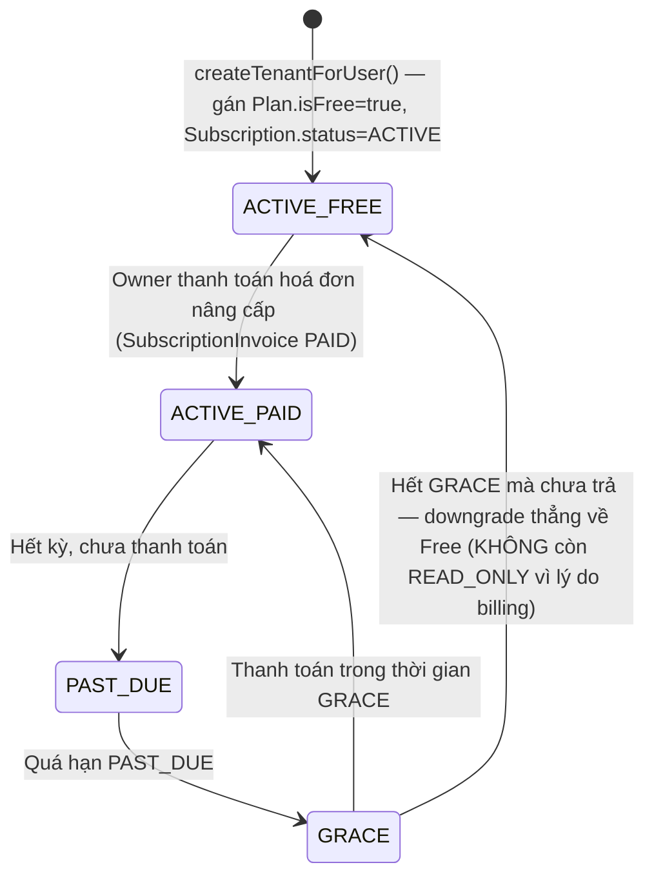

---
tags:
  - spec
  - payment
  - billing
  - status/living
date: 2026-09-26
updated: 2026-10-25
author: System Architect
---

# 📐 Đặc Tả: Thanh Toán & Billing (Payment & Billing Specs)

## 1. Tổng Quan: Hai Hệ Thống Thanh Toán Tách Biệt

Gieo Chữ có **hai** hệ thống thanh toán dùng chung code (`packages/payments`) nhưng **không bao giờ** chung
bảng, secret, hay route (CLAUDE.md, ranh giới layer):

| | Platform Billing | Tenant Billing |
| :--- | :--- | :--- |
| **Ai trả tiền cho ai** | Tenant trả **Gieo Chữ** để mua/gia hạn gói dịch vụ | Customer trả **Tenant** để mua tài liệu |
| **`PaymentScope`** | `{kind: 'PLATFORM'}` | `{kind: 'TENANT', tenantId}` |
| **Bảng cấu hình** | `PlatformPaymentConfig` (L1, 1 dòng/provider) | `TenantPaymentConfig` (L2, RLS, `@@unique([tenantId, provider])`) |
| **Bảng giao dịch** | `PlatformPaymentTransaction` | `TenantPaymentTransaction` |
| **Đối tượng thanh toán** | `SubscriptionInvoice` | `Order` |
| **Route webhook** | `POST /api/webhooks/platform/[provider]` | `POST /api/webhooks/tenants/[tenantId]/[provider]` |

Mọi hàm trong `packages/payments` (`createCheckout`, `verifyWebhook`, `parseWebhook`) nhận `PaymentScope` làm
tham số đầu — không có "chế độ mặc định" ngầm định nào trộn lẫn 2 luồng.

---

## 2. Nhà Cung Cấp Thanh Toán (`PaymentProviderId`)

```prisma
enum PaymentProviderId { MANUAL_QR  SEPAY  MOMO }
```

- **`MANUAL_QR`**: tự dựng payload VietQR (EMVCo TLV + CRC-16/CCITT-FALSE, `packages/payments/src/vietqr.ts`)
  từ số tài khoản/BIN ngân hàng đã cấu hình — không gọi API bên thứ 3, owner tự đối soát bằng mắt hoặc xác
  nhận thủ công.
- **`SEPAY`**: `authType` là `API_KEY` hoặc `HMAC_SHA256`, có `paymentPrefix` (khớp `Tenant.orderCodePrefix`
  hoặc `"SUB"` cho platform) để đối soát nội dung chuyển khoản.
- **`MOMO`**: `partnerCode`/`accessKey`/`secretKey`, môi trường `sandbox`/`production`, dùng `createCheckout`
  redirect (`CheckoutRedirectResult`) thay vì QR tĩnh.

**Mã hoá secret:** `encryptedSecrets` (AES-256-GCM, `encryptSecret`/`decryptSecret`/`maskSecret` —
`packages/core/src/crypto/`, chuyển từ `packages/payments` sang `core` ở ADR-017 để dùng chung được với
storage) — secret **không bao giờ** trả về client, UI chỉ hiện `••••abcd` (CLAUDE.md §7.3).

**Tự tắt khi đổi định danh tài khoản (ADR-013):** khi admin/owner sửa số tài khoản/BIN (hoặc `partnerCode`
MoMo) hay secret, hệ thống tự đặt `isEnabled=false` + xoá `lastVerifiedAt` — phải lưu lại và bật lại chủ động
để xác nhận cấu hình mới. Sửa các trường không ảnh hưởng định danh (tên chủ TK, `authType`...) không kích hoạt
việc này.

---

## 3. Webhook — Xác Thực Trước, Idempotent, Trả 2xx Nhanh (CLAUDE.md §7.4)

```mermaid
sequenceDiagram
    participant P as Provider (SePay/MoMo)
    participant R as Route Handler (/api/webhooks/tenants/[id]/[provider])
    participant DB as webhook_events (idempotency)
    participant J as Job Queue (pg-boss)
    participant O as apps/web/lib/payment-process.ts

    P->>R: POST webhook (chữ ký/HMAC trong header)
    R->>R: verifyWebhook() — so sánh bằng timingSafeEqual, KHÔNG parse nghiệp vụ trước khi xác thực
    alt Chữ ký sai / config không tồn tại
        R-->>P: 404 (không hint lý do — theo M7 smoke-test thật)
    else Chữ ký đúng
        R->>DB: INSERT webhook_events (scope, provider, providerEventId) — unique constraint chặn trùng
        R->>J: enqueuePaymentProcess(...) — KHÔNG xử lý nghiệp vụ nặng trong request
        R-->>P: 200 OK ngay
        Note over R,J: ADR-036 — after() chạy drainQueues ngay sau response (fetch → complete/fail); cron hằng ngày dọn job sót
        J->>O: job "payment.process" — so khớp orderId theo mã tham chiếu
        O->>DB: withTenant(tenantId) — ghi TenantPaymentTransaction (MATCHED/UNMATCHED/MISMATCH_AMOUNT)
        O->>O: markOrderPaid() nếu khớp và đơn còn hợp lệ (PENDING hoặc EXPIRED trong 24h)
    end
```

- **`timingSafeEqual`**: so sánh chữ ký/API key trong `packages/payments/src/providers/sepay.ts` và
  `momo.ts` — chống timing attack, không dùng `===` trên chuỗi bí mật.
- **`webhook_events`** (`@@unique([scope, provider, providerEventId])`): cùng một event id từ provider không
  bao giờ được xử lý 2 lần cho cùng scope+provider — ghi qua `withSystemJob` (chưa có tenant session lúc
  webhook thô vừa tới).
- **Ai xử lý job `payment.process` (ADR-036, chưa deploy) ✅:** trên Vercel không có worker thường trực — route webhook tenant gọi
  `scheduleQueueDrain([PAYMENT_PROCESS])` (`apps/web/lib/job-runner.ts`) **sau** khi đã enqueue, bọc `after()` của Next.js: response
  200 trả trước, rồi trong cùng function (`maxDuration = 60`) bộ xử lý lấy job bằng pg-boss `fetch`, gọi `processPaymentEvent`, đánh
  dấu `complete`/`fail`. Lỗi → job còn trong hàng đợi, thử lại sau (`retryDelay` 60 giây + backoff); cron `GET /api/cron/daily` dọn
  phần sót. `scheduleQueueDrain` không bao giờ ném lỗi nên không biến 2xx thành 500. Chi tiết:
  [[02-System-Specs/Background-Jobs-Specs|Background-Jobs-Specs]].
- **Webhook trễ hơn 24h sau `expiresAt` (chủ dự án chốt 2026-10-16) ✅:** giao dịch vẫn ghi `MATCHED` nhưng **không** tự fulfil —
  tenant đối soát/xử lý tay ([[Order-State-Machine]] §3.1).
- **Khoảng lệch đã biết giữa 2 module (ADR-019):** route webhook **Tenant** (M8) làm đúng đặc tả — chỉ xác
  thực + ghi `webhook_events` + đẩy job `payment.process`. Route webhook **Platform** (M3,
  `POST /api/webhooks/platform/[provider]`) xử lý đồng bộ trong request (gọi `markInvoicePaid()` trực tiếp) —
  **chưa được đồng bộ hoá lại** với M8 vì rủi ro sửa một module thanh toán đã ổn định/đã có test xanh ngoài
  phạm vi công việc đang làm; ghi vào `docs/BACKLOG.md`.

---

## 4. `markOrderPaid()` — Điểm Hội Tụ Duy Nhất Của Tenant Billing

Mọi nguồn tiền vào cho `Order` (webhook SePay, IPN MoMo, xác nhận thủ công của owner, đơn 0đ) đều đi qua
**đúng một hàm** `markOrderPaid(tx, orderId, source)` — xem chi tiết máy trạng thái tại
[[Order-State-Machine]]. Đây là nguyên tắc kiến trúc quan trọng nhất của Tenant Billing: không có đường tắt
nào khác ghi `Order.status = PAID`.

---

## 5. Platform Billing — Mô Hình Free Forever + Paid Subscription (ADR-021)

Thay cho mô hình "Trial rồi hết hạn" ban đầu, mọi tenant mới **vào thẳng gói FREE thật, bán được, không bao
giờ hết hạn**:



- **4 gói:** FREE / CREATOR / PRO / BUSINESS — số liệu (giá, `maxProducts`, `storageMb`, `maxFileMb`,
  `imageStorageMb` (ADR-028, hạn mức ảnh Cloudinary: khởi tạo 100 / 1024 / 2048 / 5120 MB), `features` JSON)
  **customize được qua `/admin/plans`**, không hard-code.
  `Plan.features` là JSON cờ tính năng — business logic (`canUsePlanFeature()`,
  `packages/core/src/billing/feature-gate.ts`) đọc `plan.features`, **không bao giờ** đọc `plan.code` — giữ
  packaging thương mại tách khỏi logic.
- **`TenantStatus.READ_ONLY`** chỉ còn dùng cho moderation/khoá thủ công — **không còn** là hệ quả tự động của
  billing hết hạn (khác thiết kế ban đầu). `LOCKED` (khoá cứng bởi Admin) là trạng thái riêng, không liên quan.
- **`SubscriptionInvoice`** (L1, không RLS) snapshot `amountVnd`/`periodStart`/`periodEnd` từ `Plan` tại thời
  điểm tạo — đổi giá gói sau đó không viết lại hoá đơn đã phát hành.
- **Dedupe hoá đơn PENDING (ADR-013):** bấm "Gia hạn" nhiều lần liên tiếp khi hoá đơn `PENDING` cũ còn hạn sẽ
  tái sử dụng hoá đơn đó, không tạo hoá đơn trùng cho cùng kỳ.
- **Sweep** (`subscription-sweep.ts`) loại trừ Free khỏi mọi truy vấn (`plan: { isFree: false }`). Lịch chạy (ADR-036, chưa
  deploy) ✅: trên Vercel gọi trực tiếp **mỗi ngày một lần** trong HTTP cron `GET /api/cron/daily` (03:00 giờ VN) — chuyển trạng
  thái thuê bao có thể trễ tới ~24h; lịch pg-boss hằng giờ (`0 * * * *`) chỉ còn khi chạy `apps/web/worker.ts` local/server riêng.

### 5A. Hạn mức gói, cờ tính năng, gói năm (ADR-041 A) — đã commit `7f8360b`, deploy ❓

Mức xác minh: ✅ Long đối chiếu working tree 2026-10-17 · 🟡 theo báo cáo · ❓ cần môi trường thật.

- **Ngữ nghĩa hạn mức (ADR-041 A.4 + bổ sung lần 2)** ✅ `packages/core/src/billing/plan-limits.ts`: `0` = **không được phép**
  (0 tài liệu / 0 byte), `PLAN_LIMIT_UNLIMITED = -1` = **không giới hạn**. Áp cho `maxProducts`, `storageMb`, `maxFileMb`,
  `imageStorageMb`. Giá trị âm khác bị `isValidPlanInput` từ chối; lọt vào DB vẫn coi là không được phép.
  - `isWithinPlanLimit`, `canPublishProduct` (`PRODUCT_LIMIT_REACHED` bỏ qua khi `-1`), `getTenantImageQuota` (`-1` → `limitBytes =
    Infinity`) dùng chung nghĩa này ✅.
  - Hiển thị dùng `describePlanLimit` (`NONE`/`UNLIMITED`/`LIMITED`) + `formatPlanLimit` ("Không có" / "Không giới hạn" / "50 tài liệu",
    "500 MB", "5 GB" — ≥ 1.024 MB đổi GB, 1 chữ số thập phân, tính bằng số nguyên) ✅. Billing Studio: `-1` không có thanh % ✅.
  - Form `/admin/plans` cho nhập `min=-1`, gợi ý "0 = không được phép · -1 = không giới hạn" ✅.
  - ❓ Trước ADR-041, Billing coi `limit === 0` là "không giới hạn" — gói trên prod đang để `0` với ý đó sẽ thành "không được phép". Long
    không kiểm dữ liệu `plans` trên DB (kế hoạch §4.1 A3 giao Quốc chạy truy vấn chỉ đọc).
- **Cờ tính năng (ADR-041 A.3)** ✅ `packages/core/src/billing/feature-gate.ts`: `PLAN_FEATURE_KEYS` (6 cờ), `PLAN_FEATURE_LABELS`,
  `IMPLEMENTED_PLAN_FEATURES = []` — chưa cờ nào được chặn theo gói (không có lời gọi `assertPlanFeature`), nên trang Bảng giá **không**
  quảng cáo cờ nào. Quy ước: khi gắn `assertPlanFeature` cho một tính năng thật, thêm khoá vào hằng này trong cùng commit.
- **Gói năm (ADR-041 A.2):** không đổi schema — admin tạo `Plan` `interval = YEAR`; CMS Bảng giá ghép cặp tháng ↔ năm bằng
  `altPlanId`; % tiết kiệm tính từ giá thật (`computeCycleSavingsPercent`, số nguyên, làm tròn xuống) ✅. Không quà tặng tháng, không dùng
  thử, không thẻ Enterprise. Chi tiết: [[02-System-Specs/Pricing-Page-Specs|Pricing-Page-Specs]].
- **Đổi gói giữa kỳ (ADR-041 A.5):** giữ hành vi hiện hành — không tính chênh lệch, kỳ mới nối sau 🟡 (theo ADR, Long chưa đối chiếu lại
  `subscription-billing.ts` đợt này).
- **Billing nhận `?plan={planId}`** ✅ (`studio/[tenantSlug]/billing/page.tsx`): chỉ nhận gói trả phí đang bật; sai/không có → gói hiện tại.

### 5B. Hoàn tiền gói trả phí (ADR-041 B + 2 lần bổ sung) — đã commit `7f8360b`, deploy ❓; migration đã áp 2026-10-17

**Quy tắc** (chủ dự án chốt): trong **7 ngày** kể từ `paidAt`, **chỉ hoá đơn gói PAID đầu tiên** của mỗi tenant, hoàn **100%** (=
`amountVnd` của hoá đơn). Admin **tự chuyển khoản tay** rồi bấm "Đã hoàn" — cổng QR/MoMo không tự hoàn. Tenant đã có **hoá đơn gói PAID
thứ hai** thì **mất quyền** yêu cầu (bổ sung lần 2).

**Dữ liệu** ✅ (migration `20261017100000_adr041_subscription_refunds`): `SubscriptionInvoiceStatus.REFUNDED`, enum
`SubscriptionRefundStatus` (`REQUESTED`/`APPROVED_REFUNDED`/`REJECTED`), bảng **L1** `subscription_refund_requests` (không RLS; `tenantId` và
`invoiceId` đều unique → mỗi tenant tối đa 1 yêu cầu) + 3 CHECK. Chi tiết cột:
[[03-API-Contracts/Database-Schema-Reference|Database-Schema-Reference]] §3.1, §4, §7.

**Điều kiện** ✅ `evaluateRefundEligibility` (`packages/core/src/billing/subscription-refund.ts`, hàm thuần):

| Lý do không đủ điều kiện | Khi nào |
| :-- | :-- |
| `NO_PAID_INVOICE` | Chưa có hoá đơn `PAID`/`REFUNDED` có `paidAt` |
| `ALREADY_REQUESTED` | Tenant đã có yêu cầu (mọi trạng thái) |
| `LATER_PAYMENT` | Có hoá đơn gói `PAID` khác hoá đơn đầu → server ném `AppError` 409 `REFUND_LATER_PAYMENT_EXISTS` |
| `NOT_FIRST_PAYMENT` | Hoá đơn đầu không còn `PAID` (đã `REFUNDED`) |
| `WINDOW_EXPIRED` | `now > paidAt + 7 ngày` (mốc UTC tuyệt đối, không theo ngày lịch) |
| `ZERO_AMOUNT` | Hoá đơn 0đ |

**Luồng** ✅ (`apps/web/lib/subscription-refund.ts`):
1. **Gửi** — Billing Studio, `requestSubscriptionRefundAction` (chỉ `OWNER` qua `requireTenantMember`). Form gửi lý do (tuỳ chọn, ≤ 500) +
   thông tin nhận tiền (ngân hàng theo `bank_bins`, số TK 6–19 chữ số, tên chủ TK chuẩn hoá in hoa không dấu); **không** gửi id hoá
   đơn/số tiền — server tính lại. Thông tin nhận tiền lưu `payoutEncrypted` = JSON mã hoá **AES-256-GCM** bằng `PAYMENT_ENCRYPTION_KEY`.
   Audit `SUBSCRIPTION_REFUND_REQUESTED` (chỉ `invoiceId`, `amountVnd`), email `subscription_refund_requested`.
2. **Admin xem** — `/admin/billing/refunds` (lọc theo trạng thái `?status=`): danh sách chỉ hiện ngân hàng + số TK che `••••1234`; "Xem
   đầy đủ" giải mã theo yêu cầu, audit `SUBSCRIPTION_REFUND_PAYOUT_VIEWED` (chỉ id). Yêu cầu đã xử lý → 409 `REFUND_NOT_PENDING`.
3. **Đã hoàn** — `approveRefundRequest`, một transaction: kiểm lại hoá đơn PAID thứ hai (có → 409, chỉ được Từ chối; UI `approveBlocked`
   ẩn nút); yêu cầu → `APPROVED_REFUNDED` + `payoutEncrypted = NULL`; hoá đơn `PAID → REFUNDED`; thuê bao về **gói Free đang bật** ngay
   (`downgradeToFree`, dùng lại từ sweep — không mất dữ liệu). Điều kiện trạng thái nằm trong câu `UPDATE` (chống bấm 2 lần / 2 admin).
   Thiếu gói Free đang bật → 409 `FREE_PLAN_MISSING`. Audit `SUBSCRIPTION_REFUNDED`, email `subscription_refund_refunded`.
4. **Từ chối** — `rejectRefundRequest`: lý do bắt buộc (≤ 500), `payoutEncrypted = NULL`, gói không đổi. Audit
   `SUBSCRIPTION_REFUND_REJECTED`, email `subscription_refund_rejected` (kèm lý do).
- `markInvoicePaid` bỏ qua hoá đơn `REFUNDED` — webhook/xác nhận tay đến muộn không áp lại hoá đơn đã hoàn ✅.
- Email không chứa số tài khoản; thông tin nhận tiền không vào audit/log ✅.
- Bảng chưa tồn tại (P2021) → `REFUND_UNAVAILABLE` 503 "chức năng hoàn tiền chưa sẵn sàng", không 500 ✅ (`isRefundSchemaMissing`).
- Ranh giới: admin chỉ đọc bảng L1 (tenant, hoá đơn gói) — không đọc đơn/khách của tenant (§7.9) ✅ comment + truy vấn.

**Kiểm dữ liệu thật** 🟡 (Hiếu báo 2026-10-17, gọi lib trực tiếp, email mock): `payoutEncrypted` là ciphertext; reveal có audit chỉ id; Đã
hoàn → hoá đơn `REFUNDED` + Free + payout `NULL`; từ chối cần lý do; hoá đơn thứ hai → 409; quá 7 ngày bị từ chối. **Chưa** kiểm qua UI có
đăng nhập, **chưa** SMTP thật ❓.

### 5C. System Center — lịch sử hoá đơn gói + "Đơn hàng gói dịch vụ" (ADR-056) — working tree, chưa commit ✅ `git status`

Quyết định: [[01-Architecture-Decisions/ADR-041-System-Center-Subscription-Invoices-Bank-Transfer-Qr|ADR-041 KB (≙ ADR-056)]]. Không migration.

- **`/admin/billing/invoices`** — 2 tab bằng `?tab=cho-doi-soat|tat-ca` ✅ (tab lạ → "Chờ đối soát"):
  - *Chờ đối soát*: `listPendingManualInvoices()` như cũ (MANUAL_QR PENDING), nút "Xác nhận đã nhận tiền" → `confirmManualInvoicePayment` (không đổi).
  - *Tất cả*: `listSubscriptionInvoices({ status, provider, page, pageSize })` — mọi trạng thái/cổng, mới nhất trước (`createdAt desc, id desc`),
    `pageSize` kẹp 1–100 (trang dùng 10/20/50/100, mặc định 20). Cột: mã, gian hàng, gói, cổng, số tiền, trạng thái, ngày tạo, hạn thanh toán, ngày thu.
    Nút xác nhận **chỉ** ở dòng `provider = MANUAL_QR` và `status = PENDING`.
- **`/admin/subscriptions`** (menu Kinh doanh → "Đơn hàng", tiêu đề "Đơn hàng gói dịch vụ") ✅ — `listSubscriptions({ planCode, status, page, pageSize })`:
  - Lọc `?plan=` (mã gói; chỉ nhận mã có trong `listPlanFilterOptions()` — mọi gói kể cả đã ngừng bán, xếp theo giá) và `?status=` (6 giá trị
    `SubscriptionStatus`); có `page`/`pageSize`.
  - Sắp xếp `plan.isFree asc` → `currentPeriodEnd asc` → `id asc`: gói trả phí hết hạn sớm nhất lên đầu, **gói miễn phí xếp sau**; cột "Hết hạn" của gói
    miễn phí hiện **"Không thời hạn"** (Free có `currentPeriodEnd = currentPeriodStart` — comment code).
  - "Hoá đơn gần nhất" = hoá đơn mới nhất của tenant (`createdAt desc`, lấy 1). Tên gian hàng link tới `/admin/tenants` (danh sách chung, không trang chi tiết).
- `parseEnumParam(allowed, value)` — query không thuộc danh sách → `undefined` (bỏ lọc), không ném lỗi ✅.
- Nhãn/tông badge dùng chung ở `app/admin/_ui/billing-labels.ts` (`INVOICE_STATUS_LABEL`, `INVOICE_PROVIDER_LABEL`, `SUBSCRIPTION_STATUS_LABEL`, …,
  `formatAdminDateTime`/`formatAdminDate` theo `DISPLAY_TIME_ZONE`) ✅.
- **Ranh giới:** bốn hàm chỉ đọc `subscription_invoices`, `subscriptions`, `plans` + tên/slug gian hàng — không đọc đơn/khách của tenant (§7.9) ✅.
- Kiểm bằng integration test có sẵn (`subscription-billing.test.ts`, thêm assert lọc `PAID`+`SEPAY`, `MANUAL_QR`, `CREATOR`+`ACTIVE`, `latestInvoice`) ✅ đọc test;
  xem UI thật với phiên SYSTEM_ADMIN ❓.

### 5D. Khối chuyển khoản dùng chung `BankTransferPanel` (ADR-056 mục 4) ✅ đọc code

`apps/web/app/_ui/bank-transfer-panel.tsx` (client, thuần trình bày — không tự truy vấn). Dùng ở:
- Studio `/studio/{slug}/billing` — hoá đơn gói đang chờ, `checkoutPayload.kind === "QR"` (PaymentScope PLATFORM); `referenceNoun = "hoá đơn"`.
- Checkout `/{tenantSlug}/checkout/{orderCode}` — đơn PENDING có QR (PaymentScope TENANT); `referenceNoun = "đơn hàng"`; số tiền truyền vào là `order.totalVnd`.

Hành vi:
- **"Tải ảnh QR"** là `<a href={qrImageDataUrl} download="QR-<mã>.png">` — QR là data URL PNG sinh ở server; **không `fetch()`** vì CSP `connect-src` không
  có `data:` ✅ comment code.
- Bảng `dl` các dòng: Ngân hàng (chỉ khi tìm được tên theo BIN — không hiện BIN thô), Số tài khoản, Chủ tài khoản, Số tiền, Nội dung chuyển khoản (= mã đơn/mã hoá
  đơn, nền nhấn + câu nhắc nhập đúng nguyên văn). Mỗi dòng một nút "Sao chép"; **số tiền sao chép là số nguyên trơn** (`String(Math.trunc(amountVnd))`, không
  dấu chấm/"đ"), còn hiển thị dạng `formatVndFull`.
- Kết quả sao chép đọc qua **một** vùng `role="status"` `aria-live="polite"` chung của khối (không phải mỗi dòng một vùng); clipboard lỗi → câu hướng dẫn chép tay.
- Tên ngân hàng (bảng L1 `bank_bins`): checkout gọi `getBankByBin(bin)` (hàm mới trong `lib/tenant-payment.ts`, trả `{ shortName, name } | null`); Studio billing
  tra trong danh sách `banks` đã nạp sẵn ở trang (không gọi `getBankByBin`) ✅.

### 5E. Lưu cấu hình cổng platform — kết quả trả về + form nạp lại (2026-10-24/25) ✅ `git diff`

- `savePlatformProviderConfig(input)` (`lib/platform-payment.ts`) nay trả **`{ isEnabled, autoDisabled }`** (trước: `void`): `isEnabled` là trạng thái thật đã lưu,
  `autoDisabled = identityChanged && input.isEnabled` — admin bật nhưng bị **tự tắt** vì định danh tài khoản/secret đổi (ADR-013).
- 3 Server Action `saveManualQrAction`/`saveSepayAction`/`saveMomoAction` trả `PlatformPaymentActionState.message` khi `autoDisabled`: "Đã lưu. Phương thức đang
  tắt vì thông tin tài khoản vừa thay đổi — bật lại và bấm Lưu thêm một lần để xác nhận."; không có thì form hiện "Đã lưu.".
- Ba form (`manual-qr-form.tsx`, `sepay-form.tsx`, `momo-form.tsx`) đặt `key` theo dữ liệu đã lưu (`JSON.stringify(initial)`; MoMo bỏ `lastVerifiedAt` khỏi key
  để "Kiểm tra kết nối" không xoá chữ đang gõ) → form dựng lại khớp DB sau mỗi lần lưu (React 19 reset form nhưng `<select defaultValue>`/Toggle không theo).
- Điểm đọc cấu hình cổng platform mới `getPlatformPaymentConfigRow(provider)` — dùng ở `createRenewalInvoice` và webhook `POST /api/webhooks/platform/[provider]`
  (thay `findUnique` trực tiếp); tách ra để integration test mock (xem
  [[04-Operations-Runbooks/Publish-And-Rollback-Runbook|Publish-And-Rollback-Runbook]] §2.2.1).

---

## 6. Nguyên Tắc Bảo Mật Bắt Buộc (CLAUDE.md §7, không đổi theo module)

1. Không tin số tiền/trạng thái từ client — luôn tính lại ở server (`calculatePrice()`, `markOrderPaid`).
2. Secret cổng thanh toán (Platform lẫn Tenant) mã hoá AES-256-GCM trước khi lưu DB — không bao giờ trả về
   client dạng plaintext.
3. Webhook xác thực chữ ký **trước** khi parse nghiệp vụ, so sánh bằng `timingSafeEqual`, idempotent qua
   `webhook_events`, trả 2xx nhanh rồi xử lý nặng trong job.
4. Route Handler ghi dữ liệu kiểm tra header `Origin` (CSRF cho non-Server-Action).

---

## 7. Tài Liệu Tham Chiếu & Liên Kết

* [[Order-State-Machine]] — Vòng đời đơn hàng đứng sau `markOrderPaid` ([Order-State-Machine.md](./Order-State-Machine.md))
* [[Architecture-Overview]] — Ranh giới L1/L2 và RLS ([Architecture-Overview.md](./Architecture-Overview.md))
* [docs/DECISIONS.md](../../docs/DECISIONS.md) — ADR-011 (bảng platform config sớm), ADR-012 (xác minh VietQR/CRC16),
  ADR-013 (dedupe/tự tắt config), ADR-019 (webhook Tenant qua job, khoảng lệch với Platform), ADR-021 (Hybrid
  Monetization), ADR-041 (Bảng giá CMS, hạn mức -1/0, hoàn tiền gói 7 ngày), ADR-056 (lịch sử hoá đơn gói, Đơn hàng gói dịch vụ, khối chuyển khoản, mã giảm giá tạo lại QR)
* [[01-Architecture-Decisions/ADR-041-System-Center-Subscription-Invoices-Bank-Transfer-Qr|ADR-041 KB (≙ ADR-056)]] ([ADR-041-System-Center-Subscription-Invoices-Bank-Transfer-Qr.md](../01-Architecture-Decisions/ADR-041-System-Center-Subscription-Invoices-Bank-Transfer-Qr.md))
* [[02-System-Specs/Pricing-Page-Specs|Pricing-Page-Specs]] — trang Bảng giá + CMS `pricing` ([Pricing-Page-Specs.md](./Pricing-Page-Specs.md))
* [docs/GIEOCHU_HYBRID_MONETIZATION_BILLING_PROPOSAL_V2.md](../../docs/GIEOCHU_HYBRID_MONETIZATION_BILLING_PROPOSAL_V2.md)
* [[02-System-Specs/Background-Jobs-Specs|Background-Jobs-Specs]] — job nền + cron (ADR-036) ([Background-Jobs-Specs.md](./Background-Jobs-Specs.md))
* Mã nguồn: `packages/payments/src/*`, `apps/web/lib/{order,payment-process,platform-payment,subscription-billing,subscription-sweep,subscription-refund,tenant-payment,job-runner,job-handlers}.ts`,
  `apps/web/app/admin/billing/{refunds,invoices,payment}/`, `apps/web/app/admin/subscriptions/`, `apps/web/app/admin/_ui/billing-labels.ts`,
  `apps/web/app/_ui/bank-transfer-panel.tsx`, `apps/web/app/studio/[tenantSlug]/billing/`,
  `packages/core/src/billing/*`

*Quay lại: [[MOC-Home]] (../00-Index/MOC-Home.md)*
