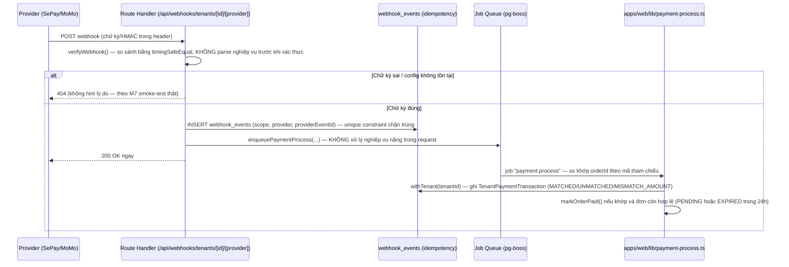
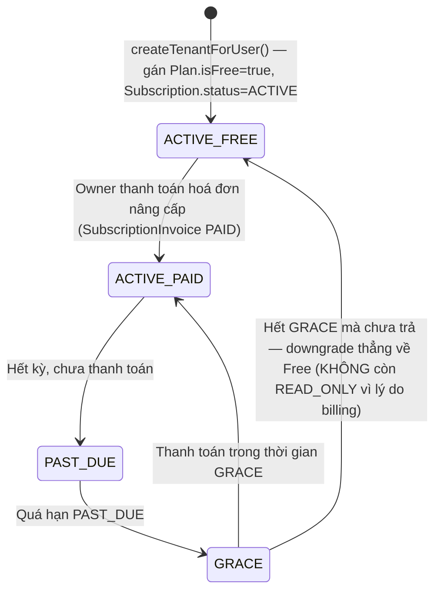

---
tags:
  - spec
  - payment
  - billing
  - status/living
date: 2026-09-26
updated: 2026-09-26
author: System Architect
---

# 📐 Đặc Tả: Thanh Toán & Billing (Payment & Billing Specs)

## 1. Tổng Quan: Hai Hệ Thống Thanh Toán Tách Biệt

Gieo Chữ có **hai** hệ thống thanh toán dùng chung code (`packages/payments`) nhưng **không bao giờ** chung
bảng, secret, hay route (CLAUDE.md, ranh giới layer):

| | Platform Billing | Tenant Billing |
| :--- | :--- | :--- |
| **Ai trả tiền cho ai** | Tenant trả **Gieo Chữ** để mua/gia hạn gói dịch vụ | Customer trả **Tenant** để mua tài liệu |
| **`PaymentScope`** | `{kind: 'PLATFORM'}` | `{kind: 'TENANT', tenantId}` |
| **Bảng cấu hình** | `PlatformPaymentConfig` (L1, 1 dòng/provider) | `TenantPaymentConfig` (L2, RLS, `@@unique([tenantId, provider])`) |
| **Bảng giao dịch** | `PlatformPaymentTransaction` | `TenantPaymentTransaction` |
| **Đối tượng thanh toán** | `SubscriptionInvoice` | `Order` |
| **Route webhook** | `POST /api/webhooks/platform/[provider]` | `POST /api/webhooks/tenants/[tenantId]/[provider]` |

Mọi hàm trong `packages/payments` (`createCheckout`, `verifyWebhook`, `parseWebhook`) nhận `PaymentScope` làm
tham số đầu — không có "chế độ mặc định" ngầm định nào trộn lẫn 2 luồng.

---

## 2. Nhà Cung Cấp Thanh Toán (`PaymentProviderId`)

```prisma
enum PaymentProviderId { MANUAL_QR  SEPAY  MOMO }
```

- **`MANUAL_QR`**: tự dựng payload VietQR (EMVCo TLV + CRC-16/CCITT-FALSE, `packages/payments/src/vietqr.ts`)
  từ số tài khoản/BIN ngân hàng đã cấu hình — không gọi API bên thứ 3, owner tự đối soát bằng mắt hoặc xác
  nhận thủ công.
- **`SEPAY`**: `authType` là `API_KEY` hoặc `HMAC_SHA256`, có `paymentPrefix` (khớp `Tenant.orderCodePrefix`
  hoặc `"SUB"` cho platform) để đối soát nội dung chuyển khoản.
- **`MOMO`**: `partnerCode`/`accessKey`/`secretKey`, môi trường `sandbox`/`production`, dùng `createCheckout`
  redirect (`CheckoutRedirectResult`) thay vì QR tĩnh.

**Mã hoá secret:** `encryptedSecrets` (AES-256-GCM, `encryptSecret`/`decryptSecret`/`maskSecret` —
`packages/core/src/crypto/`, chuyển từ `packages/payments` sang `core` ở ADR-017 để dùng chung được với
storage) — secret **không bao giờ** trả về client, UI chỉ hiện `••••abcd` (CLAUDE.md §7.3).

**Tự tắt khi đổi định danh tài khoản (ADR-013):** khi admin/owner sửa số tài khoản/BIN (hoặc `partnerCode`
MoMo) hay secret, hệ thống tự đặt `isEnabled=false` + xoá `lastVerifiedAt` — phải lưu lại và bật lại chủ động
để xác nhận cấu hình mới. Sửa các trường không ảnh hưởng định danh (tên chủ TK, `authType`...) không kích hoạt
việc này.

---

## 3. Webhook — Xác Thực Trước, Idempotent, Trả 2xx Nhanh (CLAUDE.md §7.4)



- **`timingSafeEqual`**: so sánh chữ ký/API key trong `packages/payments/src/providers/sepay.ts` và
  `momo.ts` — chống timing attack, không dùng `===` trên chuỗi bí mật.
- **`webhook_events`** (`@@unique([scope, provider, providerEventId])`): cùng một event id từ provider không
  bao giờ được xử lý 2 lần cho cùng scope+provider — ghi qua `withSystemJob` (chưa có tenant session lúc
  webhook thô vừa tới).
- **Khoảng lệch đã biết giữa 2 module (ADR-019):** route webhook **Tenant** (M8) làm đúng đặc tả — chỉ xác
  thực + ghi `webhook_events` + đẩy job `payment.process`. Route webhook **Platform** (M3,
  `POST /api/webhooks/platform/[provider]`) xử lý đồng bộ trong request (gọi `markInvoicePaid()` trực tiếp) —
  **chưa được đồng bộ hoá lại** với M8 vì rủi ro sửa một module thanh toán đã ổn định/đã có test xanh ngoài
  phạm vi công việc đang làm; ghi vào `docs/BACKLOG.md`.

---

## 4. `markOrderPaid()` — Điểm Hội Tụ Duy Nhất Của Tenant Billing

Mọi nguồn tiền vào cho `Order` (webhook SePay, IPN MoMo, xác nhận thủ công của owner, đơn 0đ) đều đi qua
**đúng một hàm** `markOrderPaid(tx, orderId, source)` — xem chi tiết máy trạng thái tại
[[Order-State-Machine]]. Đây là nguyên tắc kiến trúc quan trọng nhất của Tenant Billing: không có đường tắt
nào khác ghi `Order.status = PAID`.

---

## 5. Platform Billing — Mô Hình Free Forever + Paid Subscription (ADR-021)

Thay cho mô hình "Trial rồi hết hạn" ban đầu, mọi tenant mới **vào thẳng gói FREE thật, bán được, không bao
giờ hết hạn**:



- **4 gói:** FREE / CREATOR / PRO / BUSINESS — số liệu (giá, `maxProducts`, `storageMb`, `maxFileMb`,
  `imageStorageMb` (ADR-028, hạn mức ảnh Cloudinary: khởi tạo 100 / 1024 / 2048 / 5120 MB), `features` JSON)
  **customize được qua `/admin/plans`**, không hard-code.
  `Plan.features` là JSON cờ tính năng — business logic (`canUsePlanFeature()`,
  `packages/core/src/billing/feature-gate.ts`) đọc `plan.features`, **không bao giờ** đọc `plan.code` — giữ
  packaging thương mại tách khỏi logic.
- **`TenantStatus.READ_ONLY`** chỉ còn dùng cho moderation/khoá thủ công — **không còn** là hệ quả tự động của
  billing hết hạn (khác thiết kế ban đầu). `LOCKED` (khoá cứng bởi Admin) là trạng thái riêng, không liên quan.
- **`SubscriptionInvoice`** (L1, không RLS) snapshot `amountVnd`/`periodStart`/`periodEnd` từ `Plan` tại thời
  điểm tạo — đổi giá gói sau đó không viết lại hoá đơn đã phát hành.
- **Dedupe hoá đơn PENDING (ADR-013):** bấm "Gia hạn" nhiều lần liên tiếp khi hoá đơn `PENDING` cũ còn hạn sẽ
  tái sử dụng hoá đơn đó, không tạo hoá đơn trùng cho cùng kỳ.
- **Sweep** (`subscription-sweep.ts`, cron hằng giờ qua pg-boss in-process — không phải HTTP cron) loại trừ
  Free khỏi mọi truy vấn (`plan: { isFree: false }`).

---

## 6. Nguyên Tắc Bảo Mật Bắt Buộc (CLAUDE.md §7, không đổi theo module)

1. Không tin số tiền/trạng thái từ client — luôn tính lại ở server (`calculatePrice()`, `markOrderPaid`).
2. Secret cổng thanh toán (Platform lẫn Tenant) mã hoá AES-256-GCM trước khi lưu DB — không bao giờ trả về
   client dạng plaintext.
3. Webhook xác thực chữ ký **trước** khi parse nghiệp vụ, so sánh bằng `timingSafeEqual`, idempotent qua
   `webhook_events`, trả 2xx nhanh rồi xử lý nặng trong job.
4. Route Handler ghi dữ liệu kiểm tra header `Origin` (CSRF cho non-Server-Action).

---

## 7. Tài Liệu Tham Chiếu & Liên Kết

* [[Order-State-Machine]] — Vòng đời đơn hàng đứng sau `markOrderPaid` ([Order-State-Machine.md](./Order-State-Machine.md))
* [[Architecture-Overview]] — Ranh giới L1/L2 và RLS ([Architecture-Overview.md](./Architecture-Overview.md))
* [docs/DECISIONS.md](../../docs/DECISIONS.md) — ADR-011 (bảng platform config sớm), ADR-012 (xác minh VietQR/CRC16),
  ADR-013 (dedupe/tự tắt config), ADR-019 (webhook Tenant qua job, khoảng lệch với Platform), ADR-021 (Hybrid
  Monetization)
* [docs/GIEOCHU_HYBRID_MONETIZATION_BILLING_PROPOSAL_V2.md](../../docs/GIEOCHU_HYBRID_MONETIZATION_BILLING_PROPOSAL_V2.md)
* Mã nguồn: `packages/payments/src/*`, `apps/web/lib/{order,payment-process,platform-payment,subscription-billing,subscription-sweep,tenant-payment}.ts`,
  `packages/core/src/billing/*`
