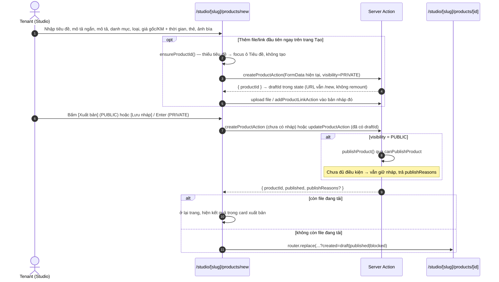

---
tags:
  - spec
  - product
  - storage
  - security
  - status/living
date: 2026-09-27
updated: 2026-10-17
author: Long (tài liệu)
---

# 📐 Đặc Tả: Sản Phẩm — Editor Tạo/Sửa, Nguồn Giao Hàng & Điều Kiện Xuất Bản (M5 + ADR-026/027/028/030)

> Phạm vi: phần nghiệp vụ sản phẩm (M5) sau đợt **Editor sản phẩm GĐ1** (ADR-026, 2026-09-26) và **bổ sung trang Tạo**
> (ADR-027, 2026-09-27, kèm "Sửa đổi ADR-027 §4" — bản nháp tự động) và **ảnh Cloudinary hệ thống + hạn mức ảnh**
> (ADR-028, 2026-09-27); **URL rút gọn `/{tenantSlug}/{productSlug}` + slug dành riêng + bỏ card xuất bản dính** (ADR-030,
> 2026-09-28, §7A). Luồng upload/tải xuống ở tầng storage: [[02-System-Specs/File-Storage-And-Downloads-Specs|File-Storage-And-Downloads-Specs]]
> (§7 cho ảnh Cloudinary).
> Contract Server Action: [[03-API-Contracts/Endpoint-Directory|Endpoint-Directory]] §10–§11. Bố cục/UI:
> [[04-Operations-Runbooks/UI-Design-System|UI-Design-System]] §9.
>
> Mức xác minh: ✅ = Long đã đọc code/migration ngày 2026-09-27 · 🟡 = theo báo cáo, chưa đọc lại · ❓ = cần môi trường
> thật (Neon, R2, Cloudinary, trình duyệt đã đăng nhập). **Toàn bộ đợt này chưa chạy qua trình duyệt với dữ liệu
> thật** ❓ — xem §9.

---

## 1. Mô hình dữ liệu liên quan ✅

- `Product.categoryId` → `DocumentCategory` (L1), `ON DELETE SET NULL`. `Product.summary` (văn bản thuần ≤300).
  `Product.coverImageUrl` (Cloudinary) cạnh `coverImageKey` (R2 cũ, chỉ còn là fallback).
- `ProductFile.sourceKind` `FILE | EXTERNAL_URL`: một bảng chứa cả file lẫn link ngoài; CHECK
  `product_files_source_shape` ép hình dạng dòng. Chi tiết cột/migration/RLS:
  [[03-API-Contracts/Database-Schema-Reference|Database-Schema-Reference]] §3.2, §7.
- **"Chế độ hiển thị" không phải cột mới** (ADR-027 §1): **Công khai = `PUBLISHED`**, **Riêng tư = `DRAFT`**.
  `ARCHIVED` giữ nguyên nghĩa cũ (UI hiển thị "Đã lưu trữ", không có radio, chỉ "Khôi phục" → `DRAFT`).
  Từ **ADR-051 (ADR-037 KB)**: Thao tác Lưu trữ kích hoạt tự động xoá vĩnh viễn cả tài liệu và storage nếu chưa có người mua; nếu có người đang mua (`PENDING`) hoặc đã mua (`PAID`/`FULFILLED`/`REFUNDED`/`Entitlement`) thì tuyệt đối không xoá mà chỉ chuyển sang `ARCHIVED` để bảo toàn quyền tải của khách hàng (§6B).

---

## 2. Bảo mật upload (ADR-026 §1 — sửa trước) ✅

Nguồn: `apps/web/lib/product-upload.ts`, `packages/storage/src/object-key.ts`.

1. **Khoá object phải thuộc đúng tenant/sản phẩm:** `complete` và `cover-complete` gọi `assertOwnObjectKey()` →
   `isProductObjectKeyFor(objectKey, tenantId, productId, kind)` **trước mọi lời gọi storage**. Hàm thuần kiểm:
   `tenantId`/`productId` là segment an toàn; key bắt đầu `tenants/<tenantId>/products/<productId>/`; phần còn lại
   đúng 2 segment — `<uuid>/<tên>` (kind `file`) hoặc `cover/<tên>` (kind `cover`); tên file đã ở dạng sanitize
   (`sanitizeFileName(tên) === tên`). Cộng thêm kiểm đuôi (allowlist file bán; ảnh bìa png/jpg/jpeg). Sai →
   `AppError INVALID_OBJECT_KEY` **400**. Lý do (comment code): tránh tenant đăng ký key của tenant khác bị lộ qua URL.
2. **Không ghi nhận trùng:** `objectKey` đã có trong `product_files` → `UPLOAD_ALREADY_COMPLETED` **409**, không động
   vào object đã ghi nhận.
3. **Kiểm dung lượng thật:** `HeadObject` không thấy → `UPLOAD_NOT_FOUND` 400; dung lượng thật ≠ khai báo → xoá object
   (best-effort, lỗi xoá chỉ ghi log) + `UPLOAD_SIZE_MISMATCH` **400**.
4. **Kiểm lại gói bằng dung lượng thật:** `assertPlanLimit("fileSize")` và `("storage")` chạy lại với `head.sizeBytes`
   (chặn "presign nhỏ, upload lớn"); vượt → xoá object rồi ném lỗi giới hạn gói.
5. Tạo `ProductFile` `PENDING` với `sizeBytes` = dung lượng thật; `storageUsedBytes += dung lượng thật`; enqueue `file.scan`.
6. **Gỡ file** (`removeProductFile`): đặt `removedAt`, **không xoá object**, **có trừ `storageUsedBytes`** ✅ (hành vi này
   có từ trước ADR-026 — đính chính báo cáo 2026-09-26 §2.2, xem [[00-Index/KB-Audit-2026-09-26|KB-Audit]] §6).

Giới hạn còn lại (BACKLOG): hai request `complete` cùng key chạy song song có thể lọt qua bước 2 rồi đụng `@unique`
→ 500 thay vì 409; `cover-complete` (R2) chưa kiểm dung lượng thật.

---

## 3. Danh mục (ADR-026 §2) ✅

- Studio chỉ liệt kê danh mục `isActive` (`listActiveCategoriesForStudio`, sắp theo tên).
- Gán danh mục mới (`createProduct`/`updateProduct`): danh mục phải tồn tại (`CATEGORY_NOT_FOUND` 400) và đang hoạt
  động (`CATEGORY_INACTIVE` 400).
- **Nháp được để trống**; sản phẩm đang `PUBLISHED` mà lưu với danh mục trống → `CATEGORY_REQUIRED` 400. Danh mục của
  sản phẩm đã xuất bản bị tắt sau đó: sản phẩm giữ nguyên, nhưng lần sửa kế tiếp gọi lại `assertAssignableCategory`
  → buộc chọn lại (editor hiện cảnh báo danh mục đã ngừng).
- Trang công khai **chưa** hiện tên danh mục (loader công khai không truyền `categoryName`); trang Xem trước có hiện.

---

## 4. Link tài liệu ngoài (ADR-026 §3) ✅

Nguồn: `packages/core/src/product/external-document-url.ts`, `apps/web/lib/product.ts`.

- **Allowlist** (`normalizeExternalDocumentUrl` / `isAllowedExternalDocumentUrl`): chỉ `https:`; không userinfo
  (`user:pass@`); không port tường minh; dài ≤ 2048 ký tự (cả trước và sau chuẩn hoá). Host khớp **chính xác**:
  `drive.google.com`, `docs.google.com`, `onedrive.live.com`, `1drv.ms`, `dropbox.com`, `www.dropbox.com`. Hậu tố
  wildcard `.sharepoint.com` chỉ nhận **đúng một nhãn DNS** phía trước (`contoso.sharepoint.com` được;
  `a.b.sharepoint.com`, `evilsharepoint.com` bị từ chối). Trả `URL.href` đã chuẩn hoá. Mở rộng allowlist phải qua ADR.
- Lưu: dòng `product_files` với `sourceKind = EXTERNAL_URL`, nhãn ở `fileName` (1…200 ký tự,
  `INVALID_EXTERNAL_LINK_LABEL`), URL ở `externalUrl`, `sizeBytes = 0`, `scanStatus = NULL`, `isPreview = false`.
  URL không hợp lệ → `INVALID_EXTERNAL_URL` 400. Không quét, không tính dung lượng.
- Sửa link: khách đã mua nhận URL mới ở lần mở sau. Gỡ link: `removedAt` (soft), khách không còn thấy trong Thư viện.
- **Kiểm allowlist lại khi giao** (phòng allowlist bị thu hẹp sau khi đã lưu): link không còn hợp lệ không được tính là
  nguồn giao hàng (`EditorProductLink.isAllowed = false`), không hiện trong Thư viện, và bị chặn khi tải
  (`DOWNLOAD_SOURCE_UNAVAILABLE`).
- **Không bao giờ ra trang public:** RLS nhánh public chỉ đọc `FILE` preview `CLEAN`; share link chỉ nhận `FILE`;
  `getProductPreviewData` không trả `externalUrl`. Khách chỉ nhận link qua Thư viện → `/api/downloads` (ghi
  `DownloadEvent`, tôn trọng `downloadLimit` như file). Luồng tải: [[02-System-Specs/File-Storage-And-Downloads-Specs|File-Storage-And-Downloads-Specs]] §4.
- UI Studio cảnh báo: link ngoài không được quét, không chống chia sẻ lại, tenant tự chịu trách nhiệm quyền truy cập ✅.

---

## 5. Điều kiện xuất bản (ADR-026 §4) ✅

`canPublishProduct(input)` (`packages/core/src/product/publish-eligibility.ts`) trả `{ allowed, reasons[], checklist[] }`,
**gom mọi lý do** (không dừng ở lý do đầu). `evaluateProductPublish()` (`apps/web/lib/product.ts`) dựng input:

| Mục checklist (`requirement`) | Nhãn | Lý do chặn (`code`) | Nguồn dữ liệu |
| :-- | :-- | :-- | :-- |
| `CATEGORY` | Có danh mục đang hoạt động | `CATEGORY_REQUIRED`, `CATEGORY_INACTIVE` | `categoryId` + `DocumentCategory.isActive` |
| `COVER_IMAGE` | Có ảnh bìa | `NO_COVER_IMAGE` | `hasProductCover`: `coverImageUrl` Cloudinary hợp lệ **hoặc** `coverImageKey` |
| `DELIVERY_SOURCE` | Có file bán hoặc link tài liệu | `NO_DELIVERY_SOURCE` | ≥1 dòng chưa gỡ, không preview: `FILE` + `CLEAN` **hoặc** `EXTERNAL_URL` còn qua allowlist |
| `PRICE` | Giá bán hợp lệ | `INVALID_PRICE` | `priceVnd` nguyên ≥ 0 |
| `TENANT_ACTIVE` | Trang đang hoạt động | `TENANT_NOT_ACTIVE` | `Tenant.status === ACTIVE` |
| `PRODUCT_LIMIT` | Còn chỗ trong giới hạn sản phẩm của gói | `PRODUCT_LIMIT_REACHED` | số sản phẩm `PUBLISHED` khác (không tính chính nó) < `plan.maxProducts` |

- Sản phẩm **chỉ có link** vẫn xuất bản được. Ảnh bìa **bắt buộc** (code áp vô điều kiện).
- `publishProduct()`: gọi trên sản phẩm đã `PUBLISHED` là no-op; không đủ điều kiện → `ProductNotPublishableError`
  (`AppError` `PRODUCT_NOT_PUBLISHABLE` 400, mang `reasons`); đủ → kiểm thêm `assertPlanLimit("products")` rồi đặt `PUBLISHED`.
- ⚠️ `publishProduct()` **không chặn trạng thái `ARCHIVED`** ở server — UI đã ẩn đường này (BACKLOG).
- `unpublishProduct()` vô điều kiện (như M5 cũ) — trừ khi đang khoá kiểm duyệt (§5.1).

### 5.1. Cam kết bản quyền & khoá kiểm duyệt (M12c, ADR-038 — 2026-10-17) ✅ code · ❓ trình duyệt

Đối chiếu code working tree 2026-10-17 (nay đã commit `36103fb`, deploy ❓). Nghiệp vụ chung: [[02-System-Specs/Abuse-Reports-Specs|Abuse-Reports-Specs]] §5.
- Chữ ký mới: `publishProduct(tenantId, productId, actorId, { rightsConfirmed })`. Thứ tự kiểm: đã `PUBLISHED` → no-op (không cần tích) ·
  đang khoá kiểm duyệt → 409 `CONTENT_MODERATION_LOCKED` · điều kiện xuất bản (§5) → `PRODUCT_NOT_PUBLISHABLE` · `rightsConfirmed !== true` →
  400 `RIGHTS_CONFIRMATION_REQUIRED` · hạn mức gói → đặt `PUBLISHED` + `rightsConfirmedAt = now`, `rightsConfirmedById = actorId` · audit
  `PRODUCT_PUBLISHED` (metadata `rightsConfirmed: true`).
- Bắt buộc tích ô cam kết (nhãn hiện tại trong `publish-card.tsx`: **"Tôi sở hữu hoặc có quyền phân phối tài liệu này"**) ở **mỗi lần** chuyển sang `PUBLISHED` (DRAFT/ARCHIVED → PUBLISHED);
  sản phẩm đang công khai không phải tích lại. Ô nằm trong card xuất bản của editor (FormData `rightsConfirmed`); lỗi map vào
  `fieldErrors.rightsConfirmed` và focus về ô. Danh sách sản phẩm không có nút "Xuất bản".
- `EditorProductData.product` thêm `moderationLockedAt`, `moderationReason`, `rightsConfirmedAt`.
- **Khoá kiểm duyệt** (admin lưu trữ do vi phạm): `publishProduct`/`unpublishProduct`/`restoreProduct` → 409 `CONTENT_MODERATION_LOCKED`;
  trigger `products_guard_moderation` chặn đổi `status` ngoài `system_job`. Editor/danh sách hiện nhãn "Bị khoá kiểm duyệt" + khối giải
  thích, ẩn các nút đổi trạng thái (Khôi phục / Chuyển Riêng tư / Lưu trữ). Sau khi admin gỡ khoá, sản phẩm giữ `ARCHIVED` — tenant tự
  khôi phục và phải tích cam kết khi xuất bản lại.
- `archiveProduct(tenantId, productId, actorId)` (tenant tự lưu trữ) **không** mở quyền chọn cho người mua — chỉ quyết định `ARCHIVE_PRODUCT`
  của admin mới mở (ADR-039).

---

## 6. Mô tả ngắn & ảnh bìa (ADR-027 §2–§3) ✅

- **Mô tả ngắn** (`normalizeProductSummary`, `packages/core/src/product/summary.ts`; import client qua
  `@gieochu/core/product-summary`): NFC → ký tự điều khiển C0/C1 (kể cả xuống dòng/tab) thành khoảng trắng → bỏ ký tự
  định dạng ẩn (bidi override, zero-width, BOM…) → gộp khoảng trắng → trim. Rỗng → `null` (xoá). Dài hơn
  **300 code point** → từ chối (`INVALID_PRODUCT_SUMMARY`), **không tự cắt**. Kiểm ở cả Server Action (zod) lẫn lib.
  Không bắt buộc khi xuất bản. Hiển thị: thẻ storefront + đầu trang chi tiết; trang công khai dùng làm meta description.
- **Ảnh bìa Cloudinary (cập nhật theo ADR-028):** `getProductCoverUploadSignatureAction(tenantSlug)` gọi
  `createTenantImageUploadSignature(tenant.id, "PRODUCT_COVER")` — kiểm hạn mức ảnh của gói, ký **`public_id` đầy đủ**
  `<uploadFolder>/tenants/<tenantId>/products/<24 hex>` (không ký `folder`), `allowed_formats=png,jpg,jpeg,webp` (không
  SVG), incoming transformation ≤2000px, và giữ chỗ 5MB trong `tenant_media_assets`. Sau upload, card gọi
  `registerTenantImageAction(tenantSlug, publicId, "PRODUCT_COVER")` → server đọc dung lượng thật qua Admin API, trả
  `url` để gửi vào field `coverImageUrl`. Không cần `productId` nên dùng được ngay ở trang Tạo. Chi tiết:
  [[02-System-Specs/File-Storage-And-Downloads-Specs|File-Storage-And-Downloads-Specs]] §7 ✅.
- **Server kiểm `coverImageUrl`:** zod kiểm host Cloudinary; sau đó `isCloudinaryImageUrl(url, cloudName hệ thống)` —
  URL của cloud Cloudinary khác bị từ chối (`INVALID_COVER_IMAGE_URL`) ✅. Rỗng = xoá ảnh Cloudinary.
- **Thứ tự hiển thị** (`apps/web/lib/product-cover.ts`): `coverImageUrl` hợp lệ (kiểm lại host khi đọc) → fallback
  `publicBaseUrl/coverImageKey` (R2) → `null`. Dùng chung cho storefront, trang chi tiết, editor, xem trước. Khi hiển thị
  ảnh Cloudinary đi qua `cloudinaryDeliveryUrl` (thẻ 800px, bìa chi tiết 1200px) ✅.
- **Ảnh trong mô tả (ADR-028):** editor Tiptap chèn ảnh bằng upload (không còn nhập URL), chữ ký
  `getContentImageUploadSignatureAction` (folder `tenants/<id>/content`) + `registerTenantImageAction(..., "CONTENT")`.
  Khi lưu, `sanitizeRichTextHtml(description, { imageCloudName })` loại mọi `` không thuộc cloud hệ thống; khi
  render trang chi tiết/Xem trước, ảnh được viết lại `w_1200` ✅. UI: [[04-Operations-Runbooks/UI-Design-System|UI-Design-System]] §9.3.
- Luồng R2 `cover-presign`/`cover-complete` **vẫn còn** cho tới khi dọn (BACKLOG).
- Giới hạn còn lại (BACKLOG): giới hạn 5 MB chọn file chỉ ở client — server bù bằng incoming transformation ≤2000px +
  đọc bytes thật vào hạn mức, nhưng chưa có upload preset chặn cứng dung lượng; asset Cloudinary mồ côi khi đổi/xoá ảnh
  vẫn tính hạn mức (chưa có job dọn); `coverImageUrl` nay kiểm **đúng cloud** nhưng **chưa kiểm folder** của đúng tenant.

---

## 7. Luồng Tạo / Sửa & chế độ hiển thị (ADR-026 §5, ADR-027 §1, §4 + Sửa đổi §4) ✅ code · ❓ trình duyệt

- Trang Tạo và Sửa dùng **chung một editor** (`products/_ui/product-editor.tsx`). Lưu thành công trên trang Tạo → chuyển
  sang URL sửa kèm `?created=draft|published|blocked` (trừ khi còn file đang tải); trang Sửa chỉ nhận 3 giá trị đó, hiện
  thông báo rồi gỡ query khỏi URL; `blocked` → focus tới checklist.
- **Bản nháp tự động — "Sửa đổi ADR-027 §4" (chủ dự án, 2026-09-27)** ✅: trang Tạo **không khoá** card Tệp tài liệu.
  Lần thêm file/link đầu tiên gọi `ensureProductId()`:
  - Đã có `productId` (trang Sửa, hoặc nháp đã tạo) → trả ngay.
  - Tiêu đề trống → focus ô Tiêu đề + thông báo "Nhập tiêu đề trước khi thêm tài liệu…"; ràng buộc HTML khác của form
    không hợp lệ → `reportValidity()`. Tiêu đề là field bắt buộc duy nhất để tạo nháp.
  - Gọi `createProductAction` với dữ liệu form hiện có + `visibility=PRIVATE`. **Một promise dùng chung** cho mọi lời gọi
    đồng thời (nhiều file cùng đợt) → chỉ một bản nháp. Lỗi → hiện như lỗi lưu thường (tóm tắt lỗi đầu form), bấm Thử lại.
  - Thành công → lưu `draftId` trong state; editor chuyển sang hành vi trang Sửa DRAFT **trên cùng component** (không
    remount → không ngắt upload). URL **giữ `/products/new`** trong phiên (không lách `history` của Next). Danh sách
    file/link giữ cục bộ trong card (từ kết quả `complete` và `link` do action trả về); checklist điều kiện chỉ có từ
    loader trang Sửa nên ẩn cho tới khi sang trang Sửa.
  - Không có bảng "staging upload"; bản nháp bị bỏ dở là dữ liệu hợp lệ, tenant thấy và xoá được.
  - Rời trang khi còn thay đổi chưa lưu **hoặc** còn file đang tải → cảnh báo `beforeunload`.
- `addProductLinkAction` / `updateProductLinkAction` thành công trả thêm `link: ProductLinkState`
  (`{ id, label, url, isAllowed, createdAt }`, `createdAt` là ISO string) để card cập nhật danh sách cục bộ ✅.
- **Gửi theo nút bấm (chưa công khai: trang Tạo / DRAFT)** ✅: [Xuất bản] gửi `visibility=PUBLIC`, [Lưu nháp] gửi
  `PRIVATE`; radio Công khai/Riêng tư chỉ phản ánh lựa chọn và được **đồng bộ theo nút** khi bấm. Enter trong ô nhập =
  Lưu nháp ("Lưu nháp" là nút submit mặc định, "Xuất bản" là `type="button"`) → không vô tình xuất bản. Không công khai
  được (`publishReasons`) → radio về Riêng tư.
- **PUBLISHED:** nút chính theo radio ("Lưu thay đổi" / chuyển Riêng tư có hộp xác nhận). **ARCHIVED:** "Lưu thay
  đổi", editor không gửi `visibility` (chỉ lưu nội dung).
- **Riêng tư trên sản phẩm đang Công khai:** lưu và chuyển `PUBLISHED → DRAFT` trong **cùng một lệnh update**
  (`updateProduct(..., { unpublish: true })`); luật "đã xuất bản phải có danh mục" xét theo trạng thái đích.
- **Công khai:** lưu trước, rồi `publishProduct`; lưu lỗi → không xuất bản; chưa đủ điều kiện → đã lưu nhưng vẫn Riêng
  tư, trả `publishReasons`.
- Submit thủ công (`startTransition` + `dispatch`) để form không tự reset khi lưu lỗi (hành vi mặc định của
  `<form action>` React 19).
- Slug không đổi được sau khi tạo (comment `updateProduct` trong `apps/web/lib/product.ts` ✅).
- Bố cục (card xuất bản đứng đầu sidebar từ xl, **không dính** khi cuộn theo ADR-030 §3; thanh lưu nhanh dưới xl):
  [[04-Operations-Runbooks/UI-Design-System|UI-Design-System]] §9.1.

---

## 6B. Vòng Đời Sản Phẩm: Lưu Trữ Kích Hoạt Xoá & Bảo Vệ Quyền Người Mua (ADR-051 / ADR-037 KB) ✅

Nguồn: `apps/web/lib/product.ts`, `apps/web/app/studio/[tenantSlug]/products/actions.ts`.

1. **Quy tắc bảo vệ người mua (`checkProductPurchaseStatus`):**
   - **Đang mua (`HAS_PENDING_ORDERS`):** Có đơn hàng `PENDING` chứa sản phẩm (`OrderItem.productId === productId`). Chặn xoá vì khách đang tiến hành thanh toán.
   - **Đã mua (`HAS_PURCHASE_HISTORY`):** Có đơn hàng `PAID`, `FULFILLED`, `REFUNDED` hoặc đã tồn tại bản ghi `Entitlement` sở hữu tài liệu. Chặn xoá nhằm bảo đảm quyền lợi tải tài liệu của khách hàng theo chính sách mua bán sản phẩm số.
   - Chưa từng phát sinh đơn: `canDelete = true`.
2. **Cơ chế Lưu trữ thông minh (`archiveProductAction` / `archiveProduct`):**
   - **Có người mua / đang mua:** Không xoá dữ liệu, chỉ chuyển `status = "ARCHIVED"`. Giữ nguyên 100% tệp trên Storage Service (MinIO/R2) để khách hàng tiếp tục tải bình thường. Ghi audit log `PRODUCT_ARCHIVED` (metadata `retainedForBuyers: true`).
   - **Chưa từng có người mua:** Kích hoạt tự động `deleteProduct()`, xoá toàn bộ dữ liệu DB và tệp vật lý trên Storage Service, trừ quota `tenant.storageUsedBytes`, trả về `isDeleted = true`. Giao diện Studio tự động điều hướng về danh sách sản phẩm.
3. **Thao tác Xoá tài liệu trực tiếp (`deleteProductAction` / `deleteProduct`):**
   - Kiểm tra nghiêm ngặt `checkProductPurchaseStatus`. Nếu vi phạm, ném lỗi `PRODUCT_CANNOT_BE_DELETED` (HTTP 400).
   - Xoá vật lý file trên Storage Service: quét `product_files`, lấy client tương ứng `storageBucket`/`storageProvider` (hoặc storage hệ thống) và gọi `deleteObject()`.
   - Xoá ảnh bìa nội bộ `coverImageKey` trên public bucket nếu có.
   - Cập nhật trừ dung lượng đã dùng: `tenant.storageUsedBytes -= sum(files.sizeBytes)`.
   - Xoá cascade dữ liệu DB: `downloadEvent`, `downloadToken`, `shareLink`, `review`, `productFile`, gỡ liên kết bài viết (`post.productId = null`) và xoá `product`.
   - Ghi audit log `PRODUCT_DELETED`.

---

## 7A. Đường dẫn công khai & slug dành riêng (ADR-030) ✅ code · ❓ trình duyệt

> Nguồn: `docs/DECISIONS.md` ADR-030 + "Bổ sung ADR-030 theo triển khai" (2026-09-28). Bản trích:
> [[01-Architecture-Decisions/ADR-016-Short-Product-Url-No-Sticky-Publish-Card|ADR-016 (≙ ADR-030)]]. ✅ = Long đọc code
> 2026-09-28.

**Route map trang tài liệu:**

| URL | File | Hành vi |
|---|---|---|
| `/{tenantSlug}/{productSlug}` | `app/[tenantSlug]/[productSlug]/page.tsx` (+ `actions.ts`, `buy-button.tsx`, `review-actions.ts`) | **URL chuẩn (canonical)**. Slug thuộc `RESERVED_PRODUCT_SLUGS` → `notFound()` (và `generateMetadata` trả `{}`). `alternates.canonical` = URL **tuyệt đối** `productUrl(APP_URL, tenant.slug, product.slug)` ✅ |
| `/{tenantSlug}/products/{productSlug}` | `app/[tenantSlug]/products/[productSlug]/route.ts` (Route Handler `GET`) | **301**, `Location` **tương đối** = `productPath(...)` + query gốc (vd `?reviews=20`); hash do trình duyệt tự giữ. Slug dành riêng → **404** (tránh đẩy `/t/products/posts` sang trang bài viết) ✅ |
| `/{tenantSlug}/products` | — (không có `page.tsx`) | **404** ✅ (thư mục `products/` chỉ chứa `[productSlug]/route.ts`) |
| `/{tenantSlug}/posts`, `/{tenantSlug}/checkout/...` | segment tĩnh cùng cấp | Next ưu tiên segment tĩnh trước segment động `[productSlug]` ✅ |

- **Vì sao Route Handler thay vì `permanentRedirect()`/`redirects()`:** cả hai trả **308**, không phải 301 như ADR; pattern
  `redirects()` trong `next.config` còn khớp cả `/api/...` (theo "Bổ sung ADR-030"; comment trong `route.ts` ✅). Handler chỉ
  đọc, không ghi → không cần kiểm `Origin`; segment đã encode trong `productPath` nên `Location` không thể thành `//host`
  (comment code ✅).
- **Hàm dựng URL duy nhất** — `packages/core/src/product/path.ts` ✅ (không phụ thuộc thư viện nào, import được từ client
  qua subpath `@gieochu/core/product-path`; cũng export từ `@gieochu/core`):
  - `productPath(tenantSlug, productSlug)` → `/${encodeURIComponent(tenantSlug)}/${encodeURIComponent(productSlug)}`.
  - `productUrl(appUrl, tenantSlug, productSlug)` → URL tuyệt đối (bỏ `/` cuối của `appUrl`) — dùng cho canonical/email.
  - `RESERVED_PRODUCT_SLUGS` (`ReadonlySet`, **23 mục**): `products`, `posts`, `checkout`, `danh-gia`, `bai-viet`, `api`,
    `studio`, `account`, `login`, `admin`, `p`, `s`, `feed`, `tag`, `category`, `search`, `cart`, `orders`, `reviews`,
    `about`, `contact`, `new`, `edit`; `isReservedProductSlug(slug)` so sánh không phân biệt hoa thường.
  - Nơi đang dùng (grep 2026-09-28 ✅): trang tài liệu + `route.ts` redirect, `account/library/page.tsx`, `ProductEditor`
    (hiện đường dẫn + link công khai), `StudioReviewCard`, `_ui/products.tsx`, `_ui/post-parts.tsx`,
    `_ui/storefront-posts.tsx`, `_ui/storefront-reviews.tsx`, `requireVerifiedAccess(...)` trong `[productSlug]/actions.ts`.
- **Tạo sản phẩm** (`createProduct`, `apps/web/lib/product.ts`) ✅:
  - Slug **tự nhập** (`input.slug`) sau `slugify` trùng từ dành riêng → `AppError` **`INVALID_SLUG`** (400) "Đường dẫn "…" là
    từ dành riêng của hệ thống — vui lòng chọn đường dẫn khác."
  - Slug **tự sinh** từ tiêu đề trùng từ dành riêng → coi như đã bị chiếm: `suggestSlug(base, [slug hiện có của tenant,
    ...RESERVED_PRODUCT_SLUGS])` thêm hậu tố `-2`, `-3`…
  - Slug đã tồn tại trong DB **trước** ADR-030 không bị kiểm lại (slug không đổi sau khi tạo) — sản phẩm như vậy chỉ ra
    404 ở URL mới. **Phải quét DB prod trước deploy** (BACKLOG) ❓.
- **Revalidate** (`revalidateProduct` trong `studio/[tenantSlug]/products/actions.ts`) ✅: `/studio/<slug>/products`, trang
  sửa (khi có `productId`), **`revalidatePath("/[tenantSlug]/[productSlug]", "page")`** (theo route pattern vì action không
  có slug — tức làm mới trang tài liệu của **mọi** tenant) và storefront `/<slug>`.
- **Checklist khi thêm route tĩnh mới dưới `app/[tenantSlug]/`** (`CLAUDE.md` mục "Quy ước code" ✅): (1) thêm tên
  segment vào `RESERVED_PRODUCT_SLUGS`; (2) quét slug sản phẩm trùng trên DB prod (sản phẩm cũ trùng sẽ bị route tĩnh che).
- Chi phí: mọi URL 2 segment không khớp route tĩnh giờ đi vào trang tài liệu → tốn 1 query tìm tenant trước khi 404
  (BACKLOG).
- **Chưa verify ❓:** 301 thật qua trình duyệt/`curl`; chưa có test tự động cho redirect 301 và chặn slug dành riêng (nợ,
  BACKLOG) — số test không đổi (93/94 unit, 52/53 integration, `pnpm test:count` 2026-09-28 ✅).

---

## 8. Trang Xem trước (ADR-027 §5) ✅ code · ❓ trình duyệt

- Route `/studio/[tenantSlug]/products/[productId]/preview` (`page.tsx` trong app shell Studio).
- Guard `requireTenantMemberPage` (chưa đăng nhập → `/login?next=...`; không qua `requireTenantMember` → 404).
  `requireTenantMember` mặc định đòi `canManageTenant(role)` = **chỉ `OWNER`** ✅ — ADR-027 ghi "chủ tenant/staff" nhưng
  STAFF hiện không vào được (MVP chưa tạo STAFF; lệch ghi ở [[00-Index/KB-Audit-2026-09-26|KB-Audit]] §6).
- Dữ liệu `getProductPreviewData(tenantId, productId)` đọc qua `withTenant` → thấy được **bản nháp của chính tenant**;
  tenant khác / id sai → 404. **Cố ý không trả** `externalUrl`, object key, danh sách file. Giá hiệu lực tính bằng
  cùng `calculateOrderPricing` như trang công khai.
- `metadata.robots`: `noindex, nofollow, nocache` (kể cả `googleBot`).
- Render `SiteHeader` + `ProductDetailView` (dùng chung với trang công khai) + `SiteFooter` trong khung, kèm dải
  "Bản xem trước — khách chưa thấy trang này", nhãn chế độ hiển thị, nút "Quay lại chỉnh sửa"; nút "Mua ngay" bị vô hiệu.
- Trang Tạo (chưa có bản nháp): nút "Xem trước" **lưu nháp (Riêng tư) trước** rồi mở tab mới (tab mở ngay trong cú
  bấm để tránh chặn popup, điền URL sau khi lưu; lưu lỗi → đóng tab). Đã có `productId` (trang Sửa hoặc bản nháp tự
  tạo): link tới bản **đã lưu** (thay đổi chưa lưu không hiện). Chi tiết UI: [[04-Operations-Runbooks/UI-Design-System|UI-Design-System]] §9.

---

## 9. Kiểm thử & chưa verify

- `pnpm test:count` chạy lại 2026-09-27 (sau ADR-028) ✅: **93 / 94 unit, 52 / 53 integration** (trần 94/53 nâng theo
  ADR-026; ADR-027/028 không nâng trần). Đợt ADR-026/027 đưa số từ 88/46 lên 91/50; ADR-028 thêm **+2 unit, +2
  integration** ✅ (đọc tên case):
  - ADR-026/027 — unit: `external-document-url.test.ts` (allowlist, lookalike, userinfo, port, scheme);
    `publish-eligibility.test.ts` case "ADR-026: requires an active category…"; `object-key.test.ts` case "accepts only
    object keys built for the same tenant/product…"; integration: `product-upload.test.ts` "complete rejects (400) another
    tenant's object key…"; `product.test.ts` "ADR-026: publishing is refused without an active category or a delivery
    source…" và "ADR-027: a Cloudinary cover satisfies publishing, preview reads the tenant's own draft only, and PRIVATE
    unpublishes on save"; `download.test.ts` "ADR-026: an entitled customer opens an external link…".
  - ADR-028 — unit: `packages/core/src/content/cloudinary-url.test.ts` "inserts f_auto,q_auto,c_limit,w_N after
    /image/upload/…"; `packages/core/src/content/sanitize-html.test.ts` "keeps only images from the system Cloudinary
    cloud…"; integration: `apps/web/tests/integration/tenant-media.test.ts` "refuses an upload signature
    (IMAGE_QUOTA_EXCEEDED) once recorded image bytes reach the plan quota, and asset rows stay tenant-isolated by RLS" và
    "register rejects public ids outside the tenant's own folder/usage before calling the Admin API, and records
    server-read bytes for a valid one".
  - Kết quả chạy các test này (xanh/đỏ) trên Neon thật ❓ — Long chỉ chạy `test:count` (đếm case), không chạy test;
    brief của Quốc ghi "xong code", không kèm kết quả chạy.
- ❓ Chưa kiểm bằng trình duyệt: các trang cần đăng nhập (Tạo/Sửa/Xem trước), bản nháp tự động khi thêm tệp đầu tiên,
  card xuất bản (không dính, ADR-030) / thanh lưu nhanh, upload Cloudinary thật (ảnh bìa + ảnh mô tả), upload R2 thật, mở link ngoài từ
  Thư viện thật, trạng thái áp migration ADR-026/027/028 trên Neon (Long chưa kiểm DB).

---

## 10. Tài liệu tham chiếu & liên kết

* [[01-Architecture-Decisions/ADR-012-Product-Editor-Category-External-Links|ADR-012 (≙ ADR-026)]] ([ADR-012-Product-Editor-Category-External-Links.md](../01-Architecture-Decisions/ADR-012-Product-Editor-Category-External-Links.md))
* [[01-Architecture-Decisions/ADR-013-Product-Summary-Cover-Preview-Visibility|ADR-013 (≙ ADR-027)]] ([ADR-013-Product-Summary-Cover-Preview-Visibility.md](../01-Architecture-Decisions/ADR-013-Product-Summary-Cover-Preview-Visibility.md))
* [[01-Architecture-Decisions/ADR-014-System-Cloudinary-Image-Quota|ADR-014 (≙ ADR-028)]] ([ADR-014-System-Cloudinary-Image-Quota.md](../01-Architecture-Decisions/ADR-014-System-Cloudinary-Image-Quota.md))
* [[03-API-Contracts/Database-Schema-Reference|Database-Schema-Reference]] ([Database-Schema-Reference.md](../03-API-Contracts/Database-Schema-Reference.md))
* [[02-System-Specs/Abuse-Reports-Specs|Abuse-Reports-Specs]] — cam kết bản quyền, khoá kiểm duyệt (ADR-038) ([Abuse-Reports-Specs.md](./Abuse-Reports-Specs.md))
* [[03-API-Contracts/Endpoint-Directory|Endpoint-Directory]] §6, §7, §10, §11 ([Endpoint-Directory.md](../03-API-Contracts/Endpoint-Directory.md))
* [[02-System-Specs/File-Storage-And-Downloads-Specs|File-Storage-And-Downloads-Specs]] ([File-Storage-And-Downloads-Specs.md](./File-Storage-And-Downloads-Specs.md))
* [[04-Operations-Runbooks/UI-Design-System|UI-Design-System]] §9 ([UI-Design-System.md](../04-Operations-Runbooks/UI-Design-System.md))
* [[01-Architecture-Decisions/ADR-016-Short-Product-Url-No-Sticky-Publish-Card|ADR-016 (≙ ADR-030)]] ([ADR-016-Short-Product-Url-No-Sticky-Publish-Card.md](../01-Architecture-Decisions/ADR-016-Short-Product-Url-No-Sticky-Publish-Card.md))
* Nguồn gốc: `docs/DECISIONS.md` ADR-026, ADR-027 (kèm Sửa đổi §4), ADR-028, ADR-030 (kèm "Bổ sung theo triển khai"); `docs/bao-cao-xu-ly-tai-lieu-san-pham-2026-09-26.md` (đầu vào)

*Quay lại: [[MOC-Home]] (../00-Index/MOC-Home.md)*
