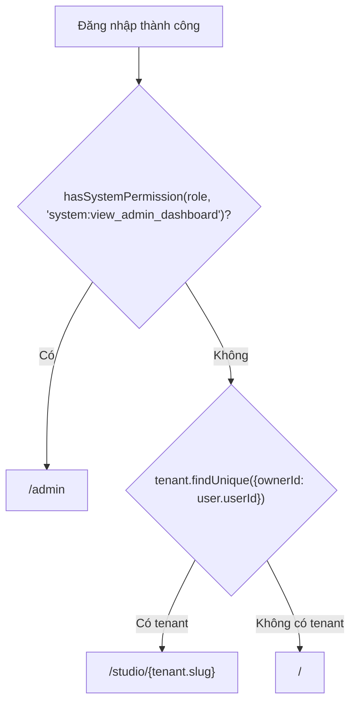

---
tags:
  - spec
  - rbac
  - security
  - status/living
date: 2026-09-26
updated: 2026-11-26
author: System Architect
---

# 📐 Đặc Tả: Phân Quyền Hệ Thống (Tenant RBAC & Permissions)

> Đổi tên từ `Branch-Scope-RBAC.md` — Gieo Chữ **không có** khái niệm chi nhánh/nhà hàng đa chi nhánh. Mô hình
> phân quyền thật gồm 3 lớp tài khoản độc lập (không chồng cấp) + bảng `Role`/`Permission` mới (ADR-022).

## 1. Mục Tiêu & Nguyên Tắc

Một `User` có thể **đồng thời** mang 3 vai trò độc lập — không phải 3 cấp role chồng nhau như hệ thống phân
cấp chi nhánh. Trang tham khảo chỉ-đọc trong sản phẩm thật: `/admin/roles`
(`apps/web/app/admin/roles/page.tsx`) trình bày đúng bảng này cho System Admin:

| Lớp | Bảng dữ liệu | Route | Ý nghĩa |
| :--- | :--- | :--- | :--- |
| **System** | `users.systemRole` | `/admin/*` | Quản trị toàn nền tảng |
| **Tenant** (trang `/admin/roles` ghi **"Gian hàng (tenant)"** từ ADR-071 ✅ code) | `tenant_members.role` | `/studio/[slug]/*` | Chủ gian hàng / nhân sự trong 1 gian hàng |
| **Customer** | `tenant_customers` (không có cột role) | `/account/*` | Người đã mua hàng ở 1+ gian hàng |

---

## 2. Hệ Thống Nhãn Định Danh (Role Labels — enum, không đổi thành FK)

### 2.1. Cấp System (`User.systemRole`, enum `SystemRole`)

```prisma
enum SystemRole { USER  SYSTEM_ADMIN }
```

- `USER`: mặc định cho mọi tài khoản đăng ký.
- `SYSTEM_ADMIN`: được vào `/admin/**`.
- `User.isSuperAdmin` (`Boolean`, bolt-on **ngoài** enum): duy nhất 1 admin do seed tạo — không admin nào khác
  (kể cả admin khác) có thể khoá tài khoản `isSuperAdmin=true` (xem [[User-Management-System-Center-Specs]]).

### 2.2. Cấp Tenant (`TenantMember.role`, enum `TenantMemberRole`)

```prisma
enum TenantMemberRole { OWNER  STAFF }

model TenantMember {
  tenantId String
  userId   String
  role     TenantMemberRole @default(OWNER)
  @@id([tenantId, userId])
}
```

- `OWNER`: chủ gian hàng — 1 `User` sở hữu **tối đa 1** `Tenant` (`Tenant.ownerId @unique`).
- `STAFF`: **có trong enum nhưng chưa vận hành được** — không có luồng nào trong code hiện tại tạo bản ghi
  `TenantMember` với `role = STAFF` (`createTenantForUser()` chỉ tạo `OWNER`).
  `canManageTenant(role)` (`packages/core`) chỉ trả `true` cho `OWNER` — nếu một ngày có STAFF thật, hàm này
  tự động từ chối họ cho tới khi được bổ sung logic phân quyền chi tiết. Đây là ghi chú thật từ
  [docs/GIEOCHU_TENANT_MODULE_STRUCTURE_V1.0.md](../../docs/GIEOCHU_TENANT_MODULE_STRUCTURE_V1.0.md) mục 10, không
  phải suy đoán.

### 2.3. Cấp Customer — không có bảng role riêng

`TenantCustomer` (`tenantId`, `userId`, `ordersCount`, `totalSpentVnd`...) chỉ là số liệu tổng hợp mỗi khi đơn
`PAID` — khách hàng không có "vai trò" nào để cấp/thu, chỉ có quan hệ "đã mua hàng của tenant X hay chưa".

---

## 3. Nguồn Sự Thật Thật Sự: `Role` / `Permission` / `RolePermission` (ADR-022)

**Bối cảnh phát sinh:** một bug thật — tài khoản chủ tenant đăng nhập bị redirect nhầm về trang chủ khách hàng
vì `login/page.tsx` cũ chỉ rẽ nhánh `role === "SYSTEM_ADMIN" ? "/admin" : "/"`, không biết user có sở hữu
tenant hay không. Thay vì sửa vá một hàm gộp tạm, đã thêm 3 bảng L1 mới làm nguồn sự thật cho "tier này được
làm gì":

```prisma
enum RoleScope { SYSTEM  TENANT }

model Role {
  id          String    @id @default(cuid(2))
  code        String    @unique   // "SYSTEM_ADMIN" | "TENANT_OWNER" | "TENANT_STAFF"
  scope       RoleScope
  name        String
  permissions RolePermission[]
}

model Permission {
  id    String @id @default(cuid(2))
  code  String @unique            // "system:view_admin_dashboard", "tenant:manage_products"...
  roles RolePermission[]
}

model RolePermission {
  roleId       String
  permissionId String
  @@id([roleId, permissionId])
}
```

**Quan trọng:** `SystemRole`/`TenantMemberRole` **không** bị đổi thành khoá ngoại trỏ vào `Role` — chúng vẫn là
nhãn định danh nhẹ trong JWT/DB như trước. `Role`/`Permission` là **lớp tra cứu song song**, ánh xạ 1-1 qua
`code` (`SYSTEM_ADMIN`, `TENANT_OWNER`, `TENANT_STAFF`). Lý do không đổi enum thành FK ngay: `SystemRole` chỉ
có 2 giá trị thật, chuẩn hoá thành bảng join sẽ buộc đổi shape JWT (`AccessTokenClaims.role`), chữ ký
`requireRole()`, và khoảng 54 call site cùng lúc — đi ngược nguyên tắc không over-engineer (xem ADR-022 trong
[docs/DECISIONS.md](../../docs/DECISIONS.md)).

### 3.1. Hàm kiểm tra quyền — `apps/web/lib/permissions.ts`

```ts
export async function hasSystemPermission(role: SystemRole, code: string): Promise<boolean>
export async function hasTenantPermission(role: TenantMemberRole, code: string): Promise<boolean>
```

Cả hai map nhãn (`SystemRole`/`TenantMemberRole`) sang `Role.code` đã seed, rồi tra `role_permissions`. Đọc
thẳng qua `getPrismaClient()` (bảng L1, không `tenantId`, không qua RLS) — đúng cách `apps/web/lib/tenant.ts`
đọc `Tenant`.

### 3.2. Điều hướng sau đăng nhập — `apps/web/lib/landing-path.ts`

```ts
export async function resolveLandingPath(user: { userId: string; role: SystemRole }): Promise<string>
```

Là nơi **duy nhất** quyết định "user này nên vào module nào" sau đăng nhập:



Luôn dựng đường dẫn Studio từ `tenant.slug` — **tuyệt đối không** dùng `user.userId` trong URL. Route đăng nhập
trả thêm `landingPath` trong response, trang login dùng trực tiếp thay vì tự suy diễn theo role.
**Chưa resolve cho STAFF** — vì hiện chưa có luồng nào tạo row `TenantMember` role `STAFF` thật.

---

## 4. Cơ Chế Guard — 3 Tầng, Không Có Middleware Tập Trung

`proxy.ts` chỉ gắn `x-request-id` + CSP nonce — **không** gác quyền. Mỗi Server Component/Server
Action/Route Handler tự gọi đúng 1 trong các guard sau (`apps/web/lib/`):

| Hàm | File | Dùng cho | Hành vi khi sai quyền |
| :--- | :--- | :--- | :--- |
| `requireTenantMember(slug, role?)` | `lib/tenant.ts` | Server Action | Chưa login → lỗi unauthorized; slug không tồn tại → 404; không phải OWNER → 403 |
| `requireTenantMemberPage(slug, nextPath)` | `lib/page-guards.ts` | Server Component | Chưa login → redirect `/login`; **mọi lỗi khác (403 lẫn 404) đều thành `notFound()`** — không lộ trang có tồn tại hay không cho non-member |
| `requireAdminAccess(nextPath)` | `lib/page-guards.ts` | Server Component `/admin/**` | Chưa login → redirect `/login`; không phải `SYSTEM_ADMIN` → `notFound()` |
| `requireRole(SYSTEM_ADMIN)` | dùng trong Route Handler/Server Action | API/Action nhạy cảm | Ném `AppError` 403 (không redirect — đúng cho API) |
| `requireVerifiedAccess(nextPath)` | `lib/page-guards.ts` | Storefront/checkout | Chưa login → redirect `/login`; chưa xác minh email → redirect `/verify-email` |

**Lưu ý kỹ thuật đã từng gây lỗi thật (M2):** `/admin` từng trả 500 vì dùng nhầm `requireRole` (ném lỗi, đúng
cho API/Action) trong Server Component thay vì `requireAdminAccess` (redirect). `requireTenantMember` tra
`TenantMember` **qua `withTenant()`** chứ không phải plain query — nếu không set `app.tenant_id` trước, RLS
trên `tenant_members` sẽ filter mất luôn bản ghi của chính owner hợp lệ (bug thật gặp ở M4).

---

## 5. Việc Chưa Làm Trong Đợt Bổ Sung RBAC (ADR-022) — Ghi Rõ Để Không Nhầm Là Đã Xong

- Chưa migrate 54 call site hiện có (`requireRole`/`requireAdminAccess`/`requireTenantMember`/
  `requireTenantMemberPage`) sang gọi permission-code trực tiếp — các guard này vẫn hoạt động như cũ.
- Chưa có UI chỉnh ma trận quyền cho `STAFF` (chỉ seed một tập khởi đầu:
  `tenant:access_studio`/`manage_products`/`manage_orders`).
- Chưa có luồng mời `STAFF`/tạo row `TenantMember` role `STAFF` thật.
- Chưa resolve `landingPath` cho `STAFF` (vì chưa có row thật để resolve).
- RBAC là lớp tách biệt, chạy song song RLS — **không thay thế** RLS (`withTenant`/`withCustomer`/
  `withPublic`/`withSystemJob`), xem [[Architecture-Overview]].

---

## 6. Tài Liệu Tham Chiếu & Liên Kết

* [[Architecture-Overview]] — 3 tầng dữ liệu và cơ chế RLS ([Architecture-Overview.md](./Architecture-Overview.md))
* [[User-Management-System-Center-Specs]] — Quản trị người dùng ở `/admin/users` ([User-Management-System-Center-Specs.md](./User-Management-System-Center-Specs.md))
* [docs/GIEOCHU_TENANT_MODULE_STRUCTURE_V1.0.md](../../docs/GIEOCHU_TENANT_MODULE_STRUCTURE_V1.0.md) — mục 4 (Guard) và mục 10
* [docs/DECISIONS.md](../../docs/DECISIONS.md) — ADR-022 (RBAC), ADR-008 (hồ sơ người dùng)
* Mã nguồn: `apps/web/lib/permissions.ts`, `apps/web/lib/landing-path.ts`, `apps/web/lib/page-guards.ts`,
  `apps/web/lib/tenant.ts`, `packages/db/prisma/schema.prisma` (`Role`/`Permission`/`RolePermission`)
