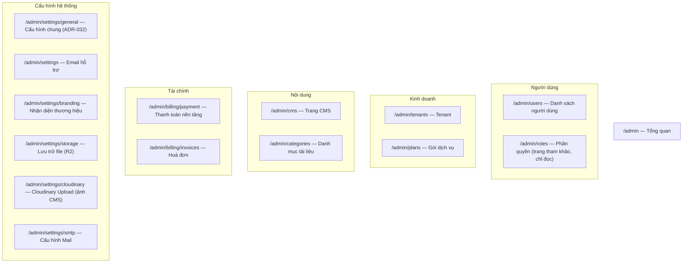
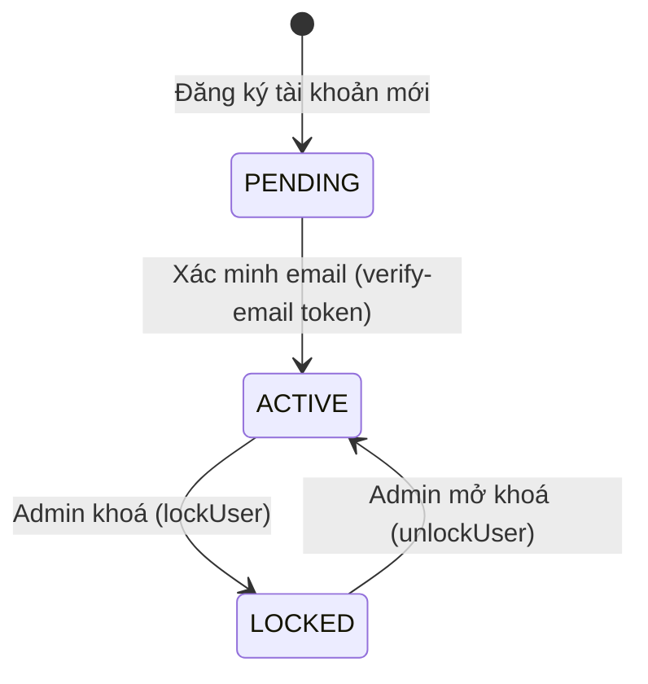

---
tags:
  - spec
  - admin
  - system-admin
  - security
  - status/living
date: 2026-09-26
updated: 2026-10-15
author: System Architect
---

# 📐 Đặc Tả: System Center — Console Quản Trị Nền Tảng (System Admin Specs)

> Phạm vi: file này không mô tả "phiên đăng nhập đa thiết bị" (Gieo Chữ không có `SessionRecord`/multi-device
> session — xem mục 4). Nội dung thật là toàn bộ console `/admin/**`
> ("System Center" theo cách gọi trong `docs/ARCHITECTURE.md`) mà System Admin dùng để vận hành nền tảng.

## 1. Mục Tiêu & Ranh Giới Tuyệt Đối

System Admin quản trị **toàn nền tảng** (người dùng, gói dịch vụ, thanh toán platform, nội dung CMS, cấu hình
hệ thống) nhưng có một ranh giới bảo mật **không được phá vỡ** (CLAUDE.md §7.9, đã xác nhận qua rà soát mã
nguồn khu vực `/admin`):

> **System Admin không có route nào đọc chi tiết `orders`/`order_items`/`tenant_customers` của một tenant cụ
> thể.** Dashboard/thống kê phía Admin chỉ đọc `tenant_daily_stats` (bảng tổng hợp, chưa xây — M12) và các
> bảng L1 (`User`, `Plan`, `Subscription`, `SubscriptionInvoice`, `PlatformPaymentTransaction`...).

Nói cách khác, System Admin không phải người xem đơn hàng của tenant — ở Gieo Chữ, dữ
liệu kinh doanh của một gian hàng là riêng tư giữa Tenant Owner và khách hàng của họ.

---

## 2. Điều Hướng Thật Của `/admin/**` (`AdminSidebarNav`)

Lấy trực tiếp từ `apps/web/app/admin/_ui/sidebar-nav.tsx` — nguồn sự thật duy nhất cho "System Center có gì":



Mọi trang trong `/admin/**` đều tự gọi `requireAdminAccess(nextPath)` (`lib/page-guards.ts`) — chưa đăng nhập
→ redirect `/login`; đăng nhập nhưng không phải `SYSTEM_ADMIN` → `notFound()` (404, không lộ thông tin trang
có tồn tại).

---

## 3. Quản Lý Người Dùng & Khoá Tài Khoản (`/admin/users`)

### 3.1. Vòng đời trạng thái tài khoản (`UserStatus`)

```prisma
enum UserStatus { PENDING  ACTIVE  LOCKED }
```



### 3.2. `lockUser`/`unlockUser` (`apps/web/lib/admin-users.ts`)

- **Ràng buộc bất biến:** không admin nào — kể cả admin khác — có thể khoá tài khoản có `isSuperAdmin = true`.
  Đây là "một admin duy nhất nobody có thể khoá" (comment gốc trong schema, mục §"M2").
- Khoá/mở khoá không xoá dữ liệu, chỉ đổi `UserStatus` — tài khoản `LOCKED` bị chặn đăng nhập ở API login.

### 3.3. Chống brute-force mật khẩu (khác cơ chế "phiên đăng nhập")

Không có bảng `SessionRecord` đa thiết bị trong Gieo Chữ. Cơ chế bảo mật đăng nhập thật dựa trên 2 cột trên
`User`:

- `failedLoginAttempts`: đếm liên tiếp số lần sai mật khẩu (chỉ khi email tồn tại thật) — về 0 khi đăng nhập
  thành công hoặc đặt lại mật khẩu thành công.
- `passwordResetRequired`: `true` khi `failedLoginAttempts` chạm ngưỡng 5 — chặn đăng nhập (**kể cả đúng mật
  khẩu**) cho tới khi người dùng tự đặt lại qua `/forgot-password`. Không liên quan `UserStatus` (đó là khoá
  admin/email chưa xác minh — hai concern khác nhau).

---

## 4. Bảo Mật Phiên Đăng Nhập — Cơ Chế Thật (Refresh Token Rotation, Không Phải Multi-Device Session)

Gieo Chữ dùng **rotation + family revocation** trên `RefreshToken` (`packages/auth/src/tokens/refresh-token.ts`),
không có bảng `SessionRecord` liệt kê từng thiết bị:

- Mỗi lần refresh, token cũ bị thay bằng token mới **cùng `familyId`** (`replacedById` trỏ tới token kế tiếp).
- **Phát hiện tái sử dụng token đã bị thay (reuse detection):** nếu một token đã `replacedById` bị dùng lại
  (dấu hiệu token bị đánh cắp), toàn bộ `familyId` bị revoke — chặn luôn mọi refresh tiếp theo trong cùng
  chuỗi.
- Chỉ lưu **hash SHA-256** của refresh token (`tokenHash`), không bao giờ lưu token gốc (CLAUDE.md §7.2).
- Access/refresh token chỉ trong cookie `httpOnly`, `Secure` (prod), `SameSite=Lax`; refresh cookie
  `Path=/api/auth`.

---

## 5. Các Module Còn Lại Của System Center (Tham Khảo Nhanh)

| Khu vực | Chức năng chính | Lib/route chính |
| :--- | :--- | :--- |
| `/admin/plans` | CRUD gói dịch vụ, `isFree`/`features` JSON | `createPlanAction`/`updatePlanAction`, `packages/core/src/admin/plan-validation.ts` |
| `/admin/tenants` | `lockTenantAction`/`unlockTenantAction` (`TenantStatus.LOCKED` ↔ `ACTIVE`) — **không** đọc order/customer của tenant | `apps/web/app/admin/tenants/actions.ts` |
| `/admin/cms` | CRUD trang CMS marketing, `blocksDraft` (nháp) tách khỏi `blocks` (live). Trang chủ (`slug=home`) dùng schema riêng `homeSectionsSchema`; từ ADR-033 bốn section `stats`/`search`/`coaches`/`documents` lấy dữ liệu thật, CMS chỉ lưu nhãn/`limit`/id ghim (ô chọn ghim `PinPicker`) | `packages/core/src/admin/cms-blocks.ts`, `packages/core/src/admin/home-sections.ts`, `apps/web/lib/home.ts` — xem [[01-Architecture-Decisions/ADR-019-Home-Page-Real-Data-Sold-Count|ADR-019 (≙ ADR-033)]] |
| `/admin/categories` | Danh mục tài liệu (metadata sản phẩm, không phải dữ liệu riêng tư của tenant) | `apps/web/app/admin/categories/*` |
| `/admin/billing/payment` | Cấu hình `PlatformPaymentConfig` (Manual QR/SePay/MoMo) | xem [[Payment-And-Billing]] |
| `/admin/billing/invoices` | Duyệt `SubscriptionInvoice` chuyển khoản thủ công | `subscription-billing.ts` |
| `/admin/settings/general` | (ADR-032) "Cấu hình chung": 10 khoá đang dùng của `SystemSettings` (TTL access/refresh, hạn link xác minh/đặt lại mật khẩu, hạn presign tải lên/tải xuống, ân hạn, đơn/hoá đơn chờ, lượt tải mặc định) — có giới hạn, chỉ áp cho thao tác mới; `trialDays` lưu nhưng ẩn (chưa dùng — ADR-021) | `apps/web/lib/system-settings.ts`, `updateSystemSettingsAction`; xem [[01-Architecture-Decisions/ADR-018-System-Settings-And-Brand-From-System-Center|ADR-018 (≙ ADR-032)]] |
| `/admin/settings` | Chỉ còn **Email hỗ trợ** (`SystemSettings.supportEmail`) | `updateSupportEmailAction` (`app/admin/settings/actions.ts`) |
| `/admin/settings/branding` | `SystemBranding` — nguồn **duy nhất** của tên thương hiệu/slogan (ADR-032; trống → `DEFAULT_BRAND`), logo, màu | `apps/web/lib/branding.ts` (`getEffectiveBrand`) |
| `/admin/settings/storage` | `SystemStorageConfig` (R2 credential mã hoá) | xem [[File-Storage-And-Downloads-Specs]] |
| `/admin/settings/smtp` | Cấu hình gửi mail (SMTP) — nguồn production; env email chỉ là fallback dev (ADR-032). Thiếu cả hai → `EMAIL_NOT_CONFIGURED` | `packages/email`, `apps/web/lib/email-dispatch.ts` |
| `/admin/roles` | Trang **chỉ đọc**, giải thích 3 lớp tài khoản (System/Tenant/Customer) | xem [[Tenant-RBAC-And-Permissions]] |

`getSystemRoleCounts()`/`getTenantOwnerCount()` (`apps/web/lib/admin-roles.ts`) là ví dụ đúng chuẩn: đếm số
lượng theo vai trò (aggregate), không bao giờ trả về danh sách đơn hàng/khách hàng chi tiết của một tenant.

---

## 6. Tài Liệu Tham Chiếu & Liên Kết

* [[Architecture-Overview]] — Ranh giới L1 System vs L2 Tenant ([Architecture-Overview.md](./Architecture-Overview.md))
* [[Tenant-RBAC-And-Permissions]] — `SystemRole`, `isSuperAdmin`, `Role`/`Permission` ([Tenant-RBAC-And-Permissions.md](./Tenant-RBAC-And-Permissions.md))
* [[Payment-And-Billing]] — `PlatformPaymentConfig`, hoá đơn subscription ([Payment-And-Billing.md](./Payment-And-Billing.md))
* CLAUDE.md §7.9 — nguyên tắc "System admin không có route nào đọc chi tiết đơn hàng/khách hàng của tenant"
* Mã nguồn: `apps/web/lib/admin-users.ts`, `apps/web/lib/admin-roles.ts`, `apps/web/lib/page-guards.ts`,
  `apps/web/app/admin/_ui/sidebar-nav.tsx`, `packages/auth/src/tokens/refresh-token.ts`,
  `packages/db/prisma/schema.prisma` (`User`, `UserStatus`, `RefreshToken`)
