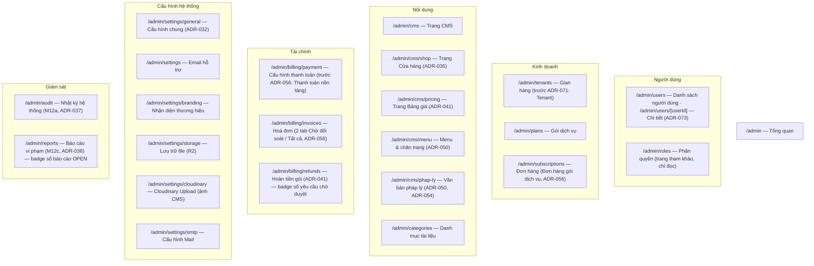
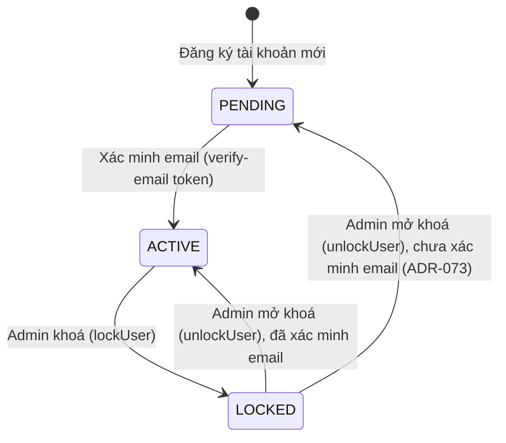

---
tags:
  - spec
  - admin
  - system-admin
  - security
  - status/living
date: 2026-09-26
updated: 2026-11-26
author: System Architect
---

# 📐 Đặc Tả: System Center — Console Quản Trị Nền Tảng (System Admin Specs)

> Phạm vi: file này không mô tả "phiên đăng nhập đa thiết bị" (Gieo Chữ không có `SessionRecord`/multi-device
> session — xem mục 4). Nội dung thật là toàn bộ console `/admin/**`
> ("System Center" theo cách gọi trong `docs/ARCHITECTURE.md`) mà System Admin dùng để vận hành nền tảng.

## 1. Mục Tiêu & Ranh Giới Tuyệt Đối

System Admin quản trị **toàn nền tảng** (người dùng, gói dịch vụ, thanh toán platform, nội dung CMS, cấu hình
hệ thống) nhưng có một ranh giới bảo mật **không được phá vỡ** (CLAUDE.md §7.9, đã xác nhận qua rà soát mã
nguồn khu vực `/admin`):

> **System Admin không có route nào đọc chi tiết `orders`/`order_items`/`tenant_customers` của một tenant cụ
> thể.** Dashboard/thống kê phía Admin chỉ đọc `tenant_daily_stats` (bảng tổng hợp M12b — section "Hoạt động bán tài liệu (30 ngày)" trên `/admin`,
> [[02-System-Specs/Tenant-Stats-Specs|Tenant-Stats-Specs]]; xong code 2026-10-16, đã commit `36103fb`, deploy ❓) và các
> bảng L1 (`User`, `Plan`, `Subscription`, `SubscriptionInvoice`, `PlatformPaymentTransaction`...).

Nói cách khác, System Admin không phải người xem đơn hàng của tenant — ở Gieo Chữ, dữ
liệu kinh doanh của một gian hàng là riêng tư giữa Tenant Owner và khách hàng của họ.

---

## 2. Điều Hướng Thật Của `/admin/**` (`AdminSidebarNav`)

Lấy trực tiếp từ `apps/web/app/admin/_ui/sidebar-nav.tsx` (mảng `ADMIN_STANDALONE` + `ADMIN_GROUPS`, đối chiếu 2026-10-17, cập nhật 2026-10-25 theo ADR-056 ✅) — nguồn sự thật duy
nhất cho "System Center có gì". Từ ADR-042 menu dựng bằng `SidebarNav` **dùng chung với Studio** (accordion 1 nhóm mở, nhớ nhóm ở
`localStorage` `admin:nav:expanded`), nằm trong `AppSidebarPanel` có nút **Đăng xuất** cố định đáy (về `/login`); dưới `lg` mở bằng nút ☰
(drawer `<dialog>`). Header có menu tài khoản (họ tên + avatar, cũng có Đăng xuất). Chi tiết giao diện:
[[04-Operations-Runbooks/UI-Design-System|UI-Design-System]] §5.1 · quyết định [[01-Architecture-Decisions/ADR-028-Shared-App-Sidebar-Logout-Mobile-Drawer|ADR-028 KB (≙ ADR-042)]].



Mọi trang trong `/admin/**` đều tự gọi `requireAdminAccess(nextPath)` (`lib/page-guards.ts`) — chưa đăng nhập
→ redirect `/login`; đăng nhập nhưng không phải `SYSTEM_ADMIN` → `notFound()` (404, không lộ thông tin trang
có tồn tại).

---

## 3. Quản Lý Người Dùng & Khoá Tài Khoản (`/admin/users`)

### 3.1. Vòng đời trạng thái tài khoản (`UserStatus`)

```prisma
enum UserStatus { PENDING  ACTIVE  LOCKED }
```



### 3.2. `lockUser`/`unlockUser` (`apps/web/lib/admin-users.ts`)

- **Ràng buộc bất biến:** không admin nào — kể cả admin khác — có thể khoá tài khoản có `isSuperAdmin = true`.
  Đây là "một admin duy nhất nobody có thể khoá" (comment gốc trong schema, mục §"M2").
- Khoá/mở khoá không xoá dữ liệu, chỉ đổi `UserStatus` — tài khoản `LOCKED` bị chặn đăng nhập ở API login.
- **Chữ ký (ADR-073, ✅ đối chiếu code 2026-11-26):** `lockUser(actor, targetUserId, rawReason)` và `unlockUser(actor, targetUserId, rawReason)` — lý do **bắt buộc**, ≤ 500 ký tự sau trim (`USER_LOCK_REASON_MAX_LENGTH`). Khoá cũng thu hồi mọi phiên.
- **Audit (ADR-073):** `USER_LOCKED` `{ reason, previousStatus, revokedSessions, emailSent }`; `USER_UNLOCKED` `{ reason, newStatus, emailSent }`. Bản ghi trước ADR-073 không có `reason`/`emailSent`. Xem [[02-System-Specs/Audit-Log-Specs|Audit-Log-Specs]] §4 và [[01-Architecture-Decisions/ADR-057-User-Detail-Account-Actions-Session-Guard|ADR-057 KB (≙ ADR-073)]].

### 3.3. Chống brute-force mật khẩu (khác cơ chế "phiên đăng nhập")

Không có bảng `SessionRecord` đa thiết bị trong Gieo Chữ. Cơ chế bảo mật đăng nhập thật dựa trên 2 cột trên
`User`:

- `failedLoginAttempts`: đếm liên tiếp số lần sai mật khẩu (chỉ khi email tồn tại thật) — về 0 khi đăng nhập
  thành công hoặc đặt lại mật khẩu thành công.
- `passwordResetRequired`: `true` khi `failedLoginAttempts` chạm ngưỡng 5 — chặn đăng nhập (**kể cả đúng mật
  khẩu**) cho tới khi người dùng tự đặt lại qua `/forgot-password`. Không liên quan `UserStatus` (đó là khoá
  admin/email chưa xác minh — hai concern khác nhau).

### 3.4. Chính sách: không xoá user, chỉ khoá (chủ dự án chốt 2026-10-23 — "Bổ sung ADR-050" (a))

- Người dùng vi phạm hoặc ngừng dùng **chỉ bị khoá** (deactivate — `UserStatus = LOCKED`, chặn thao tác, **giữ nguyên dữ liệu**) để tránh xoá nhầm.
  Không có luồng nghiệp vụ nào xoá dòng `users` ✅ grep `apps/web` (2026-10-23): ngoài test chỉ có script **dev** `apps/web/scripts/demo-reviews.ts`
  (`demo:clean`, xoá đúng các email demo — [[04-Operations-Runbooks/Dev-Demo-Data-Runbook|Dev-Demo-Data-Runbook]]).
- FK `ON DELETE CASCADE` từ bảng con tới `users` (vd `user_legal_acceptances`, ADR-050) chỉ phục vụ dọn dữ liệu test, **không** phải đường nghiệp vụ.
- Hạng mục "xoá tài khoản" trong giai đoạn pháp lý (hoãn ở ADR-050) phải có ADR riêng và không được mâu thuẫn chính sách này mà không có quyết định
  mới của chủ dự án. Xem [[01-Architecture-Decisions/ADR-035-Menu-Home-Seo-Versioned-Terms|ADR-035 KB (≙ ADR-050)]].

### 3.5. Trang chi tiết và thao tác quản trị tài khoản (ADR-073 — KB ADR-057)

> Mức xác minh: ✅ đối chiếu code working tree 2026-11-26 (chưa commit) · ❓ chưa thử trên trình duyệt, chưa gửi SMTP thật.

**Danh sách `/admin/users`:** cột "Người dùng" gộp tên và email (link tới chi tiết); menu "⋯" (`UserRowActions`, Popover API) gồm
"Xem chi tiết", "Khoá/Mở khoá…", "Gửi lại email kích hoạt…" (chỉ khi `PENDING`). Nhãn vai trò (`user-labels.ts`): Siêu quản trị ·
Quản trị viên · Chủ gian hàng · Người dùng. Ô tìm kiếm (placeholder "Tìm theo tên hoặc email...") lọc theo **email HOẶC họ tên** (`user_profiles.fullName`; `contains`, không phân biệt
hoa thường) ✅ code (ADR-074 mục 2, 2026-11-27). **Không tìm theo SĐT** (chủ dự án chốt: tránh dò số né audit "Hiện đầy đủ" ADR-073). (Trước đó placeholder ghi "tên, email, SĐT"
nhưng truy vấn chỉ lọc email — đã sửa, [[00-Index/KB-Audit-2026-09-26|KB-Audit]] §56 mục 4, §57.)

**Trang `/admin/users/[userId]`** (`requireAdminAccess`; không có người dùng → 404). Các mục:

- **Hồ sơ & tài khoản** (luôn có): SĐT che (`09•••••123`) + nút "Hiện đầy đủ" (`PhoneField`); tỉnh/thành và nghề nghiệp hiện bình thường.
- **Bảo mật & phiên đăng nhập:** IP phiên che — IPv4 giữ 2 nhóm đầu (`113.161.•••.•••`), IPv6 giữ 2 nhóm đầu (`2001:db8:•••`).
- **Gian hàng sở hữu:** chỉ dữ liệu L1 của gian hàng; **không** có đơn, thư viện, khách (§7.9).
- **Điều khoản đã đồng ý:** mới nhất trước, giờ Việt Nam.
- **Nhật ký:** allowlist `USER_AUDIT_ACTIONS` trên chính tài khoản (`tenantId IS NULL`), không đưa IP/User-Agent của request.
  - 6 action quản trị: `USER_LOCKED`, `USER_UNLOCKED`, `USER_SESSIONS_REVOKED`, `USER_PASSWORD_RESET_REQUIRED`, `USER_PHONE_VIEWED`, `USER_VERIFICATION_RESENT`.
  - 6 action tự thân: `AUTH_LOGIN_FAILED`, `AUTH_REFRESH_REUSE`, `AUTH_PASSWORD_CHANGED`, `AUTH_EMAIL_CHANGE_REQUESTED`, `AUTH_EMAIL_CHANGED`, `AUTH_GUEST_ACTIVATED`.
  - Loại `AUTH_LOGIN` và `AUTH_GUEST_ACCOUNT_CREATED` (gắn với một lần mua ở gian hàng).

**Xem số điện thoại đầy đủ** (`revealUserPhone`): server ghi `USER_PHONE_VIEWED` **trước** khi trả số; ghi audit lỗi → 503 `AUDIT_WRITE_FAILED`, không trả số. Giới hạn 30 lần/phút/quản trị viên (bộ đếm DB). Số đầy đủ không có trong HTML ban đầu.

**Bốn thao tác** (hộp xác nhận chung, lý do bắt buộc ở khoá/mở khoá). Không thao tác được với siêu quản trị hay chính mình (`lockBlocked` = `SUPER_ADMIN` | `SELF`):

| Thao tác | Điều kiện & hành vi (server) | Audit | Email |
| :-- | :-- | :-- | :-- |
| **Khoá** | Lý do ≤ 500 ký tự sau trim; đã `LOCKED` → 409 `USER_ALREADY_LOCKED`; thu hồi mọi phiên | `USER_LOCKED` `{ reason, previousStatus, revokedSessions, emailSent }` | `user_locked` (kèm lý do) |
| **Mở khoá** | Lý do như trên; không `LOCKED` → 409 `USER_NOT_LOCKED`; về `PENDING` nếu chưa xác minh email, `ACTIVE` nếu đã xác minh | `USER_UNLOCKED` `{ reason, newStatus, emailSent }` | `user_unlocked` (kèm lý do) |
| **Đăng xuất mọi thiết bị** | Thu hồi mọi phiên còn hiệu lực; không có phiên → 409 `USER_NO_ACTIVE_SESSIONS` | `USER_SESSIONS_REVOKED` `{ revokedSessions }` | Không |
| **Yêu cầu đặt lại mật khẩu** | Chỉ khi `ACTIVE` (409 `USER_NOT_ACTIVE`); bật `passwordResetRequired`; thu hồi mọi phiên; token `PASSWORD_RESET` (chỉ lưu hash); 5 lần/giờ/email, bộ đếm **trong bộ nhớ**, cùng key `forgot-password:<email>` | `USER_PASSWORD_RESET_REQUIRED` `{ revokedSessions, emailSent }` (không có `reason`) | Đặt lại mật khẩu, đoạn mở đầu "quản trị viên đã yêu cầu". Người dùng khi đăng nhập thấy: "Tài khoản của bạn cần đặt lại mật khẩu trước khi đăng nhập. Vui lòng dùng liên kết trong email chúng tôi đã gửi hoặc chọn "Quên mật khẩu"." (HTTP 403, mã `PASSWORD_RESET_REQUIRED`; ADR-057 KB §2.6) |
| **Gửi lại email kích hoạt** | Chỉ khi `PENDING` (400 `NOT_PENDING`); 1 lần/60 giây/người dùng (bộ đếm DB) | `USER_VERIFICATION_RESENT` `{ emailSent: true }` | Kích hoạt tài khoản |

Audit ghi sau khi gửi email, cùng mức chấp nhận như ADR-037: lỗi gửi chỉ log và trả `emailSent: false`.

**Email người dùng** (`packages/email/src/templates/user-lock.ts`, `renderUserLockedEmail` / `renderUserUnlockedEmail`):

| Loại | Tiêu đề | Ghi chú |
| :-- | :-- | :-- |
| `user_locked` | `Tài khoản của bạn đã bị khoá — {tên ứng dụng}` | Lý do quản trị viên nhập |
| `user_unlocked` | `Tài khoản của bạn đã được mở khoá — {tên ứng dụng}` | Lý do quản trị viên nhập |
| Đặt lại mật khẩu, biến thể `requestedByAdmin` | Khuôn "Quên mật khẩu" (`reset-password.ts`) | Đoạn mở đầu nêu quản trị viên đã yêu cầu, không nêu tên |

Gửi qua `sendEmailNow` (`apps/web/lib/email-dispatch.ts`) → ghi `email_send_log`. Hiện chưa có trang spec email riêng cho người dùng; danh mục email gửi chủ gian hàng ở [[02-System-Specs/Payment-And-Billing|Payment-And-Billing]] §5S không bao gồm nhóm này.

Liên kết: [[01-Architecture-Decisions/ADR-057-User-Detail-Account-Actions-Session-Guard|ADR-057 KB]] · [[03-API-Contracts/Endpoint-Directory|Endpoint-Directory]] §37 · [[04-Operations-Runbooks/UI-Design-System|UI-Design-System]] §29 · guard phiên [[02-System-Specs/Auth-Session-Specs|Auth-Session-Specs]] §9B.

---

## 4. Bảo Mật Phiên Đăng Nhập — Cơ Chế Thật (Refresh Token Rotation)

> [!note] Cập nhật ADR-053 (2026-10-24) ✅ code
> Từ ADR-053 mỗi `familyId` được dùng như **một phiên/thiết bị** (cột `rememberMe`, `sessionStartedAt`, `deviceLabel`): danh sách thiết bị + đăng xuất từng
> phiên ở `/account/security`, idle/absolute timeout đo ở server, "Ghi nhớ đăng nhập", ân hạn 30 giây cho refresh đồng thời (`AUTH_REFRESH_SUPERSEDED`),
> rotation nguyên tử, refresh từ chối user không `ACTIVE`. Vẫn **không** có bảng `SessionRecord` riêng. Chi tiết: [[02-System-Specs/Auth-Session-Specs|Auth-Session-Specs]].

> [!note] Cập nhật ADR-073 mục 9 (2026-11-26) ✅ code
> Khu vực nhạy cảm (System Center, Studio, checkout, tải tài liệu qua bước 1) đối chiếu trạng thái thật trong DB: tài khoản `LOCKED` → 401 `ACCOUNT_LOCKED`; phiên đã thu hồi → 401 `SESSION_REVOKED`. Chi tiết: [[02-System-Specs/Auth-Session-Specs|Auth-Session-Specs]] §9B.

Gieo Chữ dùng **rotation + family revocation** trên `RefreshToken` (`packages/auth/src/tokens/refresh-token.ts`),
không có bảng `SessionRecord` riêng:

- Mỗi lần refresh, token cũ bị thay bằng token mới **cùng `familyId`** (`replacedById` trỏ tới token kế tiếp).
- **Phát hiện tái sử dụng token đã bị thay (reuse detection):** nếu một token đã `replacedById` bị dùng lại
  (dấu hiệu token bị đánh cắp), toàn bộ `familyId` bị revoke — chặn luôn mọi refresh tiếp theo trong cùng
  chuỗi. *Ngoại lệ từ ADR-053:* token bị thay chưa quá 30 giây (race nhiều tab) → `superseded`, không revoke.
- Chỉ lưu **hash SHA-256** của refresh token (`tokenHash`), không bao giờ lưu token gốc (CLAUDE.md §7.2).
- Access/refresh token chỉ trong cookie `httpOnly`, `Secure` (prod), `SameSite=Lax`; refresh cookie
  `Path=/api/auth`.

---

## 5. Các Module Còn Lại Của System Center (Tham Khảo Nhanh)

| Khu vực | Chức năng chính | Lib/route chính |
| :--- | :--- | :--- |
| `/admin/plans` | CRUD gói dịch vụ, `isFree`/`features` JSON | `createPlanAction`/`updatePlanAction`, `packages/core/src/admin/plan-validation.ts` |
| `/admin/tenants` | Danh sách gian hàng: tên là link tới trang chi tiết, cột "GMV / 30 ngày" (từ ADR-072 — `adminStatsWindow`, `tenant_daily_stats`, thay chữ "Cần M12"), menu "⋯" → "Xem chi tiết" + Khoá/Mở khoá. `lockTenantAction`/`unlockTenantAction` (`TenantStatus.LOCKED` ↔ `ACTIVE`, qua `lib/tenant-lock.ts` từ M12a/M12c; từ ADR-072 bắt buộc lý do ≤ 500 ký tự qua hộp xác nhận + email `tenant_locked`/`tenant_unlocked` cho chủ gian hàng) — **không** đọc order/customer của tenant. Trang chi tiết `/admin/tenants/[tenantId]` (ADR-072, KB ADR-056, ✅ code, chưa commit): đầu trang (badge, "Mở trang gian hàng" ẩn khi `LOCKED`, Khoá/Mở khoá), Notice `LOCKED`/`READ_ONLY`, 7 phần Thông tin · Chủ (`fullName` null → hiện email) · Gói (link `/admin/subscriptions/{id}`) · Phương thức thanh toán (chỉ tên cổng `provider` đang bật, ngoại lệ đọc L2 ADR-072 mục 2) · Số liệu kinh doanh (30 ngày đến hết hôm qua giờ VN + từ trước tới nay, từ `tenant_daily_stats`) · Nội dung & lưu trữ (thanh mức dùng, "Gần đầy" ≥ 90%) · Vi phạm (đếm OPEN/RESOLVED/REJECTED, 5 báo cáo gần nhất không có mô tả/email người báo, yêu cầu hoàn tiền quá hạn) · Nhật ký quản trị (≤ 50 dòng, 13 action cố định — không có action của khách/đơn) Từ ADR-039: badge "N hoàn tiền quá hạn" = **chỉ số đếm** yêu cầu hoàn tiền quá 7 ngày (`countOverdueRefundRequestsByTenant`), không id đơn/khách | `apps/web/app/admin/tenants/actions.ts`, `apps/web/lib/entitlement-remedy.ts` |
| `/admin/cms` | CRUD trang CMS marketing, `blocksDraft` (nháp) tách khỏi `blocks` (live). Trang chủ (`slug=home`) dùng schema riêng `homeSectionsSchema`; từ ADR-033 bốn section `stats`/`search`/`coaches`/`documents` lấy dữ liệu thật, CMS chỉ lưu nhãn/`limit`/id ghim (ô chọn ghim `PinPicker`) | `packages/core/src/admin/cms-blocks.ts`, `packages/core/src/admin/home-sections.ts`, `apps/web/lib/home.ts` — xem [[01-Architecture-Decisions/ADR-019-Home-Page-Real-Data-Sold-Count|ADR-019 (≙ ADR-033)]]. Từ ADR-050: thêm slug hệ thống `menu` (`/admin/cms/menu` — menu header/footer), trang chủ thêm section `steps`/`faq`/`community` + ô SEO, editor văn bản pháp lý `/admin/cms/phap-ly` — xem [[02-System-Specs/System-Cms-Menu-Home-Seo-Specs|System-Cms-Menu-Home-Seo-Specs]], [[02-System-Specs/Legal-Documents-Specs|Legal-Documents-Specs]] |
| `/admin/categories` | Danh mục tài liệu (metadata sản phẩm, không phải dữ liệu riêng tư của tenant) | `apps/web/app/admin/categories/*` |
| `/admin/billing/payment` | Menu "Cấu hình thanh toán" (trước ADR-056: "Thanh toán nền tảng"). Cấu hình `PlatformPaymentConfig` (Manual QR/SePay/MoMo); lưu báo rõ khi cổng bị tự tắt (ADR-013) | `savePlatformProviderConfig` → `{ isEnabled, autoDisabled }` — xem [[Payment-And-Billing]] §5E |
| `/admin/billing/invoices` | (ADR-056) Tab "Chờ đối soát" — duyệt `SubscriptionInvoice` MANUAL_QR PENDING; tab "Tất cả" — mọi hoá đơn gói, lọc trạng thái/cổng, phân trang; nút xác nhận chỉ ở dòng MANUAL_QR PENDING | `listPendingManualInvoices`, `listSubscriptionInvoices` (`subscription-billing.ts`) — [[Payment-And-Billing]] §5C |
| `/admin/subscriptions` | (ADR-056) "Đơn hàng gói dịch vụ" (menu Kinh doanh → Đơn hàng): thuê bao của mọi gian hàng, lọc gói/trạng thái, gói trả phí theo ngày hết hạn, gói miễn phí "Không thời hạn" xếp sau, hoá đơn gần nhất. Chỉ bảng L1 (§7.9) | `listSubscriptions`, `listPlanFilterOptions`, `parseEnumParam` (`subscription-billing.ts`) — [[Payment-And-Billing]] §5C |
| `/admin/settings/general` | (ADR-032) "Cấu hình chung": 15 khoá đang dùng của `SystemSettings` (TTL access, hạn link xác minh/đặt lại mật khẩu, hạn presign tải lên/tải xuống, ân hạn, đơn/hoá đơn chờ, lượt tải mặc định; từ ADR-053 thêm nhóm "Chính sách phiên đăng nhập" 6 khoá — áp cho cả phiên đang mở từ lần refresh kế tiếp, xem [[02-System-Specs/Auth-Session-Specs|Auth-Session-Specs]] §9) — có giới hạn; `trialDays` và (từ ADR-053) `refreshTokenTtlDays` lưu nhưng ẩn (không dùng) | `apps/web/lib/system-settings.ts`, `updateSystemSettingsAction`; xem [[01-Architecture-Decisions/ADR-018-System-Settings-And-Brand-From-System-Center|ADR-018 (≙ ADR-032)]] |
| `/admin/settings` | Chỉ còn **Email hỗ trợ** (`SystemSettings.supportEmail`) | `updateSupportEmailAction` (`app/admin/settings/actions.ts`) |
| `/admin/settings/branding` | `SystemBranding` — nguồn **duy nhất** của tên thương hiệu/slogan (ADR-032; trống → `DEFAULT_BRAND`), logo, màu | `apps/web/lib/branding.ts` (`getEffectiveBrand`) |
| `/admin/settings/storage` | `SystemStorageConfig` (R2 credential mã hoá) | xem [[File-Storage-And-Downloads-Specs]] |
| `/admin/settings/smtp` | Cấu hình gửi mail (SMTP) — nguồn production; env email chỉ là fallback dev (ADR-032). Thiếu cả hai → `EMAIL_NOT_CONFIGURED` | `packages/email`, `apps/web/lib/email-dispatch.ts` |
| `/admin/users` · `/admin/users/[userId]` | (ADR-073, KB ADR-057, ✅ code, chưa commit) Danh sách người dùng + menu "⋯"; trang chi tiết 5 mục (Hồ sơ, Bảo mật & phiên, Gian hàng sở hữu, Điều khoản, Nhật ký), SĐT/IP che, bốn thao tác khoá/mở khoá có lý do, đăng xuất mọi thiết bị, đặt lại mật khẩu, gửi lại kích hoạt — chỉ bảng L1 (§7.9). Xem §3.5 | `apps/web/app/admin/users/actions.ts`, `apps/web/lib/admin-users.ts`, `apps/web/lib/admin-user-detail.ts` |
| `/admin/roles` | Trang **chỉ đọc**, giải thích 3 lớp tài khoản (System/Tenant/Customer) | xem [[Tenant-RBAC-And-Permissions]] |
| `/admin/reports` | (M12c, ADR-038) Báo cáo vi phạm: danh sách lọc trạng thái (mặc định OPEN)/loại/đối tượng, chi tiết + xử lý (ẩn nội dung, lưu trữ tài liệu, khoá gian hàng, bác bỏ), gỡ khoá kiểm duyệt. Xem nội dung đối tượng, **không** xem đơn/khách (§7.9); email người báo cáo chỉ admin thấy | `apps/web/lib/abuse-report.ts`, `app/admin/reports/actions.ts` — xem [[02-System-Specs/Abuse-Reports-Specs\|Abuse-Reports-Specs]] |
| `/admin/audit` | (M12a, ADR-037) Nhật ký hệ thống: lọc người thực hiện, hành động, gian hàng, khoảng ngày; dòng của khách chỉ hiện email đã che, không IP/User-Agent (§7.9) | `apps/web/lib/audit-query.ts` (`listAuditLogs`) — xem [[02-System-Specs/Audit-Log-Specs\|Audit-Log-Specs]] |

`getSystemRoleCounts()`/`getTenantOwnerCount()` (`apps/web/lib/admin-roles.ts`) là ví dụ đúng chuẩn: đếm số
lượng theo vai trò (aggregate), không bao giờ trả về danh sách đơn hàng/khách hàng chi tiết của một tenant.

---

## 6. Tài Liệu Tham Chiếu & Liên Kết

* [[Architecture-Overview]] — Ranh giới L1 System vs L2 Tenant ([Architecture-Overview.md](./Architecture-Overview.md))
* [[Tenant-RBAC-And-Permissions]] — `SystemRole`, `isSuperAdmin`, `Role`/`Permission` ([Tenant-RBAC-And-Permissions.md](./Tenant-RBAC-And-Permissions.md))
* [[Payment-And-Billing]] — `PlatformPaymentConfig`, hoá đơn subscription ([Payment-And-Billing.md](./Payment-And-Billing.md))
* [[02-System-Specs/Auth-Session-Specs|Auth-Session-Specs]] — phiên đăng nhập, idle/absolute, "Ghi nhớ", danh sách thiết bị (ADR-053) ([Auth-Session-Specs.md](./Auth-Session-Specs.md))
* CLAUDE.md §7.9 — nguyên tắc "System admin không có route nào đọc chi tiết đơn hàng/khách hàng của tenant"
* Mã nguồn: `apps/web/lib/admin-users.ts`, `apps/web/lib/admin-roles.ts`, `apps/web/lib/page-guards.ts`,
  `apps/web/app/admin/_ui/{sidebar-nav,app-sidebar,sidebar-drawer}.tsx`, `apps/web/app/admin/layout.tsx`, `packages/auth/src/tokens/refresh-token.ts`,
  `packages/db/prisma/schema.prisma` (`User`, `UserStatus`, `RefreshToken`)
