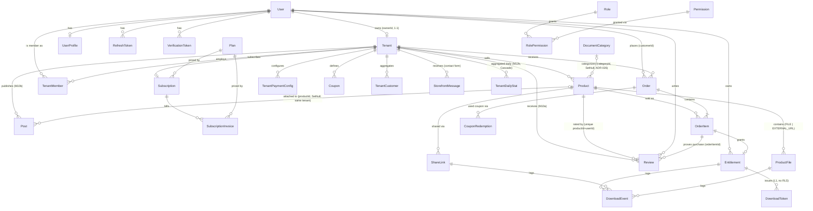

---
tags:
  - contract
  - database
  - schema
  - status/living
date: 2026-06-20
updated: 2026-11-25
author: System Architect
---

# 🔌 Hợp Đồng: Lược Đồ Dữ Liệu Prisma (Database Schema Reference)

> [!NOTE] Nguồn sinh tài liệu
> Danh mục §2–§3 được đối chiếu trực tiếp với `packages/db/prisma/schema.prisma` ngày 2026-09-26:
> **54 model + 35 enum** (`grep -c "^model " / "^enum "`, đếm lại 2026-11-25 ✅ — migration ADR-068 `20261125120000_adr068_order_hold_started_at` chỉ thêm cột `orders.holdStartedAt`; đếm 2026-11-24 — migration ADR-065 `20261124120000_adr065_order_payment_ref` chỉ thêm cột `orders.paymentRef` + unique index,
> không thêm model/enum; model thứ 54 là `ProductFilePreview` của ADR-063 — các dòng đếm "53" trước đây chưa cộng model này, KB-Audit §50). Trước đó: **53 model + 35 enum** đếm lại 2026-10-27 sau migration `20261026180000_adr061_purchase_flow` — +`RateLimitCounter`; enum chỉ thêm giá trị. Trước đó: **52 model + 35 enum** đếm 2026-10-24 sau migration ADR-053 bổ sung lần 3 — +`TenantEditorDraft`, +`SystemEditorDraft`, +`TenantEditorDraftEntity`, +`SystemEditorDraftEntity`; migration ADR-054 chỉ thêm cột; trước đó migration ADR-053 phiên đăng nhập — chỉ thêm cột, 50 model / 33 enum; trước đó 2026-10-23 sau migration ADR-050 — +`LegalDocument`, +`LegalDocumentVersion`, +`UserLegalAcceptance`, +`LegalDocumentVersionStatus`, +`LegalReviewStatus`; trước đó 2026-10-18 sau migration ADR-047 — +`OrderNote` (không thêm enum); trước đó 2026-10-17 sau 2 migration ADR-041 — +`SubscriptionRefundRequest`, +`SubscriptionRefundStatus`, giá trị enum `VerificationTokenType.EMAIL_CHANGE`, `SubscriptionInvoiceStatus.REFUNDED`; trước đó migration M12c/ADR-038 — +`AbuseReport`, +`AbuseTargetType`, +`AbuseReportType`, +`AbuseReportStatus`, +`AbuseReportDecision` — và ADR-039 — +`EntitlementRemedyStatus`; trước đó M12b/ADR-037 — +`TenantDailyStat` (không thêm enum); trước đó M12a — +`AuditLog`, +`AuditScope`; trước đó 2026-09-28 sau M10b/ADR-029 — +`Post`, +`PostStatus` (và giá trị enum `TenantMediaUsage.POST`); trước đó M10a +`Review`, +`ReviewStatus`, +`ReviewHiddenReason`; trước đó ADR-028 +`TenantMediaAsset`, +`TenantMediaUsage`; trước đó ADR-026/027 +`ProductFileSource`; trước đó +`StorefrontMessage`, +`StorefrontMessageStatus` ở Storefront CMS), mỗi model đều được phân loại theo layer L1/L2/L3
> (không sót). Danh sách bảng thật sự có RLS được đối chiếu với `packages/db/prisma/migrations/*_rls_*/migration.sql`
> (`ALTER TABLE ... ENABLE ROW LEVEL SECURITY`) — không suy đoán từ comment trong schema. Chi tiết field/kiểu/
> constraint: mở thẳng [schema.prisma](../../packages/db/prisma/schema.prisma), file này chỉ là bản đồ.

## 1. Nền Tảng CSDL

- **Hệ quản trị:** PostgreSQL trên Neon. **Migrate** dùng `PRISMA_MIGRATE_URL` (role owner, có quyền DDL, xem
  `prisma.config.ts`). **Runtime** dùng `DATABASE_URL` (pooled) qua `@prisma/adapter-neon`, kết nối bằng role
  **`gieochu_app`** — role riêng tạo bởi `packages/db/scripts/setup-app-role.mts`, **không phải** role owner
  Neon mặc định. Role owner có `BYPASSRLS` nên nếu app lỡ dùng role đó, mọi chính sách RLS ở §4 sẽ **vô hiệu**
  hoàn toàn (xem ADR-010, `docs/DECISIONS.md`) — đây là lý do tồn tại của role `gieochu_app`.
  - **Quyền `CREATE` trên database của `gieochu_app` đã bị thu hồi trên DB dùng chung** (chủ dự án chạy `REVOKE CREATE ON DATABASE
    neondb FROM gieochu_app` 2026-10-15, kiểm `has_database_privilege(..., 'CREATE') = false`) 🟡 (báo cáo Quốc). Script
    `setup-app-role.mts` nay cũng `REVOKE CREATE ON DATABASE` ✅ (đọc 2026-10-16 — đính chính bản trước ghi "vẫn `GRANT CREATE`"). Chi tiết + việc còn mở: [[04-Operations-Runbooks/Disaster-Recovery-Runbook|Disaster-Recovery-Runbook]] §4.
  - Extension/hàm ngoài Prisma: `unaccent` + `public.gieochu_unaccent(text)` (ADR-035, §7).
  - Quyền riêng: `audit_logs` — `gieochu_app` chỉ có `SELECT, INSERT, DELETE` (không UPDATE/TRUNCATE) + 3 trigger chỉ-INSERT (ADR-037, §7).
  - `tenant_daily_stats` (M12b) — quyền mặc định bảng L1 (`SELECT, INSERT, UPDATE, DELETE`, migration cấp lại tường minh), không RLS (ADR-037, §7).
- **ORM:** Prisma 7, `provider = "prisma-client"` (client tự sinh, không dùng `prisma-client-js` cũ), output
  `packages/db/src/generated/prisma`.
- **ID strategy:** **cuid2** cho mọi `@id` (`@default(cuid(2))`) — ADR-001, `docs/DECISIONS.md`. Không dùng
  UUID ở bất kỳ model nào.
- **Nguyên tắc truy cập:** `apps/web` không bao giờ `import` `@prisma/client` trực tiếp (chặn bằng ESLint
  `no-restricted-imports`) — chỉ qua helper của `@gieochu/db`:
  - `getPrismaClient()` — client thô, chỉ dùng cho bảng **L1** (không có `tenantId`).
  - `withTenant(tenantId, fn)` / `withCustomer(userId, fn)` / `withPublic(fn)` / `withSystemJob(fn)`
    (`packages/db/src/rls.ts`) — mở transaction có `SET LOCAL app.*` tương ứng, **bắt buộc** dùng cho mọi bảng
    **L2** có RLS (§4). Không có tầng "Store Factory" hay In-Memory Store nào ở giữa — route/Server Action gọi
    thẳng các helper này.

## 2. Sơ Đồ Quan Hệ Chính (ERD)

> Phân cấp thật: **`User` (chủ) 1-1 `Tenant`** (`Tenant.ownerId` unique — 1 user chỉ sở hữu 1 gian hàng ở MVP)
> **→ `Product` → `ProductFile`**. `Order` gắn cả `tenantId` **và** `customerId` (không qua bảng trung gian) —
> đơn hàng luôn thuộc 1 tenant cụ thể và 1 khách hàng cụ thể cùng lúc.

---

## 3. Danh Mục 54 Model Theo Layer

### 3.1. L1 — System (không `tenantId`, không RLS, truy cập qua `getPrismaClient()` thẳng)

| Model | Mục đích | Quan hệ tới | Enum |
| :-- | :-- | :-- | :-- |
| `User` | Tài khoản mọi actor (customer/tenant owner/system admin dùng chung 1 bảng, phân biệt bằng `systemRole`), khoá tạm sau 5 lần sai mật khẩu (`passwordResetRequired`) | UserProfile, RefreshToken, VerificationToken, Tenant (owner), TenantMember, Order, Entitlement, TenantCustomer, DownloadToken, DownloadEvent, UserLegalAcceptance (ADR-050, Cascade — chỉ dọn test; không xoá user, chỉ khoá) | `SystemRole`, `UserStatus` |
| `UserProfile` | Hồ sơ mở rộng 1-1 (`fullName`, `phone`, `avatarKey`, `consentAt`) — tạo ngay lúc đăng ký, không còn là cổng bắt buộc trước khi dùng hệ thống. ADR-041 C (không đổi schema) ✅: `phone`/`province` **tuỳ chọn**, dữ liệu cá nhân, chỉ chủ tài khoản + admin thấy; `province` lưu đúng chuỗi trong `VN_PROVINCES` (34 đơn vị); `avatarKey` = `public_id` Cloudinary hệ thống `<root>/users/<userId>/avatar/<24 hex>` | User | — |
| `RefreshToken` | Refresh token xoay theo `familyId` (rotate-on-use); reuse token đã bị thay thế → revoke cả family (§7.1 CLAUDE.md). **Từ ADR-053** một `familyId` = một phiên/thiết bị; cột mới `rememberMe Boolean @default(false)` (SYSTEM_ADMIN luôn `false`), `sessionStartedAt DateTime?` (lúc đăng nhập, không trượt — mốc absolute; NULL = phiên tạo trước ADR-053), `deviceLabel String?` ("Chrome · Windows", parse UA ở server) — cả ba cùng `userAgent`/`ip` chép sang token mới khi rotate; "hoạt động gần nhất" = `createdAt` token còn hiệu lực (không có `lastUsedAt`); `expiresAt` = `sessionStartedAt` + absolute. Index mới `expiresAt`, `revokedAt` (cron xoá dòng hết hạn/thu hồi > 90 ngày). Chi tiết: [[02-System-Specs/Auth-Session-Specs\|Auth-Session-Specs]] | User | — |
| `VerificationToken` | Token kích hoạt email + reset mật khẩu + **đổi email** (ADR-041), chỉ lưu `tokenHash` (SHA-256). `newEmail String?` (ADR-041) — email đích đã chuẩn hoá, chỉ có giá trị với `EMAIL_CHANGE`, **dữ liệu cá nhân** ✅ | User | `VerificationTokenType` |
| `RateLimitCounter` | (ADR-061 Q1 / Bổ sung ADR-062 mục 7 — `@@map("rate_limit_counters")`, migration `20261026180000_adr061_purchase_flow`) Bộ đếm rate limit dùng chung giữa các instance: `key` unique (**đã băm**, không IP/email thô), `count`, `resetAt` (index). Đếm nguyên tử bằng `consumeRateLimit` (khách vãng lai — task 12/13, working tree, 2026-10-27: tạo guest 5/IP/giờ, 3/email/ngày; gửi lại kích hoạt 3/email/giờ) + bước cron dọn dòng hết hạn ✅ đọc code/SQL | — | — |
| `Plan` | Gói subscription do System Admin quản lý (`priceVnd`, `maxProducts`, `storageMb`, `features` JSON entitlement flags); `isFree` đánh dấu gói gán tự động cho tenant mới (ADR-021). ADR-028: `imageStorageMb Int @default(100)` — hạn mức ảnh Cloudinary (MB), cộng chung ảnh mô tả + ảnh bìa + ảnh storefront; dữ liệu khởi tạo FREE 100, CREATOR 1024, PRO 2048, BUSINESS 5120; sửa ở `/admin/plans` ("Dung lượng ảnh (MB)") ✅ | Subscription, SubscriptionInvoice | `PlanInterval` |
| `Role` | Nguồn sự thật RBAC cho "tier này làm được gì" (ADR-022) — định nghĩa toàn cục theo `code`, đối chiếu với `User.systemRole`/`TenantMember.role` (vẫn giữ làm nhãn định danh, không đổi thành FK) | RolePermission | `RoleScope` |
| `Permission` | 1 row / hành động cấp quyền được, namespace kiểu `system:manage_users`, `tenant:manage_products` | RolePermission | — |
| `RolePermission` | Bảng nối N-N `Role` ↔ `Permission` | Role, Permission | — |
| `CmsPage` | Nội dung trang marketing (`blocks` = bản live, `blocksDraft` = bản đang sửa — publish copy draft → live). Slug hệ thống `SYSTEM_CMS_SLUGS` = `home` (trang chủ, ADR-033), `shop` (Cửa hàng, ADR-035), `pricing` (Bảng giá, ADR-041) và `menu` (menu header/footer, ADR-050 — `blocks` là object `SiteMenu`, không phải mảng) — `shop`/`pricing`/`menu` (và `home` từ ADR-050) tạo dòng bằng `upsert` ở lần lưu đầu — lưu mảng section riêng, có editor riêng; form CMS chung và `/p/[slug]` không nhận các slug này ✅. Cột có sẵn `seoTitle`/`seoDescription` từ ADR-050 có ô sửa ở editor trang chủ (giới hạn chung 120/320 — `@gieochu/core/seo`) ✅ | — | `CmsPageStatus` |
| `Subscription` | Subscription SaaS của 1 tenant — có `tenantId` nhưng **không** RLS (không nằm trong danh sách §4): billing là nghiệp vụ system-managed, quyền đọc gác ở app layer (`requireTenantMember` cho owner, `requireRole SYSTEM_ADMIN` cho admin), cùng nhóm với `Plan`/`SubscriptionInvoice` | Tenant, Plan, SubscriptionInvoice | `SubscriptionStatus` |
| `TenantSlugHistory` | Lịch sử đổi slug tenant (redirect 301 slug cũ → mới), có `tenantId` nhưng không RLS | Tenant | — |
| `SystemSettings` | (ADR-032) Cấu hình hệ thống 1 dòng `id="default"` (`@@map("system_settings")`): `supportEmail String?` + 11 khoá `Int` có default — `accessTokenTtlMinutes` 15, `refreshTokenTtlDays` 7, `emailVerifyTtlHours` 24, `passwordResetTtlMinutes` 30, `presignUploadTtlSeconds` 600, `presignDownloadTtlSeconds` 600, `trialDays` 14 (chưa dùng), `graceDays` 7, `orderPendingTtlMinutes` 60 (**không còn dùng** từ ADR-061 — thay bằng `orderHoldManualHours` 72 + `orderHoldAutoHours` 48, 1–168 giờ, migration `20261026180000_adr061_purchase_flow`), `invoicePendingTtlHours` 24, `defaultDownloadLimit` 5 — **từ ADR-053 thêm 6 cột** `INTEGER NOT NULL` có default: `sessionIdleMinutes` 60, `sessionAbsoluteHours` 12, `rememberMeDays` 30, `adminIdleMinutes` 15, `adminAbsoluteHours` 8, `sessionWarningMinutes` 2 (tổng 17 khoá; `refreshTokenTtlDays` không còn dùng, cột giữ tới migration contract) — giới hạn ở `SYSTEM_SETTINGS_BOUNDS` (app, không có CHECK ở DB); `updatedById String?` (không FK), `updatedAt`. **`platformName` đã bỏ khỏi schema** ✅ nhưng cột còn trên DB production sau sự cố 2026-10-15 🟡 (§7). Đọc qua `getSystemSettings()`, sửa ở `/admin/settings/general` + `/admin/settings` (`supportEmail`) | — | — |
| `SystemStorageConfig` | Cấu hình object storage duy nhất của platform (R2 prod); `encryptedSecrets` mã hoá **AES-256-GCM** bằng `STORAGE_ENCRYPTION_KEY` | — | — |
| `SystemCloudinaryConfig` | Tài khoản Cloudinary cho ảnh CMS (khác `SystemStorageConfig` — đó là R2 cho file tài liệu/ảnh bìa sản phẩm); cùng mã hoá bằng `STORAGE_ENCRYPTION_KEY` | — | — |
| `SystemSmtpConfig` | Cấu hình gửi email hệ thống (SMTP/Gmail App Password); `encryptedSecrets` mã hoá bằng `STORAGE_ENCRYPTION_KEY` | — | — |
| `EmailSendLog` | Log email **cấp platform** (kích hoạt, reset mật khẩu, billing gửi cho tenant owner) — cố ý loại trừ các loại email hướng tới khách của tenant (`TENANT_CUSTOMER_FACING_TYPES` trong `apps/web/lib/email-dispatch.ts`: `order_paid`, `new_sale`, `storefront_message`, `review_new` (ADR-029), `entitlement_remedy_customer`, `remedy_refund_requested` (ADR-039), `order_pending_manual`, `payment_mismatch` (ADR-059 — ✅ đọc code 2026-10-26, đã commit `fa29d99`; `invoice_pending_manual` báo admin vẫn ghi log) — ✅ đọc code 2026-10-17), để giữ ranh giới CLAUDE.md §7.9 | — | — |
| `DocumentCategory` | Danh mục tài liệu **cấp platform** do System Admin tạo trước (`/admin/categories`), không phải danh mục riêng từng tenant. Từ ADR-026 là đích FK của `Product.categoryId` (bảng L1 không RLS; `products` vẫn RLS như cũ) — Studio chỉ liệt kê danh mục `isActive` ✅ | Product (ADR-026) | — |
| `SystemBranding` | Nhận diện thương hiệu nền tảng (khác `Tenant.branding` — đó là branding riêng từng tenant); field null = dùng mặc định từ `@gieochu/config/brand` | — | — |
| `PlatformPaymentConfig` | Cấu hình cổng thanh toán **phí nền tảng** (Tenant → Gieo Chữ), 1 dòng/provider; `encryptedSecrets` mã hoá bằng `PAYMENT_ENCRYPTION_KEY` | — | `PaymentProviderId` |
| `SubscriptionInvoice` | Hoá đơn phí nền tảng của 1 tenant — có `tenantId` nhưng **không** RLS (comment trong schema: "billing is system-managed... not RLS protected"); gác quyền ở app layer. ADR-041: trạng thái `REFUNDED` (không bao giờ quay lại `PAID` — `markInvoicePaid` bỏ qua) ✅ | Tenant, Plan, PlatformPaymentTransaction, SubscriptionRefundRequest | `SubscriptionInvoiceStatus` |
| `SubscriptionRefundRequest` | (ADR-041 B — `@@map("subscription_refund_requests")`) Yêu cầu hoàn tiền gói: `tenantId` **unique** (FK `tenants` Cascade), `invoiceId` **unique** (FK `subscription_invoices` Cascade), `requestedById` (không FK), `reason?` (≤500), `payoutEncrypted?` (JSON `{bankBin, bankName, accountNo, accountName}` mã hoá AES-256-GCM bằng `PAYMENT_ENCRYPTION_KEY` — **dữ liệu cá nhân**, chỉ admin giải mã, NULL khi đã xử lý), `status` (mặc định `REQUESTED`), `amountVnd Int` (chụp từ hoá đơn, > 0), `adminNote?` (≤500, bắt buộc khi `REJECTED`), `decidedById?` (không FK), `decidedAt?`, `refundedAt?`, `createdAt`, `updatedAt`. Index `(status, createdAt)`. Có `tenantId` nhưng **không RLS** (L1, PaymentScope PLATFORM — như `subscription_invoices`); chủ gian hàng đọc/tạo dòng của mình qua `requireTenantMember` (OWNER), admin qua `requireRole(SYSTEM_ADMIN)` ✅ | Tenant, SubscriptionInvoice | `SubscriptionRefundStatus` |
| `PlatformPaymentTransaction` | Mọi webhook thanh toán phí nền tảng đã qua xác thực chữ ký, khớp hoặc `UNMATCHED` để admin xử lý tay. **Không có cột trạng thái** — ADR-059 suy trạng thái từ `matchedInvoiceId` + trạng thái hoá đơn + `rawPayload` (tab "Giao dịch cổng"); admin gắn `matchedInvoiceId` khi xác nhận từ giao dịch (mỗi giao dịch một hoá đơn, kiểm ở app — không có unique). Không migration ✅ | SubscriptionInvoice | — |
| `WebhookEvent` | Idempotency guard cho webhook (unique `scope+provider+providerEventId`), ghi qua `withSystemJob` | — | `WebhookScope` |
| `BankBin` | Danh sách BIN ngân hàng (NAPAS/VietQR) cho form chọn ngân hàng khi cấu hình `MANUAL_QR`/`SEPAY` | — | — |
| `DownloadToken` | Token tải file một-lần, TTL 60s — **L1 tuyệt đối, không RLS**: ranh giới bảo mật là "chỉ ai vừa yêu cầu mới giữ token thô" (giống RefreshToken/VerificationToken), không phải filter theo tenant/user row | Entitlement, ProductFile, User | — |
| `AuditLog` | (ADR-037, M12a — `@@map("audit_logs")`) Nhật ký hành động: `actorId?`, `scope`, `tenantId?`, `action` (**chuỗi**, danh sách hợp lệ ở hằng `AUDIT_ACTIONS` — không enum DB), `targetType?`, `targetId?`, `metadata Json @default("{}")` (đã lọc khoá nhạy cảm), `ip?`, `userAgent?`, `createdAt`. Có `tenantId` nhưng **không RLS** (cùng kiểu `Subscription`); **không khoá ngoại** tới users/tenants. Index `(createdAt)`, `(tenantId, createdAt)`, `(actorId, createdAt)`. **Chỉ INSERT** (quyền + trigger, §7), giữ 12 tháng. Đọc qua `apps/web/lib/audit-query.ts` (owner chỉ thấy dòng `tenantId` của mình — quyền gác ở loader) ✅ | — (không FK) | `AuditScope` |
| `TenantDailyStat` | (ADR-037, M12b — `@@map("tenant_daily_stats")`) Số liệu tổng hợp theo tenant + **ngày giờ VN** (`date DATE`): `ordersPaid Int`, `gmvVnd BigInt` (GMV gộp — tổng `orders.totalVnd` của đơn có `paidAt` trong ngày, kể cả đơn sau này hoàn tiền), `newCustomers Int`, `downloads Int` (đều `@default(0)`), `updatedAt @updatedAt`. Unique `(tenantId, date)`, index `(date)`. Có `tenantId` + **khoá ngoại tới `tenants` `ON DELETE CASCADE`** (bảng tính lại được — khác `audit_logs`) nhưng **không RLS** (L1 theo đặc tả §5/§7.9). Chỉ chứa số đếm/tổng tiền — không email, tên, mã đơn. Ghi bởi job `stats.aggregate` (`withSystemJob`); admin đọc bằng `getPrismaClient()` qua `apps/web/lib/admin-stats.ts` ✅ | Tenant | — |
| `AbuseReport` | (ADR-038, M12c — `@@map("abuse_reports")`) Báo cáo vi phạm: `targetType` + `targetId` (không FK — đối tượng có thể bị xoá) + `tenantId` (FK `tenants` `ON DELETE CASCADE`), `type`, `description` (1–2000, CHECK), `evidenceUrls String[] @default([])` (≤5, CHECK), `reporterUserId?` (FK `users` `SET NULL`), `reporterEmail` (3–320, CHECK), `ip?` (xoá sau 12 tháng bởi cron), `status` (mặc định `OPEN`), `decision?`, `resolutionNote?` (nội bộ), `resolvedById?` (FK `users` `SET NULL`), `resolvedAt?`, `createdAt`, `updatedAt`. CHECK `abuse_reports_decision_shape`. 6 index (`status+createdAt`, `targetType+targetId`, `tenantId+createdAt`, `ip+createdAt`, `reporterUserId`, `resolvedById`). Có `tenantId` nhưng **không RLS** (L1, cùng mẫu `audit_logs`); **tenant không có đường đọc nào** — chỉ `apps/web/lib/abuse-report.ts` (System Admin) ✅ | Tenant, User (reporter, resolver) | `AbuseTargetType`, `AbuseReportType`, `AbuseReportStatus`, `AbuseReportDecision` |
| `LegalDocument` | (ADR-050 — `@@map("legal_documents")`) Văn bản pháp lý hệ thống, 1 dòng/văn bản: `key` unique (khoá ổn định trong code — từ ADR-054 có 7 khoá `terms`, `privacy`, `content_policy`, `copyright`, `usage_license`, `seller`, `contact`), `slug` unique (từ ADR-054 là URL **cấp gốc** `/{slug}`; trước đó segment dưới `/phap-ly/`), `title`. CHECK `legal_documents_key_format` (ADR-050: chữ thường-số-gạch nối cho cả `key`, `slug`; **ADR-054 nới `key`** thành `^[a-z0-9]+([_-][a-z0-9]+)*$` — nhận `_`; `slug` giữ luật cũ). **ADR-054:** 3 cột tuỳ chọn `summary?`, `seoTitle?`, `seoDescription?` + CHECK `legal_documents_meta_length` (≤ 320 / 120 / 320) — migration **chưa chạy** ❓ (§7). Tạo lười khi admin tạo bản nháp đầu, không seed ✅ | LegalDocumentVersion | — |
| `LegalDocumentVersion` | (ADR-050 — `@@map("legal_document_versions")`) Phiên bản: `documentId` (FK `Restrict`), `version Int` (unique theo văn bản), `status`, `reviewStatus`, `contentHtml` (đã sanitize, ≤ 200 000), `changeSummary?` (≤ 1000), `effectiveAt?`/`publishedAt?` (bắt buộc khi không `DRAFT` — CHECK `legal_document_versions_shape`), `publishedById?`/`createdById?` (không FK). Index `(documentId, status, effectiveAt)`. **Trigger** `legal_document_versions_freeze_content`: bản không còn `DRAFT` bất biến nội dung — chỉ cho `PUBLISHED → ARCHIVED` và đổi `reviewStatus` ✅ đọc SQL | LegalDocument, UserLegalAcceptance | `LegalDocumentVersionStatus`, `LegalReviewStatus` |
| `UserLegalAcceptance` | (ADR-050 — `@@map("user_legal_acceptances")`) Người dùng chấp thuận đúng một phiên bản: `userId` (FK `users` Cascade — chỉ phục vụ dọn test, không có luồng xoá user), `versionId` (FK `Restrict`), `acceptedAt`. Unique `(userId, versionId)`, index `versionId`. **Không lưu IP/User-Agent.** Append-only với `gieochu_app` (`REVOKE ALL` → chỉ `SELECT, INSERT, DELETE`) ✅ đọc SQL. Ghi trong cùng transaction tạo user ở `POST /api/auth/register` (từ ADR-054: Điều khoản **và** Chính sách bảo mật nếu có bản hiệu lực) và trong cùng transaction tạo tenant khi mở gian hàng (Chính sách người bán — `createMany … skipDuplicates`, tức `ON CONFLICT DO NOTHING`) ✅ code | User, LegalDocumentVersion | — |
| `ProductFilePreview` | (ADR-063 — `@@map("product_file_previews")`) Cache bản xem trước **20% nội dung thật** của một `ProductFile` (`sourceKind = FILE`): `productFileId` PK (FK `product_files` **Cascade**, 1-1), `tenantId`/`productId` denormalized giống `product_files`, `kind TEXT` (`"docx"`/`"xlsx"`/`"pdf"`/`"text"`/`"unsupported"`), `payload Jsonb` (shape theo kind — §7.9A, **≤ 256 KB sau serialize**), `ratio Int @default(20)`, `schemaVersion Int @default(1)`, `generatedAt DateTime @default(now())`. Index `(productId)`, `(tenantId)`. **Có `tenantId` nhưng KHÔNG RLS** — bảng cố ý không có policy public (như `audit_logs`/`tenant_daily_stats`); access control đặt ở route handler (`apps/web/app/api/[tenantSlug]/[productSlug]/preview/[fileId]/route.ts` → `getPreviewForPublicRoute`: tenant ACTIVE + product PUBLISHED + file hợp lệ, mọi lỗi → 404). Sinh bởi hook `file.scan=CLEAN` (fire-and-forget) hoặc lazy fallback ở route; cascade delete theo `product_files`. Migration `20261027120000_adr063_product_file_previews` (expand-only, chưa áp DB ❓) ✅ đọc SQL 2026-10-27 | ProductFile | — |
| `SystemEditorDraft` | (ADR-053 bổ sung lần 3 — `@@map("system_editor_drafts")`) Nháp tự động của editor **System Center**, theo từng người dùng: `userId` (FK `users` Cascade), `entityType` (`SystemEditorDraftEntity`), `entityKey` (`"main"` cho CMS; id phiên bản hoặc `new-<khoá văn bản>` cho pháp lý), `payload Json`, `revision Int @default(1)`, `clientId` (tab đã ghi), `baseUpdatedAt?`, `createdAt`, `updatedAt`. Unique `(userId, entityType, entityKey)`, index `updatedAt`. CHECK `system_editor_drafts_bounds`: `revision ≥ 1`, `entityKey`/`clientId` 1–64 ký tự, `octet_length(payload::text) ≤ 1 MiB`. **Không RLS** (L1) — chỉ qua `getPrismaClient()` sau `requireRole("SYSTEM_ADMIN")` (`apps/web/lib/editor-draft.ts`) ✅ đọc SQL. **Chưa có editor nào ghi vào bảng** (§7) | User | `SystemEditorDraftEntity` |

### 3.2. L2 — Tenant (có `tenantId`, RLS bật thật trên bảng, qua `withTenant`/`withPublic`)

> RLS chỉ thật sự bật (đối chiếu migration `ALTER TABLE ... ENABLE ROW LEVEL SECURITY`) trên đúng các bảng
> liệt kê ở đây — không phải mọi model có cột `tenantId` đều có RLS (xem ngoại lệ ở §3.1: `Subscription`,
> `TenantSlugHistory`, `SubscriptionInvoice`, `WebhookEvent.tenantId`).

| Model | Mục đích | RLS (migration) | Quan hệ tới | Enum |
| :-- | :-- | :-- | :-- | :-- |
| `Tenant` | Gian hàng của 1 giáo viên/coach (`ownerId` unique — 1 user = 1 tenant ở MVP); là **root** của L2 nên chính bảng này không cần RLS (định danh bằng `id` của chính nó). Từ ADR-023 có thêm 2 cột Json `storefrontSections` (bản live) / `storefrontSectionsDraft` (nháp) — `null` = chưa xuất bản → nội dung demo sinh trong code; validate bằng `storefrontSectionsSchema` (`@gieochu/core`). Từ ADR-044 có thêm 2 cột nullable `storageBucket`, `storageProvider` (bucket riêng của gian hàng — migration **chưa áp DB**, §7) ✅ schema | Không (là root) | User (owner), TenantMember, Product, Subscription, TenantPaymentConfig, Coupon, Order, TenantCustomer, ShareLink, DownloadEvent, StorefrontMessage, TenantMediaAsset | `TenantStatus` |
| `TenantMember` | Thành viên tenant (`role` OWNER/STAFF) — MVP chỉ tạo dòng OWNER, schema đã sẵn cho STAFF | ✅ `rls_m4` | Tenant, User | `TenantMemberRole` |
| `Product` | Tài liệu số rao bán (`type`: TEMPLATE/SLIDE/EBOOK/EXAM/OTHER, `priceVnd`, `salePriceVnd`, `downloadLimit`, 0 = không giới hạn — ADR-015). ADR-026: `categoryId String?` FK → `DocumentCategory` `ON DELETE SET NULL`, index `products_categoryId_idx` (nháp được trống, xuất bản bắt buộc). ADR-027: `summary String?` (mô tả ngắn văn bản thuần ≤300 ký tự — giới hạn ở tầng ứng dụng `normalizeProductSummary`, DB là `TEXT`), `coverImageUrl String?` (ảnh bìa Cloudinary, chỉ `https://res.cloudinary.com/...` — kiểm ở app bằng `isCloudinaryImageUrl`); `coverImageKey` (R2 cũ) chỉ còn là fallback hiển thị ✅. ADR-029 (M10a): `ratingSum Int @default(0)`, `ratingCount Int @default(0)` — cache điểm đánh giá bằng số nguyên (chỉ review `VISIBLE`), CHECK `products_rating_cache_nonnegative`; chỉ ghi dưới `system_job` ✅. ADR-033: **`soldCount Int @default(0)`** — cache số lượt mua (dòng đơn FULFILLED, trừ entitlement đã thu hồi), CHECK `products_sold_count_nonnegative` (chỉ trong SQL), tính lại toàn phần bằng `recomputeProductSoldCounts` dưới `system_job`; trang public chỉ đọc cột này, không đọc `orders` ✅. ADR-038 (M12c): `moderationLockedAt?`, `moderationReason?` (khoá kiểm duyệt — CHECK `products_moderation_shape`: khoá ⇒ `ARCHIVED`; trigger `products_guard_moderation`), `rightsConfirmedAt?`, `rightsConfirmedById?` (cam kết bản quyền lần xuất bản gần nhất, không FK) ✅ | ✅ `rls_m5`, `rls_m9_products_customer`, **`rls_adr029_split_write_policies`** (`20260927130000` — policy tách theo lệnh, xem §7) | Tenant, DocumentCategory, ProductFile, OrderItem, Entitlement, ShareLink | `ProductType`, `ProductStatus` |
| `ProductFile` | Nguồn giao hàng của sản phẩm: file thật trong bucket **private** (`sourceKind = FILE`) **hoặc** link tài liệu ngoài (`sourceKind = EXTERNAL_URL`, ADR-026 — nhãn lưu ở `fileName`, URL ở `externalUrl`). `tenantId` denormalize từ `Product` để RLS scope không cần join; `removedAt` chỉ soft-hide, không xoá object đã có người mua. Từ ADR-026 `objectKey` (vẫn `@unique`), `mimeType`, `scanStatus` thành **nullable**; hình dạng dòng ép bằng CHECK `product_files_source_shape` (xem §7) ✅. Từ ADR-044 có thêm 2 cột nullable `storageBucket`, `storageProvider` (file nằm ở bucket nào/provider nào — migration **chưa áp DB**, §7) ✅ schema | ✅ `rls_m5`, `rls_m9_product_files_customer`, `rls_adr026_product_files` (`20260926120100`), `rls_adr029_split_write_policies` (`20260927130000`) | Product, DownloadToken, DownloadEvent | `ProductFileSource`, `ProductFileScanStatus` |
| `TenantPaymentConfig` | Cổng thanh toán **online** tenant tự cấu hình (1 dòng/provider); `encryptedSecrets` mã hoá **AES-256-GCM** bằng `PAYMENT_ENCRYPTION_KEY`, UI chỉ hiện `••••abcd` | ✅ `rls_m7` | Tenant | `PaymentProviderId` |
| `Coupon` | Mã giảm giá của tenant; `productIds` là JSON array (null/rỗng = áp mọi sản phẩm) | ✅ `rls_m6`, `rls_adr029_split_write_policies` | Tenant, CouponRedemption | `CouponType` |
| `CouponRedemption` | Lần dùng coupon (`@@unique([couponId, orderId])` chống đếm trùng `usedCount`), ghi 1 lần bởi `markOrderPaid()` | ✅ `rls_m6` | Coupon, Order | — |
| `Order` | Đơn hàng: `tenantId` + `customerId` cùng lúc; RLS cho phép owner (`tenantId` match) **hoặc** khách mua (`customerId` match, `app.scope='customer'`) **hoặc** system job đọc — từ ADR-029 nhánh customer **chỉ đọc**, ghi chỉ tenant/`system_job`. ADR-065: **`paymentRef String?`** — mã thanh toán SePay (tiền tố SePay của gian hàng + 8 chữ số, nội dung chuyển khoản), sinh khi khách chọn SePay; **`@@unique([tenantId, paymentRef])`** (NULL không đụng nhau); `code` vẫn là mã đơn/URL ✅ schema. ADR-068 mục 8: **`holdStartedAt DateTime?`** — mốc tính hạn giữ của phương thức (`holdStartedAt ?? createdAt` + số giờ); người bán mở lại đơn đặt = lúc mở lại; NULL = dùng `createdAt` ✅ schema | ✅ `rls_m8`, `rls_adr029_split_write_policies` | Tenant, User (customer), OrderItem, TenantPaymentTransaction, CouponRedemption | `OrderStatus`, `PaymentProviderId` |
| `OrderItem` | Dòng sản phẩm của đơn — snapshot `titleSnapshot`/`unitPriceVnd`/`finalPriceVnd` tại thời điểm mua (đổi giá sau không ảnh hưởng đơn cũ) | ✅ `rls_m8`, `rls_adr029_split_write_policies` (qua `orders`, không có cột `tenantId` riêng) | Order, Product, Entitlement, Review | — |
| `OrderNote` | (ADR-047 — `@@map("order_notes")`) Ghi chú **nội bộ** của gian hàng trên một đơn: `tenantId` (FK `tenants` Cascade), `orderId` (FK `orders` Cascade), `authorId String?` (FK `users` `ON DELETE SET NULL` — quan hệ `OrderNoteAuthor`; null = tài khoản tác giả đã bị xoá), `body` (văn bản thuần, server lưu bản đã NFC + trim; CHECK `order_notes_body_length`: ≤1000 ký tự và không rỗng/chỉ khoảng trắng), `createdAt`. **Không có `updatedAt`** — ghi chú bất biến. Index `(tenantId, orderId, createdAt)`, `orderId`, `authorId`. **Policy tách theo lệnh**, chỉ scope tenant + `system_job` — **không** nhánh customer/public/admin: `select_access`, `tenant_insert` (đúng `tenantId` **và** `EXISTS` đơn cùng tenant), `system_job_insert`, `tenant_delete`, `system_job_delete`; **không policy UPDATE** và `REVOKE UPDATE` khỏi `gieochu_app`. "Chỉ tác giả được xoá" kiểm ở server (`WHERE authorId = người gọi`), không nằm trong policy ✅ đọc SQL + `apps/web/lib/order-note.ts` | ✅ `adr045_order_notes` (`20261018090000` — bảng + RLS trong cùng migration) | Tenant, Order, User (author) | — |
| `TenantPaymentTransaction` | Sổ cái mọi webhook thanh toán đơn hàng đã qua xác thực chữ ký (`@@unique([tenantId, provider, providerTxnId])` chống ghi trùng) | ✅ `rls_m8` | Tenant, Order | `PaymentMatchStatus`, `PaymentProviderId` |
| `TenantCustomer` | Dòng tổng hợp 1 khách/1 tenant (`ordersCount`, `totalSpentVnd`), upsert cộng dồn khi `markOrderPaid()`. Cột `note` (`String?`, không CHECK ở DB) — từ ADR-048 là ghi chú khách của gian hàng, ≤ 500 ký tự kiểm ở server (`updateCustomerNote`); trang Khách hàng **không** hiển thị cột cache `ordersCount`/`totalSpentVnd` (tính lại từ `orders`) | ✅ `rls_m8` | Tenant, User | — |
| `ShareLink` | Link chia sẻ tải tài liệu công khai (không cần đăng nhập); RLS cho phép owner đọc đầy đủ **hoặc** `app.scope='public'` tra theo `tokenHash` (đọc được cả khi đã `revokedAt`/hết hạn, để phân biệt 404 với 410) — từ ADR-029 nhánh public **chỉ đọc** | ✅ `rls_m9`, `rls_adr029_split_write_policies` | Tenant, Product, DownloadEvent | — |
| `DownloadEvent` | Nhật ký mọi lượt tải (qua `Entitlement` hoặc `ShareLink`, đúng 1 trong 2 khác null) — chỉ owner đọc, không có view khách hàng | ✅ `rls_m9` | Tenant, ProductFile, Entitlement?, ShareLink?, User? | — |
| `StorefrontMessage` | Tin nhắn form liên hệ trên storefront `/[tenantSlug]` (ADR-023): `name`, `email`, `message`, `status`, `ipHash?` (HMAC, không lưu IP thô); FK `tenantId` `ON DELETE CASCADE`; index `(tenantId, createdAt)`, `(ipHash, createdAt)`. **Policy tách theo lệnh**: public chỉ INSERT, tenant SELECT/UPDATE/DELETE đúng `tenantId`, không nhánh admin/system_job | ✅ `rls_storefront_messages` (`20260926090100`) | Tenant | `StorefrontMessageStatus` |
| `TenantMediaAsset` | (ADR-028) Sổ ghi nhận ảnh tenant đã upload lên Cloudinary **hệ thống** để tính hạn mức `Plan.imageStorageMb`: `publicId` (`@unique`, server sinh — nằm trong chữ ký), `bytes Int`, `format?`, `width?`, `height?`, `usage` (`TenantMediaUsage`), `verifiedAt?` (`null` = mới giữ chỗ lúc ký, `bytes` là mức tạm 5MB; có giá trị = đã đọc số thật qua Cloudinary Admin API), `createdAt`. FK `tenantId` `ON DELETE CASCADE`; index `(tenantId, createdAt)`. `bytes` **không bao giờ** lấy từ client. Policy `tenant_isolation` (1 policy, không `WITH CHECK` riêng): đúng `app.tenant_id` **hoặc** `app.scope = 'system_job'` (dành cho job dọn asset — chưa có); **không** nhánh public/customer ✅ | ✅ `rls_adr028_media_assets` (`20260927110100`) | Tenant | `TenantMediaUsage` |
| `Entitlement` | Quyền tải của khách đã mua (`downloadsUsed`/`downloadLimit` snapshot từ `Product` tại thời điểm mua) — vừa có `tenantId` (RLS bật, owner xem) vừa lọc theo `userId` (khách xem quyền của chính mình) — từ ADR-029 nhánh customer **chỉ đọc**. ADR-039: `remedyStatus` (mặc định `NONE`), `remedyRequestedAt?`, `remedyChosenAt?`, `remedyResolvedAt?`, `remedyReportId?` (trỏ `abuse_reports.id`, không FK), index `(tenantId, remedyStatus)`, CHECK `entitlements_remedy_shape` + `entitlements_remedy_refunded_revoked`, trigger `entitlements_guard_remedy` (§7) ✅ | ✅ `rls_m9`, `rls_adr029_split_write_policies` | User, Tenant, Product, OrderItem, DownloadToken, DownloadEvent | `EntitlementRemedyStatus` |
| `Post` | (ADR-029, M10b) Bài viết tối giản của tenant: `title String?` (≤200), `body` (HTML đã `sanitizeRichTextHtml`, 1–100 000 ký tự, ≤6 ảnh kiểm ở app), `excerpt` (văn bản thuần ≤300 tự sinh, mặc định `""`), `productId?` (FK `products` `ON DELETE SET NULL`, phải cùng tenant — trigger), `status` (`PostStatus`, mặc định `DRAFT`), `hiddenReason?` (chỉ khi `HIDDEN`), `isPinned Boolean @default(false)`, `publishedAt?` (lần đăng đầu), `createdAt`, `updatedAt`. Không có `authorId`. FK `tenantId` `ON DELETE CASCADE`; index `(tenantId, status, publishedAt DESC)`, `productId`; **partial unique index `posts_tenantId_pinned_key` (`WHERE "isPinned"`) chỉ có trong SQL**. 6 CHECK + 2 trigger (xem §7). **Policy tách theo lệnh**, không nhánh customer/admin ✅. ADR-038 (M12c): `moderationLockedAt?`, `moderationReason?` + CHECK `posts_moderation_shape` (khoá ⇒ `HIDDEN`) + trigger `posts_guard_moderation` ✅ | ✅ `rls_m10b_posts` (`20260928090100`) | Tenant, Product | `PostStatus` |
| `Review` | (ADR-029, M10a) Đánh giá sản phẩm của khách đã mua: `productId`, `userId`, `orderItemId` (dòng đơn chứng minh quyền — FK `order_items`), `rating Int` (1–5), `body String?` (văn bản thuần ≤2000), `displayName` (snapshot "Minh N.", 1–80 ký tự), `status` (`ReviewStatus`, mặc định `VISIBLE`), `hiddenReason?`/`hiddenAt?`, `reply?`/`repliedAt?` (1 trả lời/đánh giá). `@@unique([productId, userId])` = 1 đánh giá/khách/sản phẩm; index `(tenantId, createdAt)`, `(productId, status, createdAt)`, `userId`, `orderItemId`; mọi FK `ON DELETE CASCADE`. 7 CHECK (6 trên `reviews` + 1 trên `products`) + trigger `reviews_guard_columns` (xem §7). **Policy tách theo lệnh**, không nhánh admin ✅. ADR-038 (M12c): `moderationLockedAt?`, `moderationReason?` + CHECK `reviews_moderation_shape` (khoá ⇒ `HIDDEN`) + trigger `reviews_guard_moderation` ✅ | ✅ `rls_m10a_reviews` (`20260927150100`) | Tenant, Product, User, OrderItem | `ReviewStatus`, `ReviewHiddenReason` |
| `TenantEditorDraft` | (ADR-053 bổ sung lần 3 — `@@map("tenant_editor_drafts")`) Nháp tự động của editor **Studio**, theo từng người dùng: `tenantId` (FK `tenants` Cascade), `userId` (FK `users` Cascade), `entityType` (`TenantEditorDraftEntity`), `entityKey` (id bài viết/tài liệu, `"new"` cho trang Tạo, `"main"` cho trang gian hàng), `payload Json`, `revision Int @default(1)`, `clientId`, `baseUpdatedAt?`, `createdAt`, `updatedAt`. Unique `(tenantId, userId, entityType, entityKey)`, index `updatedAt`, `userId`. CHECK `tenant_editor_drafts_bounds` (như `system_editor_drafts`, payload ≤ 1 MiB). **Policy tách theo lệnh**, chỉ scope `tenant` + `system_job`: `select_access` (tenant đúng `tenantId` **hoặc** `system_job`), `tenant_insert`, `tenant_update` (USING + WITH CHECK), `tenant_delete`, `system_job_delete` — `system_job` **chỉ SELECT/DELETE** (cron dọn), **không** nhánh customer/public/admin (§7.9). "Đúng người dùng" kiểm ở server (`WHERE userId = người gọi`), không nằm trong policy ✅ đọc SQL | ✅ `adr051_editor_drafts` (`20261024120000` — bảng + RLS trong cùng migration; tên thư mục giữ số cũ) | Tenant, User | `TenantEditorDraftEntity` |

### 3.3. L3 — Customer (không có bảng riêng; là góc nhìn/scope trên các bảng L2 ở trên)

Gieo Chữ không có bảng nào gắn nhãn "L3" tách riêng — L3 là **góc nhìn của khách hàng** trên chính các bảng L2
(`Order`, `Entitlement`, `DownloadEvent`), lọc qua `withCustomer(userId)` (`app.scope='customer'`) thay vì
`withTenant(tenantId)`. Ví dụ: `Order` cùng 1 bảng nhưng RLS cho khách chỉ thấy đơn của chính họ
(`customerId` match), còn owner thấy toàn bộ đơn của gian hàng (`tenantId` match).

---

## 4. Enum (35)

| Enum | Giá trị |
| :-- | :-- |
| `SystemRole` | `USER` · `SYSTEM_ADMIN` |
| `UserStatus` | `PENDING` · `ACTIVE` · `LOCKED` |
| `VerificationTokenType` | `EMAIL_VERIFY` · `PASSWORD_RESET` · `EMAIL_CHANGE` (ADR-041 — link gửi tới email mới, xác nhận được khi chưa đăng nhập) |
| `PlanInterval` | `MONTH` · `YEAR` |
| `RoleScope` | `SYSTEM` · `TENANT` |
| `CmsPageStatus` | `DRAFT` · `PUBLISHED` |
| `SubscriptionStatus` | `TRIALING` · `ACTIVE` · `PAST_DUE` (khai báo, chưa được state machine gán) · `GRACE` · `EXPIRED` · `CANCELED` |
| `TenantStatus` | `ACTIVE` · `READ_ONLY` · `LOCKED` |
| `TenantMemberRole` | `OWNER` · `STAFF` |
| `ProductStatus` | `DRAFT` · `PUBLISHED` · `ARCHIVED` |
| `ProductType` | `TEMPLATE` · `SLIDE` · `EBOOK` · `EXAM` · `OTHER` |
| `ProductFileScanStatus` | `PENDING` · `CLEAN` · `REJECTED` (cột nullable từ ADR-026 — `NULL` với dòng link ngoài) |
| `ProductFileSource` | `FILE` (mặc định) · `EXTERNAL_URL` (ADR-026) |
| `PaymentProviderId` | `MANUAL_QR` · `SEPAY` · `MOMO` · `MOMO_MANUAL` (ADR-059 bổ sung lần 3 — migration expand-only `20261026150000_adr059_momo_manual`: `ALTER TYPE "PaymentProviderId" ADD VALUE IF NOT EXISTS 'MOMO_MANUAL'`, **đã áp** (Quốc kiểm `prisma migrate status` — up to date, 2026-10-27) ✅ đọc SQL 2026-10-26; giá trị enum mới chỉ dùng được sau khi transaction chứa lệnh commit) |
| `SubscriptionInvoiceStatus` | `PENDING` · `PAID` · `EXPIRED` · `VOID` · `REFUNDED` (ADR-041 B — admin đã chuyển khoản hoàn 100%) |
| `WebhookScope` | `PLATFORM` · `TENANT` |
| `CouponType` | `PERCENT` · `FIXED` |
| `OrderStatus` | `PENDING` · `PAID` · `FULFILLED` · `EXPIRED` · `CANCELED` · `REFUNDED` |
| `PaymentMatchStatus` | `MATCHED` · `UNMATCHED` · `MISMATCH_AMOUNT` |
| `StorefrontMessageStatus` | `NEW` · `READ` · `ARCHIVED` (ADR-023) |
| `TenantMediaUsage` | `CONTENT` (ảnh mô tả, folder `content`) · `PRODUCT_COVER` (folder `products`) · `STOREFRONT` (folder `storefront`) (ADR-028) · `POST` (ảnh trong bài viết, folder `posts` — ADR-029 M10b, thêm bằng `ALTER TYPE ... ADD VALUE`) |
| `ReviewStatus` | `VISIBLE` · `HIDDEN` (ADR-029) |
| `ReviewHiddenReason` | `SPAM` · `OFFENSIVE` · `IRRELEVANT` · `PERSONAL_INFO` · `REFUNDED` (chỉ hệ thống đặt khi hoàn tiền/thu hồi) · `OTHER` (ADR-029) |
| `PostStatus` | `DRAFT` · `PUBLISHED` · `HIDDEN` (chỉ `system_job` đặt/gỡ — ADR-029 M10b) |
| `AuditScope` | `SYSTEM` · `TENANT` · `CUSTOMER` (ADR-037 M12a — ai thực hiện: cấp nền tảng / thành viên tenant / khách) |
| `AbuseTargetType` | `PRODUCT` · `REVIEW` · `POST` (ADR-038 M12c — bình luận chưa có) |
| `AbuseReportType` | `COPYRIGHT` · `INAPPROPRIATE` · `SCAM` · `OTHER` (ADR-038) |
| `AbuseReportStatus` | `OPEN` · `RESOLVED` · `REJECTED` (ADR-038) |
| `AbuseReportDecision` | `HIDE_CONTENT` · `ARCHIVE_PRODUCT` · `LOCK_TENANT` · `REJECT` (ADR-038) |
| `SubscriptionRefundStatus` | `REQUESTED` · `APPROVED_REFUNDED` · `REJECTED` (ADR-041 B — yêu cầu hoàn tiền gói) |
| `EntitlementRemedyStatus` | `NONE` · `PENDING_CHOICE` · `FINAL_DOWNLOAD` · `REFUND_REQUESTED` · `REFUNDED` (ADR-039 — quyền lợi người mua khi tài liệu bị lưu trữ do vi phạm) |
| `LegalDocumentVersionStatus` | `DRAFT` (mặc định, sửa được) · `PUBLISHED` · `ARCHIVED` (ADR-050 — hai trạng thái sau bất biến nội dung) |
| `LegalReviewStatus` | `PENDING_LEGAL_REVIEW` (mặc định) · `APPROVED` (ADR-050 — admin tích "đã rà soát pháp lý"; **là cổng xuất bản** cùng điều kiện hết `[[CẦN XÁC NHẬN` theo "Bổ sung ADR-050" (c); comment `schema.prisma` đã sửa khớp 2026-10-23) |
| `TenantEditorDraftEntity` | `POST` · `PRODUCT` · `STOREFRONT` (ADR-053 bổ sung lần 3 — loại thực thể của nháp Studio) |
| `SystemEditorDraftEntity` | `HOME` · `SHOP` · `PRICING` · `MENU` · `LEGAL_VERSION` (ADR-053 bổ sung lần 3 — loại thực thể của nháp System Center) |

---

## 5. RBAC (ADR-022) — `Role` / `Permission` / `RolePermission`

Thêm từ ADR-022 làm **nguồn sự thật** cho quyền theo module, thay dần các hàm hardcode kiểu `canManageTenant()`
rải trong code. Điểm mấu chốt: `Role` **không** phải 1 dòng/tenant — mọi `TENANT_OWNER` của mọi tenant cùng trỏ
về 1 `Role` row qua `code`, đối chiếu với `User.systemRole` / `TenantMember.role` lúc đọc (hai cột enum đó vẫn
giữ nguyên làm **nhãn định danh nhanh**, không đổi thành khoá ngoại tới `Role` — tránh join thêm ở mọi query
nóng). `RoleScope` (`SYSTEM` | `TENANT`) phân biệt "role này áp cho ai": `SYSTEM_ADMIN` scope `SYSTEM`;
`TENANT_OWNER`/`TENANT_STAFF` scope `TENANT`. `Permission.code` theo namespace `<scope>:<action>`, ví dụ
`system:manage_users`, `tenant:manage_products`.

## 6. Mã hoá secret (AES-256-GCM) — CLAUDE.md §7.3

| Model | Field mã hoá | Key env |
| :-- | :-- | :-- |
| `TenantPaymentConfig` | `encryptedSecrets` | `PAYMENT_ENCRYPTION_KEY` |
| `PlatformPaymentConfig` | `encryptedSecrets` | `PAYMENT_ENCRYPTION_KEY` |
| `SystemStorageConfig` | `encryptedSecrets` | `STORAGE_ENCRYPTION_KEY` |
| `SystemCloudinaryConfig` | `encryptedSecrets` | `STORAGE_ENCRYPTION_KEY` |
| `SystemSmtpConfig` | `encryptedSecrets` | `STORAGE_ENCRYPTION_KEY` |
| `SubscriptionRefundRequest` (ADR-041) | `payoutEncrypted` — thông tin nhận tiền hoàn (không phải secret cổng, nhưng là dữ liệu tài chính cá nhân); che `••••1234` ở danh sách, giải mã khi admin bấm "Xem đầy đủ" (audit chỉ id) | `PAYMENT_ENCRYPTION_KEY` |

Hai key hoàn toàn tách biệt theo ADR-017: `PAYMENT_ENCRYPTION_KEY` chỉ dùng cho secret cổng thanh toán (cả
Platform và Tenant — hai scope khác bảng nhưng cùng key, vì cùng domain "tiền"); `STORAGE_ENCRYPTION_KEY` cho
mọi tích hợp hạ tầng khác (object storage, Cloudinary, SMTP) — key bị lộ chỉ lộ đúng 1 domain secret, không lộ
cả hai. Không secret nào trả plaintext về client (UI chỉ hiện `••••abcd`).

---

## 7. Ghi Chú Đọc Bảng & Điểm Cần Lưu Ý

- **`Subscription`/`SubscriptionInvoice`/`TenantSlugHistory` có `tenantId` nhưng KHÔNG có RLS** — dễ nhầm là L2
  chỉ vì thấy cột `tenantId`. Ba bảng này bị loại khỏi mọi migration `*_rls_*` (đã grep trực tiếp
  `ALTER TABLE ... ENABLE ROW LEVEL SECURITY`, không suy đoán) — quyền đọc gác hoàn toàn ở app layer
  (`requireTenantMember`/`requireRole`), không phải Postgres RLS.
- **`OrderItem` có RLS bật (`order_items`) nhưng bản thân model không có cột `tenantId`** — chính sách RLS chắc
  chắn phải join `orders` (qua `orderId`) để suy ra tenant, khác kiểu "so cột trực tiếp" như `products`.
- **`Entitlement` là bảng lưỡng tính L2/L3** — cùng 1 bảng, owner đọc theo `tenantId` để thống kê, khách hàng
  đọc theo `userId` để xem quyền tải của chính họ. Không tách bảng riêng cho mỗi phía.
- **`DownloadToken` cố ý KHÔNG RLS** dù nằm giữa luồng nghiệp vụ L2/L3 (`Entitlement`→`DownloadToken`) — comment
  trong schema nói rõ lý do: ranh giới bảo mật là quyền sở hữu token thô (giống link email-verify/reset), một
  filter theo tenant/user là dư thừa và sai mô hình tin cậy.
- **`storefront_messages` là bảng L2 đầu tiên có policy RLS tách theo lệnh** (không phải 1 policy
  `tenant_isolation` chung): scope public chỉ có INSERT nên code ghi **phải** dùng `createMany` (INSERT không
  `RETURNING`) — `create()` sẽ bị RLS từ chối vì row mới không qua được policy SELECT ✅ (đọc migration + code).
  Chi tiết: [[02-System-Specs/Storefront-CMS-Specs|Storefront-CMS-Specs]] §5.
- **`product_files` từ ADR-026 chứa 2 loại dòng** (migration `20260926120000_adr026_product_category_external_links`) ✅
  đọc migration: CHECK `product_files_source_shape` ép —
  `FILE` ⇒ `objectKey`, `mimeType`, `scanStatus` NOT NULL và `externalUrl` NULL;
  `EXTERNAL_URL` ⇒ `externalUrl` NOT NULL, `objectKey` NULL, `scanStatus` NULL, `sizeBytes = 0`, `isPreview = false`.
  `objectKey` giữ `UNIQUE` (Postgres coi các NULL là khác nhau nên nhiều dòng link không đụng nhau). Prisma không
  biểu diễn được CHECK — chỉ thấy trong SQL migration. Link ngoài không tính dung lượng, không quét.
- **RLS `product_files` viết lại ở ADR-026** (migration `20260926120100_rls_adr026_product_files`, policy
  `tenant_isolation`; từ ADR-029 các điều kiện đọc dưới đây nằm nguyên trong policy `select_access`) ✅ đọc migration:
  - nhánh tenant (`tenantId` = `app.tenant_id`) và `system_job`: như cũ;
  - nhánh **public**: chỉ `sourceKind = 'FILE'` **và** `isPreview = true` **và** `scanStatus = 'CLEAN'` **và**
    `removedAt IS NULL` **và** sản phẩm `PUBLISHED` — `externalUrl` không bao giờ đọc được ở scope public;
  - nhánh **customer**: `removedAt IS NULL` **và** (`FILE` + `CLEAN` **hoặc** `EXTERNAL_URL`) **và** khách có
    `Entitlement` chưa `revokedAt` cho sản phẩm đó.
- **Migration ADR-027** `20260927090000_adr027_product_summary_cover_url`: thêm 2 cột nullable `products.summary`,
  `products.coverImageUrl` (không default → không rewrite bảng; RLS `products` không đổi) ✅.
- **Migration ADR-028** ✅ đọc SQL: `20260927110000_adr028_image_quota_media_assets` — `CREATE TYPE "TenantMediaUsage"`,
  `ALTER TABLE plans ADD COLUMN "imageStorageMb" INTEGER NOT NULL DEFAULT 100` rồi `UPDATE` theo `code` (CREATOR 1024,
  PRO 2048, BUSINESS 5120), tạo `tenant_media_assets` + unique `publicId` + index `(tenantId, createdAt)` + FK cascade;
  `20260927110100_rls_adr028_media_assets` — `ENABLE` + `FORCE ROW LEVEL SECURITY`, policy `tenant_isolation`, `GRANT`
  DML tường minh cho `gieochu_app` (bọc `IF EXISTS` role). Hạn mức tính bằng `aggregate _sum bytes` qua `withTenant`.
  Chi tiết luồng: [[02-System-Specs/File-Storage-And-Downloads-Specs|File-Storage-And-Downloads-Specs]] §7.
- **ADR-029 mục 0 — siết RLS 7 bảng** (migration `20260927130000_rls_adr029_split_write_policies`) ✅ đọc SQL: trước đó
  `products`, `product_files`, `coupons`, `share_links`, `orders`, `order_items`, `entitlements` dùng 1 policy
  `tenant_isolation` **`FOR ALL USING (...)` không `WITH CHECK` riêng** → điều kiện đọc của scope public/customer cũng là
  điều kiện **ghi** (ví dụ public UPDATE/DELETE được mọi share link, customer UPDATE được `downloadsUsed/downloadLimit`
  entitlement của mình, public UPDATE được sản phẩm `PUBLISHED`). Migration `DROP POLICY "tenant_isolation"` rồi tạo 4 policy
  cho mỗi bảng:
  - `select_access` `FOR SELECT` — giữ **nguyên** điều kiện đọc cũ (tenant / public / customer / `system_job`);
  - `write_insert` (`WITH CHECK`), `write_update` (`USING` + `WITH CHECK`), `write_delete` (`USING`) — chỉ
    `"tenantId" = app.tenant_id` **hoặc** `app.scope = 'system_job'`; `order_items` (không có `tenantId`) xét qua đơn cha
    `EXISTS (orders o WHERE o.tenantId = app.tenant_id)` hoặc `system_job`.
  RLS vẫn `ENABLE` + `FORCE`; không đổi GRANT. Việc "code chưa từng ghi dưới scope public/customer trên 7 bảng này" là
  khẳng định của comment migration + ADR-029 🟡 (Long chưa tự rà toàn bộ `apps/web/lib`). Chưa có integration test ❓ (nợ, BACKLOG).
- **Quy tắc cho bảng L2 mới (ADR-029):** bảng có nhánh public/customer ⇒ **phải tách policy theo lệnh**
  (`select_access` + policy ghi riêng), **không** dùng `FOR ALL`. Bảng chỉ có nhánh tenant/`system_job` (ví dụ
  `tenant_media_assets`) vẫn giữ 1 policy `tenant_isolation`.
- **Mẫu "trigger giới hạn cột theo scope"** (ADR-029 M10a, `reviews_guard_columns`) ✅ đọc SQL: khi tenant và customer cùng
  được UPDATE một bảng nhưng mỗi bên chỉ được đổi một nhóm cột, không dùng được column GRANT (cả hai chạy chung role
  `gieochu_app`) → trigger `BEFORE UPDATE` đọc `app.scope`: `system_job` qua hết; mọi scope khác không đổi được
  `id/tenantId/productId/userId/createdAt`; `customer` chỉ đổi `rating/body/displayName/orderItemId` (+`updatedAt`);
  `tenant` chỉ đổi `status/hiddenReason/hiddenAt/reply/repliedAt` (+`updatedAt`); scope khác bị từ chối
  (`RAISE EXCEPTION ... ERRCODE 42501`). Dùng lại mẫu này cho bảng L2 sau có cùng tình huống.
- **Migration M10a** ✅ đọc SQL:
  - `20260927150000_m10a_reviews` — 2 enum, 2 cột `products.ratingSum/ratingCount` (INT NOT NULL DEFAULT 0), bảng
    `reviews` + index + FK cascade; CHECK: `reviews_rating_range` (1–5), `reviews_body_length` (NULL hoặc 1–2000 ký tự),
    `reviews_reply_length` (NULL hoặc 1–2000), `reviews_display_name_length` (1–80), `reviews_hidden_shape`
    (`VISIBLE` ⇔ `hiddenReason`/`hiddenAt` NULL; `HIDDEN` ⇔ cả hai NOT NULL), `reviews_reply_shape` (`reply` NULL ⇔
    `repliedAt` NULL), `products_rating_cache_nonnegative`.
  - `20260927150100_rls_m10a_reviews` — `ENABLE` + `FORCE`; policy:
    `select_access` (tenant: `app.scope='tenant'` **và** đúng `tenantId` | public: `VISIBLE` + sản phẩm `PUBLISHED` |
    customer: `userId = app.user_id`, kể cả `HIDDEN` | `system_job`);
    `customer_insert` (customer, `userId` của mình, trạng thái sạch — VISIBLE, chưa ẩn, chưa trả lời — và `EXISTS` dòng
    đơn `FULFILLED` của chính khách chứa đúng sản phẩm/tenant + entitlement cùng `orderItemId` chưa `revokedAt`);
    `customer_update` (bản ghi của mình, dòng mới vẫn phải qua điều kiện đủ quyền); `tenant_update` (đúng tenant);
    `system_job_update`; `customer_delete` (chỉ bản ghi của mình). **Không** nhánh admin (§7.9); tenant **không** DELETE
    được. GRANT DML + EXECUTE hàm trigger cho `gieochu_app` (bọc `IF EXISTS`).
  - Nhánh tenant của `reviews` đòi thêm `app.scope = 'tenant'` (khác các bảng L2 cũ chỉ so `tenantId`) — `withTenant`
    đặt `app.scope='tenant'` ✅ (`packages/db/src/rls.ts`).
  Chi tiết nghiệp vụ: [[02-System-Specs/Reviews-Specs|Reviews-Specs]].
- **Migration M10b** ✅ đọc SQL:
  - `20260928090000_m10b_posts` — `ALTER TYPE "TenantMediaUsage" ADD VALUE 'POST'` (không dùng giá trị mới trong cùng
    migration nên hợp lệ trong transaction, PG ≥ 12); enum `PostStatus`; bảng `posts` + 2 index + FK (`tenantId` CASCADE,
    `productId` SET NULL); **partial unique index** `posts_tenantId_pinned_key` `ON posts(tenantId) WHERE "isPinned"` (tối đa
    1 bài ghim/tenant); CHECK: `posts_title_length` (NULL hoặc 1–200), `posts_excerpt_length` (≤300),
    `posts_body_length` (1–100 000), `posts_hidden_reason_length` (NULL hoặc 1–500), `posts_hidden_shape`
    (`hiddenReason` chỉ có khi `HIDDEN`), `posts_published_at_shape` (`PUBLISHED` ⇒ `publishedAt` NOT NULL).
  - `20260928090100_rls_m10b_posts` — `ENABLE` + `FORCE`; policy: `select_access` (tenant: `app.scope='tenant'` + đúng
    `tenantId` | public: `PUBLISHED` **và** `EXISTS tenants t WHERE t.status <> 'LOCKED'` — bảng `tenants` không bật RLS nên
    subquery đọc được dưới scope public | `system_job`); `tenant_insert` (đúng tenant, **không** `HIDDEN`, `hiddenReason IS
    NULL`) + `system_job_insert`; `tenant_update` (USING + WITH CHECK đúng tenant) + `system_job_update`; `tenant_delete` +
    `system_job_delete`. **Không** nhánh customer/admin. Trigger `posts_guard_product_tenant` (BEFORE INSERT / UPDATE OF
    `productId`, `tenantId`: sản phẩm phải cùng tenant — subquery chạy dưới RLS người gọi) và `posts_guard_columns` (BEFORE
    UPDATE: ngoài `system_job` không đổi `id/tenantId/createdAt`, không đặt/gỡ `HIDDEN`, không sửa `hiddenReason`), cả hai
    `RAISE ... ERRCODE 42501`. GRANT DML + EXECUTE 2 hàm trigger cho `gieochu_app` (bọc `IF EXISTS`).
  - ⚠️ **Partial unique index không có trong `schema.prisma`** (Prisma không biểu diễn được, chỉ ghi chú trên model `Post`) →
    `prisma migrate dev` có thể coi là drift và sinh migration xoá index; đọc SQL sinh ra trước khi áp (ADR-029 bổ sung M10b).
    Runtime dựa vào index này để bắt đua ghim (`P2002` → `POST_PIN_CONFLICT`).
  Chi tiết nghiệp vụ: [[02-System-Specs/Posts-Specs|Posts-Specs]].
- **Migration ADR-032/033** ✅ đọc SQL (2026-10-15):
  - `20260929090000_adr032_system_settings` — bỏ `NOT NULL` của `platformName`, `supportEmail`; default `trialDays=14`,
    `graceDays=7`; thêm 10 cột (9 `INTEGER NOT NULL DEFAULT …` + `updatedById TEXT`). Bảng L1, không RLS.
  - `20260929100000_adr032_drop_platform_name` — `DROP COLUMN "platformName"` (**không** `IF EXISTS`; loại *contract*). Đã chạy
    trên DB dùng chung dev/production gây sự cố 500, cột được thêm lại bằng tay `ADD COLUMN IF NOT EXISTS "platformName" TEXT`
    🟡. Migration contract mới `DROP COLUMN IF EXISTS` phải chạy **sau** khi deploy bản không dùng cột
    ([[04-Operations-Runbooks/Deploy-Vercel-Runbook|Deploy-Vercel-Runbook]] §9.4).
  - `20260929120000_adr033_product_sold_count` — `products.soldCount INTEGER NOT NULL DEFAULT 0`, CHECK
    `products_sold_count_nonnegative`, backfill bằng cùng công thức với `recomputeProductSoldCounts` (không chạm `updatedAt`).
  - Hai file sau chưa commit (untracked) ✅ `git status`.
- **Migration ADR-035 (Cửa hàng GĐ2 — tìm không dấu)** ✅ đọc SQL (2026-10-15):
  - `20261015090000_adr035_unaccent_search` — loại **expand**, idempotent, **không đổi bảng/dữ liệu**:
    `CREATE EXTENSION IF NOT EXISTS unaccent WITH SCHEMA public`; `CREATE OR REPLACE FUNCTION public.gieochu_unaccent(text)
    RETURNS text LANGUAGE sql IMMUTABLE PARALLEL SAFE STRICT` = `public.unaccent('public.unaccent'::regdictionary, translate($1,
    'đĐ', 'dD'))` (gọi tường minh schema + dictionary nên không phụ thuộc `search_path` → dùng được trong index biểu thức sau này);
    `COMMENT ON FUNCTION`; khối `DO` cấp `GRANT EXECUTE` trên `public.unaccent(regdictionary, text)` **và** `public.gieochu_unaccent(text)`
    cho `gieochu_app` (bọc `IF EXISTS` role — hàm bọc không phải `SECURITY DEFINER` nên role gọi cần quyền cả hai).
  - **Không tạo index** (`pg_trgm` GIN trên `gieochu_unaccent(lower(...))` là nợ "catalog lớn" — BACKLOG).
  - **Prisma không quản lý** extension/hàm (preview `postgresqlExtensions` không bật) → không có trong `schema.prisma`, không gây drift;
    chỉ tồn tại qua migration SQL. DB mới / restore: `prisma migrate deploy` tự tạo extension (extension `unaccent` là *trusted* trên Neon
    → role owner DB tạo được, không cần superuser 🟡 theo comment migration + báo cáo Quốc).
  - Đã áp lên DB dùng chung 2026-10-15; kiểm `gieochu_unaccent(lower('Đề thi Toán học'))` = `de thi toan hoc`; extension `unaccent` 1.1,
    schema `public` 🟡 (báo cáo Quốc). Dùng ở `searchShopProducts` (`apps/web/lib/shop.ts`) ✅. File migration chưa commit ✅ `git status`.
  - Nghiệp vụ: [[02-System-Specs/Shop-Marketplace-Specs|Shop-Marketplace-Specs]] §6.2, §9.
- **Migration M12a — Audit log (ADR-037)** ✅ đọc SQL (2026-10-16):
  - `20261016090000_m12a_audit_logs` — loại **expand** (chỉ thêm, không đổi bảng cũ): `CREATE TYPE "AuditScope"`, `CREATE TABLE
    "audit_logs"` (không FK), 3 index. Code ghi audit tự bỏ qua khi bảng chưa có (`isAuditTableMissing`: P2021/42P01) nên thứ tự
    deploy code ↔ migration không làm hỏng nghiệp vụ.
  - **3 hàm + 3 trigger** (ngoài Prisma, chỉ có trong SQL): `audit_logs_block_update` (BEFORE UPDATE FOR EACH ROW — luôn RAISE),
    `audit_logs_guard_delete` (BEFORE DELETE FOR EACH ROW — cho qua chỉ khi `current_setting('gieochu.audit_purge', true) = 'on'` **và**
    `OLD."createdAt" < (now() AT TIME ZONE 'UTC') - interval '12 months'`), `audit_logs_block_truncate` (BEFORE TRUNCATE FOR EACH
    STATEMENT). Mọi RAISE dùng `ERRCODE 42501`. Trigger áp cho cả role owner (trừ khi owner tắt trigger).
  - **Quyền:** khối `DO` (bọc `IF EXISTS` role) `REVOKE ALL ON "audit_logs" FROM gieochu_app` rồi `GRANT SELECT, INSERT, DELETE` + `GRANT
    EXECUTE` 3 hàm trigger. `packages/db/scripts/setup-app-role.mts` ✅: sau `ALTER DEFAULT PRIVILEGES ... GRANT SELECT, INSERT, UPDATE,
    DELETE` thì `REVOKE UPDATE, TRUNCATE ON "audit_logs"` nếu bảng đã có — chạy lại script không mở lại UPDATE.
  - Cờ phiên `gieochu.audit_purge` chỉ đặt bằng `SET LOCAL` trong transaction purge (`audit.purgeExpired`), không rò sang kết nối pool khác.
  - Đã áp lên DB dùng chung 2026-10-16; kiểm bằng role `gieochu_app` trong transaction rollback: UPDATE/TRUNCATE → permission denied;
    DELETE và DELETE có cờ purge với dòng mới → trigger `42501`; quyền `DELETE, INSERT, SELECT`; đủ 3 trigger 🟡 (báo cáo Quốc). File
    File migration đã commit `36103fb` ✅ `git log`.
  - Partition theo tháng: **để sau** (ADR-037 mục 4, BACKLOG).
  - Nghiệp vụ: [[02-System-Specs/Audit-Log-Specs|Audit-Log-Specs]].
- **Migration M12b — Thống kê hằng ngày (ADR-037)** ✅ đọc SQL (2026-10-16):
  - `20261016120000_m12b_tenant_daily_stats` — loại **expand**: `CREATE TABLE "tenant_daily_stats"` (`id TEXT`, `tenantId`, `date DATE`,
    3 cột `INTEGER` + `gmvVnd BIGINT` đều `DEFAULT 0`, `updatedAt TIMESTAMP(3)`), index `tenant_daily_stats_date_idx`, unique
    `tenant_daily_stats_tenantId_date_key`, FK `tenantId → tenants(id) ON DELETE CASCADE ON UPDATE CASCADE`. Không bật RLS, không trigger.
  - **Quyền:** khối `DO` (bọc `IF EXISTS` role) `GRANT SELECT, INSERT, UPDATE, DELETE ON "tenant_daily_stats" TO gieochu_app` (idempotent,
    trùng quyền mặc định của `setup-app-role.mts`; DELETE giữ như bảng L1 khác để dọn dữ liệu test/ops).
  - Code chịu được thứ tự deploy: bảng chưa có (P2021/42P01, `isStatsTableMissing`) → cron trả `{ skipped: true }`, dashboard trả
    `{ status: "unavailable" }`.
  - Đã áp lên DB dùng chung 2026-10-16; `gieochu_app` có SELECT/INSERT/UPDATE, không RLS, bảng trống (backfill lần đầu khi cron chạy sau
    deploy) 🟡 (báo cáo Quốc — Quốc không nêu DELETE; migration có cấp DELETE ✅ đọc SQL). File migration đã commit `36103fb` ✅ `git log`.
  - Index `orders("paidAt")` chưa có — truy vấn tổng hợp quét theo `paidAt`; thêm khi dữ liệu lớn (BACKLOG).
  - Nghiệp vụ: [[02-System-Specs/Tenant-Stats-Specs|Tenant-Stats-Specs]].
- **Migration M12c — Báo cáo vi phạm (ADR-038)** ✅ đọc SQL (2026-10-17):
  - `20261016150000_m12c_abuse_reports` — loại **expand**: 4 enum, bảng `abuse_reports` + 6 index + 3 FK; cột nullable
    `moderationLockedAt`/`moderationReason` trên `products`/`reviews`/`posts`, `rightsConfirmedAt`/`rightsConfirmedById` trên `products`.
  - CHECK: `abuse_reports_description_length` (1–2000), `abuse_reports_evidence_count` (≤5), `abuse_reports_reporter_email_length`
    (3–320), `abuse_reports_decision_shape`; `products_moderation_shape` (khoá ⇒ `ARCHIVED`), `reviews_moderation_shape`,
    `posts_moderation_shape` (khoá ⇒ `HIDDEN`).
  - **3 trigger `<bảng>_guard_moderation`** (BEFORE INSERT OR UPDATE FOR EACH ROW, `ERRCODE 42501`): ngoài `app.scope = 'system_job'` không tạo
    dòng có khoá, không đặt/gỡ khoá, khi đang khoá không đổi `status` (`reviews` thêm `hiddenReason`/`hiddenAt`). Role owner không đặt
    `app.scope` → cũng bị áp. **Không có nhánh DELETE** — xoá dòng đang khoá không bị trigger chặn. Mẫu "trigger giới hạn cột theo scope".
  - **Quyền:** khối `DO` (bọc `IF EXISTS` role) `GRANT SELECT, INSERT, UPDATE, DELETE ON "abuse_reports"` + `GRANT EXECUTE` 3 hàm trigger.
  - ⚠️ **Thứ tự deploy: migration TRƯỚC code** — code M12c đọc cột mới của `products`/`reviews`/`posts` (Prisma chọn đủ cột) → code lên
    trước sẽ lỗi P2022 (500) mọi truy vấn sản phẩm/đánh giá/bài viết. Code cũ chạy trên schema mới không sao.
  - Đã áp lên DB dùng chung 2026-10-16 🟡 (báo cáo Quốc). File migration đã commit `36103fb` ✅ `git log`.
  - Nghiệp vụ: [[02-System-Specs/Abuse-Reports-Specs|Abuse-Reports-Specs]].
- **Migration ADR-039 — Quyền lợi người mua** ✅ đọc SQL (2026-10-17):
  - `20261016180000_adr039_entitlement_remedy` — loại **expand**: enum `EntitlementRemedyStatus`; 5 cột trên `entitlements` (`remedyStatus`
    NOT NULL DEFAULT `'NONE'` — PG ≥ 11 chỉ sửa metadata, không rewrite bảng; `remedyRequestedAt`, `remedyChosenAt`, `remedyResolvedAt`,
    `remedyReportId` nullable); index `entitlements_tenantId_remedyStatus_idx`.
  - CHECK `entitlements_remedy_shape` (`NONE` ⇔ không mốc/không báo cáo; `PENDING_CHOICE` ⇔ có `remedyRequestedAt`, chưa chọn;
    `FINAL_DOWNLOAD`/`REFUND_REQUESTED` ⇔ có `remedyRequestedAt` + `remedyChosenAt`, chưa `remedyResolvedAt`; `REFUNDED` ⇔ đủ 3 mốc) và
    `entitlements_remedy_refunded_revoked` (`REFUNDED` ⇒ `revokedAt` NOT NULL).
  - **Trigger `entitlements_guard_remedy`** (BEFORE INSERT OR UPDATE, `42501`), ngoài `system_job`: INSERT chỉ dòng `NONE` sạch, **ngoại lệ**
    `PENDING_CHOICE` chưa chọn khi `products.moderationLockedAt` khác null và `remedyReportId` (nếu có) là báo cáo `PRODUCT` về đúng sản phẩm
    (fulfil đơn thanh toán muộn); UPDATE không đổi `remedyRequestedAt`/`remedyChosenAt`/`remedyReportId`; không đổi `remedyStatus`/
    `remedyResolvedAt` trừ đúng chuyển `REFUND_REQUESTED → REFUNDED` kèm `revokedAt` + `remedyResolvedAt` (`markOrderRefunded`); không đổi
    `downloadLimit` khi `remedyStatus ≠ NONE`. RLS `entitlements` giữ nguyên (customer vẫn chỉ SELECT — lựa chọn của khách UPDATE dưới
    `system_job` sau khi server kiểm sở hữu).
  - **Quyền:** `GRANT EXECUTE` hàm trigger cho `gieochu_app` (bọc `IF EXISTS`).
  - ⚠️ **Thứ tự deploy: migration TRƯỚC code** (code mới đọc `remedyStatus` → code lên trước lỗi P2022 ở thư viện/tải/đơn Studio).
  - Đã áp lên DB dùng chung 2026-10-16; Quốc kiểm bằng `gieochu_app` (rollback): tenant đặt khoá/remedy → `42501`; tenant cấp thêm lượt khi
    có remedy → `42501`; `system_job` được; CHECK shape chặn; checksum migration khớp file 🟡 (báo cáo Quốc). File migration đã commit `36103fb` ✅ `git log`.
- **Migration ADR-041 — đổi email** ✅ đọc SQL (2026-10-17): `20261017090000_adr041_email_change` — loại **expand**: `ALTER TYPE
  "VerificationTokenType" ADD VALUE 'EMAIL_CHANGE'` (chạy được trong transaction từ PG 12 vì không dùng giá trị mới cùng transaction) +
  cột nullable `verification_tokens."newEmail" TEXT`. ⚠️ **Thứ tự deploy: migration TRƯỚC code** — Prisma Client mới chọn cột `newEmail`,
  code lên trước → mọi truy vấn `verification_tokens` (đăng ký, xác minh, quên mật khẩu) lỗi P2022.
- **Migration ADR-041 — hoàn tiền gói** ✅ đọc SQL (2026-10-17): `20261017100000_adr041_subscription_refunds` — loại **expand**:
  `SubscriptionInvoiceStatus` thêm `REFUNDED`; `CREATE TYPE "SubscriptionRefundStatus"`; bảng L1 `subscription_refund_requests` (2 unique
  index `tenantId`/`invoiceId`, index `(status, createdAt)`, FK Cascade tới `tenants`/`subscription_invoices`) + 3 CHECK:
  - `subscription_refund_requests_amount_positive` (`amountVnd > 0`);
  - `subscription_refund_requests_status_shape`: `REQUESTED` ⇔ có `payoutEncrypted`, chưa `decidedAt`/`decidedById`/`refundedAt`;
    `APPROVED_REFUNDED` ⇔ `payoutEncrypted` NULL + có `decidedAt`/`decidedById`/`refundedAt`; `REJECTED` ⇔ `payoutEncrypted` NULL + có
    `decidedAt`/`decidedById`, không `refundedAt`, `adminNote` không rỗng;
  - `subscription_refund_requests_text_length` (`reason`, `adminNote` ≤ 500).
  - **Quyền:** `GRANT SELECT, INSERT, UPDATE, DELETE` cho `gieochu_app` (bọc `IF EXISTS`). Không RLS.
  - Thứ tự deploy: code chạy được trước migration (bắt P2021 → "chức năng hoàn tiền chưa sẵn sàng"), nhưng nên áp trước.
- Hai migration ADR-041 **đã áp lên DB dùng chung 2026-10-17** 🟡 (brief Quốc; Long không chạy lệnh DB). File migration đã commit `7f8360b` ✅ `git log`.
- **Migration ADR-047 — ghi chú nội bộ đơn** ✅ đọc SQL (2026-10-18): `20261018090000_adr045_order_notes` (tên thư mục giữ số cũ ADR-045) — loại **expand** (chỉ thêm bảng
  `order_notes` + 3 index + 3 FK + CHECK + RLS + quyền; không đổi bảng cũ — quan hệ mới trên `Order`/`Tenant`/`User` là quan hệ ngược, không thêm cột):
  - CHECK `order_notes_body_length`: `char_length(body) <= 1000 AND char_length(btrim(body, E' \t\r\n')) >= 1` (không rỗng sau khi bỏ khoảng trắng/tab/xuống dòng).
  - RLS `ENABLE` + `FORCE`; 5 policy: `select_access` (tenant đúng `app.tenant_id` | `system_job`), `tenant_insert` (`WITH CHECK` tenant đúng `tenantId`
    **và** `EXISTS (SELECT 1 FROM orders o WHERE o.id = orderId AND o.tenantId = tenantId)` — subquery chạy dưới RLS của người gọi nên không gắn được
    ghi chú vào đơn tenant khác kể cả khi server lỗi), `system_job_insert`, `tenant_delete`, `system_job_delete`. **Không** policy UPDATE.
  - **Quyền:** `GRANT SELECT, INSERT, DELETE` + `REVOKE UPDATE` cho `gieochu_app` (bọc `IF EXISTS`).
  - Xoá tenant/đơn → CASCADE; xoá user → `authorId` SET NULL (RI bỏ qua RLS).
  - Thứ tự deploy: code chịu được việc lên **trước** migration — đọc gặp P2021/42P01 → `notes: []` + `notesAvailable: false`, thêm/xoá →
    `ORDER_NOTES_UNAVAILABLE` (503) ✅ `lib/order-note.ts`.
  - **Đã áp lên DB dùng chung 2026-10-18** 🟡 (brief Quốc — Quốc kiểm RLS enable+force, 5 policy, không UPDATE, CHECK; Long không chạy lệnh DB).
    File migration **chưa commit** (untracked) ✅ `git status`.
- **Migration ADR-044 — lưu trữ MinIO + bucket riêng cho gian hàng** ✅ đọc SQL (2026-10-23): `20261017140000_adr038_tenant_storage_bucket` — tên thư mục
  mang số "adr038" nhưng thuộc quyết định **ADR-044** (ADR-038 là báo cáo vi phạm; comment đầu file SQL cũng ghi "ADR-038"). Loại **expand**: 4 lệnh
  `ALTER TABLE … ADD COLUMN IF NOT EXISTS` thêm `storageBucket TEXT`, `storageProvider TEXT` (nullable) vào `tenants` và `product_files`. Không index,
  không CHECK, không đổi RLS/quyền. Số model/enum không đổi (47/31) ✅ grep. File đã commit `78a9d9c` (vuong, 2026-10-22) ✅ `git log`.
  - **CHƯA áp lên DB dùng chung** 🟡 (Quốc kiểm `prisma migrate status` 2026-10-23; Long không chạy lệnh DB).
  - ⚠️ Code trên `master` đã `select` các cột này (`lib/tenant-storage.ts`, `lib/product-upload.ts`…) và Prisma client sinh lại đã có cột → trên DB
    chưa có cột, truy vấn `tenants`/`product_files` dùng các cột này sẽ lỗi "column does not exist" (suy từ code ❓ chưa chạy thật). Theo expand →
    contract (ADR-034 trong `docs/DECISIONS.md`) phải áp migration **trước** khi code lên môi trường dùng DB đó. Nghiệp vụ: [[01-Architecture-Decisions/ADR-034-Dual-Storage-MinIO-R2-Dedicated-Tenant-Bucket|ADR-034 KB (≙ ADR-044)]].
- **Migration ADR-050 — văn bản pháp lý có phiên bản** ✅ đọc SQL (2026-10-23): `20261023090000_adr050_legal_documents` — loại **expand** (chỉ thêm 2 enum,
  3 bảng L1 + index + FK + 2 CHECK + trigger + quyền; không đổi bảng cũ — quan hệ mới trên `users` là quan hệ ngược, không thêm cột). Không RLS (L1).
  Chi tiết nghiệp vụ: [[02-System-Specs/Legal-Documents-Specs|Legal-Documents-Specs]] §2.
  - **Đã chạy trên DB dùng chung** 🟡 (brief Quốc 2026-10-23; Long không chạy lệnh DB). File migration **chưa commit** ✅ `git status`.
  - Thứ tự: comment đầu SQL ghi "code cần migration chạy TRƯỚC (… bảng chưa có → lỗi P2021 được bắt, đăng ký giữ hành vi cũ)", nhưng
    `getEffectiveLegalVersion` (`lib/legal.ts`) **không** bắt P2021 — nếu code lên DB chưa có bảng, `/register` và `POST /api/auth/register` sẽ lỗi
    (suy từ code ❓). Quốc chốt **không sửa** `migration.sql` (đã chạy — sửa làm đổi checksum, "Bổ sung ADR-050 lần 2"); quy tắc: với mọi DB (restore, branch mới) phải `pnpm db:migrate` **trước** deploy code — KB-Audit §31.
- **Migration ADR-053 — chính sách phiên đăng nhập** ✅ đọc SQL (2026-10-24): `20261024090000_adr051_session_policy` — loại **expand** (chỉ thêm cột có
  `DEFAULT` hằng hoặc NULL — comment SQL: Postgres 11+ không rewrite bảng — + 2 index; không đổi/xoá cột có sẵn):
  - `refresh_tokens`: `deviceLabel TEXT`, `rememberMe BOOLEAN NOT NULL DEFAULT false`, `sessionStartedAt TIMESTAMP(3)`; index `refresh_tokens_expiresAt_idx`,
    `refresh_tokens_revokedAt_idx`.
  - `system_settings`: `adminAbsoluteHours` 8, `adminIdleMinutes` 15, `rememberMeDays` 30, `sessionAbsoluteHours` 12, `sessionIdleMinutes` 60,
    `sessionWarningMinutes` 2 (`INTEGER NOT NULL DEFAULT`). Không có CHECK ở DB — giới hạn ở app (`SYSTEM_SETTINGS_BOUNDS` + `validateSessionSettings`).
  - Cả hai bảng L1 → không RLS; `gieochu_app` đã có `DELETE` trên bảng public → cron dọn token không cần GRANT mới (theo comment SQL; Long không kiểm quyền
    trên DB ❓).
  - `system_settings.refreshTokenTtlDays` **giữ nguyên** — chỉ bỏ ở migration contract sau khi code ADR-053 lên prod.
  - Thứ tự (comment SQL): chạy migration **trước** deploy code GĐ B; code GĐ A chạy trên schema mới không sao (Prisma bỏ qua cột lạ, INSERT nhận DEFAULT).
    Phiên có sẵn: `rememberMe = false`, `sessionStartedAt = NULL` → không đăng xuất hàng loạt lúc deploy.
  - **Đã chạy trên DB dùng chung** 🟡 (brief Quốc 2026-10-24; Long không chạy lệnh DB). File migration **chưa commit** ✅ `git status`.
- **Migration ADR-053 bổ sung lần 3 — nháp tự động editor** ✅ đọc SQL (2026-10-24): `20261024120000_adr051_editor_drafts` (tên thư mục giữ số cũ
  ADR-051 — đổi số ADR 2026-10-24, KB-Audit §34; comment đầu SQL cũng còn ghi "ADR-051", không sửa vì migration đã chạy) — loại **expand**: 2 enum, 2 bảng,
  5 index, 3 FK (Cascade theo tenant/user), 2 CHECK, RLS + 5 policy trên bảng L2, `GRANT SELECT, INSERT, UPDATE, DELETE` cho `gieochu_app` (bọc `IF EXISTS`).
  Quan hệ mới trên `Tenant`/`User` là quan hệ ngược, không thêm cột.
  - Hai bảng tách theo layer (không gộp một bảng `tenantId` nullable): `tenant_editor_drafts` (L2, RLS `ENABLE` + `FORCE`) và `system_editor_drafts`
    (L1, không RLS) — §3.1, §3.2.
  - CHECK DB 1 MiB chỉ là lưới an toàn; giới hạn chính theo loại kiểm ở server trên `JSON.stringify` (POST 400 KB, PRODUCT 64 KB, STOREFRONT/CMS 256 KB,
    LEGAL_VERSION 400 KB, trần chung 512 KB) — [[02-System-Specs/Editor-Autosave-Drafts-Specs|Editor-Autosave-Drafts-Specs]] §3.
  - **Đã chạy trên DB dùng chung** 🟡 (brief Quốc 2026-10-24; Long không chạy lệnh DB). File migration **chưa commit** ✅ `git status`.
  - Hiện **chưa có editor nào** đọc/ghi hai bảng (chỉ lib + integration test) và **chưa gắn** bước cron dọn ✅ grep.
- **Migration ADR-054 — mô tả ngắn + SEO văn bản pháp lý, nới khoá** ✅ đọc SQL (2026-10-24): `20261024150000_adr053_legal_document_meta` (tên thư mục giữ số cũ
  053 — đổi số 2026-10-25, KB-Audit §36) — loại **expand**: `legal_documents` thêm `summary TEXT`, `seoTitle TEXT`, `seoDescription TEXT` (NULL); CHECK mới `legal_documents_meta_length`
  (`summary` ≤ 320, `seoTitle` ≤ 120, `seoDescription` ≤ 320 — khớp `LEGAL_SUMMARY_MAX`, `SEO_TITLE_MAX`, `SEO_DESCRIPTION_MAX`); `DROP` + tạo lại
  CHECK `legal_documents_key_format` để `key` nhận `_` (`content_policy`, `usage_license`), `slug` giữ luật cũ. L1 → không RLS, không GRANT thêm.
  - **Đã chạy trên DB dùng chung** 🟡 (chủ dự án xác nhận 2026-10-24, brief Quốc 2026-10-25; Long không chạy lệnh DB). Theo comment SQL: code cũ chạy được trên schema mới; **code
    ADR-054 cần migration chạy TRƯỚC** — trang văn bản/editor đọc 3 cột mới (`getLegalDocumentMeta`), tạo nháp `content_policy`/`usage_license` cần
    CHECK đã nới. Suy từ code ❓: trên DB khác chưa chạy migration (chưa có cột), metadata trang văn bản và editor `/admin/cms/phap-ly` sẽ lỗi "column does not exist".
- **Migration `20261026180000_adr061_purchase_flow` (ADR-061 + ADR-062 — đợt 1 luồng mua)** ✅ đọc SQL 2026-10-27; **đã áp DB dùng chung** 🟡 (brief Quốc;
  Long không chạy lệnh DB). Expand-only (ADR-034), chạy **sau** migration `20261026150000_adr059_momo_manual`:
  - enum `VerificationTokenType` thêm **`GUEST_ACTIVATION`** — token "Kích hoạt tài khoản và đặt mật khẩu", 7 ngày (task 12/13 — **đã dùng**, working tree chưa commit, 2026-10-27);
  - `users.hasPassword BOOLEAN NOT NULL DEFAULT true` (tài khoản khách vãng lai chưa tự đặt mật khẩu; tài khoản có sẵn = true) — đã dùng ở login/refresh/forgot/reset/resend;
  - `refresh_tokens.guestCheckout BOOLEAN NOT NULL DEFAULT false` (phiên khách vãng lai, claim `gco`, ≤ 24 giờ) — **đã dùng** ([[02-System-Specs/Auth-Session-Specs|Auth-Session-Specs]] §9A);
  - `system_settings.orderHoldManualHours INTEGER NOT NULL DEFAULT 72`, `orderHoldAutoHours INTEGER NOT NULL DEFAULT 48` (giới hạn ứng dụng 1–168 giờ);
    `orderPendingTtlMinutes` **giữ cột nhưng không còn dùng** (`INACTIVE_SYSTEM_SETTINGS` — UI ẩn, `packages/core/src/settings/system-settings.ts`);
  - `orders` thêm 6 cột: `customerDeclaredPaidAt`, `customerPaymentEmailedAt`, `customerPaymentEmailedProvider "PaymentProviderId"`, `customerReminderSentAt`,
    `ownerDeclaredPaidNotifiedAt`, `ownerManualNotifiedAt` (đều `TIMESTAMP(3)`/enum, NULL) — policy RLS `rls_m8` áp nguyên, không đổi policy;
  - bảng **L1 `rate_limit_counters`** (`id`, `key` unique — khoá **HMAC**, không IP/email thô —, `count` default 0, `resetAt` + index, `createdAt`, `updatedAt`), không RLS,
    `GRANT SELECT/INSERT/UPDATE/DELETE` cho `gieochu_app` nếu role tồn tại. Đếm bằng `consumeRateLimit` (task 12/13, working tree) + bước dọn của cron;
  - index `orders_status_expiresAt_idx` trên `orders(status, expiresAt)` (cron nhắc khách + sweep).
- **Migration `20261124120000_adr065_order_payment_ref` (ADR-065 — mã thanh toán SePay của đơn)** ✅ đọc SQL 2026-11-24; **đã áp DB dev (Neon, `.env`)** 🟡 (Quốc báo; Long không
  chạy lệnh DB); **production (VPS) chưa áp** ❓ — **bước bắt buộc khi deploy**: `prisma migrate deploy` trên DB production trước/khi deploy code ADR-065 (production dùng DB
  riêng — Quốc xác minh 2026-11-24, KB-Audit §50 mục 12; bản ghi trước "đã áp DB dùng chung" là sai). Loại **expand** (ADR-034): `ALTER TABLE "orders" ADD COLUMN "paymentRef" TEXT` + `CREATE UNIQUE INDEX "orders_tenantId_paymentRef_key" ON "orders"("tenantId",
  "paymentRef")`. Không DROP/RENAME/UPDATE dữ liệu; `orders` là L2 — policy RLS hiện có áp cho cột mới, **không đổi policy**. Theo comment SQL: code cũ không đọc cột mới nên chạy
  trước deploy an toàn. Đơn cũ (trước ADR-065) để `paymentRef = NULL`. Cột + thư mục migration **chưa commit** ✅ `git status`.
  Nghiệp vụ: [[02-System-Specs/Payment-And-Billing|Payment-And-Billing]] §5M.
- **Migration `20261125120000_adr068_order_hold_started_at` (ADR-068 mục 8 — mốc giữ đơn)** ✅ đọc SQL 2026-11-25; **đã áp DB trong `.env` (Vercel/dev)** 🟡 (Quốc báo; Long
  không chạy lệnh DB); **production (VPS): chưa xác minh** ❓ — `prisma migrate deploy` khi deploy sẽ áp **cả** `adr065_order_payment_ref` lẫn migration này. Loại **expand**
  (ADR-034): chỉ `ALTER TABLE "orders" ADD COLUMN "holdStartedAt" TIMESTAMP(3)` (NULL) — không DROP/RENAME/UPDATE dữ liệu; `orders` là L2, policy RLS hiện có áp cho cột mới,
  **không đổi policy**. Theo comment SQL: code cũ không đọc cột mới → chạy trước deploy an toàn; NULL = hành vi cũ (tính từ `createdAt`). Cột + thư mục migration **chưa
  commit** ✅ `git status`. Không thêm model/enum (vẫn 54 / 35 ✅ đếm). Nghiệp vụ: [[02-System-Specs/Order-State-Machine|Order-State-Machine]] §3.4, §3.14.
- **Sửa lỗi RLS khi đọc `orders` (2026-10-16)** ✅ đọc `git diff`: `sendOrderPaidEmailsInner` và `resolveUniqueOrderCode`
  (`apps/web/lib/order.ts`) từng đọc `orders` (RLS `FORCE`) bằng `getPrismaClient()` không scope → 0 dòng → email `order_paid`/`new_sale`
  chưa từng gửi, kiểm trùng mã đơn chưa từng chạy. Nay dưới `withSystemJob`. Bài học: **mọi đọc bảng L2 ngoài phạm vi request (sau commit,
  job) phải đi qua `withSystemJob`** — xem [[02-System-Specs/Order-State-Machine|Order-State-Machine]] §3.7.
- **Không có tầng Store Factory / In-Memory Store nào** trong Gieo Chữ (khác các dự án khác từng dùng mẫu
  Dual-Store) — route/Server Action gọi thẳng `getPrismaClient()` (L1) hoặc `withTenant`/`withCustomer`/
  `withPublic`/`withSystemJob` (L2), không có interface trung gian để hoán đổi backend.

---

## 8. Tài Liệu Tham Chiếu & Liên Kết

* [[MOC-Home]] — Trang chủ Map of Content ([MOC-Home.md](../00-Index/MOC-Home.md))
* [[Endpoint-Directory]] — Danh bạ API ([Endpoint-Directory.md](./Endpoint-Directory.md))
* [[03-API-Contracts/README|README]] — Giới thiệu thư mục ([README.md](./README.md))
* `packages/db/src/rls.ts` — implementation `withTenant`/`withCustomer`/`withPublic`/`withSystemJob`
* `docs/DECISIONS.md` — ADR-001 (cuid2), ADR-010 (role `gieochu_app` vs owner `BYPASSRLS`), ADR-015
  (`downloadLimit=0`), ADR-017 (2 key mã hoá riêng: `PAYMENT_ENCRYPTION_KEY` vs `STORAGE_ENCRYPTION_KEY`),
  ADR-021 (`Plan.isFree`, Free Forever), ADR-022 (RBAC `Role`/`Permission`), ADR-023 (Storefront CMS +
  `storefront_messages`), ADR-026 (`Product.categoryId`, `ProductFile.sourceKind/externalUrl`), ADR-027
  (`Product.summary`, `Product.coverImageUrl`), ADR-028 (`Plan.imageStorageMb`, `tenant_media_assets`), ADR-029 (siết RLS 7 bảng, `reviews`,
  `products.ratingSum/ratingCount`, `posts`, `TenantMediaUsage.POST`), ADR-033 (`products.soldCount`), ADR-035 (`CmsPage` slug `shop`,
  extension `unaccent` + hàm `gieochu_unaccent`), ADR-037 (`audit_logs`, `AuditScope`, trigger chỉ-INSERT; `tenant_daily_stats` M12b), ADR-038 (`abuse_reports`, khoá kiểm duyệt, cam kết bản quyền), ADR-039 (`entitlements.remedy*`), ADR-041 (`verification_tokens.newEmail`, `subscription_refund_requests`), ADR-044 (`tenants`/`product_files` `.storageBucket/storageProvider` — chưa áp DB), ADR-047 (`order_notes`), ADR-050 (`legal_documents`, `legal_document_versions`, `user_legal_acceptances`, 2 enum pháp lý; slug CMS `menu`), ADR-053 (`refresh_tokens.rememberMe/sessionStartedAt/deviceLabel`, 6 cột phiên ở `system_settings`; bổ sung lần 3: `tenant_editor_drafts`, `system_editor_drafts`, 2 enum nháp), ADR-054 (`legal_documents.summary/seoTitle/seoDescription`, nới CHECK `key_format`), ADR-065 (`orders.paymentRef` + unique `(tenantId, paymentRef)`)
* [[02-System-Specs/Product-Editor-And-Publishing-Specs|Product-Editor-And-Publishing-Specs]] ([Product-Editor-And-Publishing-Specs.md](../02-System-Specs/Product-Editor-And-Publishing-Specs.md)) — nghiệp vụ dùng các cột trên
* [[02-System-Specs/Reviews-Specs|Reviews-Specs]] ([Reviews-Specs.md](../02-System-Specs/Reviews-Specs.md)) — nghiệp vụ `reviews` (M10a)
* [[02-System-Specs/Posts-Specs|Posts-Specs]] ([Posts-Specs.md](../02-System-Specs/Posts-Specs.md)) — nghiệp vụ `posts` (M10b)
* [[02-System-Specs/Audit-Log-Specs|Audit-Log-Specs]] ([Audit-Log-Specs.md](../02-System-Specs/Audit-Log-Specs.md)) — nghiệp vụ `audit_logs` (M12a)
* [[02-System-Specs/Abuse-Reports-Specs|Abuse-Reports-Specs]] ([Abuse-Reports-Specs.md](../02-System-Specs/Abuse-Reports-Specs.md)) — nghiệp vụ `abuse_reports`, khoá kiểm duyệt, `entitlements.remedy*` (M12c, ADR-038/039)
* [[02-System-Specs/Tenant-Stats-Specs|Tenant-Stats-Specs]] ([Tenant-Stats-Specs.md](../02-System-Specs/Tenant-Stats-Specs.md)) — nghiệp vụ `tenant_daily_stats` (M12b)

*Quay lại: [[MOC-Home]] (../00-Index/MOC-Home.md)*
