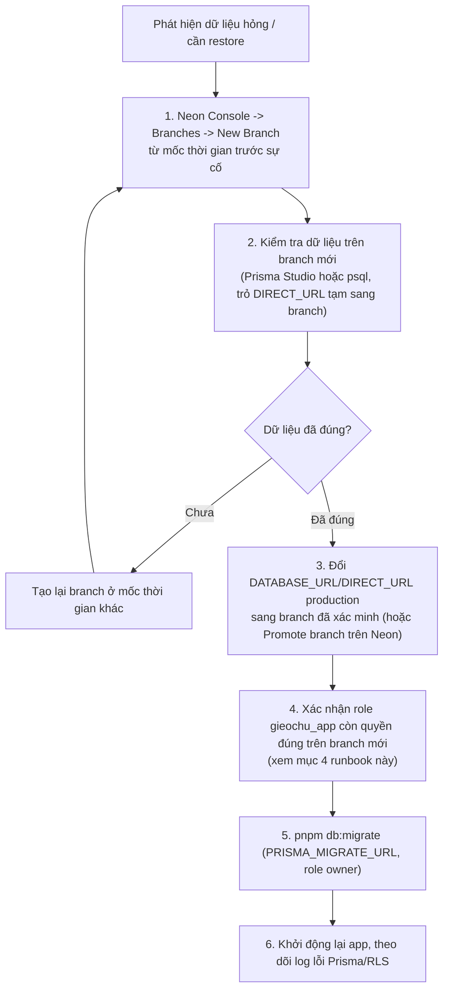

---
tags:
  - runbook
  - ops
  - recovery
  - status/living
date: 2026-05-27
updated: 2026-10-16
author: System Architect
---

# 🚀 Cẩm Nang: Ứng Phó & Phục Hồi Thảm Họa (Disaster Recovery Runbook)

> Phạm vi: Gieo Chữ là ứng dụng **web-only** (Next.js 16 App Router, `apps/web`), không có app mobile. Hạ
> tầng dữ liệu gồm **Neon Postgres** (database chính, qua `@prisma/adapter-neon`) và **object storage
> S3-compatible** (Cloudflare R2 theo hướng đã chọn ở ADR-017 trong `docs/DECISIONS.md`, cấu hình qua
> `/admin/settings/storage` — không phải biến môi trường).

## 1. Phân Loại Mức Độ Sự Cố (Incident Severity)

| Cấp Độ | Định Nghĩa Sự Cố | Ví Dụ Điển Hình | Ghi chú RTO |
| :---: | :--- | :--- | :---: |
| **P0** | Toàn hệ thống không dùng được | Neon mất kết nối, app trả 500 toàn trang, role `gieochu_app` bị xoá/hỏng | ❓ Chưa có SLA/RTO chính thức nào được chốt trong đặc tả — cần xác nhận với chủ dự án |
| **P1** | Luồng lõi bị gián đoạn | Khách không thanh toán được (webhook lỗi), không tải được file đã mua | ❓ Chưa có SLA/RTO chính thức |
| **P2** | Suy giảm phụ | Ảnh/preview tải chậm, email kích hoạt gửi trễ (job queue tồn đọng) | ❓ Chưa có SLA/RTO chính thức |

---

## 2. Quy Trình Kiểm Tra Nhanh Tình Trạng Hệ Thống (Health Check)

❓ **Chưa xác minh được** endpoint health-check (`/api/health` hoặc tương tự) có tồn tại trong `apps/web`
hay chưa tại thời điểm viết runbook này — không tìm thấy route nào tên `health` khi rà soát `apps/web/app/api`
trong phiên viết lại tài liệu này. Trước khi dùng bước dưới, xác minh lại route thật hoặc tạo route health
check tối thiểu (kiểm tra `SELECT 1` qua Prisma) nếu chưa có.

Nếu route tồn tại, quy trình kiểm tra gợi ý (mẫu, cần khớp với response thật của route):

```bash
curl -i https://<domain-production>/api/health
```

Cách kiểm tra thủ công không phụ thuộc route health-check — luôn dùng được vì dựa trực tiếp vào lệnh CLI đã
có trong bảng lệnh của CLAUDE.md:

```bash
# Kiểm tra kết nối DB qua Prisma (dùng DATABASE_URL hiện tại của môi trường)
pnpm --filter @gieochu/db exec prisma db execute --stdin <<< "SELECT 1;"
```

---

## 3. Khôi Phục Dữ Liệu Từ Neon Postgres (Point-in-Time Restore)

Neon hỗ trợ **Point-in-Time Restore (PITR)** và **branching** (tạo nhánh DB mới từ một mốc thời gian trong
quá khứ) trên nền tảng của họ — đây là năng lực có thật của Neon, không phải cơ chế Gieo Chữ tự xây.

❓ **Chưa xác minh:** độ dài cửa sổ PITR thật (bao nhiêu ngày lịch sử restore được) phụ thuộc **gói Neon
project đang dùng** — con số này thay đổi theo plan Neon và không có trong bất kỳ file cấu hình nào của repo
này. Trước khi cần restore thật, kiểm tra lại tại **Neon Console → Project Settings → Backup/Restore** (hoặc
mục tương đương trong giao diện Neon hiện hành) để biết chính xác cửa sổ restore còn khả dụng.



### Chi tiết các bước:

1. **Truy cập Neon Console** (`https://console.neon.tech`) → chọn project Gieo Chữ → tab **Branches**.
2. **Tạo nhánh khôi phục:** *New Branch* → đặt tên rõ mục đích (ví dụ `restore-2026-09-26`) → chọn mốc thời
   gian ngay trước khi sự cố xảy ra (trong giới hạn cửa sổ PITR còn khả dụng — xem cảnh báo ❓ ở trên).
3. **Kiểm tra dữ liệu độc lập, không đụng vào production:**
   ```bash
   DATABASE_URL="<connection string của branch restore>" pnpm --filter @gieochu/db exec prisma studio
   ```
   Kiểm tra bảng `Order`, `Entitlement`, `Tenant`, `User` gần thời điểm sự cố — đối chiếu số liệu với báo cáo
   sự cố (đơn hàng gần nhất, tenant đang hoạt động, tài khoản admin).
4. **Áp dụng vào môi trường chính:** cập nhật `DATABASE_URL`/`DIRECT_URL` ở nơi lưu biến môi trường production
   (❓ chưa xác minh nơi lưu — xem mục "Chưa có pipeline CI/CD tự động" trong
   [[Publish-And-Rollback-Runbook]]) sang connection string của branch đã xác minh, hoặc dùng chức năng
   *Promote to primary* của Neon nếu có trên giao diện hiện hành.
5. **Chạy lại migration để đồng bộ schema** (mục 4 dưới) rồi khởi động lại app.

---

## 4. Tái Tạo Role Postgres `gieochu_app` (ADR-010)

Đây là sự cố riêng của Gieo Chữ, quan trọng vì role này quyết định **RLS có hiệu lực thật hay không** (xem
`docs/DECISIONS.md` ADR-010). Nếu restore sang một Neon project/branch **mới** (chưa từng chạy
`setup-app-role.mts`), hoặc nếu role `gieochu_app` bị xoá/mất quyền, ứng dụng sẽ:
- Không kết nối được (nếu role không tồn tại), hoặc
- Kết nối được nhưng RLS **không lọc đúng dữ liệu giữa tenant** nếu vô tình dùng lại role owner
  (`neondb_owner` có `BYPASSRLS`, khiến RLS vô hiệu hoàn toàn — đúng nguyên nhân gốc mô tả trong ADR-010).

### Cách tái tạo:

```bash
# Cần PRISMA_MIGRATE_URL trỏ tới role owner Neon (có quyền DDL/CREATE ROLE) trong .env
pnpm --filter @gieochu/db run setup-app-role
```

Script `packages/db/scripts/setup-app-role.mts` sẽ tạo (hoặc cập nhật) role `gieochu_app` với
`NOSUPERUSER NOCREATEDB NOCREATEROLE NOBYPASSRLS`, cấp `SELECT/INSERT/UPDATE/DELETE` trên các bảng hiện có,
cộng `ALTER DEFAULT PRIVILEGES` để tự cấp quyền cho bảng tạo sau này.

**Kiểm tra sau khi chạy:**
```sql
-- Chạy bằng role owner (psql hoặc Neon SQL Editor)
SELECT rolname, rolbypassrls FROM pg_roles WHERE rolname = 'gieochu_app';
-- Kỳ vọng: rolbypassrls = false
```

**Lưu ý theo ADR-010:** không cần chạy lại script này mỗi khi thêm bảng L2 mới (nhờ
`ALTER DEFAULT PRIVILEGES`) — chỉ chạy lại khi: (a) tạo Neon project/branch mới hoàn toàn, hoặc (b) tạo một
schema Postgres mới ngoài `public`/`pgboss`.

### 4.1. Quyền `CREATE` trên database — đã thu hồi trên DB dùng chung (2026-10-15)

* **Hiện trạng DB dùng chung (dev = Preview = production, ADR-034):** chủ dự án đã chạy
  `REVOKE CREATE ON DATABASE neondb FROM gieochu_app;` ngày 2026-10-15 và kiểm
  `has_database_privilege('gieochu_app', 'neondb', 'CREATE') = false` 🟡 (báo cáo Quốc). Mục đích: role runtime không tự tạo được
  schema mới trong database.
* **Script chưa khớp** ✅ (đọc `packages/db/scripts/setup-app-role.mts`): script vẫn chạy `GRANT CREATE ON DATABASE "<db>" TO
  gieochu_app` (comment: để pg-boss tự tạo schema `pgboss` trên database mới). Hệ quả:
  - Chạy lại `setup-app-role` trên DB dùng chung (ví dụ trường hợp (b) ở trên) sẽ **cấp lại** quyền `CREATE` → phải chạy lại câu
    `REVOKE` ở trên bằng role owner ngay sau đó, rồi kiểm lại bằng `has_database_privilege`.
  - Môi trường/branch Neon mới: sau `setup-app-role` cần chạy `REVOKE` thủ công cho tới khi script được sửa (BACKLOG — việc của Hiếu,
    chưa làm).
* ❓ **Chưa rõ thứ tự với pg-boss trên DB mới:** nếu `REVOKE` trước khi schema `pgboss` tồn tại, `createJobQueue().start()` có thể không
  tự tạo được schema. Từ ADR-036 (2026-10-16, chưa deploy) người khởi động pg-boss đầu tiên trên production **không còn là worker** mà là
  chính web app trên Vercel — lần enqueue đầu (webhook tenant/upload) hoặc lần chạy đầu của cron `/api/cron/daily` (`getStartedQueue()`,
  `apps/web/lib/jobs.ts`) ✅ đọc code. Chưa ai thử — cần Quốc chốt cách làm (tạo schema `pgboss` bằng role owner trước, hay để script giữ `GRANT` rồi
  `REVOKE` sau lần khởi động worker đầu tiên).

```sql
-- Chạy bằng role owner (Neon SQL Editor). Thay neondb bằng tên database thật nếu khác.
REVOKE CREATE ON DATABASE neondb FROM gieochu_app;
SELECT has_database_privilege('gieochu_app', 'neondb', 'CREATE');  -- kỳ vọng: false
```

### 4.2. Extension/hàm ngoài Prisma cần có sau restore/rebuild

* Extension `unaccent` + hàm `public.gieochu_unaccent(text)` (ADR-035, tìm không dấu ở `/cua-hang/tai-lieu`) **do migration
  `20261015090000_adr035_unaccent_search` tạo** ✅ — `pnpm db:migrate` trên DB mới tự tạo (`IF NOT EXISTS`/`OR REPLACE`), không cần bước
  tay. Extension `unaccent` là *trusted* trên Neon nên role owner DB tạo được 🟡.
* PITR (§3) khôi phục cả extension/hàm cùng dữ liệu. Thiếu hàm → trang tìm `/cua-hang/tai-lieu` có `q` lỗi (vào `error.tsx`); các trang
  khác không dùng hàm này ✅ (`grep gieochu_unaccent` chỉ có ở `apps/web/lib/shop.ts`).
* Kiểm nhanh (role `gieochu_app` hoặc owner): `SELECT public.gieochu_unaccent(lower('Đề thi Toán học'));` → `de thi toan hoc`.
  Lược đồ: [[03-API-Contracts/Database-Schema-Reference|Database-Schema-Reference]] §7.

---

## 5. Xử Lý Mất Kết Nối Neon Postgres

**Nguyên nhân thường gặp & cách khắc phục:**
1. **Compute endpoint bị suspend:** trên gói Neon có auto-suspend, endpoint tự ngủ sau một khoảng thời gian
   không có traffic — gửi bất kỳ query nào sẽ tự khởi động lại (thường vài giây). ❓ Thời gian chính xác phụ
   thuộc gói Neon đang dùng, chưa xác minh trong repo này.
2. **Vượt hạn mức (quota):** kiểm tra Storage/Compute Hours trên Neon Console → nâng gói nếu chạm ngưỡng.
3. **Sai cấu hình connection string:** đối chiếu `DATABASE_URL` (pooled, role `gieochu_app`) và `DIRECT_URL`
   (không qua pooler, cũng role `gieochu_app`, dùng cho `pg-boss` theo ADR-007) và `PRISMA_MIGRATE_URL` (role
   owner, chỉ CLI migrate/seed dùng — xem ADR-003, ADR-010) — ba biến này **khác role và khác mục đích**, dễ
   nhầm khi cấu hình môi trường mới. Xác minh `sslmode=require` có trong chuỗi kết nối.

---

## 6. Sự Cố Object Storage (R2 / S3-compatible)

Theo ADR-017, cấu hình storage thật (endpoint, bucket, access key R2) **không nằm trong biến môi trường** —
được quản lý qua **System Admin → `/admin/settings/storage`**, lưu trong bảng `SystemStorageConfig` (mã hoá
bằng `STORAGE_ENCRYPTION_KEY`, tách riêng khỏi `PAYMENT_ENCRYPTION_KEY`).

**Nếu upload/download file lỗi:**
1. Vào `/admin/settings/storage`, dùng nút *Kiểm tra kết nối* (gọi `HeadBucketCommand` thật lên cả 2 bucket:
   private + public) để xác minh endpoint/credentials còn đúng.
2. Nhắc lại cơ chế tự-tắt (giống ADR-013 áp dụng cho payment): nếu endpoint/bucket/access key bị đổi, cấu
   hình tự chuyển về trạng thái tắt — phải vào lại `/admin/settings/storage`, lưu và bật lại tường minh.
3. File luôn nằm trong bucket **private**; URL tải chỉ là presigned, sống ≤ `PRESIGN_DOWNLOAD_TTL_SECONDS`
   (mặc định 600s theo `.env.example`, giới hạn cứng ≤ 600s theo quy tắc bảo mật ở CLAUDE.md mục 7.6). Nếu
   nghi ngờ leak presigned URL, giảm `PRESIGN_DOWNLOAD_TTL_SECONDS` tạm thời và revoke `ShareLink` liên quan
   (`/studio/[tenantSlug]/products/[productId]/share-links`).

❓ **Chưa xác minh:** Cloudflare R2 tự có tính năng backup/versioning riêng ở mức nào (R2 hỗ trợ object
versioning nhưng chưa rõ đã bật/cấu hình cho bucket Gieo Chữ hay chưa) — không thấy nhắc trong
`docs/DECISIONS.md` hay `.env.example`. Cần xác nhận với chủ dự án trước khi coi đây là một lớp phục hồi có
sẵn.

---

## 7. Rebuild Toàn Bộ Môi Trường Từ Đầu (Trường Hợp Xấu Nhất)

Nếu phải dựng lại toàn bộ môi trường (ví dụ chuyển sang Neon project mới hoàn toàn), thứ tự đúng theo lệnh
đã có trong CLAUDE.md:

```bash
pnpm install                                          # cài dependency toàn monorepo
pnpm --filter @gieochu/db run setup-app-role          # 1 lần/môi trường Neon mới — tạo role gieochu_app (ADR-010)
pnpm db:migrate                                        # prisma migrate deploy, dùng PRISMA_MIGRATE_URL (role owner)
pnpm db:seed                                           # prisma db seed, dùng DATABASE_URL (role gieochu_app)
```

Sau `setup-app-role`: chạy `REVOKE CREATE ON DATABASE … FROM gieochu_app` theo §4.1 (script chưa tự làm — lưu ý ❓ thứ tự với
pg-boss). Trên Vercel nhớ đặt lại `CRON_SECRET` (tuỳ chọn, ≥ 32 ký tự — ADR-036) để cron hằng ngày chạy:
[[04-Operations-Runbooks/Deploy-Vercel-Runbook|Deploy-Vercel-Runbook]] §6.2. `db:migrate` tự tạo extension `unaccent` + hàm `gieochu_unaccent` (§4.2). `db:seed` **chỉ** dùng cho DB trống hoàn toàn —
DB đang có dữ liệu thì không chạy (ADR-034).

Trước khi chạy, `.env` phải đủ biến bắt buộc — env fail-fast qua zod (`packages/config/src/env.ts`) sẽ làm
app dừng ngay khi khởi động nếu thiếu, kể cả khi chỉ mở trang marketing (hành vi cố ý, không phải bug).

❓ **Chưa có lịch backup tự động nào được xác nhận trong repo** (không có cron job, script, hay cấu hình nào
sao lưu định kỳ ngoài PITR có sẵn của Neon — cron Vercel `/api/cron/daily` của ADR-036 chỉ chạy sweep + dọn hàng đợi, **không** sao lưu ✅) — mục "Vận hành xuyên suốt" trong `docs/PLAN.md` liệt kê
"backup/PITR" như một việc **còn nằm trong roadmap tương lai**, chưa triển khai. Trước khi coi PITR của Neon
là đủ, xác nhận lại chính sách retention thật của gói Neon đang dùng.

---

## 8. Tài Liệu Tham Chiếu & Liên Kết

* [[MOC-Home]] — Trang chủ Map of Content ([MOC-Home.md](../00-Index/MOC-Home.md))
* [[Publish-And-Rollback-Runbook]] — Quy trình phát hành & rollback ([Publish-And-Rollback-Runbook.md](./Publish-And-Rollback-Runbook.md))
* `docs/DECISIONS.md` — ADR-003 (kết nối Neon), ADR-004 (Postgres local), ADR-007 (`DIRECT_URL` cho pg-boss),
  ADR-010 (role `gieochu_app`, RLS), ADR-017 (storage qua System Admin)
* `docs/PLAN.md` — mục "Vận hành xuyên suốt" (backup/PITR, giám sát — còn trong roadmap)
* `packages/db/scripts/setup-app-role.mts` — script tạo/cập nhật role `gieochu_app`
* [[04-Operations-Runbooks/README|Quay lại danh mục Operations Runbooks]]
