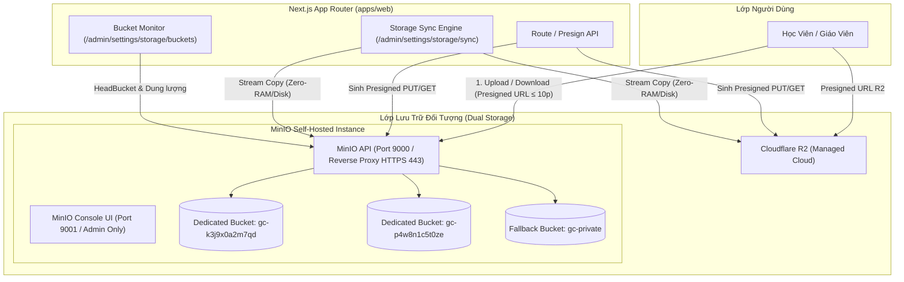
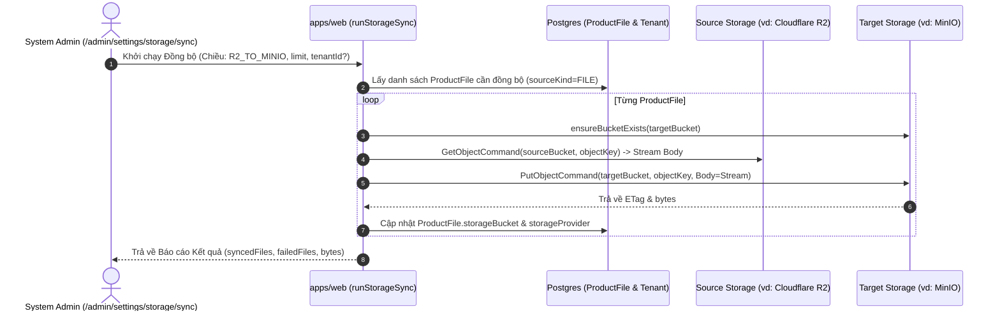

---
tags:
  - runbook
  - ops
  - storage
  - minio
  - s3
  - backup
  - troubleshooting
  - status/living
date: 2026-10-17
updated: 2026-10-23
author: System Architect & DevOps
---

# 🗄️ Cẩm Nang Vận Hành MinIO Storage (MinIO Storage Operations Runbook)

> **Phạm vi tài liệu:** Vận hành, triển khai, giám sát, đồng bộ và khắc phục sự cố hệ thống lưu trữ đối tượng **MinIO Self-hosted** trong Gieo Chữ. Hệ thống vận hành theo kiến trúc **Dual Storage Provider** (**ADR-044** trong [`docs/DECISIONS.md`](../../docs/DECISIONS.md) — chưa có bản trích ở `01-Architecture-Decisions/`) song song với Cloudflare R2, áp dụng mô hình **Dedicated Bucket cho từng Gian hàng (Tenant)** và công cụ đồng bộ luồng Stream Copy.

> [!WARNING] Production `gieochu.net` từ ADR-045 (2026-10-22)
> Trên VPS, MinIO **không** còn được phơi ra internet qua tên miền riêng như mô hình §2.2 mục 2 / §4 dưới đây: MinIO bind `127.0.0.1`, host trong
> Admin là `127.0.0.1:9000` (useSSL tắt), trình duyệt chỉ thấy `/_s/<vé>` và `/media/` qua nginx của `gieochu.net`. Làm theo
> [[04-Operations-Runbooks/Storage-Gateway-VPS-Runbook|Storage-Gateway-VPS-Runbook]]. §2.2 mục 2 và §4 chỉ còn áp dụng khi **không** bật Storage
> Gateway. (Ghi chú của Long 2026-10-22; phần còn lại của trang này chưa được Long đối chiếu lại với code — xem KB-Audit §27.)

---

## 1. Tổng Quan Kiến Trúc MinIO Trong Gieo Chữ

Hệ thống Gieo Chữ sử dụng MinIO như một giải pháp lưu trữ đối tượng tương thích chuẩn **S3 API** chạy tự quản (Self-hosted) nhằm mang lại các lợi ích chiến lược:
1. **Tiết kiệm chi phí băng thông & lưu trữ:** Cho phép tận dụng hạ tầng máy chủ riêng (VPS, On-premise, Dedicated Server) mà không phát sinh chi phí egress hàng tháng.
2. **Chủ quyền dữ liệu (Data Sovereignty):** Lưu trữ độc lập tại trung tâm dữ liệu nội địa Việt Nam, tăng tốc độ tải file học liệu cho học viên trong nước.
3. **Mô hình Dedicated Bucket:** Phân bổ mỗi gian hàng sở hữu một bucket riêng biệt (`gc-<12 ký tự đầu tenantId>`, xem mục 5.1) giúp cô lập hoàn toàn dữ liệu giữa các giáo viên/coach, chống rủi ro lộ lọt chéo và hỗ trợ sao lưu/xóa dữ liệu theo từng tenant riêng lẻ.
4. **Quản trị tập trung & Mã hoá an toàn:** Mọi thông số kết nối (Host, Port, Credentials) được quản lý qua giao diện System Center (`/admin/settings/storage`), mật khẩu và Access Key được mã hóa AES-256-GCM với khóa riêng `STORAGE_ENCRYPTION_KEY` (theo [[01-Architecture-Decisions/ADR-005-Storage-Config-System-Admin|ADR-005 (≙ ADR-017)]]).



---

## 2. Cấu Hình Mạng, Cổng Dịch Vụ & Cơ Chế SSL/TLS

MinIO yêu cầu phân tách hai cổng mạng độc lập: một cổng dành riêng cho giao thức S3 API và một cổng dành cho giao diện web quản trị (Console).

### 2.1 Chi Tiết Các Cổng Mạng (Ports)

| Cổng (Port) | Tên Dịch Vụ | Mục Đích Sử Dụng | Đối Tượng Truy Cập | Khuyến Nghị Bảo Mật |
| :---: | :--- | :--- | :--- | :--- |
| **9000** | **MinIO S3 API** | Giao tiếp S3-compatible: `@aws-sdk/client-s3`, Presigned PUT/GET URL, upload/download file học liệu | Next.js Server & Trình duyệt học viên/giáo viên | Mở qua Reverse Proxy có chứng chỉ SSL/TLS (Port 443) |
| **9001** | **MinIO Console** | Giao diện đồ họa Web UI quản trị MinIO: quản lý bucket, user, chính sách phân quyền, xem log | Quản trị viên hạ tầng (SysAdmin/DevOps) | **KHÔNG mở công khai**. Giới hạn truy cập qua VPN, SSH Tunnel hoặc IP Whitelist |

### 2.2 Cơ Chế `useSSL` (Kết Nối IP Trực Tiếp vs Tên Miền FQDN)

Trong giao diện Cấu hình Lưu trữ Hệ thống (`/admin/settings/storage`), tùy chọn `useSSL` ảnh hưởng trực tiếp đến cách hàm `resolveMinioEndpoint()` dựng endpoint URL kết nối S3:

1. **Khi triển khai qua Địa Chỉ IP (Thử nghiệm / Mạng nội bộ):**
   - **Host:** Nhập địa chỉ IP máy chủ (ví dụ: `103.142.26.15` hoặc `192.168.1.100`).
   - **Port:** Nhập cổng API (mặc định: `9000`).
   - **useSSL:** Đặt là **TẮT (`false`)**.
   - *Endpoint kết quả:* `http://103.142.26.15:9000`.
   - > [!WARNING] Cảnh báo Mixed Content khi dùng IP HTTP trên Production
     > Nếu ứng dụng Gieo Chữ chạy HTTPS (ví dụ `https://gieochu.net`), trình duyệt của người dùng sẽ **chặn tải lên / tải xuống** qua Presigned URL nếu MinIO dùng giao thức `http://` do chính sách Mixed Content của trình duyệt. Vì vậy trên môi trường thật, **bắt buộc cấu hình HTTPS** cho MinIO qua tên miền.

2. **Khi triển khai qua Tên Miền Độc Lập (Production chuẩn):**
   - **Host:** Nhập tên miền (ví dụ: `s3.gieochu.net`).
   - **Port:** Nhập `443` (hoặc để trống, hệ thống tự nhận diện cổng mặc định HTTPS).
   - **useSSL:** Đặt là **BẬT (`true`)**.
   - *Endpoint kết quả:* `https://s3.gieochu.net`.

---

## 3. Triển Khai MinIO Cục Bộ Với Docker Compose

Môi trường phát triển cục bộ và máy chủ staging có thể khởi chạy MinIO dễ dàng thông qua Docker Compose được chuẩn hóa trong file [`docker/docker-compose.yml`](../../docker/docker-compose.yml).

### 3.1 Cấu Hình Dịch Vụ Docker Compose

```yaml
services:
  minio:
    image: minio/minio:latest
    restart: unless-stopped
    environment:
      MINIO_ROOT_USER: minioadmin
      MINIO_ROOT_PASSWORD: minioadmin
    command: server /data --console-address ":9001"
    ports:
      - "9000:9000"
      - "9001:9001"
    volumes:
      - minio-data:/data
    healthcheck:
      test: ["CMD", "mc", "ready", "local"]
      interval: 5s
      timeout: 5s
      retries: 10

  minio-createbuckets:
    image: minio/mc:latest
    depends_on:
      minio:
        condition: service_healthy
    entrypoint: >
      /bin/sh -c "
      mc alias set local http://minio:9000 minioadmin minioadmin &&
      mc mb -p local/gieochu-private &&
      mc mb -p local/gieochu-public &&
      mc anonymous set download local/gieochu-public &&
      exit 0
      "

volumes:
  minio-data:
```

### 3.2 Các Lệnh Thao Tác Cơ Bản

```bash
# 1. Khởi động dịch vụ MinIO chạy nền
docker compose up -d minio minio-createbuckets

# 2. Kiểm tra trạng thái và logs khởi động
docker compose ps minio
docker compose logs -f minio

# 3. Dừng dịch vụ MinIO (dữ liệu vẫn an toàn trong volume minio-data)
docker compose stop minio

# 4. Khởi động lại dịch vụ
docker compose restart minio
```

### 3.3 Thiết Lập Và Thao Tác Với MinIO Client (`mc`)

MinIO Client (`mc`) là công cụ dòng lệnh mạnh mẽ để kiểm tra và quản trị server:

```bash
# Cấu hình alias kết nối tới MinIO local
docker compose exec minio mc alias set local http://localhost:9000 minioadmin minioadmin

# Liệt kê danh sách toàn bộ bucket hiện có
docker compose exec minio mc ls local/

# Kiểm tra dung lượng sử dụng của toàn bộ cluster
docker compose exec minio mc du local/

# Kiểm tra thông tin chi tiết một bucket gian hàng
docker compose exec minio mc stat local/gc-k3j9x0a2m7qd
```

---

## 4. Hướng Dẫn Cấu Hình MinIO Trên Production (Nginx & SSL Let's Encrypt)

Khi đưa MinIO vào vận hành Production, cần thiết lập một Reverse Proxy bằng Nginx phía trước để xử lý chứng chỉ SSL/TLS, định tuyến tên miền và bảo vệ cổng quản trị.

### 4.1 Mô Hình Tên Miền Đề Xuất
- **API S3 Endpoint:** `s3.yourdomain.com` (Trỏ về port `9000` của MinIO)
- **Console Web UI:** `minio-admin.yourdomain.com` (Trỏ về port `9001` của MinIO)

### 4.2 Cấu Hình Nginx Reverse Proxy (`/etc/nginx/sites-available/minio.conf`)

> [!IMPORTANT] Các Cấu Hình Nginx Bắt Buộc Với MinIO S3 API
> - `client_max_body_size 0;`: Tắt giới hạn kích thước tải lên của Nginx để cho phép upload file học liệu lớn.
> - `proxy_buffering off;` và `proxy_request_buffering off;`: Tắt bộ đệm để luồng stream tải lên / tải xuống không bị nghẽn RAM máy chủ web.
> - `proxy_set_header Host $http_host;`: Giữ nguyên host header để tính toán chữ ký AWS Signature v4 chính xác.

```nginx
# 1. Cấu hình S3 API (s3.yourdomain.com)
server {
    listen 80;
    server_name s3.yourdomain.com;
    return 301 https://$host$request_uri;
}

server {
    listen 443 ssl http2;
    server_name s3.yourdomain.com;

    ssl_certificate /etc/letsencrypt/live/s3.yourdomain.com/fullchain.pem;
    ssl_certificate_key /etc/letsencrypt/live/s3.yourdomain.com/privkey.pem;
    ssl_protocols TLSv1.2 TLSv1.3;
    ssl_ciphers HIGH:!aNULL:!MD5;

    # Tắt giới hạn body size cho S3 upload
    client_max_body_size 0;
    proxy_buffering off;
    proxy_request_buffering off;

    location / {
        proxy_pass http://127.0.0.1:9000;
        proxy_set_header Host $http_host;
        proxy_set_header X-Real-IP $remote_addr;
        proxy_set_header X-Forwarded-For $proxy_add_x_forwarded_for;
        proxy_set_header X-Forwarded-Proto $scheme;

        proxy_connect_timeout 300;
        proxy_http_version 1.1;
        proxy_set_header Connection "";
        chunked_transfer_encoding on;
    }
}

# 2. Cấu hình MinIO Console UI (minio-admin.yourdomain.com)
server {
    listen 80;
    server_name minio-admin.yourdomain.com;
    return 301 https://$host$request_uri;
}

server {
    listen 443 ssl http2;
    server_name minio-admin.yourdomain.com;

    ssl_certificate /etc/letsencrypt/live/minio-admin.yourdomain.com/fullchain.pem;
    ssl_certificate_key /etc/letsencrypt/live/minio-admin.yourdomain.com/privkey.pem;
    ssl_protocols TLSv1.2 TLSv1.3;
    ssl_ciphers HIGH:!aNULL:!MD5;

    # Giới hạn IP truy cập Web Console (Khuyến nghị bảo mật)
    # allow 14.161.x.x; # IP tĩnh của SysAdmin
    # deny all;

    location / {
        proxy_pass http://127.0.0.1:9001;
        proxy_set_header Host $http_host;
        proxy_set_header X-Real-IP $remote_addr;
        proxy_set_header X-Forwarded-For $proxy_add_x_forwarded_for;
        proxy_set_header X-Forwarded-Proto $scheme;

        # Cần thiết cho tính năng WebSocket của MinIO Console
        proxy_http_version 1.1;
        proxy_set_header Upgrade $http_upgrade;
        proxy_set_header Connection "upgrade";
    }
}
```

### 4.3 Cài Đặt Chứng Chỉ SSL Let's Encrypt Tự Động

```bash
# Cài đặt certbot và plugin nginx
sudo apt update && sudo apt install -y certbot python3-certbot-nginx

# Cấp phát chứng chỉ tự động cho cả 2 tên miền
sudo certbot --nginx -d s3.yourdomain.com -d minio-admin.yourdomain.com

# Kiểm tra gia hạn tự động
sudo certbot renew --dry-run
```

### 4.4 Thiết Lập Tường Lửa (UFW Firewall)

```bash
# Chỉ cho phép SSH, HTTP và HTTPS từ Internet
sudo ufw default deny incoming
sudo ufw default allow outgoing
sudo ufw allow 22/tcp
sudo ufw allow 80/tcp
sudo ufw allow 443/tcp

# BẬT TƯỜNG LỬA
sudo ufw enable

# Tuyệt đối KHÔNG mở trực tiếp cổng 9000 và 9001 ra công khai nếu đã có Nginx
sudo ufw status verbose
```

---

## 5. Cơ Chế Dedicated Bucket Cho Gian Hàng (Tenant)

Theo quy định kiến trúc **ADR-044** ([`docs/DECISIONS.md`](../../docs/DECISIONS.md)), Gieo Chữ phân bổ mỗi gian hàng một bucket độc lập.

### 5.1 Quy Tắc Sinh Tên Bucket Chuẩn S3 (`deriveTenantBucketName`)

Tên bucket được tạo tự động bởi hàm `deriveTenantBucketName(tenantId, prefix)` tại `apps/web/lib/tenant-storage.ts`:
- **Định dạng (đổi ngày 2026-10-23 ✅ code):** `${bucketPrefix}${12 ký tự đầu của tenantId}` — `tenantId` là cuid2 nên chỉ gồm `[a-z0-9]`. Prefix không kết thúc bằng `-` thì hệ thống tự thêm `-`.
- **Ví dụ:** Với `bucketPrefix = "gc-"` và `tenantId = "k3j9x0a2m7qdz81..."`, bucket name là `gc-k3j9x0a2m7qd`. (Mẫu cũ `gc-tenant-<24 ký tự>` không còn được sinh cho gian hàng mới.)
- **Ràng buộc `bucketPrefix` (✅ `isValidBucketPrefix`, `BUCKET_PREFIX_MAX_LENGTH` trong `apps/web/lib/system-storage.ts`):** tối đa 20 ký tự, chỉ `[a-z0-9-]`, bắt đầu bằng chữ/số. Được kiểm tra khi lưu cấu hình (`saveSystemStorageConfig`) và khi bấm Test kết nối (`testRawStorageConnection`); sai thì trả `INVALID_STORAGE_CONFIG` (HTTP 400). Prefix cũ đã lưu mà không hợp lệ **không** chặn việc đọc cấu hình, chỉ báo lỗi khi tạo bucket cho gian hàng mới.
- **Ràng buộc chuẩn S3/MinIO của tên bucket:** 3–63 ký tự, chỉ `a-z`, `0-9`, `-`, không bắt đầu/kết thúc bằng `-`. Tên sinh ra không hợp lệ thì ném `AppError` `STORAGE_BUCKET_NAME_INVALID` (HTTP 500); **không còn** fallback cắt chuỗi hay quay về `gc-tenant-...`.
- **Kiểm tra trùng tên (✅ `getOrCreateTenantBucket`):** nếu gian hàng khác đã có cùng `storageBucket`, hệ thống dùng 16 ký tự đầu của `tenantId`; vẫn trùng thì ném `STORAGE_BUCKET_NAME_CONFLICT` (HTTP 409). Kiểm tra ở tầng ứng dụng, **không** có unique constraint DB và không có migration.
- **Gian hàng đã có `storageBucket`:** giữ nguyên tên cũ (kể cả dạng `gc-tenant-...`), không đổi tên, không di chuyển bucket.

### 5.2 Cơ Chế Cấp Phát Lười (Lazy Provisioning)

Hệ thống hỗ trợ cấp phát linh hoạt và an toàn cho dữ liệu lịch sử:
1. **Gian hàng mới tạo (đính chính 2026-10-23 ✅ code):** `createTenantForUser` (`apps/web/lib/create-tenant.ts`) **không** gán `storageBucket`/`storageProvider` và không gọi MinIO. Ngay sau đó, Server Action `createTenantAction` (`apps/web/app/studio/actions.ts`) gọi `getOrCreateTenantBucket` để tạo bucket thật; lỗi chỉ ghi log (`tenant bucket provisioning failed at creation`), không chặn việc tạo gian hàng — khi đó bucket được cấp lại ở mục 2 hoặc 3. Đường tạo gian hàng khác (không qua `createTenantAction`) vẫn chỉ cấp phát lười.
2. **Khởi tạo lười (Lazy Provisioning):** Với gian hàng chưa có bucket riêng (gồm gian hàng mới), ở lần presign upload file sản phẩm đầu tiên (`presignProductFileUpload` / `completeProductFileUpload`), hàm `getOrCreateTenantBucket(tenantId)` sẽ:
   - Sinh tên bucket theo mẫu mục 5.1 (có kiểm tra trùng).
   - Gọi `ensureBucketExists(client, bucketName)` trên MinIO provider.
   - Cập nhật trường `Tenant.storageBucket` và `Tenant.storageProvider` vào cơ sở dữ liệu.
3. **Khởi tạo chủ động bởi Admin:** Tại màn hình Giám sát Bucket (`/admin/settings/storage/buckets`), Quản trị viên có thể nhấn nút **"Khởi tạo bucket"** thủ công cho các gian hàng mà không cần chờ lượt tải lên.

---

## 6. Vận Hành Công Cụ Đồng Bộ Dữ Liệu (Storage Sync Engine)

Công cụ đồng bộ dữ liệu tại `/admin/settings/storage/sync` cho phép luân chuyển toàn bộ hoặc một phần file học liệu giữa Cloudflare R2 và MinIO.

### 6.1 Cơ Chế Stream Copy (Zero-RAM & Zero-Disk Buffering)

Hàm `copyObjectBetweenClients()` (`packages/storage/src/stream-copy.ts`) thực thi sao chép đối tượng trực tiếp:
- Lấy đối tượng từ nhà cung cấp nguồn qua `GetObjectCommand` (trả về luồng `ReadableStream`).
- Đẩy trực tiếp luồng stream sang nhà cung cấp đích thông qua `PutObjectCommand`.
- **Lợi thế kiến trúc:** Máy chủ web Next.js đóng vai trò trung gian định tuyến luồng dữ liệu, **hoàn toàn không đệm dữ liệu vào bộ nhớ RAM** và **không ghi file tạm ra đĩa cứng**. Giúp xử lý an toàn các file học liệu dung lượng hàng trăm MB mà không gây sập tiến trình Node.js (Out-of-Memory).

### 6.2 Các Bước Thực Hiện Đồng Bộ Giữa R2 Và MinIO



1. **Bước 1: Kiểm tra kết nối:** Đảm bảo cả hai provider Cloudflare R2 và MinIO đều đang có trạng thái kết nối hợp lệ tại `/admin/settings/storage` (nhấn nút "Kiểm tra kết nối" cho cả 2 tab).
2. **Bước 2: Chọn chiều đồng bộ:**
   - `R2 -> MinIO`: Chuyển dữ liệu từ Cloudflare R2 về MinIO Self-hosted.
   - `MinIO -> R2`: Chuyển dữ liệu từ MinIO lên Cloudflare R2.
3. **Bước 3: Lọc phạm vi (Tùy chọn):**
   - Đồng bộ theo từng `tenantId` cụ thể (để di chuyển thử nghiệm cho 1 gian hàng).
   - Thiết lập số lượng tệp tối đa mỗi đợt (`limit`, mặc định 500 file/đợt).
4. **Bước 4: Theo dõi kết quả:** Giao diện hiển thị tổng số file đã duyệt, số file thành công, dung lượng byte đã truyền và danh sách lỗi chi tiết nếu có file thất bại.

---

## 7. Xử Lý Sự Cố Thường Gặp (Troubleshooting)

### 7.1 Lỗi Kết Nối Bị Từ Chối (`ECONNREFUSED` / `Connection refused`)
- **Triệu chứng:** Khi bấm "Kiểm tra kết nối" hoặc khi upload file, hệ thống báo lỗi không thể kết nối tới MinIO.
- **Nguyên nhân & Khắc phục:**
  1. *Container MinIO chưa chạy:* Kiểm tra `docker compose ps minio`. Nếu dừng, chạy `docker compose up -d minio`.
  2. *Sai cổng hoặc sai IP Host:* Kiểm tra cấu hình trong Admin. Đảm bảo cổng API là `9000` (hoặc `443` nếu đi qua Nginx).
  3. *Tường lửa chặn:* Kiểm tra `sudo ufw status` trên máy chủ MinIO xem cổng 443/9000 đã được mở hay chưa.

### 7.2 Lỗi Sai Chữ Ký / Xác Thực (`SignatureDoesNotMatch` / `InvalidAccessKeyId`)
- **Triệu chứng:** Báo lỗi sai chữ ký khi ký Presigned URL hoặc khi gọi S3 client.
- **Nguyên nhân & Khắc phục:**
  1. *Khóa Access Key / Secret Key không khớp:* Xác minh lại với `MINIO_ROOT_USER` và `MINIO_ROOT_PASSWORD` trong docker-compose hoặc file cấu hình MinIO.
  2. *Lệch thời gian hệ thống (Clock Skew):* Giao thức AWS Signature v4 yêu cầu thời gian giữa máy chủ Gieo Chữ và máy chủ MinIO không được lệch quá 15 phút. Khắc phục bằng cách đồng bộ NTP:
     ```bash
     sudo timedatectl set-ntp true
     sudo systemctl restart systemd-timesyncd
     ```
  3. *Lỗi cấu hình STORAGE_ENCRYPTION_KEY:* Nếu đổi khóa `STORAGE_ENCRYPTION_KEY` trong file `.env`, mật khẩu đã lưu trong DB sẽ không thể giải mã đúng. Cần nhập lại credentials và lưu cấu hình trong Admin.

### 7.3 Lỗi Bucket Đã Tồn Tại (`BucketAlreadyExists` / `BucketAlreadyOwnedByYou`)
- **Triệu chứng:** Quá trình tạo bucket báo lỗi xung đột tên.
- **Nguyên nhân & Khắc phục:**
  - Hàm `createBucket` trong `packages/storage/src/bucket.ts` đã chủ động bọc xử lý và bỏ qua lỗi này nếu bucket đã thuộc quyền sở hữu của bạn.
  - Nếu báo lỗi thuộc sở hữu của tài khoản khác trên cùng cluster, hãy đổi `bucketPrefix` khác biệt trong System Storage Config (ví dụ: `gcprod-`; tối đa 20 ký tự, `[a-z0-9-]`, bắt đầu bằng chữ/số). Đổi prefix chỉ ảnh hưởng gian hàng chưa có bucket; gian hàng đã có `storageBucket` giữ tên cũ. Lỗi `STORAGE_BUCKET_NAME_CONFLICT` (409) nghĩa là tên dự kiến đã gán cho gian hàng khác, cần điều tra thủ công.

### 7.4 Lỗi Mixed Content Hoặc Lỗi Chứng Chỉ SSL/TLS
- **Triệu chứng:** Người dùng bấm "Tải xuống" nhưng trình duyệt chặn không cho tải, hoặc báo lỗi `ERR_SSL_PROTOCOL_ERROR`.
- **Nguyên nhân & Khắc phục:**
  - Kiểm tra cờ `useSSL`: Nếu máy chủ MinIO chỉ chạy HTTP cổng 9000 mà cờ `useSSL` lại BẬT (hoặc ngược lại), kết nối sẽ thất bại.
  - Đảm bảo chứng chỉ SSL của tên miền S3 (`s3.yourdomain.com`) còn hạn sử dụng (`certbot certificates`).

---

## 8. Quy Trình Sao Lưu & Phục Hồi Dữ Liệu MinIO (Backup & Restore)

### 8.1 Chiến Lược Sao Lưu (Backup Strategy)

Hệ thống khuyến nghị áp dụng phương pháp sao lưu hai tầng:
1. **Sao lưu vật lý ổ đĩa (Volume Snapshot):** Sao lưu toàn bộ thư mục dữ liệu `/data` (volume `minio-data`) hằng ngày.
2. **Sao lưu logic bằng MinIO Client (`mc mirror`):** Tự động đồng bộ các object sang một máy chủ lưu trữ thứ hai hoặc đám mây phụ.

### 8.2 Kịch Bản Sao Lưu Tự Động Hằng Ngày Qua Cron (`mc mirror`)

Tạo script sao lưu `/opt/scripts/backup-minio.sh`:

```bash
#!/bin/bash
set -e

BACKUP_DIR="/backup/minio/$(date +%Y%m%d)"
mkdir -p "$BACKUP_DIR"

echo "=== Bắt đầu sao lưu MinIO: $(date) ==="

# Cấu hình alias tới local MinIO
mc alias set local http://127.0.0.1:9000 minioadmin minioadmin --api s3v4

# Mirror toàn bộ các bucket có tiền tố gc- ra thư mục sao lưu
mc mirror --overwrite --remove local/ "$BACKUP_DIR"

# Nén thư mục sao lưu
tar -czf "${BACKUP_DIR}.tar.gz" -C "/backup/minio" "$(date +%Y%m%d)"
rm -rf "$BACKUP_DIR"

# Dọn dẹp bản sao lưu cũ hơn 14 ngày
find /backup/minio -name "*.tar.gz" -mtime +14 -delete

echo "=== Hoàn thành sao lưu MinIO: $(date) ==="
```

Thêm cron job chạy lúc 02:00 sáng mỗi ngày:
```bash
0 2 * * * /bin/bash /opt/scripts/backup-minio.sh >> /var/log/minio-backup.log 2>&1
```

### 8.3 Quy Trình Phục Hồi Dữ Liệu Khi Gặp Sự Cố (Disaster Recovery)

Khi máy chủ MinIO bị hỏng hoàn toàn:

1. **Bước 1: Khởi tạo máy chủ MinIO mới:**
   - Dựng máy chủ mới, cài đặt Docker và khởi chạy container MinIO với volume trống theo mục 3.
2. **Bước 2: Phục hồi dữ liệu từ bản sao lưu:**
   ```bash
   # Giải nén bản sao lưu gần nhất
   tar -xzf /backup/minio/20261021.tar.gz -C /tmp/restore/

   # Dùng mc để mirror dữ liệu ngược trở lại MinIO mới
   mc alias set new-minio http://127.0.0.1:9000 minioadmin minioadmin
   mc mirror --overwrite /tmp/restore/20261021/ new-minio/
   ```
3. **Bước 3: Cập nhật cấu hình hệ thống (Nếu IP hoặc Tên Miền thay đổi):**
   - Đăng nhập vào System Admin Gieo Chữ (`/admin/settings/storage`).
   - Cập nhật Host/Port mới của MinIO.
   - Nhấn "Kiểm tra kết nối" và "Lưu cấu hình".
4. **Bước 4: Kiểm tra tính sẵn sàng của bucket:**
   - Truy cập `/admin/settings/storage/buckets`.
   - Bấm "Kiểm tra bucket" cho các gian hàng để đảm bảo mọi bucket đều phản hồi sẵn sàng (`HeadBucket` thành công).

---

## 9. Tài Liệu Tham Chiếu & Liên Kết
- **ADR-044** trong [`docs/DECISIONS.md`](../../docs/DECISIONS.md) — Quyết định kiến trúc Dual Storage MinIO & Cloudflare R2, Dedicated Bucket per Tenant; bản trích [[01-Architecture-Decisions/ADR-034-Dual-Storage-MinIO-R2-Dedicated-Tenant-Bucket|ADR-034 KB]].
- [[01-Architecture-Decisions/ADR-030-Storage-Gateway-Encrypted-Ticket-Nginx|ADR-030 (≙ ADR-045)]] · [[04-Operations-Runbooks/Storage-Gateway-VPS-Runbook|Storage-Gateway-VPS-Runbook]] — giấu MinIO sau `gieochu.net` bằng vé `/_s/` + nginx `auth_request`.
- [[01-Architecture-Decisions/ADR-005-Storage-Config-System-Admin|ADR-005 (≙ ADR-017)]] — Quản lý cấu hình Storage qua System Admin và mã hoá an toàn DB.
- [[02-System-Specs/File-Storage-And-Downloads-Specs|File-Storage-And-Downloads-Specs]] — Đặc tả kỹ thuật chi tiết về lưu trữ file, presigned URL và quét file.
- [[04-Operations-Runbooks/Disaster-Recovery-Runbook|Disaster-Recovery-Runbook]] — Cẩm nang ứng phó và phục hồi thảm họa toàn hệ thống.
- [[04-Operations-Runbooks/README|04-Operations-Runbooks README]] — Danh mục các cẩm nang vận hành hệ thống.
- Mã nguồn triển khai:
  - Docker Compose: [`docker/docker-compose.yml`](../../docker/docker-compose.yml)
  - Quản trị Storage: `apps/web/lib/system-storage.ts`, `apps/web/lib/tenant-storage.ts`, `apps/web/lib/storage-sync.ts`
  - Thư viện S3: `packages/storage/src/{bucket,stream-copy,s3-client,presign}.ts`

*Quay lại: [[04-Operations-Runbooks/README|Operations Runbooks]] | [[MOC-Home|Trang Chủ MOC]]*
