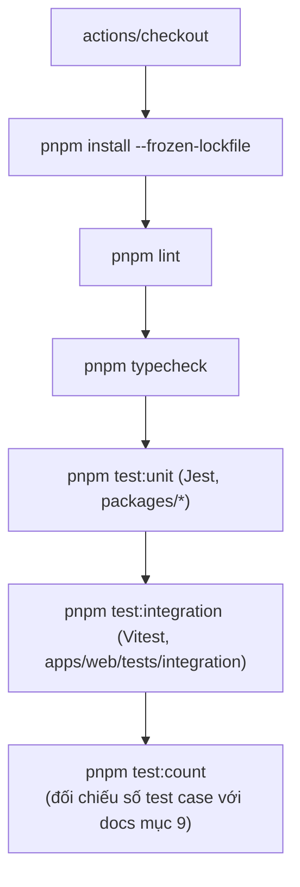
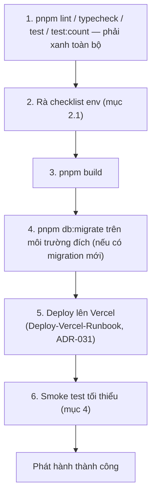

---
tags:
  - runbook
  - ops
  - deployment
  - rollback
  - status/living
date: 2026-07-02
updated: 2026-09-29
author: System Architect
---

# 🚀 Cẩm Nang: Phát Hành & Thu Hồi Bản Dựng (Publish & Rollback Runbook)

> Gieo Chữ là **monorepo pnpm workspaces + Turborepo** (`apps/web` là app Next.js 16 App Router duy nhất;
> `packages/*` là các package dùng chung: `config`, `core`, `db`, `auth`, `payments`, `storage`, `email`,
> `jobs`). **Chưa có pipeline CI/CD tự động triển khai (CD) lên production** — chỉ có CI kiểm thử
> (`.github/workflows/ci.yml`, chạy lint/typecheck/test trên push `main` và pull request). **Deploy hiện là
> thủ công.** Từ **ADR-031 (2026-09-29)** nền tảng hosting app là **Vercel** (`apps/web/vercel.json` ✅) — quy trình chi
> tiết ở [[04-Operations-Runbooks/Deploy-Vercel-Runbook|Deploy-Vercel-Runbook]]; deploy thành công đầu tiên chưa xác nhận ❓.
> Worker pg-boss chưa có host.

## 1. CI Hiện Có (`.github/workflows/ci.yml`)

Chạy trên mọi `push` vào `main` và mọi `pull_request`, theo đúng thứ tự:



CI chạy với biến môi trường test riêng (secrets `TEST_DATABASE_URL`, `TEST_DIRECT_URL`,
`TEST_PRISMA_MIGRATE_URL`, `TEST_JWT_ACCESS_SECRET`, `TEST_PAYMENT_ENCRYPTION_KEY`) và MinIO giả lập qua
`S3_ENDPOINT=http://localhost:9000` với credentials `minioadmin` — **CI không deploy gì cả**, chỉ xác nhận
code có thể build/test sạch trước khi merge.

---

## 2. Danh Sách Kiểm Tra Trước Khi Phát Hành (Pre-Deploy Checklist)

### 2.1. Biến môi trường (theo `.env.example`, xác thực bằng zod fail-fast trong `packages/config/src/env.ts`)

App **dừng ngay khi khởi động** nếu thiếu biến bắt buộc — đây là hành vi cố ý, không phải bug. Nhóm biến cần
rà lại cho môi trường mới, theo đúng CLAUDE.md mục 11:

| Nhóm | Biến | Lưu ý |
| :--- | :--- | :--- |
| App | `APP_URL`, `APP_NAME`, `APP_SHORT_NAME`, `APP_SLOGAN`, `TZ_DISPLAY` | Không hard-code chuỗi thương hiệu ở nơi khác — luôn đọc từ `@gieochu/config/brand` |
| Database | `DATABASE_URL`, `DIRECT_URL` (role `gieochu_app`, xem ADR-010) | Pooled connection cho `DATABASE_URL`; `DIRECT_URL` không qua pooler (dùng cho `pg-boss`, ADR-007) |
| Database (CLI) | `PRISMA_MIGRATE_URL` (role owner Neon) | **Chỉ** CLI `prisma migrate`/`studio` + `setup-app-role` trên máy dev/CI; **không** thuộc schema env runtime, **không đặt trên Vercel** (ADR-031). `generate`/`db seed` không cần |
| Auth | `JWT_ACCESS_SECRET` (≥ 32 bytes), `JWT_ISSUER`, `JWT_AUDIENCE`, `ACCESS_TOKEN_TTL`, `REFRESH_TOKEN_TTL_DAYS`, `EMAIL_VERIFY_TTL_HOURS`, `PASSWORD_RESET_TTL_MINUTES` | Secret phải khác giữa dev/staging/production |
| Mã hoá | `PAYMENT_ENCRYPTION_KEY` (32 bytes base64), `STORAGE_ENCRYPTION_KEY` (32 bytes base64, tách riêng theo ADR-017) | Không dùng chung 1 key cho cả 2 miền secret |
| Storage (tham số vận hành) | `PRESIGN_UPLOAD_TTL_SECONDS`, `PRESIGN_DOWNLOAD_TTL_SECONDS` (≤ 600), `CLAMAV_HOST` | Endpoint/bucket/access key R2 **không** ở env — cấu hình qua `/admin/settings/storage` (ADR-017) |
| Email | `EMAIL_PROVIDER`, `EMAIL_FROM`, `SMTP_HOST`/`SMTP_PORT` hoặc `RESEND_API_KEY` | |
| Seed | `SEED_ADMIN_EMAIL`, `SEED_ADMIN_PASSWORD` | Chỉ dùng khi chạy `pnpm db:seed` để tạo super admin đầu tiên; bỏ trống thì seed không tạo tài khoản demo |
| Business | `TRIAL_DAYS`, `GRACE_DAYS`, `ORDER_PENDING_TTL_MINUTES`, `INVOICE_PENDING_TTL_HOURS`, `DEFAULT_DOWNLOAD_LIMIT` | |

### 2.2. Kiểm thử cục bộ trước khi build

```bash
pnpm install
pnpm lint            # ESLint flat config, --max-warnings=0
pnpm typecheck        # tsc --noEmit mọi package
pnpm test             # Jest (unit, packages/*) + Vitest (integration, apps/web/tests/integration)
pnpm test:count        # đối chiếu số test case: trần gốc mục 9 là 91/50, trần hiện 94/53 (ADR-026)
pnpm build            # build tất cả package/app qua Turborepo
```

**Số test (chạy `pnpm test:count` 2026-09-27, sau ADR-028) ✅:** thực **93 / 94 unit**, **52 / 53 integration**. Trần
gốc ở đặc tả mục 9 là 91/50, nâng lên 94/53 theo ADR-026; ADR-027/028 không nâng trần. Script
`scripts/count-tests.mjs` báo lỗi khi vượt trần. Không tự thêm/bớt test case khi chưa hỏi chủ dự án.

#### 2.2.1. Quy tắc integration test: không được xoá cấu hình dùng chung

Integration test (Vitest) chạy trên **DB dev dùng chung** (ADR-009), nên test nào ghi đè cấu hình hệ thống dạng
singleton phải **chụp lại dòng cũ trước khi ghi và khôi phục đúng dòng đó ở `afterAll`** — chỉ xoá khi trước đó
không có dòng nào. **Không bao giờ `deleteMany` mù** cấu hình thật của môi trường ✅.

- Helper: `apps/web/tests/integration/shared-config-snapshot.ts` ✅
  - `snapshotStorageConfig()` / `restoreStorageConfig(snapshot)` — bảng `system_storage_config` (dòng `id = "default"`,
    cấu hình R2).
  - `snapshotPlatformPaymentConfig(provider)` / `restorePlatformPaymentConfig(snapshot)` — bảng
    `platform_payment_configs` theo `provider` (cổng thanh toán platform, vd SePay). Khôi phục bằng upsert theo
    `provider`, giữ nguyên `encryptedSecrets`, `webhookSecretHash`, `isEnabled`, `lastVerifiedAt`.
- Đang dùng ở: `download.test.ts`, `product-upload.test.ts`, `subscription-billing.test.ts`,
  `tenant-payment.test.ts` ✅.
- Test mới đụng cấu hình singleton khác (vd `system_cloudinary_config`) phải theo cùng mẫu — bổ sung hàm vào helper này.
- **Hậu quả đã xảy ra:** các test cũ (trước helper) từng xoá cấu hình R2 + SePay platform trên DB dev 🟡 (theo brief của
  Quốc 2026-09-27) — cần nhập lại qua `/admin/settings/storage` và `/admin/billing/payment` (BACKLOG).

### 2.3. Database — bắt buộc trước khi app chạy trên môi trường mới/đã đổi schema

Migration mới nhất tại 2026-09-27: `20260927110100_rls_adr028_media_assets` (ADR-028: `plans.imageStorageMb`, bảng
`tenant_media_assets` + RLS). Sau migrate, ảnh tenant cần Cloudinary hệ thống đã cấu hình và "Kiểm tra kết nối" ở
`/admin/settings/cloudinary` (không có thì chữ ký trả `CLOUDINARY_NOT_CONFIGURED`).

```bash
pnpm db:migrate    # prisma migrate deploy — dùng PRISMA_MIGRATE_URL, role owner (có quyền DDL)
pnpm db:seed        # prisma db seed — dùng DATABASE_URL, role gieochu_app
```

Nếu là **Neon project/branch hoàn toàn mới**, chạy thêm một lần trước cả hai lệnh trên (xem
[[Disaster-Recovery-Runbook]] mục 4):

```bash
pnpm --filter @gieochu/db run setup-app-role
```

---

## 3. Quy Trình Phát Hành (Thủ Công)



**Bước 5 (từ ADR-031, 2026-09-29):** deploy lên **Vercel** theo [[04-Operations-Runbooks/Deploy-Vercel-Runbook|Deploy-Vercel-Runbook]]
(Root Directory `apps/web`, `vercel.json` `buildCommand: "next build"`, env runtime không có `PRISMA_MIGRATE_URL`). Bước 3
`pnpm build` là kiểm tra cục bộ — Vercel không chạy `turbo run build`. Migration (bước 4) luôn chạy từ máy dev/CI, không
phải trên Vercel. ❓ Chưa có lần deploy Vercel thành công được xác nhận.

### 3.1. Smoke Test Tối Thiểu Sau Deploy

Vì `proxy.ts` (không phải `middleware.ts`) chỉ gắn `x-request-id` và redirect thô — mọi route nhạy cảm tự
`requireUser()`/`requireRole()` — smoke test nên đi qua ít nhất các luồng chạm tới lớp bảo mật thật:

1. **Trang chủ + trang public sản phẩm** (`/`, `/p/[slug]`) — tải được, không lỗi CSP (theo ADR-016, CSP có
   nonce sinh trong `proxy.ts` — nếu hydrate không chạy, kiểm tra console lỗi CSP inline script trước).
2. **Đăng nhập** (`/(auth)/login`) — đăng nhập một tài khoản test, xác nhận `landingPath` điều hướng đúng
   (System Admin → `/admin`, chủ tenant → `/studio/[tenantSlug]`, theo ADR-022).
3. **Studio** (`/studio/[tenantSlug]`) — mở được trang tổng quan, danh sách sản phẩm.
4. **Checkout** (`/[tenantSlug]/checkout/[orderCode]`) — tạo một đơn test, xác nhận trạng thái poll đúng.
5. **Tải file đã mua** (`/account/library`) — xác nhận presigned URL tải được (chạm tới R2 thật, ADR-017).

---

## 4. Quy Trình Thu Hồi Khẩn Cấp (Rollback)

### 4.1. Lỗi Code, Chưa Đổi Schema Database

Không có bằng chứng trong repo về cơ chế rollback tức thời của một nền tảng hosting cụ thể (kiểu "Promote to
Production" của Vercel) — ❓ cần xác nhận cơ chế rollback thật của nền tảng đang dùng. Trong lúc chưa xác
nhận, phương án an toàn nhất luôn đúng với mọi nền tảng:

```bash
git revert <commit-loi>    # hoặc checkout lại commit ổn định gần nhất
pnpm install
pnpm build
# deploy lại bản build từ commit ổn định, theo đúng quy trình mục 3
```

### 4.2. Lỗi Liên Quan Đến Migration Database

**Cảnh báo quan trọng — giống nguyên tắc chung cho mọi hệ thống có migration không tương thích ngược:**
Nếu bản deploy mới đã chạy `pnpm db:migrate` làm đổi cấu trúc bảng:
- **Không rollback code cũ ngay** nếu code cũ không tương thích với schema mới (sẽ gây lỗi query hàng loạt).
- **Ưu tiên roll-forward:** viết hotfix trên `main`, chạy lại `pnpm lint/typecheck/test`, deploy đè lên ngay.
- Nếu buộc phải rollback database: thực hiện Point-in-Time Restore theo
  [[Disaster-Recovery-Runbook]] mục 3 — và nhớ kiểm tra lại role `gieochu_app` trên branch/DB được restore
  (mục 4 của runbook đó).

### 4.3. Rà Soát Ranh Giới Layer Trước Khi Rollback

Trước khi rollback bất kỳ thay đổi liên quan payment/storage, đối chiếu lại CLAUDE.md mục "Ranh giới layer":
hai hệ thống thanh toán Platform vs Tenant **không bao giờ chung bảng/secret/route** — rollback một phía
không nên vô tình ảnh hưởng phía còn lại.

---

## 5. Tài Liệu Tham Chiếu & Liên Kết

* [[MOC-Home]] — Trang chủ Map of Content ([MOC-Home.md](../00-Index/MOC-Home.md))
* [[Disaster-Recovery-Runbook]] — Kế hoạch khôi phục Neon/role/storage ([Disaster-Recovery-Runbook.md](./Disaster-Recovery-Runbook.md))
* `.github/workflows/ci.yml` — pipeline CI kiểm thử (không phải CD)
* `packages/config/src/env.ts` — schema env fail-fast (zod)
* `docs/DECISIONS.md` — ADR-007 (`DIRECT_URL`), ADR-010 (role `gieochu_app`), ADR-016 (CSP nonce trong
  `proxy.ts`), ADR-017 (storage qua System Admin), ADR-022 (RBAC/`landingPath`)
* [[04-Operations-Runbooks/README|Quay lại danh mục Operations Runbooks]]
