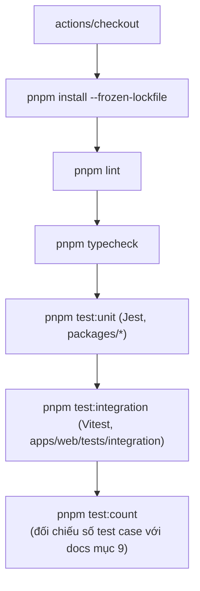
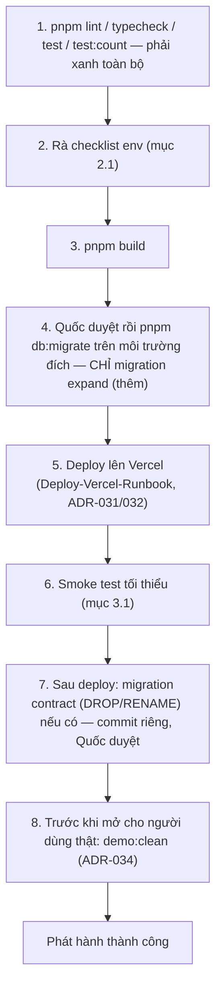

---
tags:
  - runbook
  - ops
  - deployment
  - rollback
  - status/living
date: 2026-07-02
updated: 2026-10-25
author: System Architect
---

# 🚀 Cẩm Nang: Phát Hành & Thu Hồi Bản Dựng (Publish & Rollback Runbook)

> Gieo Chữ là **monorepo pnpm workspaces + Turborepo** (`apps/web` là app Next.js 16 App Router duy nhất;
> `packages/*` là các package dùng chung: `config`, `core`, `db`, `auth`, `payments`, `storage`, `email`,
> `jobs`). **Chưa có pipeline CI/CD tự động triển khai (CD) lên production** — chỉ có CI kiểm thử
> (`.github/workflows/ci.yml`, chạy lint/typecheck/test trên push `main` và pull request). **Deploy hiện là
> thủ công.** Từ **ADR-031 (2026-09-29)** nền tảng hosting app là **Vercel** (`apps/web/vercel.json` ✅) — quy trình chi
> tiết ở [[04-Operations-Runbooks/Deploy-Vercel-Runbook|Deploy-Vercel-Runbook]]; deploy thành công đầu tiên chưa xác nhận ❓.
> Job nền không cần worker riêng nữa: từ **ADR-036** (2026-10-16, đã commit `9a3208f`, deploy ❓) job xử lý trong app bằng `after()` +
> Vercel Cron hằng ngày `GET /api/cron/daily` — cần đặt env `CRON_SECRET` trên Vercel (Deploy-Vercel-Runbook §6.2).

## 1. CI Hiện Có (`.github/workflows/ci.yml`)

Chạy trên mọi `push` vào `main` và mọi `pull_request`, theo đúng thứ tự:



CI chạy với biến môi trường test riêng (secrets `TEST_DATABASE_URL`, `TEST_DIRECT_URL`,
`TEST_PRISMA_MIGRATE_URL`, `TEST_JWT_ACCESS_SECRET`, `TEST_PAYMENT_ENCRYPTION_KEY`) và MinIO giả lập qua
`S3_ENDPOINT=http://localhost:9000` với credentials `minioadmin` — **CI không deploy gì cả**, chỉ xác nhận
code có thể build/test sạch trước khi merge.

---

## 2. Danh Sách Kiểm Tra Trước Khi Phát Hành (Pre-Deploy Checklist)

### 2.1. Biến môi trường (theo `.env.example`, xác thực bằng zod fail-fast trong `packages/config/src/env.ts`)

App **dừng ngay khi request đầu tiên gọi `getEnv()`** nếu thiếu biến bắt buộc — hành vi cố ý. Từ **ADR-032** env runtime chỉ còn
**8 biến bắt buộc** ✅ (danh sách đầy đủ + biến phải xoá trên Vercel:
[[04-Operations-Runbooks/Deploy-Vercel-Runbook|Deploy-Vercel-Runbook]] §3):

| Nhóm | Biến | Lưu ý |
| :--- | :--- | :--- |
| App | `APP_URL` | Có `https://`, không `/` cuối |
| Database (runtime) | `DATABASE_URL`, `DIRECT_URL` (role `gieochu_app`, xem ADR-010) | Pooled connection cho `DATABASE_URL`; `DIRECT_URL` không qua pooler (dùng cho `pg-boss`, ADR-007) |
| Database (CLI) | `PRISMA_MIGRATE_URL` (role owner Neon) | **Chỉ** CLI `prisma migrate`/`studio` + `setup-app-role` trên máy dev/CI; **không** thuộc schema env runtime, **không đặt trên Vercel** (ADR-031). `generate`/`db seed` không cần |
| Auth | `JWT_ACCESS_SECRET` (≥ 32 ký tự), `JWT_ISSUER`, `JWT_AUDIENCE` | Secret phải khác giữa dev/staging/production |
| Mã hoá | `PAYMENT_ENCRYPTION_KEY` (32 bytes base64), `STORAGE_ENCRYPTION_KEY` (32 bytes base64, tách riêng theo ADR-017) | Không dùng chung 1 key cho cả 2 miền secret |
| Tuỳ chọn (hạ tầng) | `CRON_SECRET` (ADR-036, nếu đặt ≥ 32 ký tự); `STORAGE_GATEWAY_PROVIDERS` (ADR-045, `MINIO`/`CLOUDFLARE_R2` — **chỉ** trên máy có nginx Storage Gateway, xem [[04-Operations-Runbooks/Storage-Gateway-VPS-Runbook\|Storage-Gateway-VPS-Runbook]]) | Giá trị sai của cả hai làm app dừng khi khởi động (fail-fast) ✅ `env.ts` |
| Tuỳ chọn | `CLAMAV_HOST`; email fallback **chỉ dev** (`EMAIL_PROVIDER`, `EMAIL_FROM`, `SMTP_HOST`/`SMTP_PORT`, `RESEND_API_KEY`) | Production gửi email qua `/admin/settings/smtp`; thiếu cả hai nguồn → `EMAIL_NOT_CONFIGURED`, app vẫn chạy |
| Seed | `SEED_ADMIN_EMAIL`, `SEED_ADMIN_PASSWORD`, `SEED_SUPPORT_EMAIL` | Chỉ dùng khi chạy `pnpm db:seed` |

**Không còn là env (ADR-032):** chuỗi thương hiệu (`/admin/settings/branding`, fallback `DEFAULT_BRAND`), múi giờ hiển thị (hằng
`DISPLAY_TIME_ZONE`), TTL phiên/liên kết/presign, ân hạn, đơn/hoá đơn chờ, lượt tải mặc định (`/admin/settings/general`) ✅.

### 2.2. Kiểm thử cục bộ trước khi build

```bash
pnpm install
pnpm lint            # ESLint flat config, --max-warnings=0
pnpm typecheck        # tsc --noEmit mọi package
pnpm test             # Jest (unit, packages/*) + Vitest (integration, apps/web/tests/integration)
pnpm test:count        # đối chiếu số test case: trần gốc mục 9 là 91/50, trần hiện 100/66 (ADR-026 + ADR-037 + ADR-050 + ADR-053 + ADR-054)
pnpm build            # build tất cả package/app qua Turborepo
```

**Số test (chạy `pnpm test:count` 2026-10-24, sau ADR-053 bổ sung lần 3 + ADR-054) ✅:** thực **100 / 100 unit**, **66 / 66 integration** — **chạm trần**. Trần
gốc ở đặc tả mục 9 là 91/50, nâng lên 94/53 theo ADR-026; ADR-027…036 không nâng trần; ADR-037 mục 6 nâng trần integration 53 → **55**
cho đúng 2 test M12 (M12a — `audit.test.ts`; M12b — `stats.test.ts`). ADR-043 dùng nốt 1 unit (`dashboard-range.test.ts`) + 1 integration
(`studio-dashboard.test.ts`) còn trống, không nâng trần. **ADR-050** (chủ dự án duyệt) nâng trần **94/55 → 95/57**: +1 unit
`packages/core/src/admin/site-menu.test.ts` (parse menu/section trang chủ + link không an toàn), +2 integration `apps/web/tests/integration/legal.test.ts`
(chấp thuận theo phiên bản; chặn xuất bản khi còn placeholder/chưa duyệt). **ADR-053** (chủ dự án cho nâng trần theo nhu cầu module) nâng **95/57 → 99/63**:
GĐ A +1 unit (ân hạn refresh, `refresh-token.test.ts`) +2 integration (`auth.test.ts`: refresh đồng thời; từ chối user không ACTIVE); GĐ B +3 unit
(`packages/auth/src/session-policy.test.ts`) +4 integration (`apps/web/tests/integration/session-policy.test.ts`). **ADR-053 bổ sung lần 3** (tự lưu nháp)
nâng **99/63 → 100/65**: +1 unit `packages/core/src/content/editor-draft.test.ts`, +2 integration `apps/web/tests/integration/editor-draft.test.ts`. **ADR-054**
(chủ dự án duyệt nâng tối thiểu) **65 → 66 integration** (+1 trong `legal.test.ts`: đăng ký ghi Điều khoản + Bảo mật; mở gian hàng bắt buộc + ghi Chính
sách người bán), trần unit giữ 100 ✅ `scripts/count-tests.mjs`. Test mới từ nay cần chủ dự án duyệt nâng trần.

**Integration lỗi đã biết** 🟡 (Quốc báo; Long không chạy `pnpm test`): ngày 2026-10-23 có **4 test** lỗi — 3 test `PRODUCT_LIMIT_REACHED` (Plan FREE
trên DB dùng chung đang `maxProducts = 1` — ❓ giá trị thật cần đọc DB) và 1 test đơn hàng **timeout**. **Cập nhật 2026-10-24 (lượt verify ADR-053):** 3 test
`PRODUCT_LIMIT_REACHED` **đã pass** (Quốc báo, chưa rõ nguyên nhân hết lỗi — Long không đọc DB); còn **1 test RLS trong `order.test.ts`** timeout 20 giây
(`testTimeout: 20000` của Vitest) — **đã có từ trước**, không do ADR-050/052, chưa xử lý; lượt verify ADR-053 lần 3 + ADR-054 (2026-10-24) vẫn còn lỗi này 🟡 (brief Quốc). Đừng "sửa" bằng cách đổi Plan FREE trên DB dùng chung (là cấu hình production — ADR-034); chờ Quốc quyết hướng
(xem `docs/PLAN.md` và [[00-Index/KB-Audit-2026-09-26|KB-Audit]] §31). Lưu ý: dòng `audit_logs` do integration test tạo không xoá
được (12 tháng) — xem [[04-Operations-Runbooks/Deploy-Vercel-Runbook|Deploy-Vercel-Runbook]] §9.6. Script
`scripts/count-tests.mjs` báo lỗi khi vượt trần. Không tự thêm/bớt test case khi chưa hỏi chủ dự án.

#### 2.2.1. Quy tắc integration test: không ghi cấu hình dùng chung — mock lớp đọc cấu hình

**Quy ước (từ 2026-10-25): mock lớp đọc cấu hình, không snapshot/restore bảng singleton** ✅ đọc test. Integration test (Vitest) chạy trên **DB dùng chung với
production** (ADR-034) nên **không được ghi** vào các bảng cấu hình hệ thống dạng singleton (`system_storage_config`, `platform_payment_configs`, và tương tự
`system_cloudinary_config`, `system_settings`…). Cần cấu hình giả thì `vi.mock` **module lib đọc cấu hình** và trả dữ liệu trong bộ nhớ, giữ phần còn lại
của module bằng `importOriginal`:

| Test | Module mock | Hàm thay | Ghi chú |
| :-- | :-- | :-- | :-- |
| `download.test.ts`, `product-upload.test.ts` | `../../lib/system-storage` | `getDecryptedSystemStorageConfig`, `createClientForProvider` | Cấu hình R2 giả (`https://fake.example.com`); presign chỉ ký cục bộ, không gọi mạng; tenant mới chưa có bucket riêng → nhánh R2 mặc định |
| `subscription-billing.test.ts` | `../../lib/platform-payment` | `getPlatformPaymentConfigRow` | Dòng SePay platform giả (secret mã hoá AES-GCM như thật); provider khác → `null` |
| `tenant-payment.test.ts` | — | — | Không còn upsert dòng SePay platform: cấu hình platform dựng trong bộ nhớ (vẫn đi qua `encryptSecret`/`decryptSecret`) |

- Lib phải có **một điểm đọc** để mock được — vd `getPlatformPaymentConfigRow(provider)` (`lib/platform-payment.ts`) được tách ra cho mục đích này và dùng ở
  `createRenewalInvoice` + webhook platform ([[02-System-Specs/Payment-And-Billing|Payment-And-Billing]] §5E).
- Helper cũ `apps/web/tests/integration/shared-config-snapshot.ts` (chụp dòng cũ trước khi ghi, khôi phục ở `afterAll`) **đã xoá** ✅ `git status` — không dùng lại
  mẫu snapshot/restore: nếu test dừng giữa chừng hoặc chạy song song, cấu hình thật vẫn bị ghi đè.
- Test mới cần cấu hình singleton khác: tách hàm đọc trong lib (nếu chưa có) rồi mock hàm đó; không `upsert`/`deleteMany` bảng cấu hình.
- **Sự cố đã xảy ra:**
  - Trước khi có helper snapshot (≤ 2026-09-27): test cũ từng xoá cấu hình R2 + SePay platform trên DB dev 🟡 (brief Quốc 2026-09-27).
  - **2026-10-24:** integration test ghi đè `system_storage_config` và dòng SePay platform trên DB dùng chung 🟡 (brief Quốc 2026-10-25). Chủ dự án đã nhập lại
    cấu hình storage; hiện **không còn dòng SEPAY** trong `platform_payment_configs` 🟡 (Long không đọc DB) — nếu cần SePay platform thì nhập lại ở
    `/admin/billing/payment` ❓. Test còn để lại **27 dòng audit `SUBSCRIPTION_PAID` giả** — **không xoá** (append-only, ADR-037; ADR-056) —
    [[00-Index/KB-Audit-2026-09-26|KB-Audit]] §37.
- ⚠️ **Một DB duy nhất (ADR-034):** máy dev, Preview và Production dùng cùng database — integration test từ máy dev **ghi dữ
  liệu thật vào production**. Chỉ chạy khi cần; test phải tự dọn user/tenant/đơn tạm, không đụng cấu hình dùng chung, chỉ gửi
  email tới `@example.test` ([[04-Operations-Runbooks/Deploy-Vercel-Runbook|Deploy-Vercel-Runbook]] §9.1).

### 2.3. Database — bắt buộc trước khi app chạy trên môi trường mới/đã đổi schema

Migration mới nhất trong repo tại 2026-10-15 ✅: `20260929090000_adr032_system_settings` (thêm 10 cột cấu hình — expand),
`20260929100000_adr032_drop_platform_name` (DROP — **contract**), `20260929120000_adr033_product_sold_count` (thêm
`products.soldCount` + CHECK + backfill — expand). Hai file sau chưa commit. Sau migrate, ảnh tenant cần Cloudinary hệ thống đã
cấu hình và "Kiểm tra kết nối" ở `/admin/settings/cloudinary` (không có thì chữ ký trả `CLOUDINARY_NOT_CONFIGURED`).

Cập nhật 2026-10-17 ✅ (`ls packages/db/prisma/migrations`): migration mới nhất là `20261016180000_adr039_entitlement_remedy`, trước đó
`20261016150000_m12c_abuse_reports`, `20261016120000_m12b_tenant_daily_stats`, `20261016090000_m12a_audit_logs` — đều *expand*, đều đã áp DB
dùng chung 2026-10-16 🟡, file đã commit `36103fb` ✅ `git log`. **Hai migration M12c/ADR-039 bắt buộc chạy TRƯỚC khi deploy code** (code lên trước → P2022/500 trên
mọi trang sản phẩm/đánh giá/bài viết/thư viện) — [[04-Operations-Runbooks/Deploy-Vercel-Runbook|Deploy-Vercel-Runbook]] §9.8.

> ⚠️ **Một DB duy nhất (ADR-034) + sự cố 2026-10-15:** migration chỉ do Quốc duyệt và chạy, không `prisma migrate dev/reset`;
> theo **expand → contract** — migration *thêm* chạy trước deploy, `DROP`/`RENAME` chạy **sau** khi bản code không còn dùng
> cột đã lên production. Trình tự: [[04-Operations-Runbooks/Deploy-Vercel-Runbook|Deploy-Vercel-Runbook]] §9.2.
> **Không chạy `pnpm db:seed`** — seed ghi đè `blocks` trang chủ (`CmsPage` slug `home`) ✅; dữ liệu hệ thống sửa qua UI
> System Center. Hai lệnh dưới chỉ áp cho DB **trống** dựng lại từ đầu (Disaster-Recovery).

```bash
pnpm db:migrate    # prisma migrate deploy — dùng PRISMA_MIGRATE_URL, role owner (có quyền DDL)
pnpm db:seed        # prisma db seed — dùng DATABASE_URL, role gieochu_app
```

Nếu là **Neon project/branch hoàn toàn mới**, chạy thêm một lần trước cả hai lệnh trên (xem
[[Disaster-Recovery-Runbook]] mục 4):

```bash
pnpm --filter @gieochu/db run setup-app-role
```

---

## 3. Quy Trình Phát Hành (Thủ Công)



**Bước 5 (từ ADR-031, 2026-09-29):** deploy lên **Vercel** theo [[04-Operations-Runbooks/Deploy-Vercel-Runbook|Deploy-Vercel-Runbook]]
(Root Directory `apps/web`, `vercel.json` `buildCommand: "next build"`, env runtime không có `PRISMA_MIGRATE_URL`). Bước 3
`pnpm build` là kiểm tra cục bộ — Vercel không chạy `turbo run build`. Migration (bước 4) luôn chạy từ máy dev/CI, không
phải trên Vercel. Theo `docs/DECISIONS.md` đã có một bản production chạy trên Vercel (bản trước ADR-032) 🟡; bản ADR-032/033
chưa deploy ❓. **Bước 7 (từ sự cố 2026-10-15):** migration xoá/đổi tên cột chỉ chạy sau khi bản mới đã chạy ổn trên production
— chi tiết [[04-Operations-Runbooks/Deploy-Vercel-Runbook|Deploy-Vercel-Runbook]] §9.2.

### 3.1. Smoke Test Tối Thiểu Sau Deploy

Vì `proxy.ts` (không phải `middleware.ts`) chỉ gắn `x-request-id` và redirect thô — mọi route nhạy cảm tự
`requireUser()`/`requireRole()` — smoke test nên đi qua ít nhất các luồng chạm tới lớp bảo mật thật:

1. **Trang chủ + trang public sản phẩm** (`/`, `/p/[slug]`) — tải được, không lỗi CSP (theo ADR-016, CSP có
   nonce sinh trong `proxy.ts` — nếu hydrate không chạy, kiểm tra console lỗi CSP inline script trước).
2. **Đăng nhập** (`/(auth)/login`) — đăng nhập một tài khoản test, xác nhận `landingPath` điều hướng đúng
   (System Admin → `/admin`, chủ tenant → `/studio/[tenantSlug]`, theo ADR-022).
3. **Studio** (`/studio/[tenantSlug]`) — mở được trang tổng quan, danh sách sản phẩm.
4. **Checkout** (`/[tenantSlug]/checkout/[orderCode]`) — tạo một đơn test, xác nhận trạng thái poll đúng.
5. **Tải file đã mua** (`/account/library`) — xác nhận presigned URL tải được (chạm tới R2 thật, ADR-017).
6. **Từ M12c (2026-10-17):** mở một trang tài liệu công khai — nút "Báo cáo vi phạm" hiện, trang không 500 (dấu hiệu migration đã áp);
   `/admin/reports` mở được; sau đơn thật đầu tiên kiểm email `order_paid`/`new_sale` đã tới (lần đầu gửi thật — Deploy-Vercel-Runbook §9.8).
   Không gửi báo cáo thử bằng email thật của người khác; báo cáo thử phải dọn (ADR-034).

---

## 4. Quy Trình Thu Hồi Khẩn Cấp (Rollback)

### 4.1. Lỗi Code, Chưa Đổi Schema Database

Không có bằng chứng trong repo về cơ chế rollback tức thời của một nền tảng hosting cụ thể (kiểu "Promote to
Production" của Vercel) — ❓ cần xác nhận cơ chế rollback thật của nền tảng đang dùng. Trong lúc chưa xác
nhận, phương án an toàn nhất luôn đúng với mọi nền tảng:

```bash
git revert <commit-loi>    # hoặc checkout lại commit ổn định gần nhất
pnpm install
pnpm build
# deploy lại bản build từ commit ổn định, theo đúng quy trình mục 3
```

### 4.2. Lỗi Liên Quan Đến Migration Database

**Cảnh báo quan trọng — giống nguyên tắc chung cho mọi hệ thống có migration không tương thích ngược:**
Nếu bản deploy mới đã chạy `pnpm db:migrate` làm đổi cấu trúc bảng:
- **Không rollback code cũ ngay** nếu code cũ không tương thích với schema mới (sẽ gây lỗi query hàng loạt).
- **Ưu tiên roll-forward:** viết hotfix trên `main`, chạy lại `pnpm lint/typecheck/test`, deploy đè lên ngay.
- Nếu buộc phải rollback database: (một DB duy nhất — ADR-034 — nên restore ảnh hưởng cả dev lẫn Preview) thực hiện
  Point-in-Time Restore theo
  [[Disaster-Recovery-Runbook]] mục 3 — và nhớ kiểm tra lại role `gieochu_app` trên branch/DB được restore
  (mục 4 của runbook đó).

#### 4.2.1. Sự cố đã xảy ra — 2026-10-15: drop cột khi bản production còn dùng 🟡

Theo `docs/DECISIONS.md` (cuối ADR-033) — Long không có log production:

| Mục | Nội dung |
| :-- | :-- |
| Diễn biến | Migration `20260929100000_adr032_drop_platform_name` (`DROP COLUMN "platformName"`) được chạy trên DB dev; DB dev **dùng chung** với production → bản đang deploy (Prisma client còn cột `platformName`) trả **500** |
| Khắc phục | Thêm lại cột bằng tay: `ALTER TABLE "system_settings" ADD COLUMN IF NOT EXISTS "platformName" TEXT;` — roll-forward schema, **không** rollback code |
| Nguyên nhân gốc | (1) DB dev = DB production; (2) migration contract (DROP) đi cùng đợt với code mới thay vì sau deploy |
| Phòng ngừa | Không tự migrate khi chưa được Quốc duyệt; expand → contract. Đề xuất tách DB dev bằng Neon branch **bị chủ dự án bác** — giữ một DB duy nhất (ADR-034), thay bằng kỷ luật thao tác DB ([[04-Operations-Runbooks/Deploy-Vercel-Runbook|Deploy-Vercel-Runbook]] §9.1) |
| Còn treo | Migration contract mới `DROP COLUMN IF EXISTS "platformName"` chạy **sau** khi bản ADR-032 lên production; kiểm `_prisma_migrations` trên production bằng `prisma migrate status` ❓ (Deploy-Vercel-Runbook §9.4) |

Bài học áp dụng chung: khi lỗi do schema thiếu thứ mà bản đang chạy cần, cách nhanh và an toàn nhất là **thêm lại** (idempotent
`IF NOT EXISTS`) chứ không restore cả DB.

### 4.3. Rà Soát Ranh Giới Layer Trước Khi Rollback

Trước khi rollback bất kỳ thay đổi liên quan payment/storage, đối chiếu lại CLAUDE.md mục "Ranh giới layer":
hai hệ thống thanh toán Platform vs Tenant **không bao giờ chung bảng/secret/route** — rollback một phía
không nên vô tình ảnh hưởng phía còn lại.

---

## 5. Tài Liệu Tham Chiếu & Liên Kết

* [[MOC-Home]] — Trang chủ Map of Content ([MOC-Home.md](../00-Index/MOC-Home.md))
* [[Disaster-Recovery-Runbook]] — Kế hoạch khôi phục Neon/role/storage ([Disaster-Recovery-Runbook.md](./Disaster-Recovery-Runbook.md))
* `.github/workflows/ci.yml` — pipeline CI kiểm thử (không phải CD)
* `packages/config/src/env.ts` — schema env fail-fast (zod)
* `docs/DECISIONS.md` — ADR-007 (`DIRECT_URL`), ADR-010 (role `gieochu_app`), ADR-016 (CSP nonce trong
  `proxy.ts`), ADR-017 (storage qua System Admin), ADR-022 (RBAC/`landingPath`), ADR-031 (deploy Vercel), ADR-032 (env 8 biến,
  cấu hình ở System Center, sự cố 2026-10-15)
* [[04-Operations-Runbooks/Deploy-Vercel-Runbook|Deploy-Vercel-Runbook]] — env, migration expand → contract, một DB duy nhất ([Deploy-Vercel-Runbook.md](./Deploy-Vercel-Runbook.md))
* [[01-Architecture-Decisions/ADR-020-Single-Database-Dev-Preview-Production|ADR-020 (≙ ADR-034)]] ([ADR-020-Single-Database-Dev-Preview-Production.md](../01-Architecture-Decisions/ADR-020-Single-Database-Dev-Preview-Production.md))
* [[01-Architecture-Decisions/ADR-018-System-Settings-And-Brand-From-System-Center|ADR-018 (≙ ADR-032)]] ([ADR-018-System-Settings-And-Brand-From-System-Center.md](../01-Architecture-Decisions/ADR-018-System-Settings-And-Brand-From-System-Center.md))
* [[04-Operations-Runbooks/README|Quay lại danh mục Operations Runbooks]]
